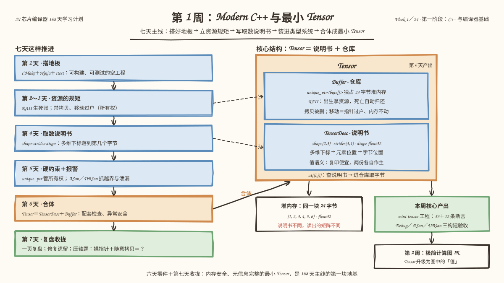

第 1 周是 168 天计划的地基周：动手写编译器之前，先把代码和内存管住。第 1 天搭好可构建、可测试的工程地板，让每天的改动都有把关；第 2～3 天用会记日志的 Buffer 类弄清对象生命周期与 RAII，再通过禁止拷贝、实现移动回答资源归谁所有；第 4 天设计 TensorDesc，用 shape、strides、dtype 说清多维下标如何落到具体字节；第 5 天把所有权装进类型系统（unique_ptr），并学会用 Sanitizer 当场抓住越界与泄漏；第 6 天把说明书和仓库组合成内存安全的最小 Tensor 类；第 7 天复盘收拢，回答为什么 Tensor 不能裸指针加随意拷贝。七天围绕一条主线推进：内存归谁管、数据怎么读，最终得到一个内存安全、元信息完整的最小 Tensor，为下周的计算图 IR 打好地基。

