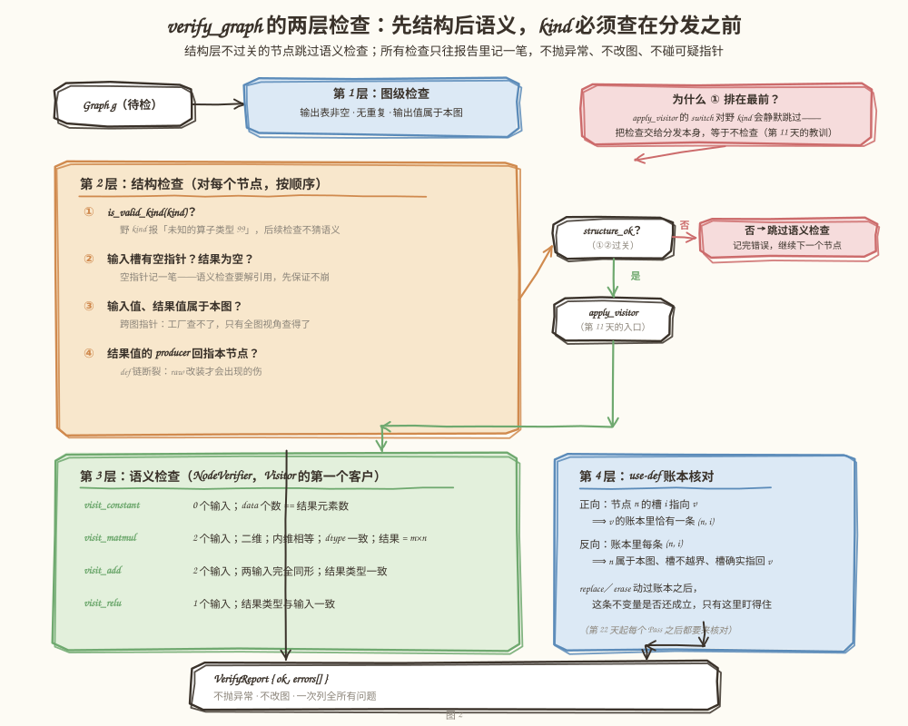

# 第 12 天技术校对报告

> 校对方法：完整阅读本日 README、`examples/mini-graph-v5/` 全部源码与测试、`experiments/cost-of-skipping-verify.log` 冻结日志和三张 SVG；在本机（与正文声明一致的 g++ 9.4.0 / CMake 3.20.5 / Ninja 1.10.0 / aarch64 / Ubuntu 20.04）临时目录中真实完成 Debug／ASan／UBSan 三构建与 `ctest`（3×3 全绿，断言数 71＋44＋62 与正文一致）、复跑 `main.cpp` 三幕输出（与 5.3 节逐字一致）、复现三个 `bugs/`（含删除 `expect_inputs` early-return 后的检查器自崩溃，gdb 栈帧与第 6 节「错误三」一致）、并核对了 v4→v5 源码 diff 与 MLIR 官方源码（llvm-project main）。仓库内冻结产物（实验日志等）一律未覆盖，全部验证在 /tmp 下完成并清理。

## 【错误】

#### 1. 5.4 节 ASan 节选的崩溃行号与冻结日志、当前源码均不符

- **原文**："    #2 0xaaaac9922b90 in main ../bugs/err_oob_read.cpp:35                # err_oob_read，退出码 1"
- **依据**：正文在节选前写明「一键复现（真实日志全文在 `experiments/cost-of-skipping-verify.log`）……日志里三段真实结果」，但冻结日志第 32 行记录的是 `#2 0xaaaacc83fc50 in main ../bugs/err_oob_read.cpp:37`。行号 37 才与当前源码吻合：`err_oob_read.cpp:37` 是 `interp.run(g)`（越界发生时的调用点），第 35 行是 `interp.bind(a, {1, 2, 3, 4, 5, 6})`，它在崩溃前正常返回；按节选所用构建参数（`g++ -std=c++17 -g`，无 `-O`，即 -O0）编译，`main` 帧只能归属到 `run` 的调用行 37。我在临时目录按同样参数复跑，得到的同样是 `err_oob_read.cpp:37`。此外节选的 ASan 线程号（`==742505==`）与地址（`0xffff90800b40`）也与所引日志（`==744900==`、`0xffffa8b00b40`）不同，说明节选并非取自它所指的这份日志。节选其余帧（`Interpreter.cpp:18` 的 `at()`、`Interpreter.cpp:54` 的 `run`、`Graph.cpp:95` 的 `head()`）均与日志和源码一致，仅此行有误：`35` 应改为 `37`，并建议整体与冻结日志对齐。
- **置信度**：高（冻结日志、当前源码行号、本机复现三方一致）

#### 2. 5.0 节把 `Graph` 列为「原样保留」，与改动二及 v4→v5 实际差异矛盾

- **原文**："由第 11 天的 v4 复制而来（`Value`／`Node`／`Graph`／`NodeVisitor`／`Interpreter` 原样保留），新增和修改的只有下文四处。"
- **依据**：逐文件 diff 第 11 天 `mini-graph-v4/src` 与本日 `mini-graph-v5/src`：`Value.h`、`Node.h`、`NodeVisitor.h`、`Interpreter.h/.cpp`（以及 `Dtype.h`、`TensorType.h`、`Attrs.h`、`OpCardPrinter.h`）字节级相同，但 `Graph.h` 与 `Graph.cpp` 明确被修改——`make_node` 改名为 `make_node_impl` 并加 `check_nulls` 开关、新增 `add_raw_node`、use 登记循环加空槽判空。README 自己的「改动二」标题就是「`Graph`——不设防的建造路径」，同一篇文档内自相矛盾。另外「新增和修改的只有下文四处」也偏少：`src/main.cpp` 相对 v4 的 `main.cpp` 同样有改动（三幕演示是重写的），`tests/test_verifier.cpp`、两个 `bugs/` 反面教材和 `experiments/` 都是新增（5.1 目录树里也标了 ★）。准确说法应是把 `Graph`（与 `OpKind.h`）从「原样保留」清单里拿出来，例如改为「`Value`／`Node`／`NodeVisitor`／`Interpreter` 原样保留，`OpKind.h` 与 `Graph` 按下文改动一、二修改」。若作者本意是「既有行为原样保留（工厂路径行为与 v4 一字不差）」，也应在措辞上与改动二区分，避免读者拿 diff 或改动清单对照时被误导。
- **置信度**：高（diff 实证 + 文档内部矛盾；本条不涉及代码行为错误，工程本身构建运行全部正常）

## 【存疑】

#### 1. 「每个 Pass 之后各跑一次验证」是无条件的默认行为表述；Verifier.h 注释里的 MLIR API 名与现行源码不符

- **原文**："MLIR 的做法是把"建造"和"验证"拆开：`OpBuilder` 造 op 时不跑 Verifier，`mlir-opt` 在解析之后、每个 Pass 之后各跑一次验证。"
- **依据**：已对照 llvm-project main 的 `mlir/lib/Tools/mlir-opt/MlirOptMain.cpp` 核实：`--verify-each`（"Run the verifier after each transformation pass"）为 `cl::init(true)`；解析期验证默认开启（`--mlir-very-unsafe-disable-verifier-on-parsing` 默认 false，经 `ParserConfig` 的 `shouldVerifyOnParsing` 传入）；`OpBuilder::create`（`mlir/lib/IR/Builders.cpp`）只做 `insert(Operation::create(state))`，确实不跑 Verifier。因此这句对**默认行为**是准确的，但两个时机都能被命令行关掉，写成无条件的「各跑一次」略显绝对，建议补一句「默认开启（`--verify-each=false` 可关）」。另一个相关存疑在当天代码注释里：`src/Verifier.h` 写「对应 MLIR 的 `Operation::verify()` / `verify()`」，但我检查了 main／release-19.x／release-16.x／release-14.x 的 `mlir/IR/Operation.h`，`Operation` 类并没有 `verify()` 成员；现行公开入口是 `mlir/IR/Verifier.h` 里的自由函数 `LogicalResult verify(Operation *op, bool verifyRecursively = true)`（Op 包装类上的 `verify()` 是受保护的 hook）。引用 API 名时建议写 `mlir::verify(Operation*)`。
- **置信度**：高（MLIR 官方源码逐条核实；归入「存疑」是因为正文陈述与默认事实相符，仅绝对化措辞与代码注释中的 API 命名需跟进）

## 【建议】

#### 1. 「缺失的记录成了账本检查的靶子」归属不准——空槽实际由结构层的空指针检查点名

- **原文**："这条"缺失的记录"本身就成了Verifier 账本检查的靶子之一——错误不会消失，只是换了个地方等着被点名。"
- **依据**：`Verifier.cpp` 的账本核对两条循环都显式跳过空槽：正向循环 `if (v == nullptr) { continue; }`（注释即「空指针已在上面点名」），反向循环遍历的是各值的 `uses_`，空槽没有登记、自然也不会出现。空槽错误实际由结构层检查报出（`rep.fail(where(*n) + ": 第 i 个输入是空指针")`）——真实输出可证：`bugs/err_print_on_invalid.cpp` 的 verify 输出只有一条 `[relu%n0]: 第 0 个输入是空指针`，冻结日志与我的复现都没有任何账本类错误。结论「错误不会消失」正确，但点名者应写为结构层的空指针检查，而非账本检查；`Graph.h`／`Graph.cpp` 注释里「这条『缺失的记录』正是 Verifier 账本检查要抓的缺口之一」同款表述也一并顺手改。
- **置信度**：高（代码路径与真实输出双重核实）

#### 2. 「第 11 天遗留现场」的文件名与第 11 天工程实际文件名不一致

- **原文**："昨天（第 11 天）结尾留了一根刺：`bugs/err_silent_fake_kind.cpp` 里，`static_cast<OpKind>(99)` 这个枚举外的野值一路绿灯——`to_string()` 里它的节点行整个消失，use 表里它顶着 `?%n0` 的假面，解释器对它什么都不算，结果静默输出全 0。全程没有编译错误，没有运行期异常。"
- **依据**：第 11 天 `mini-graph-v4/bugs/` 实际只有 `err_fallthrough.cpp` 与 `err_unhandled_kind.cpp`；假 kind 现象在第 11 天的文件名是 `err_unhandled_kind.cpp`（第 11 天 README 的「错误二」也如此引用），`err_silent_fake_kind.cpp` 是本日工程重建的同现象复现文件（5.1 目录树注释「第 11 天遗留现场」同样含糊）。现象描述本身全部属实（我在本机复跑 `err_silent_fake_kind.cpp`，节点行消失、use 表 `?%n0`、输出全 0、退出码 0，与第 11 天日志一致），只是文件来历表述容易让读者去第 11 天目录找 `err_silent_fake_kind.cpp` 而扑空。建议注明「第 11 天 `err_unhandled_kind.cpp` 的同款现象，本工程重建为 `err_silent_fake_kind.cpp`」。
- **置信度**：高（两个工程目录均可核对；现象本身已复现证实）

#### 3. `err_print_on_invalid.cpp` 头部注释的 SEGV 地址与真实日志不符

- **原文**："**错误一：对非法图调用 `to_string()`——段错误（`bugs/err_print_on_invalid.cpp`）**"
- **依据**：README 正文与 5.4 节节选写的都是 `SEGV on unknown address 0x10`，与冻结日志（`0x000000000010`）和我的本机复现一致；但该 `.cpp` 文件头部注释第 7 行写的是「ASan 下报 SEGV on unknown address 0x000000000000」。实际地址来自 `n.input(i)->name()` 对空指针做成员访问：`name_` 相对 `this=nullptr` 的偏移（`id_` 占 8 字节）正是 0x10，不可能报 0x0。README 无需改动，代码注释这一处旧值应更正。
- **置信度**：高（日志、复现、地址算术三方一致）

#### 4. 图 2 的 SVG 内部标题写「两层检查」，与本图内容和正文「四层」表述不一致

- **原文**：""
- **依据**：`images/02-verifier-two-layers.svg` 的标题文本是「verify_graph 的两层检查：先结构后语义，kind 必须查在分发之前」，但同一张图内画的是第 1～4 层（图级／结构／语义／账本），README 的替代文本、图注（「第 1 层……第 4 层……四层的结果汇进同一份 `VerifyReport`」）和 5.2 节也都按四层描述。标题应是早期「结构＋语义」两分法的遗留（文件名 `two-layers` 同源，文件名可不动）。技术上不属于链接或 SVG 失效，本报告只记录，未改动图片。
- **置信度**：高（SVG 文本与 README 表述可直接对照）
