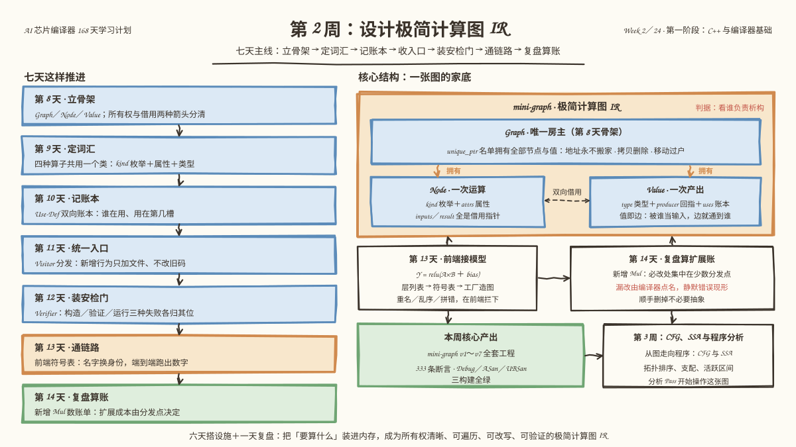

第 1 周的 Tensor 只管存数据；第 2 周给编译器立主角——计算图 IR：把“要算什么”从 C++ 函数搬进内存，变成一张可遍历、可改写、可验证的图，后续分析、优化都在它身上开工。第 8 天立骨架，Graph 用 unique_ptr 拥有全部节点与值，依赖只用借用指针，值即边；第 9 天装词汇表，四种算子共用一个 Node，差异装进 kind、属性与类型；第 10 天记双向账本，每个值记下被谁在第几槽用，替换删除有了机制保证；第 11 天收拢入口，Visitor 让新行为只加文件不改旧码；第 12 天装安检门，Verifier 分清构造、验证、运行三种失败；第 13 天接前端，符号表把名字换成对象身份，端到端出数；第 14 天复盘，新增 Mul 数清账单，扩展成本由分发点决定。七天围绕“把结构装进内存”层层叠加，产出 mini-graph v1～v7：所有权清晰、可验证可扩展、333 条断言三构建全绿的极简图 IR，下周分析 Pass 在它上面开工。

> 第一阶段：C++ 与编译器基础（第 1～28 天）

### 第 008 天｜计算图与节点抽象

- **学习**：Graph、Node、Edge、输入输出和拓扑依赖；区分数据依赖与节点所有权。
- **实践**：定义 `Graph`、`Node` 和 `Value` 的最小接口，只支持当前项目需要的能力。
- **产出**：IR 类图和可编译的接口骨架。

### 第 009 天｜算子表示与属性

- **学习**：算子类型、输入、输出和属性的表达；避免为每个小差异增加复杂继承。
- **实践**：增加 `MatMul`、`Add`、`Relu`、`Constant` 节点，记录 Shape 和 Dtype。
- **产出**：四种节点及构造测试。

### 第 010 天｜Use-Def 关系

- **学习**：定义值与使用值之间的关系，理解为什么编译器不能只保存单向输入指针。
- **实践**：实现添加使用者和移除使用者，确保替换或删除节点时关系同步更新。
- **产出**：Use-Def 数据结构及多使用者测试。

### 第 011 天｜Visitor 与扩展方式

- **学习**：Visitor、动态分发和 CRTP 的用途与代价。
- **实践**：实现一个只读 Visitor，用于打印图中不同算子；比较它与 `switch` 方案的修改范围。
- **产出**：图打印器及一段“当前为什么选这种分发方式”的说明。

### 第 012 天｜图的合法性检查

- **学习**：IR Verifier 的职责；区分构造失败、验证失败和运行失败。
- **实践**：检查输入数量、空指针、Shape 兼容性和简单类型约束。
- **产出**：Verifier、合法用例和至少 5 个非法用例。

### 第 013 天｜构造第一张端到端计算图

- **学习**：从模型算子到图 IR 的映射关系。
- **实践**：构造 `MatMul → Add → Relu` 图，完成拓扑打印、合法性检查和 Use-Def 检查。
- **产出**：可运行的图构造示例和文本形式 IR。

### 第 014 天｜第 2 周复盘

- **学习**：总结所有权、依赖、扩展性和 Verifier 的职责边界。
- **实践**：尝试新增一个 `Mul` 节点，记录需要修改的文件，删除不必要抽象。
- **产出**：一页复盘；能回答“新增一种算子的成本由哪些设计决定”。
