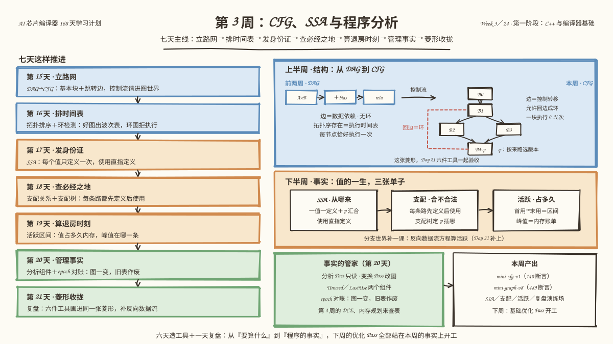

第 2 周把“要算什么”装进了无环的计算图；第 3 周补上另一半真相——程序怎么走：CFG、SSA 与程序分析，给编译器建立“程序的事实”。第 15 天立路网，从 DAG 走到 CFG，基本块与跳转边把分支和循环请进图世界；第 16 天排时间表，拓扑排序配上环检测，好图出波次表、环图当场拒绝；第 17 天发身份证，SSA 让每个值只出生一次，φ 按来路选版本；第 18 天查必经之地，支配树保证每条路先定义后使用、φ 插在哪；第 19 天算退房时刻，活跃区间回答值占多久内存、峰值在哪；第 20 天管理事实，分析 Pass 只读、变换 Pass 改图，epoch 对账：图一变旧表作废；第 21 天复盘，六件工具画进同一张菱形，补上反向数据流方程一课。七天从结构到事实层层递进，产出 mini-cfg-v1（140 条断言）、mini-graph-v8（489 条断言）与 SSA／支配／活跃／分析组件演练场；下周的优化 Pass 全部站在这些事实上开工。

> 第一阶段：C++ 与编译器基础（第 1～28 天）

### 第 015 天｜从 DAG 到 CFG

- **学习**：基本块、前驱、后继、控制流和数据流；比较计算图 DAG 与 CFG。
- **实践**：在独立示例中创建多个基本块和条件跳转，打印 CFG。
- **产出**：CFG 示例和结构图。

### 第 016 天｜拓扑排序与依赖检查

- **学习**：拓扑排序、环检测以及为什么循环图不能直接按普通拓扑序执行。
- **实践**：为计算图实现拓扑排序，遇到环时给出错误。
- **产出**：拓扑排序实现、正常图和带环图测试。

### 第 017 天｜SSA 基础

- **学习**：SSA 的定义、单赋值特性和 SSA 对常量传播、死代码消除的帮助。
- **实践**：将一小段多次赋值程序手工改写为 SSA，标注每个值的定义和使用。
- **产出**：原程序、SSA 版本和 Use-Def 对照表。

### 第 018 天｜支配关系

- **学习**：支配、严格支配、直接支配和支配树；理解定义为何需要支配使用。
- **实践**：为一个含分支和汇合的 CFG 手工计算支配关系，再实现简单迭代算法。
- **产出**：支配关系计算代码和测试 CFG。

### 第 019 天｜活跃变量与内存意义

- **学习**：定义点、使用点、活跃区间和寄存器／缓冲区分配的关系。
- **实践**：在线性计算图中计算每个 Value 的首次和最后使用位置。
- **产出**：活跃区间表和自动计算代码。

### 第 020 天｜把分析用于实际问题

- **学习**：分析 Pass 与变换 Pass 的分离；理解分析结果失效问题。
- **实践**：实现未使用节点分析和最后使用位置分析，供后续优化调用。
- **产出**：两个分析组件、测试和接口说明。

### 第 021 天｜第 3 周复盘

- **学习**：串联 CFG、SSA、支配和活跃区间。
- **实践**：手画一个含分支的例子，标出基本块、SSA 值、支配关系和活跃区间。
- **产出**：一页复盘；能回答“SSA 为什么让优化更容易，但不直接等于高性能”。
