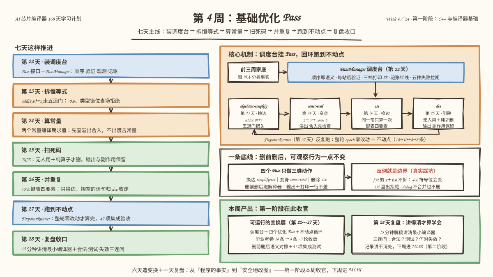

第 3 周为图 IR 建好了 SSA、支配和活跃区间这些“程序的事实”，第 4 周轮到编译器动手改图：七天沿“安全地优化”一条主线层层推进。第 22 天先装调度台，PassManager 定下每个 Pass 的输入输出、依赖与失败处理，顺序、验证、观测、记账一起管；第 23 天拆恒等式，add(x,0) 换成 x 前要过五道门，浮点负零当场拒绝；第 24 天算常量，两个 const 相加先查溢出和舍入，不产出谎言常量；第 25 天扫死码，只有结果无人使用且算子纯净才可删，输出与副作用保留；第 26 天并重复，CSE 按四要素把同一笔计算只算一次；第 27 天把四个 Pass 挂上调度台跑到不动点，顺序不同终点一致、语义一行不差；第 28 天复盘，15 分钟讲清这台最小编译器，并答好“优化为什么合法、如何测试、何时失效”三连问。走完本周，第一阶段收官：调度台、四个优化 Pass 和不动点循环组成可运行的变换层，下周带着它进入 MLIR。

> 第一阶段：C++ 与编译器基础（第 1～28 天）
### 第 022 天｜Pass 接口与执行管理

- **学习**：Pass 的输入、输出、依赖、执行顺序和失败处理。
- **实践**：定义最小 Pass 接口和 PassManager，支持按顺序运行并打印图。
- **产出**：PassManager 和空 Pass 示例。

### 第 023 天｜常量折叠

- **学习**：常量折叠成立的条件、类型提升和溢出风险。
- **实践**：实现 `Add(x, 0) → x`、`Mul(x, 1) → x`，避免处理不合法类型。
- **产出**：代数化简 Pass、正例和反例。

### 第 024 天｜真正的常量计算

- **学习**：编译期求值与运行期求值的边界。
- **实践**：对两个标量 Constant 的 Add 执行编译期计算，检查溢出和类型一致性。
- **产出**：常量求值实现及边界测试。

### 第 025 天｜死代码消除

- **学习**：无副作用、有使用者和图输出之间的关系。
- **实践**：实现反向遍历删除无使用者的纯算子，保留图输出和有副作用节点。
- **产出**：DCE Pass、多层死代码和副作用反例。

### 第 026 天｜公共子表达式消除

- **学习**：结构等价、属性等价、输入顺序和副作用对 CSE 的影响。
- **实践**：合并完全相同的纯算子，并正确迁移所有使用者。
- **产出**：CSE Pass、等价和不等价测试。

### 第 027 天｜Pass 组合与阶段验收

- **学习**：分析结果失效、Pass 重复运行和不动点的基础概念。
- **实践**：依次运行常量折叠、CSE、DCE，比较不同顺序的 IR；完成第一阶段集成测试。
- **产出**：优化前后 IR、全部测试和第一阶段可运行代码。

### 第 028 天｜第 4 周复盘

- **学习**：回顾从 Tensor 到图 IR、程序分析和优化 Pass 的完整关系。
- **实践**：用 15 分钟口头讲解自己的最小编译器，记录讲不清楚的地方。
- **产出**：阶段总结；能回答“一个优化 Pass 为什么合法、如何测试、何时失效”。

---
