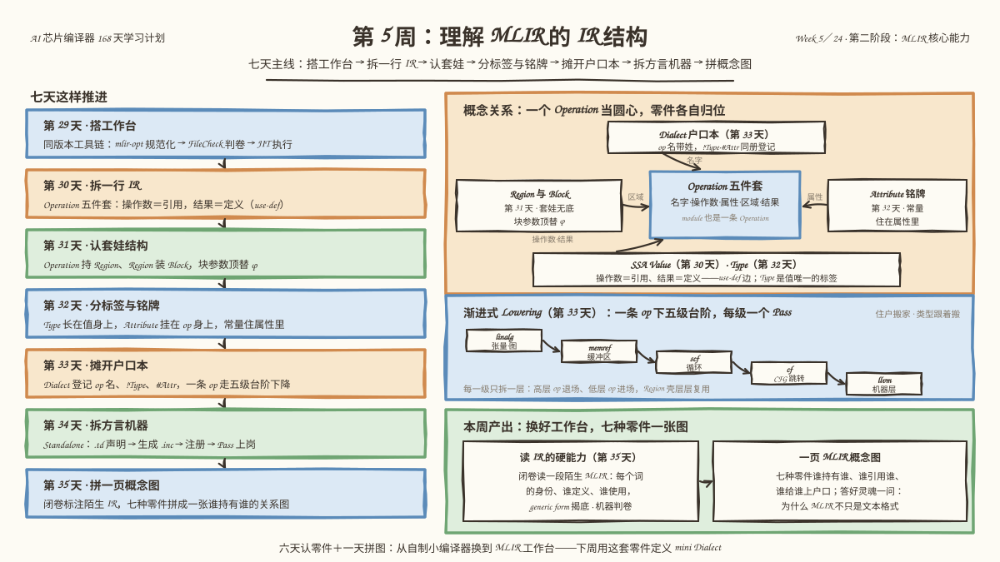

第 5 周是从手写小编译器迈向工业级编译器基础设施的换挡点：第二阶段用 MLIR 重建对 IR 的认识，而吃透 IR 结构正是后续定义 Dialect、编写 Pass 的地基。七天沿一条主线推进：第 29 天搭好可运行的 MLIR 工作台；第 30 天拆开一行 IR，分清 Operation 的操作数、结果与 SSA 值；第 31 天钻进套娃结构，看 Operation 持有 Region、Region 装下 Block 与控制流；第 32 天分清身份，Type 长在值上、Attribute 挂在操作上；第 33 天摊开 Dialect 户口本，理解混合抽象与渐进式 Lowering；第 34 天拆解 Toy 或 Standalone 示例工程，看清操作定义、构建与 Pass 注册如何连成一条链；第 35 天闭卷复盘，把七种零件拼成一页 MLIR 概念图。走完本周，应能不查资料读懂一段 MLIR 并说出每个元素的定义与使用，这张概念图既是本周核心产物，也是下周定义 mini Dialect 的门票。

> 第二阶段：MLIR 核心能力（第 29～56 天）

### 第 029 天｜准备 MLIR 环境

- **学习**：了解 LLVM／MLIR 源码构建、安装版本匹配和常用工具。
- **实践**：准备可运行的 MLIR 环境，确认 `mlir-opt`、测试工具和示例可用。
- **产出**：环境记录、构建命令和一个成功执行的 MLIR 示例。

### 第 030 天｜Operation 与 Value

- **学习**：Operation、Operand、Result、SSA Value 和类型系统。
- **实践**：阅读一段简单 MLIR，逐个标注操作数、结果、类型和定义位置。
- **产出**：一份带注释的 MLIR 文件和概念对照表。

### 第 031 天｜Region 与 Block

- **学习**：Operation 为什么可以包含 Region，Region、Block 与 CFG 的关系。
- **实践**：构造或阅读带控制流的 IR，打印 Region 和 Block 层级。
- **产出**：Region／Block 结构图和控制流示例。

### 第 032 天｜Type 与 Attribute

- **学习**：Type 和 Attribute 的区别，为什么常量值通常不是 Type。
- **实践**：分析 Tensor 类型、静态维度、动态维度和常量属性的表示。
- **产出**：至少 5 个合法／非法类型示例及说明。

### 第 033 天｜Dialect 与渐进式 Lowering

- **学习**：Dialect 的职责、混合 IR 和多层抽象；理解为什么不必一步降到机器码。
- **实践**：画出 `mini → loop → LLVM` 的目标 Lowering 路线。
- **产出**：项目 Dialect 分层图和每层职责说明。

### 第 034 天｜跑通 Toy 或 Standalone 示例

- **学习**：跟踪示例项目的 Operation 定义、构建和 Pass 注册过程。
- **实践**：运行 Toy 或 Standalone 示例，修改一个输出文本或简单属性并重新验证。
- **产出**：可构建的示例工程和源码阅读笔记。

### 第 035 天｜第 5 周复盘

- **学习**：串联 Operation、Value、Region、Block、Type、Attribute 和 Dialect。
- **实践**：不查资料解释一段 MLIR，并指出每个元素的定义和使用。
- **产出**：一页 MLIR 概念图；能回答“为什么 MLIR 不只是一个新的文本格式”。
