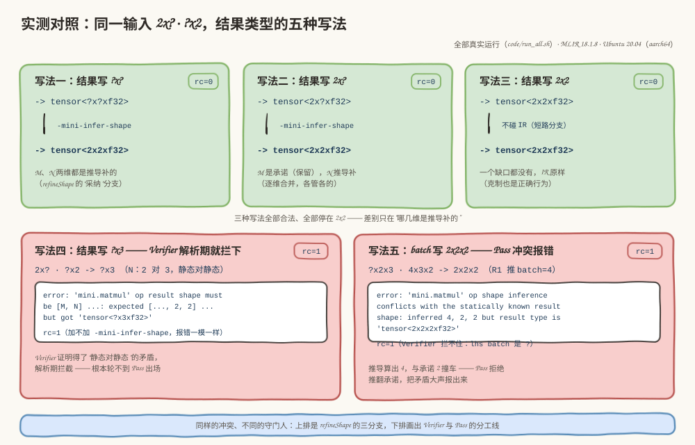

# 第 44 天技术校对报告

校对范围：`tutorials/week-007/day-044/`（README.md、`code/mini`、8 个探针、`run_all.sh`、images/01～03 SVG）。
校对方法：在本环境（Ubuntu 20.04.5 aarch64、gcc 9.4.0、cmake 3.20.5、ninja 1.10.0、MLIR 18.1.8）独立构建 mini-opt 并重放全部探针，逐条比对 README 记录；对存疑的 MLIR API/机制问题查证安装头文件与上游源码；对练习提示用真实运行验证。总体结论：全部 8 个探针的输出与退出码、三种失败路径的报错消息、4 处接缝改动清单、6.1 命名空间二义性均可逐字复现，教程质量很高；以下为逐项发现。

## 【错误】

#### 1. 必做练习的提示把"无来源"的 M 维说成"有来源"
- **原文**："提示：第一个探针里 M、N、batch 全都无来源；第二个探针里 batch 两侧都是 `?`，但 M、N 有来源。"
- **依据**：按 R2，M 只看 lhs 倒数第 2 维。第二个探针 `@batch_both_unknown(%a: tensor<?x?x3xf32>, %b: tensor<?x3x2xf32>)` 的 lhs 倒数第 2 维（第 1 维）是 `?`，M 无来源；只有 N（rhs 倒数第 1 维 = 2）有来源。本人实测（本环境 mini-opt 18.1.8，结果类型写 `?x?x?`）：输出为 `-> tensor<?x?x2xf32>`，M 诚实保留 `?`。照提示预测会得出 `?x2x2`，与真实输出不符，直接卡住"②你的预测与打印出的 matmul 行完全一致"这条验收标准。若想保留"M 有来源"的提示，需把 `%a` 改成 `tensor<?x2x3xf32>` 之类 M 静态的输入。
- **置信度**：高（规则推导＋真实运行双重验证）

#### 2. "walk 默认 pre-order"与 MLIR 18.1.8 实现不符
- **原文**："// walk 默认 pre-order：SSA 直线代码里定义先于使用被访问，"
- **依据**：MLIR 18.1.8 的 `Operation::walk`（单参数回调版本）模板默认参数是 `WalkOrder::PostOrder`，头文件注释明写 "post-order by default"（`/usr/lib/llvm-18/include/mlir/IR/Operation.h:788`；枚举定义在 `mlir/IR/Visitors.h:63`，实现在 Visitors.h 的 `detail::walk`）。pre/post 只决定"祖先与嵌套后代"之间的回调先后；同一 Block 里的兄弟操作在两种顺序下都按程序序（ForwardIterator 字典序）访问。因此探针 4 的一趟传播**结论仍然成立**——`%0`、`%1` 是同一 Block 里的兄弟 matmul、无嵌套 Region，与 pre-order 无关——但教程给出的原因是错的。同一说法还出现在 `code/mini/lib/ShapeInferencePass.cpp` 注释（"walk 默认 pre-order：SSA 直线代码里，定义先于使用被访问"）和 `images/02-mechanism.svg` 底部蓝条（"walk 按定义序（pre-order）"）。准确说法：walk 默认 post-order，但兄弟操作按程序序访问，直线 SSA 代码里程序序即定义序。
- **置信度**：高（安装头文件模板默认参数＋文档注释＋实现三重核实；探针 4 输出复现一致）

## 【存疑】

#### 1. "与 Day 43 的 Python 逐条对应"过于绝对
- **原文**："**第一层：纯函数，R0～R4 的 C++ 直译**（`lib/ShapeInferencePass.cpp`，与 Day 43 的 Python 逐条对应）："
- **依据**：Day 43 Python 版（`day-043/code/matmul_infer.py`）的防御性失败分支有四个：unranked、rank<2、秩不等、K 双侧静态且不等；C++ 版 `inferMatmulShape` 只保留"秩相等"一个（ShapeInferencePass.cpp:50），K 不等的输入会照常返回 `[batch, M, N]`。在 mini-opt 管线内两者行为一致（Verifier 规则 3 在解析期先拦 K 不等，实测 `2x3 · 2x2` 类输入根本到不了 Pass）；但第 2 节说该纯函数"不碰 IR、不诊断，可以直接单元测试"——单独调用时两版行为不同（Python 对 `2x3 · 2x2` 返回 FAIL，C++ 返回 shape）。"直译/逐条对应"按取维规则（R1～R4）理解成立，按失败语义理解不成立，建议注明差异或弱化表述。
- **置信度**：高（两版源码逐行对照）；归为存疑而非错误，是因为教程语境的"规则表"指取维规则，且管线内无可观察差异。

#### 2. "短路不碰 IR 让增量编译、Pass 失效管理少背锅"缺 MLIR 机制支撑
- **原文**："4. **短路**：合并结果与原 shape 完全相同（全静态输入、或一个 `?` 都推不出来）就 `return`，**不碰 IR**——避免"Pass 动过 IR"的假象，也让增量编译、Pass 失效管理少背锅。"
- **依据**：mlir-opt 没有"增量编译"机制；MLIR 的分析失效由 Pass 自己声明的 PreservedAnalyses 驱动（`mlir/Pass/Pass.h:237` 的 `markAllAnalysesPreserved`/`preserve<...>`，PassManager 在每个 Pass 之后按声明失效），并不检测"IR 是否真的被改"。因此"不调用 setType"对 MLIR 的失效判定没有任何影响——收益只对"人眼 diff 输出、`--mlir-print-ir-between-passes` 对比"这类调试场景成立。若作者泛指传统编译器的增量编译概念，则表述过于含糊，容易让初学者误以为 MLIR 有按 IR 变更驱动的失效管理。
- **置信度**：中（MLIR 机制核实无误；若按通用编译器概念理解则属表述含糊而非硬错误）

## 【建议】

#### 1. "本环境实测输出 BUILD_OK"不是所示命令的输出
- **原文**："本环境实测输出 `BUILD_OK`，产物 `/tmp/day044/build/bin/mini-opt`。"
- **依据**：`cmake --build /tmp/day044/build`（Ninja 生成器）的真实输出是 `[n/16] Building CXX object ...`/`[16/16] Linking CXX executable bin/mini-opt` 进度行（本人在同环境复现，16 行进度，无 "BUILD_OK" 字样）。"BUILD_OK" 疑似作者自加的 `&& echo BUILD_OK` 成功标记。教程开篇承诺"以下全部命令与输出都是真实运行记录"，建议改为"构建成功（ninja 无告警）"之类如实描述，或补全带 echo 的完整命令。
- **置信度**：高

#### 2. 统计空报告宜补一句原因，避免读者怀疑自己的代码
- **原文**："一个如实的注记：Pass 里挂着 `refined-results` 的 `Pass::Statistic` 计数器，但在本环境（MLIR 18.1.8 的 mini-opt）实测 `--mlir-pass-statistics` 打印的是空报告——所以今天的验收**不依赖统计表**"
- **依据**：现象记录属实（本人复现：不仅 mini-opt，上游 mlir-opt 18.1.8 跑 `-cse --mlir-pass-statistics` 同样只打印表头无任何条目，连上游 `--test-stats-pass` 也是空）。根因是发行版 MLIR 默认未启用 `LLVM_ENABLE_STATS`：`mlir/lib/Pass/PassStatistics.cpp` 的两个统计打印函数体整体被 `#if LLVM_ENABLE_STATS` 包住，只有报告表头无条件打印。教程如实记录了现象并正确地不依赖统计表，建议补一句"上游工具也一样，是构建配置而非本工程代码问题"，避免读者在 Pass 写法上自我怀疑。
- **置信度**：高（上游对照实验＋PassStatistics.cpp 源码核实）

#### 3. 前置准备的括号路径覆盖不了"mini 方言工程"
- **原文**："> **前置准备**：Day 41～43 的 mini 方言工程与 Python 规则表（`tutorials/week-007/day-043/code/`）、LLVM/MLIR 18.1.8（含 `MLIRConfig.cmake`）、CMake 与 Ninja。"
- **依据**：`tutorials/week-007/day-043/code/` 下只有 Python 规则表（matmul_infer.py、探针与测试），不含 mini 方言工程；mini 工程的前身在 `tutorials/week-006/day-041/`、`day-042/` 的 `code/mini`（本日 `code/mini` 也自带完整基线）。括号路径会让读者跑到 day-043 找 mini 工程。
- **置信度**：高（目录结构核对）

#### 4. 图 3 SVG 标题"同一输入……五种写法"与第五张卡的输入不符
- **原文**：""
- **依据**：README 正文与此 alt 文字都准确（三种写法用同一输入，两种失败路径另算），但 `images/03-results.svg` 的标题写"同一输入 2x? · ?x2，结果类型的五种写法"——其中"写法五"卡片实际是 3D 输入 `?x2x3 · 4x3x2`（卡片内标注正确），并非同一输入。标题易让读者以为 batch 冲突也能用 2x? · ?x2 复现。建议后续修订图题（本次按规则不改动已有图）。
- **置信度**：高

#### 5. 遗漏一个实测可复现的坑：细化会把下游 Verifier 此前放行的冲突翻出来
- **原文**："- **修复**：今天范围内最简单的做法是**让细化结果就地观察、不外传**（8 个探针里 7 个都这么写）；正解是让 Pass 同步更新函数签名——留给选做挑战。"
- **依据**：6.3 只覆盖"细化结果 vs 函数签名"这一种外传。同一机制还有第二个现场：细化后的值喂给下游算子时，`--verify-each` 的 Pass 后验证会把解析期被 `?` 掩盖的静态冲突翻出来。本人实测：`%0 = mini.matmul 2x?·?x2 -> ?x?` 细化成 2x2 后接 `%1 = mini.add %0, %c : tensor<?x?xf32>, tensor<?x3xf32> -> tensor<?x?xf32>`，不加 Pass rc=0；加 `-mini-infer-shape` rc=1，报 `error: 'mini.add' op requires identical operand shapes, but got 'tensor<2x2xf32>' and 'tensor<?x3xf32>', which do not match dimension by dimension and are not broadcast-compatible either`。与 6.3 同根（Value 的类型变了，别的检查在 Pass 之后重跑），初学者往后组合 Pass 时很容易撞上，建议纳入常见错误或练习。
- **置信度**：高（实测复现）
