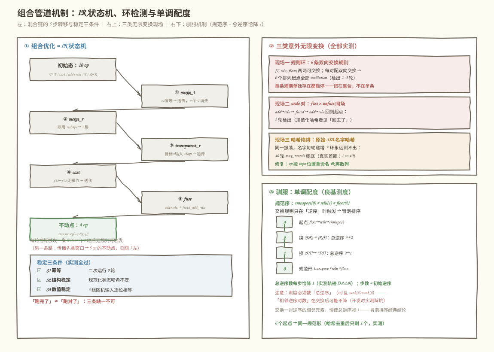

# 第 69 天技术校对报告

审阅范围：`README.md`、`code/combo_lab.py`、`code/test_combo_lab.py`、4 个 `.mlir` 探针、`code/outputs/` 全部冻结输出、`images/` 下 4 张已引用 SVG；对照 `skills/ai-compiler-daily-tutorial/SKILL.md`。核验方式：在本机（Python 3.11.4 / numpy 1.26.4 / Ubuntu LLVM 18.1.8，与教程环境一致）临时目录完整重跑主实验与验收测试（输出与冻结产物逐字节一致），逐条重跑 4 个 MLIR 探针，并针对存疑论断做了补充小实验（见各条依据）。

## 【错误】

#### 1. 「S1 单独不够」的解释与当天 run_passes 的语义相反
- **原文**：“一个 Pattern 若在不动点上还能「触发但什么也没改」，轮次是 0 而图仍在变（例如改了名字没改结构）——S2 把它拦住”
- **依据**：与 5.2 节自己给出的 `run_passes` 矛盾：只要 Pattern 返回 True（触发），`rounds` 必然先加 1，不可能「触发而轮次是 0」。我用当天的 `run_passes` 做了两组对照实验（临时目录，未动仓库产物）：① 写一个「触发但什么也不改」的 Pattern，重跑结果是 rounds=1、verdict=oscillation（哈希重复）——这类情形 S1 就能抓住，S2 反而抓不住（图没变，哈希也不变）；② 写一个「改了图却返回 False」的 Pattern（把 relu(add) 静默改成 fused），重跑结果是 rounds=0、verdict=fixpoint、哈希改变——这才是 S2 真正拦得住的情形。另外「改了名字没改结构」恰好是 S2 检不出的一类：`state_hash`（combo_lab.py:337）按 topo 位置把 op 重命名为 #k，对纯改名天然免疫。所以这段话的因果方向写反了：S2 拦的是「改了图却没报触发」，不是「触发了却什么也没改」；稳定三条件的分层校验本身是好的工程实践，但这条解释教给读者的机制模型是错的。
- **置信度**：高（用当天 `run_passes`/`state_hash` 直接实验复核；两方向均验证）。

#### 2. 图 1（01-overview.svg）两处标签文字重叠，不可读
- **原文**：“”
- **依据**：该 SVG 中小节标题「本周链路（第 10 周）」位于 (x=40, y=92, font-size 13, 粗体)，注释「前五天：每条 Pattern 自己的单测里都收敛」位于 (x=44, y=94, font-size 11.5)——两者基线只差 2px、横向起点几乎相同，渲染时整段叠印在一起，两个标签都不可读，违反「文字不得重叠」的图片要求。对 4 张 SVG 全部文本做了包围盒检测，这是唯一一处重叠。本次审阅已做最小修复：把「前五天：…」注释的 x 从 44 移到 196（仍在 D64–D68 盒子上方、避开标题，复检无新重叠），SVG 其余内容未动。
- **置信度**：高（坐标直接取自 SVG 源码；修复后已复检）。

## 【存疑】

#### 3. TVM `PassContext` 的「required passes」表述未能在线核实
- **原文**：“TVM 的 pass 依赖声明（`PassContext` 的 required passes）”
- **依据**：本环境无法访问 TVM 官方文档与源码（webfetch 返回 404/超时，本机未安装 tvm），无法核实 PassContext 配置项的准确名称与语义（印象中 TVM 的 pass 依赖主要声明在各 pass 的 PassInfo required 字段，PassContext 也有 required_pass 相关配置，但本次未能验证，不能作为依据）。该句只是三个工程化举例之一，不影响当天主线结论；建议后续能联网时对照 TVM 官方文档核实措辞，确认「依赖声明」归属 PassContext 还是 PassInfo。
- **置信度**：低（无法验证；仅提示需核实，不构成错误判断）。

## 【建议】

#### 4. 「15% const 起头」与生成器实际概率不符
- **原文**：“30% add 起头、15% const 起头”
- **依据**：combo_lab.py:1162-1168 的生成器是 `if rng.random() < 0.30: add 起头 elif rng.random() < 0.15: const 起头`——elif 结构下「const 起头」的无条件概率是 0.7×0.15=10.5%，而同句的「30% add 起头」是无条件概率，两种口径混在一句里。按「15% 是阈值」读不算错，按「15% 的图以 const 起头」读则与代码不符。不影响任何结论（200/200 等统计全部复核通过），建议改成「其余图中按 15% 阈值抽 const 起点（实际约 10.5%）」或直接写实际占比。
- **置信度**：高（代码可直接核对；属表述口径问题，非结论性错误）。

#### 5. 5.1 节文件清单遗漏 code/make_images.py
- **原文**：“├── run_all.sh                一键复跑”
- **依据**：5.1 节的目录树列出了 code/ 下的全部交付文件（combo_lab.py、test_combo_lab.py、4 个 .mlir、run_all.sh、outputs/），但 code/ 目录里实际还有 make_images.py（35 KB，当日 4 张 SVG 的生成脚本，已随仓库交付）。初学者按清单核对文件时会发现一个清单里没有的文件；建议在目录树中补一行，或在文中说明该脚本是图片生成工具、不属于实验链路。
- **置信度**：高（目录实况与清单可直接比对）。

#### 6. 「传播收尾」在混合链的 5 步中并未出现
- **原文**：“顺序就是「消除类把图变小 → 融合改变算子形态 → 传播收尾」的缩影”
- **依据**：实测的 5 次触发是 merge_t → merge_r → transparent_r → cast → fuse（outputs/combo_lab.txt 第 2 节），全部落在消除类与融合两档；push_transpose 在混合链上从未触发（最终转置卡在 fused_add_relu 上、白名单不认）。把这 5 步称作包含「传播收尾」的缩影，容易让读者以为混合链也走过传播一步。建议注明「传播在混合链上没有触发，收尾档位的效果要看竞争对的另一条路（5 op 不动点）」。同句后半「旁边那条路（先传播）会到另一个 5-op 不动点」已经给了对照，只是「缩影」的说法与前半句不够自洽。
- **置信度**：高（触发序列与冻结输出逐条核对）。

#### 7. 图 2 驯服梯子缺少 1→0 那一步的交换标签
- **原文**：“”
- **依据**：图 2 右侧的驯服梯子画了 3→2→1→0 四个状态，只标了两步交换（「换 (F,R) 3→2」「换 (F,T) 2→1」），从 1 到 0 的第三步交换「换 (R,T) → (T,R)」没有标注，单看图 2 不知道 1→0 是怎么走出来的；图 3 右侧同一梯子标全了三步。数值与轨迹本身同 outputs 一致（[3,2,1,0]），仅缺一个中间标签，建议补齐使两图一致。
- **置信度**：高（两张 SVG 的文本标签逐条比对）。
