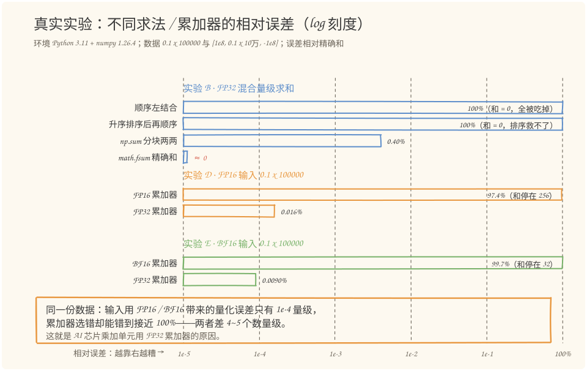

# 第 78 天技术校对报告

审阅范围：`README.md`、`code/float_error_lab.py`、`code/make_images.py`、`images/01～04.svg`、5.3／5.4 节全部“真实输出”。核对环境与教程声明一致（aarch64 Linux，Python 3.11.4，numpy 1.26.4，torch 2.7.1+cpu）：`float_error_lab.py` 原样重跑、5.4 节改参数重跑、`bf16()` 与 torch 的边界值对比、`np.spacing`／`np.sum` 小数组行为、Kahan 逐步跟踪均在临时目录实际执行后核对。

## 【错误】

#### 1. FP16 与 BF16 的范围差被写成 28 个数量级，实约 34 个
- **原文**：“FP16 与 BF16 的范围差了 28 个数量级（65504 vs 3.4e38）。”
- **依据**：log10(3.4e38 / 65504) = 33.72（本机实测），即约 34 个数量级，不是 28。按“最大有限值之比”算：3.4e38 / 6.5504e4 ≈ 5.2e33；按最小正规数算（1.18e-38 vs 6.1e-5）同样是 ~33.7 个数量级，任何一种口径都得不出 28。第 6 节“错误三”中“指数域 8 位 vs 5 位，范围差 28 个数量级”重复了同一错误。改法：约 34 个数量级（或“3.4e38 vs 6.5e4，差约 33～34 个数量级”）。
- **置信度**：高（纯算术，已用 log10 复核）。

#### 2. “[1e8, 2e8) 这一档”不是同一档，区间内间距并不恒等于 8
- **原文**：“所以在 `[1e8, 2e8)` 这一档里，FP32 的间距恒等于 8，不随数变大而继续变疏。”
- **依据**：FP32 的 binade 边界是 2 的幂：[2^26, 2^27) = [6.71e7, 1.34e8)。1e8 落在这一档（间距 8），但 2e8 = 2×10^8 > 2^27 = 134217728，所以 `[1e8, 2e8)` 跨过了档边界：1.34e8 之后间距跳成 16。实测 `np.spacing(np.float32(1.5e8)) = 16.0`、`np.spacing(np.float32(2e8)) = 16.0`。要表达“同一档内间距恒定”，正确的区间是 `[2^26, 2^27)`（或 `[1e8, 1.34e8)`）。初学者按原文在 1.5e8 处验证会直接得到 16，与“恒等于 8”矛盾。
- **置信度**：高（numpy 实测 + binade 定义核对）。

#### 3. 实验 E 的“剩余误差几乎全部来自输入表示，累加本身基本不再贡献”与真实误差构成相反
- **原文**：“- 实验表里 `FP32 累加器` 对十进制真值的相对误差约 1.6e-4／9e-5，和输入量化同一量级——说明换对累加器后，**剩余误差几乎全部来自输入表示，累加本身基本不再贡献**。”
- **依据**：脚本自己打印的“FP32 累加器(对存储值)”一行给出了反例数据：实验 E 中 FP32 累加器结果 10000.9，而存储值精确和为 10009.8——FP32 顺序累加本身贡献了约 −8.87 的误差，与输入表示误差（+9.78，即 BF16 的 0.1 存成 0.10009765625）同量级、方向相反，两者恰好大部分抵消，净误差才只剩 +0.90（8.98e-5）。也就是说：E 的净误差小不是因为“累加不贡献”，而是两笔同量级的误差互相抵消；实验 D 中累加贡献（9998.41 − 9997.56 = +0.85）也约占净误差 1.59 的一半，同样谈不上“基本不再贡献”。且“和输入量化同一量级”对 E 不成立：E 的输入量化是 9.78e-4（约 1e-3），净误差 8.98e-5 比它小 10 倍。本条结论出现在“把机制钉实”的三行证据里，属于对自家实验表的误读，需要改写（例如：FP16 路径净误差与输入量化同量级；BF16 路径两笔误差同量级且相互抵消，顺序累加在 FP32 下仍会有约 1e-3 量级的漂移）。
- **置信度**：高（误差分解已用脚本输出复核：stored_sum=10009.7656、fp32_seq=10000.8984、累加误差 8.8672、输入误差 9.7656、净误差 0.8984）。

#### 4. “FP16／BF16 输入本身只带来 1e-4 量级的量化误差”对 BF16 差了约 10 倍
- **原文**：“而 FP16／BF16 输入本身只带来 1e-4 量级的量化误差”
- **依据**：FP16 的 0.1 存储值 0.0999755859375，相对偏差 2.44e-4，勉强算 1e-4 量级；但 BF16 的 0.1 存储值 0.10009765625，相对偏差 9.77e-4 ≈ 1e-3（0.1%），差一个数量级。教程自己的证据链也印证：实验 E 的“存储值精确和 = 10009.8”（对十进制真值 10000 的偏差 9.78e-4）；脚本结论行印的是“输入量化误差 ~0.1%”；后续 day-080 教程给出的 BF16 输入格式税是 3.9e-3。开头目标句“输入量化误差约 1e-4”与图 4 文本“输入用 FP16 / BF16 带来的量化误差只有 1e-4 量级”同样把 BF16 一并算进 1e-4。改法：FP16 约 2e-4、BF16 约 1e-3，或写“1e-4～1e-3 量级”。
- **置信度**：高（数值全部来自实际运行输出；唯一弹性在“量级”的宽严口径，但 9.77e-4 无论如何归不到 1e-4）。

#### 5. “实验 B 里两者相差 0.40%”张冠李戴：树形 vs 顺序相差约 100%，0.40% 是树形 vs 精确参考
- **原文**：“CPU 单核验证常是顺序累加，**顺序不同结果本来就不同**——实验 B 里两者相差 0.40%，完全合法。”
- **依据**：实验 B 的真实数据是：顺序左结合 = 0.0，np.sum（分块两两／树形）= 9960，math.fsum = 10000.0001。句中“两者”指树形与顺序累加，它们的差是 |9960 − 0| / 10000 ≈ 99.6%（约 100%）；0.40% 是 np.sum 与 math.fsum（精确参考）之间的差。按原文表述，读者会得出“NPU 树形归约和 CPU 顺序 golden 只差 0.4%”的错误预期，而实验 B 恰恰展示了两者可以差到 100%。改法：要么写“树形与顺序可以差到近 100%（实验 B），与精确参考比则只有 0.40%”，要么把 0.40% 明确归给“np.sum vs fsum”。
- **置信度**：高（实验 B 输出已重跑核对；作者本意大概率是“树形 vs 精确参考”，但按字面是错的）。

#### 6. 5.4 节标注“真实输出”的文本块不是脚本的实际输出
- **原文**：“把实验 D／E 里的增量从 `0.1` 改成 `1.0`（改动 `float_error_lab.py` 中 `np.full(100_000, 0.1, ...)` 的一个数字），重新运行，**真实输出**：”
- **依据**：把仓库脚本复制到临时目录、按原文所述把两处 `np.full(100_000, 0.1, ...)` 改成 `1.0` 后实际运行，脚本打印的是“FP16 顺序累加 10 万次：和停在 2048，再也不会动”“BF16 顺序累加 10 万次：和停在 256”这样的行；README 中“FP16 顺序累加 0.1 x 100000 -> 256.0   (np.spacing@256 = 0.25)”这种带 `->` 和 `np.spacing@...` 注记的格式在任何一次运行里都不会出现，且该块把 0.1 版和 1.0 版两次运行的行拼在一起而未说明是整理稿。数值本身全部正确（256／2048／32／256 均已实测复现），问题仅在证据呈现：把改写后的输出标注为“真实输出”违反本仓库教程“不伪造执行结果呈现”的底线。改法：直接引用脚本实际打印行，或标注“整理后的两轮输出对照”。
- **置信度**：高（两种参数均已实际运行；数值一致、格式不符是确定的）。

#### 7. `bf16()` “与 torch 逐位一致（已验证）”在 NaN 输入上不成立
- **原文**：“本实现与 torch.tensor(x).to(torch.bfloat16).float() 逐位一致（已验证）。”
- **依据**：用教程 5.3 节同一条 API 链路（`torch.from_numpy(...).to(torch.bfloat16).to(torch.float32).numpy()`）对边界值实测：输入 sNaN 0x7F800001 时，本实现得 0x7F800000（+Inf），torch 得 0x7FC00000（+qNaN）；输入 −NaN 0xFFC00000 时，本实现保留符号得 −NaN，torch 得 +NaN。原因在 torch 2.7.1 源码 `c10/util/BFloat16.h` 的 `round_to_nearest_even`：对任何 NaN 直接返回常量 0x7FC0，而本实现沿用同一位技巧（`u + 0x7FFF + ((u>>16)&1)`）没有 NaN 分支，sNaN 加上进位会溢出成 Inf。有限值（含次正规数、接近 max float 的数、舍入平局点）实测逐位一致，5.3 节的验证片段也只覆盖有限值，所以教程内实验结论不受影响；但“逐位一致”作为普适断言不成立，若读者把 `bf16()` 用到含 NaN 的数据上会得到与 torch 不同的结果。改法：限定为“对有限值逐位一致”，或给 `bf16()` 加 NaN 保留分支。
- **置信度**：高（torch 2.7.1+cpu 本机实测 + 源码 `c10/util/BFloat16.h` round_to_nearest_even 函数体直接核对；影响面仅限 NaN 输入）。

## 【存疑】

#### 1. “砍掉低 16 位／前 16 位”与“就近舍入”两种说法并存，按字面互相矛盾
- **原文**：“砍掉低 16 位（配一个就近舍入）就完成 FP32→BF16，硬件上只是一次移位截断”
- **依据**：同一行先说“配一个就近舍入”，又说“只是一次移位截断”，两句只能对一个：RNE 转换是“加进位再截位”，不是纯截断。可实测的反例：0.1f = 0x3DCCCCCD，按“前 16 位／砍掉低 16 位”得 0x3DCC0000 = 0.099609375，而本教程 `bf16()` 与 torch 的 RNE 结果都是 0x3DCD0000 = 0.10009765625（低 16 位 0xCCCD 超过一半，向前进 1）——实验 E 的输入 0.10009765625 和“存储值精确和 10009.8”都依赖这次进位。图 2 内文本“BF16 = FP32 的前 16 位”与 3.2 节图注“BF16 就是把 FP32 的低 16 位尾数砍掉得到的”都是纯截断表述，`bf16()` docstring 同样先写“砍掉”再实现 RNE。作为位布局类比可以接受，但作为转换规则会预测出与实验 E 相反的输入值。建议统一口径：“保留高 16 位，低 16 位按就近舍入到偶数决定进位”。
- **置信度**：高（数值实测无误）；定级存疑是因为 5.2 节代码与 3.2 节正文实际都讲了舍入，属于表述不一致而非机制讲错。

#### 2. “Cube／Vector 计算单元……累加器用 FP32”对 Vector 单元过于绝对
- **原文**：“对应到昇腾这类 AI 芯片上是：Cube／Vector 计算单元接受 FP16／BF16 输入做乘加，但**累加器用 FP32**”
- **依据**：Cube（矩阵乘加）的“FP16/BF16 输入＋FP32 累加”是昇腾公开资料和本仓库 day-080 教程都采用的说法（day-080 原文只写“昇腾 Cube 矩阵单元的原生配方”）。但 Vector 单元情况不同：逐元素算子没有“累加器”概念（FP16 加 FP16 直接出 FP16）；Reduce 类算子在 Ascend C 里区分高精度模式（FP32 中间结果）与高性能模式（中间结果与输入同精度），并非一律 FP32 累加，选错模式正是工程上真实的坑。本环境无法联网核对昇腾官方文档原文，未能给出文档级证据。
- **置信度**：中（Cube 部分把握高；Vector 部分基于 Ascend C 高精度/高性能双模式的一般认知，无法在当前环境验证官方文档，建议作者对照 CANN 文档确认后把“Cube／Vector”收窄为“Cube 矩阵乘加”或加模式限定）。

## 【建议】

#### 1. “本周三天”把 Day 77 算入第 12 周，与仓库周划分不符
- **原文**：“中排是本周三天，Day 77 复盘融合，今天讲浮点格式与累加顺序，Day 79 建立参考实现和误差指标”
- **依据**：按本仓库 SKILL.md 的公式（第 N 天属第 (N-1)//7+1 周），Day 77 属第 11 周（week-011，其标题即“第 11 周复盘”），本周第 12 周是 Day 78～84；总计划里第 12 周也从头一天 078 开始。图 1 中排把 Day 77/78/79 括为“本周三天”同样如此。另外图 1 上排“73~80 天 数值：也要对”“81 天起 算子验证进阶”与总计划不符：73～77 天属第 11 周（融合收益与代价模型），81～84 天仍属第 12 周（数值/量化）。不影响技术内容，但导航性信息不准。
- **置信度**：高（纯仓库结构事实）。

#### 2. 图 4 副标题的误差基准与 D／E 条形数值的基准不一致
- **原文**：“”
- **依据**：`04-results.svg` 副标题写“误差相对精确和”，这只对实验 B 成立（100%、0.40% 相对 math.fsum）；实验 D／E 的 97.4%、99.7%、0.016%、0.0090% 相对的是十进制真值 10000（README 表格明确标注“十进制真值 = 10000”），若改按“存储值精确和”，FP32 累加器两行分别是 8.5e-5 与 8.9e-4。数值本身没抄错，只是图内一句口径说明以偏概全；SVG 已冻结，下次生成时统一标注即可（例如“B 组相对精确和，D／E 组相对十进制真值”）。
- **置信度**：高（两种基准的数值均已从脚本输出核对）。

#### 3. 未提示“纯 Python 复现必须显式用 float32”这个初学者必踩的坑
- **原文**：“这不是 Python 或 NumPy 的 bug，而是 IEEE 754 浮点表示的固有属性。”
- **依据**：教程开头的最小例子用了 `np.float32(...)`，是对的；但初学者最容易在交互式 Python 里直接敲 `(1e8 + 1) + (-1e8)`——Python 字面量是 FP64，实测结果为 `1.0` 而不是 `0.0`（FP64 在 1e8 处间距约 1.5e-8，1.0 完全装得下），于是误以为教程例子造假。补一句“Python 的 float 是双精度，复现必须显式 `np.float32`”能挡住这个高频坑，也顺便解释了为什么要写 `np.float32(1e8)` 这种看起来啰嗦的代码。
- **置信度**：高（本机实测 `(1e8 + 1.0) + (-1e8)` 在纯 Python 下得 1.0）。

#### 4. “牺牲一半精度”与同表数据不一致
- **原文**：“| BF16 | 1＋8＋7 = 16 位 | ±3.4e38 | 约 2~3 位 | 与 FP32 同范围，牺牲一半精度 |”
- **依据**：“一半”只有按总位宽（32→16 位）才成立；按精度口径，尾数 23→7 位、十进制有效位约 7→约 2~3 位，都约是 1/3 而不是 1/2，且同一行的“约 2~3 位”已经给出了正确比例。措辞含糊，建议改成“砍掉 16 位尾数、精度约剩 1/3”或“用一半的位数换同范围”。
- **置信度**：高（与表格自身数据对照即可确认）；定级建议是因为不影响任何结论，只是措辞精度。
