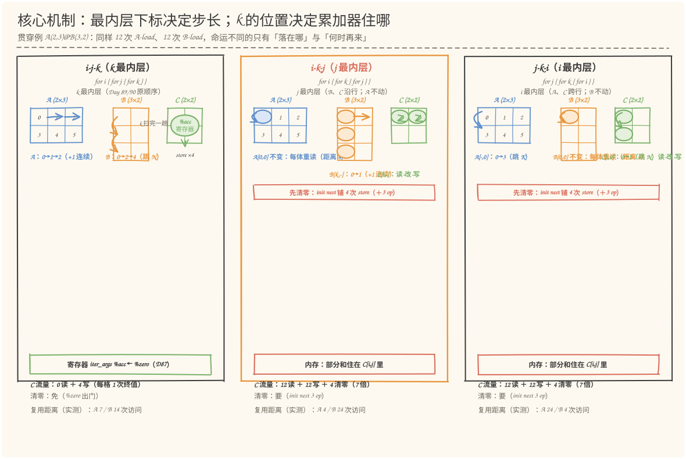

# 第 92 天技术校对报告

审阅范围：`README.md`、`code/order_pass.py`、`code/make_images.py`、`code/outputs/` 全部 6 个文件、`images/` 全部 4 张 SVG。审阅环境：aarch64 Linux，Python 3.11.4，numpy 1.26.4（与教程声明一致）。核实方式：在临时目录以修正后的 `sys.path` 完整复跑 `order_pass.py`（14/14 PASS，6 份 outputs 与仓库冻结产物逐字节一致）、复跑 `--cache 48/56/60/62/63/64` 与 `--no-init`、用 `rsvg-convert` 实际渲染 4 张 SVG 并测量文字边界、逐条比对 §3.1/§3.2/§5.3 的日志摘录与复用距离公式。配图审阅另新增 `images/05-slot-conflict.svg`（直接映射槽位冲突机理）与 `images/06-cache-flip.svg`（容量扫描翻转曲线），图中全部块号与缺失数取自上述同一复跑（32/40/48/56/60/62/63/64/80/96/128/256 行扫描）。

## 【错误】
#### 1. 跨目录 import 路径在当前仓库布局下已失效，README 声称“可运行”的 `order_pass.py` 实际无法启动
- **原文**：“`code/order_pass.py`（6 种循环顺序的生成＋分析＋缓存模拟，OT1~OT5 十四项检查全部可运行）”
- **依据**：`order_pass.py:48` 计算 `HERE.parent.parent / "day-090" / "code"`，其中 `HERE` 是 `tutorials/week-014/day-092/code`，故解析为 `tutorials/week-014/day-090/code`——该目录不存在（`shape_pass.py` 实际位于 `tutorials/week-013/day-090/code/`，Day 92 属第 14 周而 Day 90 属第 13 周）。本仓库实测 `python3 order_pass.py` 直接抛 `ModuleNotFoundError: No module named 'shape_pass'`，§5.3 的“一条命令跑全部（真实运行）”与 §8 的“独立运行复现 14/14 PASS”当前都无法照做；§5.1 文件树注释“（../day-090/code/shape_pass.py 被跨目录 import）”指向的路径同样不存在（正确相对路径是 `../../week-013/day-090/code/`）。这是 2026-11-24 按周重组仓库（commit 40e66b8，把 `tutorials/day-09X` 移入 `week-0XX`）后遗留的断裂：冻结 outputs 是重组前生成的，所以内容本身没错，但代码与 README 的可运行声明已失效。在临时目录把 `sys.path` 改指 `week-013/day-090/code` 后复跑：14/14 PASS，6 份输出与仓库冻结产物逐字节相同——即除 import 路径外一切数据真实可复现。
- **置信度**：高（两条路径均已实际运行验证；冻结 outputs 与修正后复跑结果逐字节 diff 为空）。

#### 2. 图 3（03-trace-compare.svg）上带第二条弧线把“相邻的不同元素”标成“B[0,0] 重访：距离 7”，与真实日志和同图脚注矛盾
- **原文**：“弧线标出 `A[0,0]` 从 t0 到 t7 的重访（距离 7 = 2K+1）”
- **依据**：README 该句（A 弧线）本身正确；问题在它所指向的 SVG：`03-trace-compare.svg` 上带（i-j-k 泳道）还画了第二条弧线，标签为“B[0,0] 重访：距离 7（i=0 这轮里 B 列每格只用一次）”，弧线从 token 1（t1，`Lb[0]`，地址 0）连到 token 8（t8，`Lb[1]`，地址 1）——t8 是 **B[0,1]**（相邻的另一个元素），不是 B[0,0] 的重访。真实日志（本次复跑核对）中 B[0,0] 只在 t1 与 t15（i=1、j=0、k=0）出现，重访距离是 14，正是同图脚注“B[·,j] 要等 i 轮回才重访（距离 14 = N(2K+1)）”和 OT2d 实测（B 均值 14）所说；而“i=0 这轮里 B 列每格只用一次”恰好证明 t8 不可能是 B[0,0]。标签自相矛盾且教错读者（在 i-j-k 里 B 的重访是 14 不是 7）。错误位于 `make_images.py:428` 的 arcs 元组 `(1, 8, "B[0,0] 重访：距离 7 …")`。
- **置信度**：高（已对照真实 access_log 逐条核对 t1/t8/t15 的地址与元素）。

## 【存疑】
#### 3. “隔得比缓存能装下的访问还多，就一定被冲掉了”——在直接映射缓存（本教程全天使用的模型）里不成立
- **原文**：“隔得比缓存能装下的访问还多，就一定被冲掉了”
- **依据**：“一定”过强。直接映射下行 X 被逐出的充要条件是“期间有映射到同一槽位的**别的块**被访问”，与间隔访问总数没有必然关系：间隔再多次、只要都不落在槽 `block(X) % 行数` 上，X 就原样存活（同槽自冲突反而是短距离全缺）；且“访问次数 > 行数”不等于“不同行 > 行数”，同一行重复访问并不逐出他人。该断言只在“按**不同行**计距离的全相联 LRU”口径下才严格成立。教程自己在 §5.3 演示了反向反例（j-i-k 的 B 复用距离 7 仍 4096 全缺），却在此处给出正向的“一定被冲掉”，两处口径不一。建议改为“隔得比缓存能装下的**不同行**还多，在（近似 LRU 的）缓存里通常就活不下来了”，或在 §3.2 补一句直接映射的例外。
- **置信度**：高（缓存替换机理明确，无需实验即可判定；影响的是直觉段表述而非任何数字）。

#### 4. §5.4 用“工作集 ≈ 20 行彻底装下”解释 1KB 翻转，与实测的非单调数据对不上：20 行工作集在 512B（32 行）下容量上也装得下
- **原文**：“容量过了"整个矩阵"这道坎，i-j-k 的工作集（A 行 4 行 + B 列 16 行 ≈ 20 行）彻底装下，它"不碰 C"的先天优势就兑现了”
- **依据**：A 行 4 行 + B 列 16 行 = 20 行 < 32 行，即该工作集在 512B 下“装得下”，容量论证无法区分 32 行与 64 行。本次复跑实测（`--cache`）：62 行时 i-j-k 854、63 行 801、64 行反升到 950——i-j-k 自身在 64 行并未变得更好；真正把排名翻过来的是 i-k-j 从 63 行 608 暴涨到 64 行 1584。机理是直接映射的对齐效应：64 行时 A（块 0–63）、B（块 65–128）、C（块 130–193）的块号各自 1:1 铺满全部 64 个槽位，B 行与 C 行错位同槽互撞，i-k-j 吃亏；而 B 列的 16 个块（步长 4）在 mod 64 下恰好两两不同槽，i-j-k 的 B 列扫描不再自相残杀——这两件事在数值上都发生在 64 行，所以“过了整块矩阵这道坎后 i-j-k 赢”的现象为真，但“工作集装下”这个因果解释不严格（它既非 64 行独有，也不是 i-j-k 缺失下降的原因）。建议把因果收窄为“64 行起 B 列的块号不再同槽互撞、且 i-k-j 的 B/C 行撞上对齐冲突”，或至少补一句“缺失数随容量并非单调（i-j-k 62→64 行 854→950），直接映射的对齐效应也在起作用”。
- **置信度**：高（62/63/64 行各点缺失数均为本次真实复跑；60 行 1274 vs 739、64 行 950 vs 1584 与 README 引用一致；槽位互撞的块号算术已逐步核对）。

#### 5. “cache line，常见 16B~64B”对真实硬件的概括偏宽——主流 CPU 行宽是 64B（部分 128B），16B 并不常见
- **原文**：“内存搬运的最小单位不是一个 f32，而是一整条缓存行（cache line，常见 16B~64B，即 4~16 个 f32）”
- **依据**：x86 与 ARM Neoverse 系列的缓存行宽普遍为 64B，Apple M 系列 L1 为 128B；16B 更接近某些 DSP/NPU 的 DMA 搬运粒度，而不是常见 CPU 缓存行宽。教程取 16B 行做仿真没有任何问题（§3.4 已明示模型口径），但把 16B 说成真实缓存行“常见”取值，初学者拿着它去对照真实硬件参数会对不上。建议改为“常见 32B~128B（本教程仿真取 16B，是为了让小容量下的效应看得见）”。此处未能逐一核对各厂商手册原文，按公开常识判断。
- **置信度**：中（方向把握大——64B 为绝对主流；具体厂商数值未查官方文档，保守起见不列为错误）。

## 【建议】
#### 6. “复用距离短……它只是必要条件”——方向反了：直接映射下短距离对命中既不必要也不充分
- **原文**：“复用距离短也不保证命中（行可能被别的访问挤掉），它只是必要条件”
- **依据**：直接映射下命中既不需要短距离（无同槽冲突时隔多远都命中——4KB/256 行下 6 种顺序全部只剩 192 次强制缺失就是实例），短距离也不保证命中（j-i-k 的 B 距离 7 仍全缺）。只有换成“按不同行计数 + 全相联 LRU”的口径，“距离 < 容量”才是命中的充要条件。建议把“必要条件”改成“有利条件（既不必要也不充分，取决于相联度与冲突）”，避免与 §5.3 的实测反例打架。
- **置信度**：高（逻辑关系明确，且有当天两组实测数据支撑）。

#### 7. 复用距离的口头定义与实现口径差一个“+1”，也与文献常用定义不同
- **原文**：“同一个地址相邻两次访问之间，隔了多少次别的访问”
- **依据**：实现（`reuse_distances`，OT2d）算的是全局访问**序号差**：A[0,0] 在 t0 与 t7 两次读取记 7，但两次之间“别的访问”只有 6 次（t1~t6）；全部表格数字（7、14、4、24、8）都是序号差口径，比“隔了多少次别的访问”多 1。此外文献里的 reuse distance 通常统计间隔中的**不同**访存（或不同行）数，与本文“重复访问也计数”的元素级口径不同。教程内部自洽（§3.2 用“每隔 4 次就重访”与序号差一致），建议只把定义句改成“隔了多少次访问（含它自己这次，即访问序号差）”并注明与经典口径的差异，数字都不用动。
- **置信度**：高（代码与两处日志均可复核；影响仅为定义句表述）。

#### 8. “B 列的块号步长是 4（16B 行 × N=16 跨度）”括号写法读作乘法会得出 256B，正确算术是 64B = 4 行
- **原文**：“因为 j-i-k 里 B 列的块号步长是 4（16B 行 × N=16 跨度），与 A 行的块号在同几个槽上撞车”
- **依据**：“块号步长是 4”本身正确（B 沿列每步 +16 元素 = +64B，一行 16B，64/16 = 4 个块；B 列 16 个块为 65、69、…、125，已按 `flat_bases` 实算核对）。但括号“16B 行 × N=16 跨度”若按字面相乘是 16B×16 = 256B，与 4 行 = 64B 对不上，初学者照着算会翻车。建议改成“（N=16 元素 × 4B = 64B = 4 个 16B 块）”。
- **置信度**：高（数值结论正确，仅注记表述易误读）。

#### 9. “16³ 上……访存量差 7 倍以上”——16³ 的实际比值是 33 倍，“7 倍”只对应小例（K=3）
- **原文**：“16³ 上：**256 次 store vs 4096 读＋4352 写**——同一个 C，访存量差 7 倍以上”
- **依据**：(4096 读 + 4352 写) / 256 = 8448/256 = 33；一般式是 2K+1（小例 K=3 → 7，16³ K=16 → 33）。“7 倍以上”字面为真但严重低估 16³ 档，读者自己一除反而会困惑。建议写“倍率 = 2K+1：小例 7 倍、16³ 33 倍”，既准确又点出倍率随 K 增长。
- **置信度**：高（纯算术；两档数字均与 cache-sim.txt/order-table.txt 一致）。

#### 10. OT1a 的“18 op”枚举漏了 func.func 与 func.return，括号里加起来只有 16 个
- **原文**：“[PASS] OT1a i-j-k 复现 Day 89/90 的 18 op 结构：实测 18 op（alloc/zero/常量×5/for×3/load×2/mulf/addf/yield/store）”
- **依据**：18 = func.func + alloc + 常量×6（%zero + 5 个 index）+ for×3 + load×2 + mulf + addf + yield + store + func.return（Day 90 `shape_pass.py` 的 `EXPECTED_BODY` 可逐项核对）。括号枚举（合计 16）漏掉了首尾两个 func op；数值 18 本身正确，属检查消息文案（Day 90 起沿用）表述不全，建议补“func.func/func.return”。
- **置信度**：高（EXPECTED_BODY 源码逐项数过）。

#### 11. 图 2（02-innermost-anatomy.svg）四处两行标签被渲染成一行：末尾标签被画布右缘裁切、另两处与网格/圆圈重叠
- **原文**：“”
- **依据**：该 SVG 有 4 个 `<text>` 元素含字面换行（“k 扫完\n一趟”“A[0,0] 不变：\n每体重读（距离 4）”“B[0,0] 不变：\n每体重读（距离 4）”“C[·,0]：0→2（跳 N）\n读-改-写”，来自 `make_images.py:338/343/362/367`）。SVG 默认 xml:space 处理会把换行折叠成空格、按**单行**渲染（多行须拆成多个 text 或用 tspan）。用 rsvg-convert 按 1180×790 渲染后实测：j-k-i 面板的“C[·,0]：0→2（跳 N） 读-改-写”延伸到 x≈1179（画布宽 1180、米白背景止于 1174），末字“写”被右缘裁切；i-j-k 面板的“k 扫完 一趟”横跨 B 网格并与 %acc 圆（x 294–342）重叠；i-k-j 面板的“A[0,0] 不变：…”横穿 B 网格下排圆圈。图中数字本身无误，属呈现缺陷；根治需改 `make_images.py`（把这 4 处换成逐行 mtext）再重新生成图片。本次按“不修改代码与冻结产物”的口径仅报告。
- **置信度**：高（已实际渲染并测量像素范围）。

#### 12. “沿列……每次都落在不同的行里——搬一箱只用了其中一本”需要 N ≥ 4（每行 4 个 f32 时）才成立，贯穿小例 N=2 不满足
- **原文**：“**沿列的访问步长是 +N**（跳过一整行），每次都落在不同的行里——搬一箱只用了其中一本”
- **依据**：按前文口径“行”= 16B 缓存行（4 个 f32）。N ≥ 4 时沿列每步 +N ≥ 一整条缓存行，落点必换行、搬一箱只用一本，成立；但贯穿小例 N=2（B 列脚印 0→2→4，步长 8B）时 0 与 2 同在块 0，两次访问共享一条 16B 行（§3.1 的“每次都换行”若按缓存行理解同样不真）。当天所有缓存结论都取自 N=16 的 16³ 回放，数字不受影响；建议给这句补上条件“（N ≥ 行内元素数时）”，免得初学者拿 2×3 小例对 16B 行手算时得出 B 全缺的错误预期。
- **置信度**：高（地址算术直接可验：B 列 j=0 地址 0、2、4 分属块 0、0、1）。
