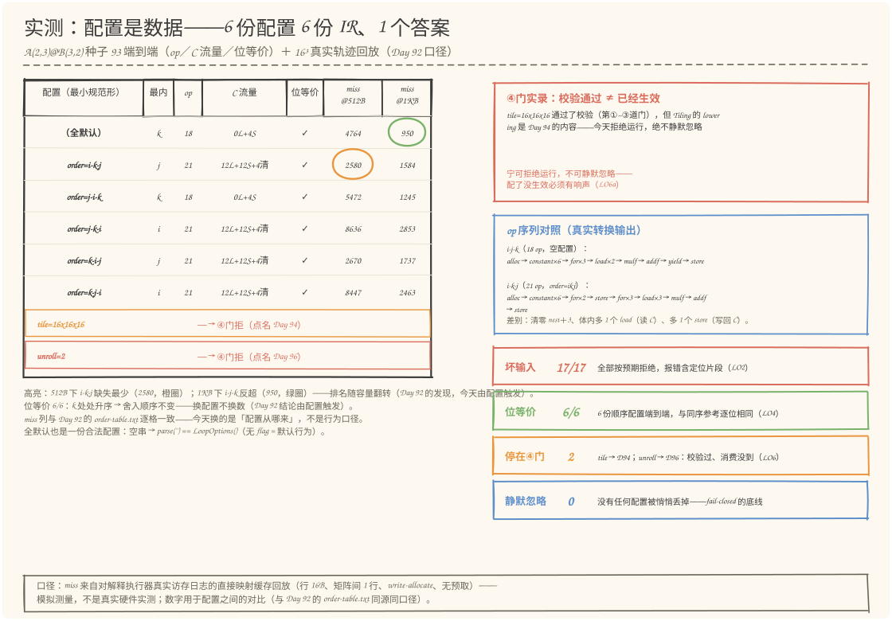

# 第 93 天技术校对报告

审阅对象：`tutorials/week-014/day-093/`（README.md、`code/loop_options.py`、`code/make_images.py`、`code/outputs/` 四份产出、`images/` 四张 SVG）。审阅环境：aarch64 Linux、Python 3.11.4、numpy 1.26.4（与教程声明一致）。核实方式：因当前仓库布局下 import 已断裂（见【错误】1），全部代码在 `/tmp` 的扁平布局（day-090/092/093 同级，即仓库按周重组前的相对位置）复跑——25/25 PASS，4 份 outputs 与仓库冻结产物**逐字节一致**；`--show`、`--battery`、`--preset` 三种交互模式与 §5.4/§5.3 的引文逐行比对；MLIR 论断对照官方 Pass Management 文档与 llvm-project main 的 `PassOptions.h` 源码；4 张 SVG 经 XML 解析与 rsvg-convert 渲染验证，图中数值与 outputs 逐格核对。配图审阅结论：现有 4 图覆盖定位／结构门／校验电池／端到端实测，§3.3 的默认值语义（「未设置 ≠ 显式平凡」＋最小规范形往返）仅靠文字与零散片段表达，属多阶段数据转换类难点，故新增 1 张 `images/05-default-semantics.svg`（图题编为「图 2」，原图 2/3/4 顺延为图 3/4/5，文件名不变）。

## 【错误】

#### 1. 跨目录 import 在当前仓库布局下断裂：README 声称可运行的命令实际无法启动
- **原文**：“python3 loop_options.py                    # 全套检查（LO0~LO6，25 项）”
- **依据**：`loop_options.py:59` 把 `HERE.parent.parent / "day-090" / "code"` 插入 `sys.path`，其中 HERE 是 `tutorials/week-014/day-093/code`，解析结果 `tutorials/week-014/day-090/code` **不存在**——`shape_pass.py` 实际在 `tutorials/week-013/day-090/code/`（Day 93 属第 14 周、Day 90 属第 13 周）；被依赖的 `day-092/code/order_pass.py:48` 插入的是同一条不存在路径，其第 50 行 `import shape_pass` 直接失败。本仓库实测 `cd tutorials/week-014/day-093/code && python3 loop_options.py` 抛 `ModuleNotFoundError: No module named 'shape_pass'`。受影响的还有 §5.1 其余三条命令（`--show`／`--battery`／`--preset`）、§7 必做练习的验证方式（`python3 loop_options.py --show "<配置串>"`）与 §8 验收项「我能独立运行 `python3 loop_options.py` 得到 25 PASS / 0 FAIL」——当前都做不到。根因是 2026-11-24 按周重组仓库（commit 40e66b8，`tutorials/day-0XX` 移入 `tutorials/week-0XX/day-0XX`）后跨周引用未随之更新；Day 92 的技术校对报告已记录同款断裂。在 /tmp 扁平布局下用同版本环境复跑：25/25 PASS，`options-table.txt`／`validate-battery.txt`／`presets-run.txt`／`shape-check.txt` 四份输出与冻结产物 diff 为空——产物本身真实，失效的只是「怎么跑起来」的路径声明（正确相对位置是 `../../week-013/day-090/code/`）。
- **置信度**：高（两种布局均实际运行验证；冻结 outputs 与复跑结果逐字节相同）。

#### 2. §5.4 引用的 `--show`“真实输出”缺 tile_n 一行，与代码实际输出不符
- **原文**：“用 `--show` 做一组对照实验——**同一份语义，只改配置串**（以下全部为本机真实输出）：”
- **依据**：宣称「全部为本机真实输出」的第一段引文（`--show "order=ikj,tile=2x2x3"`）的形状感知校验部分只有 `[ok] tile_m=2` 与 `[ok] tile_k=3` 两行，中间缺了真实的 `  [ok] tile_n=2 整除 N=2：整除场景，Day 94 的首选测试点` 一行（本机复跑与 `outputs/shape-check.txt` 第 4~7 行均确认三条 [ok] 连续出现，且引文无任何省略号标记）；同段还缺首行 `配置串：'order=ikj,tile=2x2x3'` 与 describe() 的末行 `  最小规范形：order=i-k-j,tile=2x2x3`。缺 tile_n 行不是无害节选：`validate_for_shape` 对 tile 是逐三维检查的（M/N/K 各一条 finding），删掉中间一行会让读者误以为 N 维不在形状门视野内——而 N 维恰是本日口径里出 warn 的常见维度（练习 (d) 的 `tile=2x2x2` 若换 3×3 例即落在 tile_n 上）。第二段引文（`--show "tile=1x1x1"`）同样省略了 describe()/形状校验全部中段输出且无省略标记，但所示各行本身逐字属实。
- **置信度**：高（复跑输出与冻结产物逐行比对）。

#### 3. MLIR 没有 `--pass-options` 这个旗子；Pass 声明选项的 API 也不是 `OptionValue`
- **原文**：“真实编译器里这是标准形态：LLVM 的 `-O2`、GCC 的 `-march=`、MLIR 的 `--pass-options='...'`（每个 Pass 用 `OptionValue` 声明自己的旗子，`mlir-opt` 负责解析与拒绝未知旗子）——**优化选择是配置数据，不是写死在代码里的常量**。今天我们在自己的仿真工程里做同构的最小版本。”
- **依据**：MLIR 官方 Pass Management 文档（mlir.llvm.org/docs/PassManagement/）全文没有 `--pass-options` 旗子（文档中 "pass-options" 仅作为章节锚点出现）；给 pass 传选项的两种真实写法是文本管线 `-pass-pipeline='anchor(...pass{key=value})'` 和对单个已注册 pass 的旗子，文档示例原文为 `mlir-opt foo.mlir -convert-func-to-llvm='use-bare-ptr-memref-call-conv=1'`。选项声明的用户 API 是 `Option<>`／`ListOption<>`（文档 "Instance Specific Pass Options" 节：`Option<int> exampleOption{*this, "flag-name", llvm::cl::desc("...")}`）；`OptionValue` 只是底层值存储类（llvm-project main 的 `mlir/include/mlir/Pass/PassOptions.h` 里有 `GenericOptionValue` 与 `OptionValue<OpPassManager>` 特化，用于打印/拷贝），不是「声明旗子」的接口。§3.2 的“`mlir-opt` 解析 `--pass-options` 与 Pass 构造用同一套 `OptionValue` 校验”是同一失实的第二次出现。论断精神没错——文档确有 "These options are parsed at pass construction time independently for each instance of the pass"（两入口共用一套校验的类比成立），未知 pass 名与未知选项也会在管线解析处报错——但照抄 `--pass-options` 会被 mlir-opt 当场拒绝，与本日 fail-closed 主题形成反讽。
- **置信度**：高（已对照当前官方文档与 main 分支 PassOptions.h 源码）。不确定点：未逐一排查 MLIR 历史版本是否曾存在同名旗子，但教程未标注版本口径，按现行文档核对即应更正。

## 【存疑】

#### 1. “可变默认值会在多个实例间共享”对 dataclass 字段不成立：自 3.7 起类定义时即被拒绝
- **原文**：“三个默认值合起来是同一句话：**「什么都不做」**。这是默认值的第一设计原则——空配置跑出来的行为必须与 Day 89~92 完全一致（LO4c 用 op 序列逐项验证过）。第二原则是**字段类型全部不可变**（`tuple`／`None`／`int`）：Python 的可变默认值（如空列表）会 notorious 地在多个实例间共享，配置对象绝不能踩这个坑。”
- **依据**：该句的语境是为 `@dataclass(frozen=True)` 选字段类型。普通函数／方法的默认值确实会跨调用共享；但 Python 3.7 起 dataclass 对不可哈希默认值在**类定义时**就抛 `ValueError: mutable default <class 'list'> for field x is not allowed: use default_factory`（本机 3.11.4 实测：`@dataclass class A: x: list = []` 直接 ValueError）。即在教程声明的环境里，`tile: list = []` 这一行根本无法完成类定义，“在多个实例间共享”的失败模式在 dataclass 字段上不会发生。字段全用不可变类型仍是正确实践（值语义、可哈希、与 frozen 配合、避免 default_factory 陷阱），但论据用错了场景，初学者照句意推展会得出错误的心智模型。建议改为“函数默认值会 notorious 地共享；dataclass 虽然直接拒绝可变默认值，但字段不可变还保证配置可哈希、可 `==` 比较、与 frozen 语义自洽”。
- **置信度**：高（实测复现；CPython dataclasses 该行为自 3.7 长期稳定）。归入存疑而非错误：句子字面说的是「Python 的可变默认值」（函数语境为真），只是在本教程 dataclass 语境下推转会误导。

## 【建议】

#### 1. `parse('')` 与 `LoopOptions()`“是同一个对象”应改为“相等”：== 成立、is 不成立
- **原文**：“它要满足**往返性质**：`parse(to_config_string(o)) == o`（LO1c 验证）。这就是真实编译器"无 flag = 默认行为"的形式化：空配置串 `parse('')` 与 `LoopOptions()` 是同一个对象。而 `describe()` 是给**人**看的台账——编译器开跑前打印自己的配置，每个字段标注（默认值）或（显式设置）：审计时能分清"用户要的"和"程序默认的"。”
- **依据**：实测 `LoopOptions.parse('') is LoopOptions()` 为 **False**（`parse` 末行 `return cls()` 每次新建实例），`==` 为 True（dataclass 按字段值比较）；LO3b 验证的也是 `==`。“同一个对象”是可证伪的身份断言，而本日 §3.1/LO3c 恰在教“值相同 ≠ 是同一个东西”（None vs (1,1,1)），同一篇里两处口径打架。教学结论（无 flag = 默认行为）不受影响，建议改为“是两份相等（==）的配置”。
- **置信度**：高（实测）。

#### 2. 17 个坏输入的“6/5/6”三门分组与本教程自己的门定义不一致
- **原文**：“**图 4**：左列是 17 个坏输入的真实归宿，按三组着色——类型门 6 例（序列／float／bool／分量数……）、取值门 5 例（未知变量／重复／非正……）、解析层 6 例（未知键／键重复／缺 `=`／坏值）；右列是"好输入各有归宿"：全默认、显式平凡、平凡块放行、动态跳过。这张图想说明的不是"17 这个数字"，而是**每一类坏输入都有专门为它设计的报错**——报错文本里带定位片段（哪个分量、合法值是什么、拿到的是什么），而不是一句"不是排列"。”
- **依据**：按本教程自己的分类（§3.2 表格“②取值门：`order` 不是 3 个不同合法变量”；`options-table.txt`“②取值门（长度 3、正数）”），“长度／分量数”检查属②取值门。照此口径 17 例应为：类型门 4（`order=42`、`tile=(1.5,2,2)`、`tile=(True,2,2)`、`unroll='x'`）、取值门 7（`order='ikm'`、`order='iij'`、`order=('i','j')`、`tile=(0,2,2)`、`tile=(2,-1,2)`、`tile=(2,2)`、`unroll=0`）、解析层 6。图 4 图注（顺延后编号）与 LO2 检查说明（`loop_options.py:502`，同样冻结在运行口径里）把 `order=('i','j')`、`tile=(2,2)` 两个分量数案例记入类型门，得“6/5”，与自家门分类矛盾；总数 17 与“全部被 OptionsValidationError 拒绝”的行为结论不受影响，属归类标注问题。
- **置信度**：高（§3.2 表格、options-table.txt 与 17 例报错文本三方对照）。

#### 3. §5.3 第 4 条“真实报错”被截短且无省略标记
- **原文**：“✗ 拒绝：parse('order=ikj,order=kij')：同一键两次  →  以哪个为准？拒绝猜测”
- **依据**：`validate-battery.txt` 第 18 行完整报错为 `配置项「order」出现两次：'ikj' 和 'kij'——以哪个为准？拒绝猜测`，引文删掉了前半句——恰好是“哪个键、两个值各是什么”的定位片段，而“报错含定位片段”正是该节强调的卖点（同段前 3 条引文均逐字完整）。建议补全或加“……”。
- **置信度**：高（与冻结产物逐字比对）。

#### 4. §5.1 目录树漏列 `code/make_images.py`，“唯一新文件”与目录实际不符
- **原文**：“今天的目录结构（`loop_options.py` 是唯一新文件，其余是引用与产出）：”
- **依据**：`day-093/code/` 实际含 `make_images.py`（510 行，与 day-092 的 566 行版本不同，是本日为生成 4 张 SVG 重写的脚本），§5.1 目录树未列出，且“唯一新文件”会让读者以为 `images/` 与代码无关。顺带核实：`make_images.py:25-26` 与 `loop_options.py` 一样把 `day-090/code` 解析到 week-014 之下，在当前布局同样无法运行（见【错误】1）。
- **置信度**：高（目录清单与两文件 diff 直接核对）。

#### 5. `04-presets-results.svg`（现图 5）内的 op 差别分解不守恒：三项相加得 +5，与真实差 +3 对不上
- **原文**：“”
- **依据**：`images/04-presets-results.svg` 的“op 序列对照”区末行写着“差别：清零 nest＋3、体内多 1 个 load（读 C）、多 1 个 store（写回 C）”。对照 `presets-run.txt` 的真实序列：i-j-k 体内为 for×3＋load×2＋mulf＋addf＋yield＋store（9 op），i-k-j 体内为 for×3＋load×3＋mulf＋addf＋store（9 op）——**体内 store 数不变（各 1 个）**，真实差别是 +1 load（读 C）与 −1 yield（iter_args 累加器随 k 内层消失），再加清零 nest（for×2＋store×1，+3）合计 21−18=+3；图中“多 1 个 store（写回 C）”把清零 store（已计入 nest＋3）重复计数，照图相加得 +5。改用动态口径也解释不通（RMW 的写回 store 每趟一次，不止“多 1 个”）。README 正文未做该分解（只说 18／21），属图内技术标注失实；正确写法是“清零 nest +3（for×2＋store）；体内 +1 load（读 C）、−1 yield（iter_args 没了）；store 数不变”。
- **置信度**：高（对 presets-run.txt 两条 op 序列逐项清点）。
