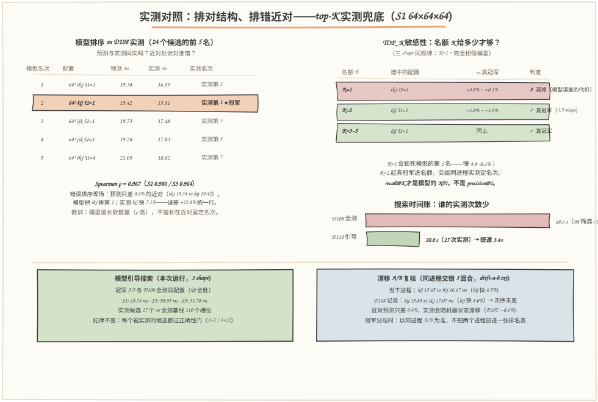

# 第 110 天技术校对报告

> 校对范围：README.md、code/（cost_model.py / tune_guided.py / kernel_gen.py / bench.py / run_all.sh）、outputs/ 全部 13 个文件、images/ 下 3 张 SVG，并对照 D106~D109 的冻结产物与教程原文。校对环境与教程同机同版本（CPython 3.11.4，Linux aarch64，32 逻辑核）；所有可复现实验均在临时目录或只读方式运行，未改动仓库冻结产物。输入血统（results-d108.jsonl / probes-d109.json 的 sha256）、kernel_gen.py / bench.py 与 D108 的逐字节复制关系均已验证属实。

## 【错误】

#### 1. predict_ms 对最内层循环机器成本重复计价，3.4 节把系统性高估归因于"自适应特化"与可复现证据不符
- **原文**："- **系统性高估**：误差（预测−实测）/实测 中位数 +9.9%~+13.4%，几乎全为正——探针量的是"独唱"的语句，内核里的语句在热循环上下文中被自适应特化得略快；分家族看，j 内层 U=1 家族高估最多（均值 +18.4%），k 内层 U=1 最少（+10.3%）；"
- **依据**：逐项核实如下（全部可在本机复现）：
  1. 语句行单价来自 `_slope_ns(f, 1024)`：探针内层是 `for v in range(rhi): rowC[v] += a * rowB[v]`，最小二乘斜率按"每个内层迭代"计价，因此 j0=60.2 ns/行**已包含**该层 FOR_ITER/STORE_FAST/JUMP 循环机器成本（loop 单价 6.7 ns 正是同款机器的斜率）。而 count_ops 的 `c.loop = … + c.it_main + c.it_tail` 把最内层循环的迭代数也计入，`predict_ms` 又按 6.7 ns/次收一遍——对 64³ kij U=1（it_main=262,144，与 j0 行数相同），机器成本被计了两次，约 262,144 × 6.7 ≈ 1.76 ms，占预测 19.42 ms 的 9%。
  2. 源码内证：cost_model.py 里机器行探针全部显式扣掉了循环机器——`_per_exec_ns` 注释"每次执行价 = t/(n·96) − 纯循环机器价"，range2/range3 的计算也是 `t/n − c.loop`；唯独 11 种语句行单价（`_slope_ns`）没有做同样的扣除。同一文件两种口径，语句行的口径与 loop 项重叠。
  3. 直接实验：把内核 j0 语句替换为 `pass` 后实测（同结构、同 3 参 range），内核内 j0 语句净成本 ≈ 52.3 ns/行，与 60.2 − 6.7 = 53.5 吻合，而不是 60.2——探针斜率确实含机器。
  4. 用冻结 calibration.json 单价对 D108 全部 96 个正确候选复算：把语句行单价统一减去 loop（循环机器只在 cnt.loop 计一次），三 shape 误差中位数从 +13.4 / +11.7 / +9.9% 降到 +4.4 / +2.4 / +1.0%，"j 内层 U=1 高估最多"的家族模式基本消失（S1：j U=1 +18.4→+7.8，j U=4 +11.4→+2.3，k U=1 +13.2→+3.1）。也就是说，可复现的记账重复解释了大部分系统性高估和几乎全部"U=1 家族最惨"的家族模式（U=1 时每条语句恰好摊一次机器、U=4 时只摊 1/4 次，比值正好是观察到的家族梯度）；把它归因于"内核语句被自适应特化得略快"缺乏依据，3.1 节"这就是模型误差的来源"同理。
  5. 影响范围：复算表明该修正不改变模型 top-5、真冠军名次（三 shape 仍在模型第 2 名）与 ρ（0.967 / 0.981 / 0.964），recall@K 的全部结论稳健；受影响的是误差量级本身和 3.4 节的归因叙事。
- **置信度**：高（重复计价、字节码口径、数值复算均可独立复现；残余 +1~+4% 中不排除自适应特化与见【存疑】2 的 LOAD_DEREF 差异等次要因素，但它们不是主因）。

#### 2. "k 内层 U=1 最少（+10.3%）"与 accuracy.txt 不符
- **原文**："- **系统性高估**：误差（预测−实测）/实测 中位数 +9.9%~+13.4%，几乎全为正——探针量的是"独唱"的语句，内核里的语句在热循环上下文中被自适应特化得略快；分家族看，j 内层 U=1 家族高估最多（均值 +18.4%），k 内层 U=1 最少（+10.3%）；"
- **依据**：accuracy.txt 的分家族表：k 内层 U=1 三 shape 均值为 +13.2 / +11.9 / +8.2（S1/S2/S3），按 n 加权汇总 ≈ +10.8，三个均值的平均 ≈ +11.1——没有任何口径能得出 +10.3%。且"最少"不成立：按汇总值，最小是 k 内层 U=4（≈ +8.3）与 i 内层 U=4（≈ +9.2），k 内层 U=1（≈ +10.8）排第三；按 S1 单列，k U=4（+10.1）与 i U=4（+10.9）也都低于 k U=1（+13.2）。同句的 +18.4%（j U=1，S1）与 accuracy.txt 一致，仅此一半成立。
- **置信度**：高（数字直接复算自冻结 accuracy.txt）。

#### 3. 错误 ④ 的近对数值 kij/ikj 标反，与本段"定位"及冻结输出矛盾
- **原文**："现象：引导搜索（本进程）量出 ikj 15.70 / kij 16.59，D108 记录里 kij 15.80 / ikj 17.07——同协议同门，两个进程对近对的结论相反，直接同表比较会得出"模型把冠军排错了"或"内核变慢了"的错误结论。原因：跨进程环境漂移 ~8.6%（D107 实测），而近对实测差只有 6~8%——漂移幅度大于被测差异。定位：drift-a-b.txt 的同进程交错 A/B（3 回合 × 3+21）：当下进程 kij 快 6.5%，次序与 D108 记录一致 → 判定"次序未变"；若翻转，判定"环境漂移，非模型误差、非内核变化"。修复：**冠军分歧时以同进程交错 A/B 为准**；跨进程对比只能当参考，且必须在报告里标注（guided-search.txt 的冠军一致性行自带这条提示）。"
- **依据**：guided-search.txt（同一次 12:32 运行）的实测记录是 **kij=15.70 / ikj=16.59**（"实测（3+7 过门）：64³ kij U=1=15.70 64³ ikj U=1=16.59"），drift-a-b.txt 也判定"当下更快：kij……次序未变"。原文写成"ikj 15.70 / kij 16.59"恰好把两个数对调；按冻结输出的正确读数，本进程与 D108（kij 15.80 快）结论**相同**，"两个进程对近对的结论相反"对这组数字不成立。同段"定位"又说当下进程 kij 快 6.5%（次序与 D108 一致），与"现象"自相矛盾。"结论相反"的场景在 12:22 的第一轮复现确实发生过（错误 ② 记录 0/3 一致），但本段引用的数值取自 12:32 的正式运行且两个标签写反。
- **置信度**：高。

#### 4. 图 2（02-mechanism.svg）把内核语句的下标写错（v1/v2/v3 混用）
- **原文**："1. **数行（count_ops）**：候选配置 (64,64,64, kij, U=1) 展开成四层结构——tile 外壳（单 tile，min3 行 ×1）、v1 行提升（k 循环体，`Bv = B[v1]` 执行 64 次）、v2 行提升（`Ci = C[v2]; a = A[v2][v1]` 执行 4,096 次）、v3 主循环（j 内层语句 262,144 行）。每一行归入 16 类之一，计数单位与校准单位严格相同；"
- **依据**：kernel_gen.py 对 kij 实际生成的 v2 行提升是 `Ci = C[v2]; a = A[v2][v1]`、v3 主循环语句是 `Ci[v3] += a * Bv[v3]`（make_kernel 的 src 可直接打印验证，正文这一句也写得正确）；但 02-mechanism.svg 第 20 行把 v2 行写成"内层行 Ci=C[v1]; a=A[v1][v1]"、第 25 行把主循环语句写成"Ci[v1] += a*Bv[v1]（j 内层）"——下标与正文、内核源码均不一致。计数与数值不受影响，但该图声称"逐行镜像 kernel_gen 的生成规则"，展示的镜像源码本身错了。
- **置信度**：高。

#### 5. extrapolation.txt 与图 1 的"校准 0.2 s"与实测校准墙钟 1996 ms 矛盾（10 倍）
- **原文**："校准（一次 ~2 s，16 根单价落盘共享）→ 静态排序（28 µs/候选，零内核执行）"
- **依据**：README 正文一致且正确（§2 "~2 s"、§5.3 摘录"校准墙钟：1996 ms"、guided-search.txt"一次性成本（~2 s）"）；calibration.json 的 wall_ms=1996.4。但被正文引用的 outputs/extrapolation.txt 第 13 行写"模型引导 ≈ 校准 0.2 s + 分析 0.4 s + 实测 15 s ≈ 15 s 量级"，01-overview.svg 第 71 行同样写"（校准 0.2 + 分析 0.4 + 实测 15 s）"——与同图第 69 行自己的"校准 ~2 s"及全部冻结记录矛盾，差 10 倍。结论（~15 s 量级）不受影响（按 2 s 计约 17.4 s），但读者按正文去核对文件会看到两套数字。笔误来源可定位：tune_guided.py 模块 docstring"校准（一次，~0.2 s）"与 exp_extrap 中硬编码的 0.2 s。
- **置信度**：高。

#### 6. "另有 7 个 it_*/inner0_* 校验字段"计数错误（实际 9 个）
- **原文**："（源文件里另有 7 个 `it_*`/`inner0_*` 校验字段，专供 settrace 对账，不进预测。）"
- **依据**：cost_model.OpCounts 中不进预测的校验字段是 it_i0 / it_j0 / it_k0 / it_v1 / it_v2 / it_main / it_tail（7 个 it_*）**加** inner0_main / inner0_tail（2 个），共 9 个；"7 个"只能匹配 it_* 子集，与"it_*/inner0_*"的写法矛盾。
- **置信度**：高（直接数源码字段；属轻微错误）。

#### 7. "D108 第四节外推过……96³ 口径要 3.1 小时"归属不实
- **原文**："D108 收官时留下了一笔不舒服的账：三个 shape 全测（98 个筛选槽＋12 个决赛），Σwall 共 **68.6 s**；D108 第四节外推过，把同样的协议搬到 D106 的全空间（**12,970 个候选**），96³ 口径要 **3.1 小时**，512³ 口径要 **13 天**。测量是理解候选最诚实的方式，但也是最贵的：每个候选都要真跑预热＋重复计时＋过正确性门，而搜索空间随 tile × 顺序 × 展开乘法式膨胀——真实编译器（TVM Ansor、Triton autotune、Ascend 的算子调优）面对的都是几千到几十万个候选。**全测验证了"测完能找到冠军"，工程上等不起"测完"。**"
- **依据**：D108 的 outputs/search-cost.txt 第四节只有 512³ 口径的外推（"≈ 12,970×11×7.8 s ≈ 13 天"），D108 的 README 与全部输出中均无"3.1 小时"字样；该数字是 D110 当天在 extrapolation.txt 里用 D108 的 S2 平均 wall 新算的（12,970 × 0.86 s ≈ 3.1 小时）。数字本身成立（已复算），但把它说成"D108 第四节外推过"是引用来源错误——按此表述去 D108 查证会落空。
- **置信度**：高。

#### 8. 图 3 注"实测差 7.1%"无法从任何输出推导
- **原文**："**图 3**：四个区块回答四个问题——**左上**"排得对不对"：模型前 5 名里预测与实测大体同向（ρ = 0.967），但近对处模型把 ikj 排在 kij 前面（预测只差 0.4%，实测差 7.1%）——**模型擅长砍数量，不擅长在近对里定名次**；**右上**"名额给多少"：TOP_K 扫描显示 K=1（完全相信模型）慢 4.8~8.1%，K=2 起真冠军全部进名额——recall@K 才是模型的 KPI；**右中**"省了多少"：20.0 s vs 68.6 s 的实测账（27 次 vs 110 个槽位）；**底部**"冠军一致性与漂移边界"：3/3 冠军同配置，且漂移 A/B（同进程交错 3 回合）显示 kij 在当下进程快 6.5%、D108 记录里快 8.0%——次序未变，但如果哪天翻转了，那是环境漂移不是模型误差，以同进程 A/B 为准。"
- **依据**：用 outputs 里的各对读数算 ikj/kij 实测差：D108 筛选中位数（model-table S1，即图 3 表格里自己展示的 16.99/15.81）→ +7.46%（以 kij 为基准）或 6.95%（以 ikj 为基准）；D108 决赛 17.07/15.80 → +8.04%；guided 筛选 16.59/15.70 → +5.67%；drift-a-b 中位 16.67/15.65 → +6.52%。没有任何口径得到 7.1%；03-results.svg 第 41 行同样写"kij 快 7.1%"。3.4 节正文用"实测差 7~8%"的写法反而能覆盖 7.46/8.04。数值偏差只有 0.3~0.4 个百分点，但按本仓库"数字全部出自 outputs/"的纪律应当可溯源。
- **置信度**：高（对"无法溯源"而言；建议改为 7.5%（D108 筛选、以 kij 为基准）或 8.0%（决赛口径））。

## 【存疑】

#### 1. "指令……静态看不见"过于绝对
- **原文**："为什么不用更"标准"的单位？**FLOP 不行**：所有候选的名义计算量都是 2MNK，人人一样，排序信息为零。**指令不行**：指令是解释器把源码编译成字节码之后的产物，静态看不见；就算看见了，解释执行的时间也不由指令数决定（还有分发循环、栈操作、内联缓存命中与否）。**源码行恰好是 CPython 的天然粒度**：`sys.settrace` 的 line 事件就是逐行计数器（今天的真值校验正是用它），一行是计数的单位、校准的单位、也是预测的单位——**三个环节必须同单位，否则对不上账**。"
- **依据**：字节码并非"静态看不见"：本教程自己的 kernel_gen.make_kernel 就是先 `compile(src, …, "exec")` 再 exec；对生成的内核源码 compile() + dis.dis 无需执行内核即可逐条数指令（本机已验证可行）。该论据的后半句（解释执行时间不由指令数决定，还有分发循环/栈操作/内联缓存）成立，也是放弃"指令"单位的真正理由；前半句作为独立论据与事实不符。若要保留因果链，应改说"指令要编译后才能数（成本虽低但多一步），且数出来也定不了时间"。
- **置信度**：高（对"静态看不见"为假）；整句定级为存疑（结论正确、论据过于绝对）。

#### 2. "探针一律用函数局部变量"与实际字节码不符（实为闭包变量 LOAD_DEREF），且 D109 "~20%" 口径未在本机复现
- **原文**："现象：校准出的 j0 单价比 D109 探针的口径贵 ~20%，且每次运行波动大。原因：探针写成了模块级函数，语句里的变量是全局变量，走的是 LOAD_GLOBAL 字节码（比 LOAD_FAST 贵），量出来的不是"内核语句"的单价而是"全局语句"的单价。定位：把探针语句和内核 v3 主循环并排比对字节码（`dis`），发现 LOAD_GLOBAL vs LOAD_FAST。修复：探针一律用函数局部变量＋真实 float 列表（calibrate 的镜像纪律 ①）。这继承自 D109 探针 A 的教训——**校准数据必须长成被测代码的样子**。"
- **依据**：对 cost_model.py 实际代码做 code-object 检查：f_j0 的 co_freevars = ('a','rowB','rowC')，语句中三个操作数全部是 **LOAD_DEREF**（calibrate 的局部变量被嵌套探针捕获为闭包单元）；而内核 v3 主循环语句的 Ci/a/Bv/v3 全部是 **LOAD_FAST**（对 make_kernel 生成代码 dis 验证）。本机实测同一语句三种口径：全局 60.8 / 闭包 60.0 / 局部 57.7 ns/行——"镜像纪律 ①"确实避免了 LOAD_GLOBAL，但没有达到 LOAD_FAST，约 2~3 ns（~4%）的加价进入了全部 11 种语句行单价，与"自适应特化"一起构成 3.4 节的系统性高估（前者可修、后者不可）。另外 CPython 3.11 的 LOAD_GLOBAL 带内联缓存，本机量得全局 vs 局部差约 5%，与文中引用的 D109 教训"~20%"量级不同——D109 探针 A 的原始口径未在本批复测，该历史数字存疑。
- **置信度**：高（字节码事实与 2~3 ns 差值均实测）；中（D109 "~20%" 是否适用于本语句形态）。

## 【建议】

#### 1. §8 "11 份输出"与 §5.1/前言的"13 个文件"不一致
- **原文**："- [ ] 我能独立运行 `./run_all.sh`，并指出 11 份输出里哪份是计数器真值校验、哪份是模型精度账、哪份是搜索时间对比；"
- **依据**：outputs/ 实际 13 个文件（10 份实验记录 + calibration.json + guided-results.jsonl + run-all-log.txt），前言与 §5.1 文件树都写 13；验收清单写"11 份输出"会让读者对不上账。另注：run-all-log.txt 末行是旧文案"完成：outputs/ 下 11 份真实运行记录"，与当前 run_all.sh 输出的"13 个文件"不一致（日志冻结自旧版脚本文案），可在修订时一并说明，避免读者误以为少跑了两个实验。

#### 2. "数据集 ≤ 80 KB"按指针骨架计，实际驻留约 4 倍
- **原文**："2. **数据集 ≤ 80 KB**：内核真实工作集就这么大——探针每个双下标堆的指针骨架正好 80 KB（100×100×8 B），与内核 S2 单矩阵的 ~73 KB（96×96×8 B）同量级，数据留在 L2 里；数据集一大，量进来的是 cache miss，不是语句本身；"
- **依据**：100×100 探针堆的指针骨架确为 80,000 B（正文已注明口径，该子句成立）；但每个 float 对象另占 24 B（本机 sys.getsizeof 验证），10,000 个非共享 float 约 240 KB，一个堆的实际驻留约 318 KB（外加行对象头部）；内核 S2 单矩阵同口径约 295 KB。"同量级""数据留在 L2"的结论不变（aarch64 L2 常见 512KB~1MB/核），但条目标题"数据集 ≤ 80 KB"易被读成总足迹，建议把口径写进标题或注明"指针骨架 80 KB＋浮点对象约 240 KB"。

#### 3. 03-results.svg 的 text-anchor="True"/"False" 不是合法枚举值
- **原文**：""
- **依据**：SVG 规范中 text-anchor 只接受 start/middle/end；03-results.svg 有十余处输出 text-anchor="True" 或 "False"（如第 13/15/16/19/21/22/24/26/31/32/34/36 行，gen_images.py 的 text() 把布尔值传给了 anchor 参数）。浏览器按初始值 start 渲染，图能正常显示、不属"图片失效"，但严格校验器会判非法属性值；后续再生图时应改为传字符串。

#### 4. §3.2 的示例行与 kernel_gen 实际生成行不完全一致
- **原文**："- **一行 ≠ 一条语句**：kernel_gen 把成对的行提升写在同一行（`Ci = C[v1]; a = A[v1][v1]`），一次执行、一个单价——计数器和校准探针必须用同样的"行"口径（cost_model.py 的 `f_hsm` 探针就是一行两句的镜像）；"
- **依据**：kernel_gen 实际生成的成对行是 `Ci = C[v1]; Ai = A[v1]`（ikj，hs2）与 `Ci = C[v2]; a = A[v2][v1]`（kij，hsm）、`Ai = A[v2]; c = C[v2][v1]`（jik，hsm）；原文的 `Ci = C[v1]; a = A[v1][v1]` 不对应任何真实生成的行（下标与变量名都对不上）。论点本身（一行两句、一次执行一个单价）不受影响，f_hsm 确实是一行两句的镜像；建议示例直接引用真实行。02-mechanism.svg 第 20 行使用的正是同一个不存在的写法（已列入【错误】4）。
