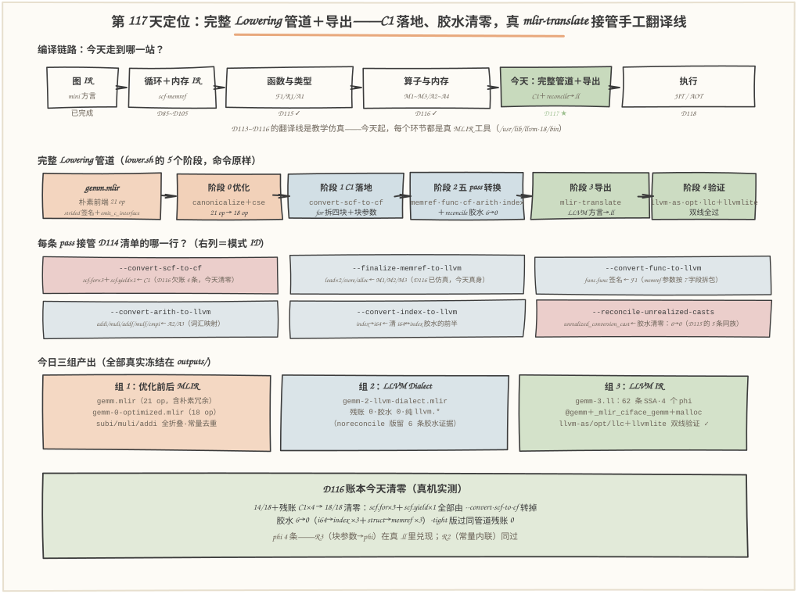
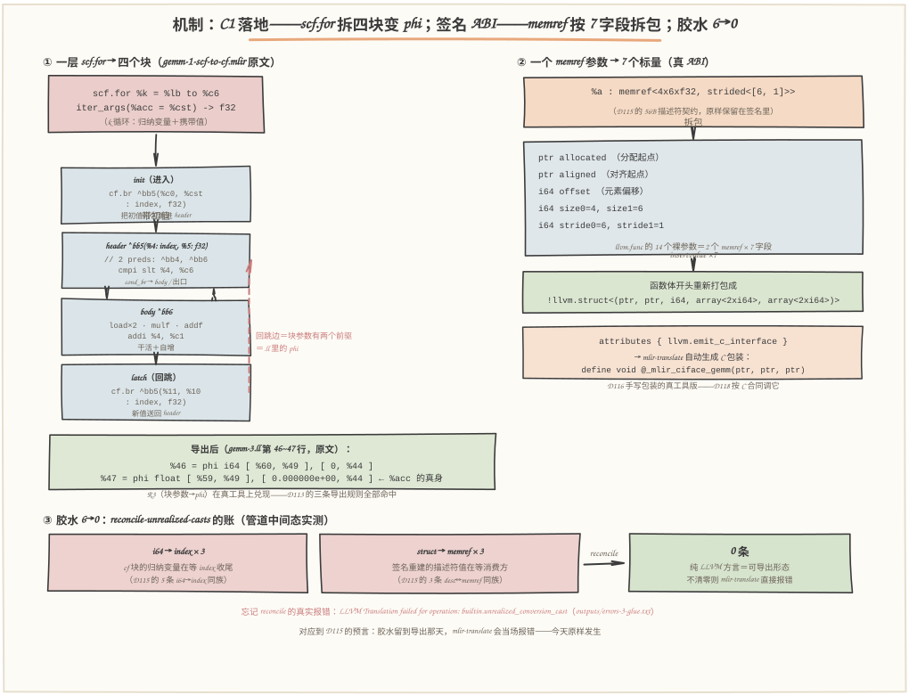
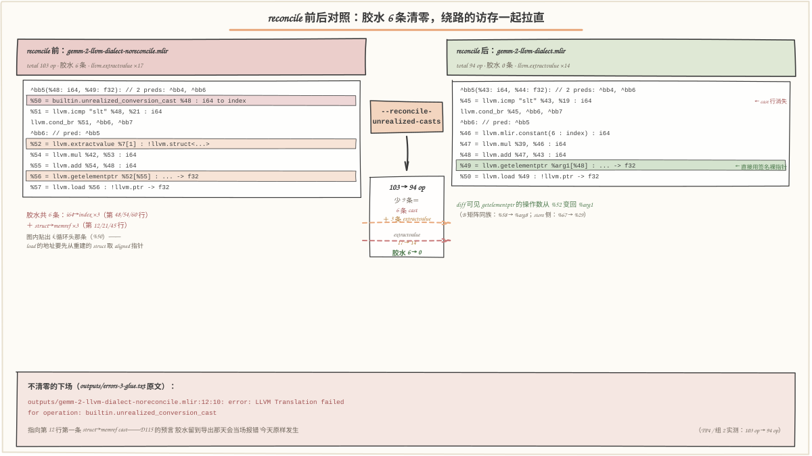
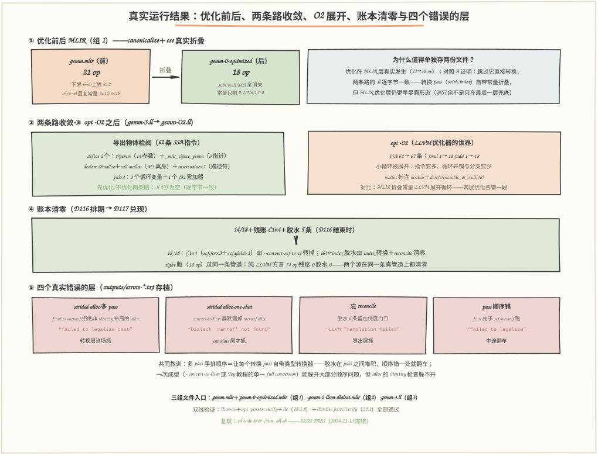

# 第 117 天：导出 LLVM IR——C1 落地、胶水清零，真 mlir-translate 接管手工翻译线

> **今日目标**：完成本教程后，你能做到五件事——用自己的话讲清"从 MLIR 到 LLVM IR 需要哪几条 pass、为什么顺序本身就是合同"（scf→cf 在转换链最前、memref 在 func 前、reconcile 收尾；顺序错的真实报错见 errors-4）；复述完整管道每一站的真实账目（21 op → 优化后 18 → scf 清零 9 块 3 cond_br → 胶水 6 条清零 → .ll 62 条 SSA / 2 个 define / 4 个 phi）；解释 `builtin.unrealized_conversion_cast` 这类胶水的两族来源（i64→index ×3 来自循环归纳变量、struct→memref ×3 来自签名 ABI 重建）以及为什么不清零 mlir-translate 会当场罢工；说出三组产出文件各自的证据价值（优化前后 MLIR 证明 MLIR 层折叠真实发生、LLVM Dialect 证明残账与胶水双清零、LLVM IR 证明 phi/malloc/insertvalue/_mlir_ciface 全部兑现）；复述四个真实踩坑（显式 strided alloc 被拒、one-shot 静默漏掉 memref.alloc、忘 reconcile、pass 顺序错）的现象、原因与修复，并解释 D116 仿真预言的"5 条胶水"与真管道实测"6 条"为什么不同（预言对族类、没对条数——以实测为准）。
>
> **预计时间**：学习 45 分钟＋实践 55 分钟
>
> **前置准备**：一台装有 MLIR/LLVM 工具链的机器（需要 `mlir-opt`、`mlir-translate`、`llvm-as`、`opt`、`llc`）＋ Python 3.11（含 llvmlite，用于跨版本双线验证）。本文所有 `code/outputs/` 冻结自 aarch64 Linux 真机（2026-11-13，Ubuntu LLVM 18.1.8，位于 `/usr/lib/llvm-18/bin`；Python 3.11.4，llvmlite 0.50.0 内嵌 LLVM 22.1.0）。**诚实声明**：D113~D116 的机器上没有 MLIR 工具链，翻译线是教学仿真；今天起每个环节都是真 MLIR 工具——但如果你在 macOS 上复跑，`/usr/lib/llvm-18/bin` 这类路径不存在（需自装 LLVM，如 Homebrew 的 `/opt/homebrew/opt/llvm/bin`）、`llc` 生成的汇编格式、llvmlite 版本都可能不同；pass 链、报错族、账目口径一致，逐字输出以你的机器为准。内容上需要：D115 的兑换表/描述符/胶水（今天真管道把它们全部兑现）、D114 的模式清单（今天每条 pass 接管清单的哪一行）、D116 的算子层模式与三层验证（今天的对照基线）、D113 的 LLVM 方言语法与导出三规则（R2 常量内联、R3 块参数→phi 今天在真工具上兑现）。
>
> **今日产出**：`code/lower.sh`（五阶段完整 Lowering 管道：优化 → C1 落地 → 五 pass 转换 → reconcile → 导出＋验证，每阶段中间文件单独存档）、`code/census.py`（口径对齐 D114~D116 的 op 计数器，胶水单列）、`code/run_all.sh`（一键复现 TP0~TP10，22 PASS / 0 FAIL）、三份源 IR（`gemm.mlir` 21 op 主输入、`gemm_tight.mlir` 18 op 账本回归、`gemm_strided.mlir` 错误实验）、`code/outputs/` 三组冻结文件——组 1 优化前后 MLIR（`gemm-0-optimized.mlir` 等）、组 2 LLVM Dialect（`gemm-2-llvm-dialect.mlir`＋noreconcile 胶水证据版）、组 3 LLVM IR（`gemm-3.ll`/`gemm-3.s`，外加 `gemm-O2.ll` 与 naive-direct 收敛对照、tight 全套、四个 `errors-*.txt` 真实报错存档）＋`outputs/report.txt` 真机报告＋本文 4 张图。

## 1. 今天解决什么问题？

D116 结束时账本上写着：**14/18 已转，残账 C1×4**（scf.for×3＋scf.yield×1，排期今天）；**胶水 8 条**——其中 desc↔memref 的 3 条已被 M1/M2/M3 消费，i64→index 的 5 条留给 C1。当时翻译线还是**教学仿真**：模式注册表与驱动器模仿 MLIR DialectConversion 的行为，导出规则 R1/R2 手工复刻。D116 的结尾预告了今天的三件事：C1 落地、GEMM 账本清零、真 mlir-translate 接管手工翻译线。

今天的任务一句话：**把 GEMM 从"循环＋内存 IR"一路降到"可交给真 LLVM 的 .ll"，中间每一站都留下冻结的物证**。展开成三层：

- **Pass 层**：学习 MLIR→LLVM IR 翻译需要哪些必要 pass——`--canonicalize --cse` 收紧形态，`--convert-scf-to-cf` 落地 C1，`--finalize-memref-to-llvm`／`--convert-func-to-llvm`／`--convert-cf-to-llvm`／`--convert-arith-to-llvm`／`--convert-index-to-llvm` 五连完成方言切换，`--reconcile-unrealized-casts` 清胶水；顺序本身是合同，错一步中途翻车（errors-4）；
- **导出层**：`mlir-translate --mlir-to-llvmir` 把 LLVM 方言变成 .ll，`llvm-as`＋`opt -passes=verify`＋`llc` 三连验证可解析、可校验、可编译——执行留给 D118；
- **证据层**：产出**三组文件**——优化前后 MLIR（21 op→18 op，证明 MLIR 级优化真实发生）、LLVM Dialect（残账 0、胶水 0，证明方言切换彻底）、LLVM IR（62 条 SSA、4 个 phi、malloc/insertvalue 真身、`_mlir_ciface_gemm` 自动包装）——外加 tight 版 18/18 账本回归和四个真实错误的存档。

一个贯穿今天的对比值得先立起来：**教学仿真 vs 真工具**。D116 仿真预言"剩 5 条 i64→index 胶水等 C1"；真管道实测 reconcile 前是 **6 条**——i64→index ×3（循环归纳变量）**＋** struct→memref ×3（签名 ABI 重建出的描述符要 cast 回 memref 类型才能被函数体消费，D115 的 desc↔memref 同族）。预言对族类、没对条数：真管道的签名转换会额外制造一族胶水。今天起，**一切数字以真机实测为准**——这正是从仿真走向真工具的意义。

## 2. 先看全貌：今天的内容位于哪里？



**图 1**：看三块——**上排**把今天放回编译链路：图 IR → 循环＋内存 IR（D85~D105）→ 函数与类型（D115 ✓）→ 算子与内存（D116 ✓）→ **今天：完整管道＋导出**（C1＋reconcile→.ll）→ 执行（D118）；底部注明 D113~D116 的翻译线是教学仿真，今天起每个环节都是真 MLIR 工具。**中排**是管道五个阶段（lower.sh 原样命令）：gemm.mlir 朴素前端 21 op → 阶段 0 优化（21→18）→ 阶段 1 C1 落地 → 阶段 2 五 pass 转换＋reconcile（胶水 6→0）→ 阶段 3 导出 .ll → 阶段 4 llvm-as/opt/llc＋llvmlite 双线验证。**下排**左侧是"每条 pass 接管 D114 清单哪一行"的对照（convert-scf-to-cf←C1、finalize-memref-to-llvm←M1/M2/M3、convert-func-to-llvm←F1、convert-arith-to-llvm←A2/A3、convert-index-to-llvm 清胶水前半、reconcile 清零），右侧是三组产出与账本清零的实测数字（14/18→18/18、胶水 6→0、phi 4 条）。

把今天的工作串成 5 步：

1. **验工具**（TP0）：`which mlir-opt` 为空——PATH 里没有不等于机器上没有，`/usr/lib/llvm-18/bin` 下全套工具真实可用（Ubuntu LLVM 18.1.8）；
2. **记账**（TP1/TP2）：census.py 点名——gemm.mlir 21 op（含三处朴素冗余），`--canonicalize --cse` 后 18 op：下界 6−6、上界 2×2、3+(6−6) 全部折成常量；
3. **落地 C1**（TP3/TP4）：`--convert-scf-to-cf` 把三个 scf.for 拆成 9 个带标签块＋3 条 cf.cond_br，归纳变量/累加器变成块参数（phi 的前身）；五 pass 转完后 reconcile 前**胶水 6 条**、后 **0 条**，非 llvm 残账 0；
4. **导出**（TP5/TP6）：mlir-translate 吐出 gemm-3.ll——62 条 SSA、2 个 define（@gemm＋自动生成的 @_mlir_ciface_gemm，另有 declare @malloc）、4 个 phi；llvm-as/opt/llc 三连通过，llvmlite（LLVM 22.1）跨版本 parse+verify 也通过；
5. **对照与回归**（TP7~TP10）：跳过优化直接转换，两条路的 .ll **逐字节一致**（转换与翻译层自带常量折叠）；opt -O2 之后 SSA 62→67、fmul 1→18（LLVM 展开循环）；tight 版 18 op 过同一条管道，纯 LLVM 方言 74 op、残账 0——D116 排期的 18/18 兑现；四个常见错误全部复现存档。汇总 **22 PASS / 0 FAIL**。

## 3. 核心概念：先用直觉，再给准确定义

今天三个概念一根链条：**pass 链管"谁先谁后"，胶水管"转换边界怎么缝合"，约束收缩管"源 IR 要为管道让多少步"**。

### 3.1 必要 Pass 链：每条 pass 接管一层，顺序本身就是合同

一句通俗解释：**Lowering 不是一条"降级"命令，而是七条各管一层的 pass 按依赖关系排成的流水线**——排错的不是"效率低"，是"中途翻车"。

类比：拆迁旧城盖新楼。先拆家具（scf 循环拆成裸控制流）还是先改门牌（func 签名换 ABI）有讲究：门牌换完，屋里还按旧门牌找路的人（函数体里的循环）就断线了。对应到技术上是今天实测的顺序约束：**`--convert-scf-to-cf` 在转换链最前**（先把结构化循环拆成 cf 块，块参数直接变成后面的 phi 前身）；**`--finalize-memref-to-llvm` 在 `--convert-func-to-llvm` 之前**（memref 类型先换掉，func 转签名时才不需要为它造胶水）；**`--reconcile-unrealized-casts` 收尾**（前面各转换互相制造的 cast 统一清算）。lower.sh 阶段 2 的命令原样：

```bash
"$BIN"/mlir-opt "$OUT/$TAG-0-optimized.mlir" \
  --convert-scf-to-cf \
  --finalize-memref-to-llvm \
  --convert-func-to-llvm \
  --convert-cf-to-llvm \
  --convert-arith-to-llvm \
  --convert-index-to-llvm \
  -o "$OUT/$TAG-2-llvm-dialect-noreconcile.mlir"
```

类比边界：流水线类比暗示"站与站只顺序不同"——对应到技术上是：**有些站不能合并**。`--convert-to-llvm` 这类 one-shot 入口看似等价，实测会把 strided 布局的 `memref.alloc` **静默漏掉**（mlir-opt 不报错、照常写文件），直到 mlir-translate 才炸出 `Dialect 'memref' not found`（errors-2）；而多 pass 管道在 mlir-opt 阶段就大声报 `failed to legalize`（errors-1）。**多 pass 分阶段保存中间文件的价值就在这：每一站的残账都能当场盘点（census.py），错误在发生的站暴露，而不是攒到最后**。

当天实测证据：按正确顺序跑 gemm.mlir，阶段 1 后 scf.* 清零、新块 9 个、cf.cond_br 3 条；五 pass 转完非 llvm 残账 0；把顺序换成"func 先于 scf/memref"，同一个输入在 `%lb = arith.subi %c6, %c6` 一行报 `failed to legalize operation 'builtin.unrealized_conversion_cast'`、note 点名 cast 类型 `(i64) -> index`（errors-4）——func 先转，签名里的 index 先变 i64，循环还等 index，胶水卡在中途没人清。

### 3.2 unrealized_conversion_cast：转换边界的临时胶水，导出前必须清零

一句通俗解释：**两个方言的转换模式没对齐时，MLIR 用 `builtin.unrealized_conversion_cast` 打个临时补丁先接上，把"彻底缝合"欠成一笔债**——reconcile 就是还债的 pass，不还，mlir-translate 当场罢工。

类比：两家公司合并，系统没接通前先用人工搬数据（cast）顶着——每搬一次是一笔"待核销"的账；合并完成日（reconcile）必须把人工通道全部撤掉、系统直连，否则审计（mlir-translate）通不过。对应到技术上是今天的实测账目：五 pass 转完、reconcile **前**，`gemm-2-llvm-dialect-noreconcile.mlir` 里共 **6 条** cast，两族——

```mlir
%8 = builtin.unrealized_conversion_cast %7 : !llvm.struct<(ptr, ptr, i64, array<2 x i64>, array<2 x i64>)> to memref<4x6xf32, strided<[6, 1]>>
...
%43 = builtin.unrealized_conversion_cast %42 : i64 to index
```

**struct→memref ×3**（第 12/21/45 行）：F1 把签名的 memref 参数按 7 字段拆包成裸标量，函数体开头用 7 次 insertvalue 重建成 `!llvm.struct<...>`——但函数体里的 memref.load/store 还认 memref 类型，于是 cast 缝合（D115 的 desc↔memref 同族，只是真管道里描述符的真身是 LLVM struct）；**i64→index ×3**（第 48/54/60 行）：index→i64 转换先动了类型，三个循环头上的归纳变量还是 index 消费者，cast 顶上（D115/D116 预言的 i64→index 族，条数以实测 3 条为准）。reconcile 一跑，6 条全消，连带把绕胶水的间接访问一起拉直：总 op 从 103 降到 94（extractvalue 17→14——load 不再从 cast 后的 struct 里取 aligned 指针，直接用 `%arg1`/`%arg8`）。忘记 reconcile 的真实下场（errors-3）：

```text
outputs/gemm-2-llvm-dialect-noreconcile.mlir:12:10: error: LLVM Translation failed for operation: builtin.unrealized_conversion_cast
```

类比边界：人工搬数据类比里"债是浪费"——对应到技术上是：**cast 不是 bug，是转换框架的正规机制**（渐进式转换必须允许临时类型桥接）；真正的错是"带债导出"。D115 预言过"胶水留到导出那天，mlir-translate 会当场报错"——今天原样发生，报错文件就冻结在 outputs/。

### 3.3 约束收缩：为什么签名可以 strided、alloc 不行

一句通俗解释：**管道对源 IR 有硬约束（显式 strided 布局的 alloc 被拒），与其硬闯，不如把"必须保留的契约"和"可以让步的写法"分开——契约一个不少，写法全面收缩**。

类比：过海关带样品——报关单（函数签名）上写明产地成分（strided 布局契约）没问题，但手提箱里必须装"标准包装"（identity 布局的 alloc）才能过 X 光机；不改报关单，只换包装。对应到技术上是今天的三份输入：`gemm.mlir` 保留 strided 签名（D115 的 ABI 契约原样），alloc/return 用自动布局 `memref<4x3xf32>`——管道全绿；`gemm_strided.mlir` 把 alloc 也写成 `memref<4x3xf32, strided<[3, 1]>>`（strides 数值上就是行主序恒等布局！），`--finalize-memref-to-llvm` 的 alloc 模式不认这个**类型身份**，类型留下、return 处造出 cast、cast 在转换目标里非法：

```text
gemm_strided.mlir:24:5: error: failed to legalize operation 'builtin.unrealized_conversion_cast' that was explicitly marked illegal
```

注意这里的微妙处：strided<[3,1]> 在数值上与默认布局完全等价——但**类型系统看身份，不看数值等价**（与 D116 的"%desc 与字面 struct 是两个类型"同一族问题）。修复不是"把签名也改掉"，而是**约束收缩**：签名（对外契约，D118 的 C 边界要用）保留 strided；alloc/return（内部实现细节）用自动布局。另外两个变体把这条策略补完整：**tight 版**（gemm_tight.mlir，18 op、无冗余、无 emit_c_interface）证明收缩后的源在同一条管道上 18/18 清零、纯 LLVM 方言 74 op——管道对"干净源"同样健壮；**emit_c_interface** 属性保留在 gemm.mlir 上，让 mlir-translate 自动生成 `_mlir_ciface_gemm` 包装（D116 手写包装的真工具版）——D118 按 C 合同调它。

类比边界：海关类比里"换包装"零成本——对应到技术上是：收缩有代价也有边界——strided **签名**能活是因为 F1 拆包时把布局字段（strides 6/1、3/1）原样写进 7 字段描述符，数值语义分毫未动；strided **alloc** 被拒是因为内存管理模式只实现了 identity 一种。约束收缩是"在管道现有能力内最大化保留语义"，不是"语义打折"。

## 4. 图解核心机制



**图 2**：三个机制各占一块——**① C1 落地**：一层 scf.for 变四个块（引用 gemm-1-scf-to-cf.mlir 原文）：init 块把初值打包跳进 header（`cf.br ^bb5(%c0, %cst : index, f32)`）、header 块 `^bb5(%4: index, %5: f32)` 挂两个前驱做比较分叉、body 块干活＋自增、latch 块把新值送回 header；**"回跳边＋块参数有两个前驱"正是 .ll 里 phi 的前身**——导出后（gemm-3.ll 第 48~49 行原文）`%46 = phi i64 [ %60, %49 ], [ 0, %44 ]`、`%47 = phi float [ %59, %49 ], [ 0.000000e+00, %44 ]`——D113 的 R3（块参数→phi）在真工具上兑现。**② 签名 ABI**：一个 memref 参数拆 7 个标量（allocated/aligned 两个指针、offset、sizes×2、strides×2——D115 的 56B 描述符契约原样保留在签名里），llvm.func 于是有 14 个裸参数＝2 memref × 7 字段；函数体开头 7 次 insertvalue 重新打包成 struct；`llvm.emit_c_interface` 让 mlir-translate 自动生成 `define void @_mlir_ciface_gemm(ptr, ptr, ptr)`——D116 手写包装的真工具版。**③ 胶水 6→0**：i64→index ×3（cf 块的归纳变量在等 index 收尾）＋struct→memref ×3（签名重建的描述符在等消费方），reconcile 一次清零；不清零则 mlir-translate 直接报错（errors-3 原文贴在图上）——对应 D115 的预言"胶水留到导出那天会当场报错"，今天原样发生。

## 5. 动手实践

### 5.1 准备文件与环境

三份源 IR＋三个脚本（都在 `code/`）：

- **`gemm.mlir`（38 行，主输入）**：4×6·6×3 GEMM——与 D115/D116 同一算子，strided 签名＋`llvm.emit_c_interface` 保留，alloc/return 用自动布局；故意埋三处朴素冗余：下界 `%lb = arith.subi %c6, %c6`、上界 `%ubM = arith.muli %c2, %c2` 与 `%ubN = arith.addi %c3, %lb`、重复常量 `%c1a/%c1b`——census 口径 **21 op**；
- **`gemm_tight.mlir`（31 行）**：同样的 GEMM，下界/上界直接写常量、无重复常量、无 emit_c_interface——D116 口径 **18 op**，只做账本回归；
- **`gemm_strided.mlir`（26 行）**：alloc 和 return 都写显式 strided——错误实验专用；
- **`lower.sh`**（60 行）：五阶段管道，每阶段中间文件单独存档；**`census.py`**（77 行）：对齐 D114~D116 口径的计数器——func.func 记 1 条、`return`/`br`/`cond_br` 归一成 `func.return`/`cf.br`/`cf.cond_br`、**胶水（unrealized_conversion_cast）单列不计入 op**，输出形如 `path: total N op（胶水 X 条，llvm.* Y，非 llvm 残账 Z）`——三个数字分别是"总量、方言纯度、欠账"，正是 D114~D116 账本的延续；**`run_all.sh`**（195 行）：TP0~TP10 一键复现，报告写进 `outputs/report.txt`。

环境第一个坑（TP0 实测）——PATH 里没有，不等于机器上没有：

```text
  which mlir-opt mlir-translate: (空——不在 PATH)
  /usr/lib/llvm-18/bin/mlir-opt: Ubuntu LLVM version 18.1.8
  /usr/lib/llvm-18/bin/mlir-translate: Ubuntu LLVM version 18.1.8
```

五个工具（mlir-opt/mlir-translate/llvm-as/opt/llc）在 `/usr/lib/llvm-18/bin` 全套可用——lower.sh 里 `BIN=/usr/lib/llvm-18/bin` 就来自这一步盘点。

### 5.2 编写代码：lower.sh 的关键实现

脚本头部的"必要 Pass"清单把每条 pass 与 D114 模式编号的接管关系写成注释（这是全篇的骨架）：

```bash
#   --canonicalize --cse           MLIR 级优化（折叠朴素冗余）
#   --convert-scf-to-cf            C1：scf.for 拆四块（init/header/body/latch）
#   --finalize-memref-to-llvm      M1/M2/M3：读写/分配 -> 描述符字段操作
#   --convert-func-to-llvm         F1：签名 -> llvm.func（memref 按 7 字段展开）
#   --convert-cf-to-llvm           cf.br/cond_br -> llvm.br/cond_br
#   --convert-arith-to-llvm        A2/A3：arith 整数/浮点 -> llvm 指令
#   --convert-index-to-llvm        index -> i64（清 i64<->index 胶水的前半）
#   --reconcile-unrealized-casts  胶水清零（管道中间态实测 6 条）
```

三个设计决定值得注意：

1. **分阶段落盘**：每阶段产物命名 `<tag>-<阶段>.<ext>`（0-optimized / 1-scf-to-cf / 2-llvm-dialect-noreconcile / 2-llvm-dialect / 3.ll / 3.s）——三组产出文件不是"顺便存"，是**验阅证据**：没有 noreconcile 版，胶水 6 条就成了看不见的中间态；
2. **reconcile 单独一步**（阶段 2b）：从 noreconcile 版跑 `--reconcile-unrealized-casts`——与五 pass 合并成一条命令结果相同，拆开是为了让"胶水清算"有独立的两份对照文件；
3. **验证三连但不执行**（阶段 4）：`llvm-as`（可解析）＋`opt -passes=verify`（可通过模块校验）＋`llc -o .s`（可编译到汇编）——编译是今天的天花板，**执行是 D118 的第一件事**，gemm-3.s 就是那时的对照基线（D116 的 ciface-disasm.s 同理）。

错误捕获不在 lower.sh 里（它只跑 happy path），在 run_all.sh 的 TP10：四组故意犯错的命令各自 `2> errors-*.txt` 存档真实报错——常见错误一节的全部素材。

### 5.3 运行与观察：三组文件逐段验阅

`./run_all.sh` 一键全跑（TP0~TP10，22 PASS / 0 FAIL），下面按三组产出验阅关键证据。

**组 1：优化前后 MLIR。** census 点名（TP1）：

```text
gemm.mlir: total 21 op（胶水 0 条，llvm.* 0，非 llvm 残账 20）
    arith.addf       x1
    arith.addi       x1
    arith.constant   x6
    ...
    scf.for          x3
    scf.yield        x1
```

阶段 0 一跑（TP2）：

```text
outputs/gemm-0-optimized.mlir: total 18 op（胶水 0 条，llvm.* 0，非 llvm 残账 17）
  [PASS] 优化后 op 数减少：21 -> 18
  [PASS] 朴素冗余全部折叠：下界 6-6、上界 2x2、3+(6-6) 变成常量
```

subi/muli/addi 三条全消失；打开 gemm-0-optimized.mlir 看，常量只剩 4/0/3/6/1/0.0 六个（`%c2` 随 muli 一起死，折叠出的 `%c4` 补位）——**优化在 MLIR 层真实发生**，不是最后兜底。

**组 2：LLVM Dialect。** 阶段 1（C1 落地）后，k 循环的四块结构（gemm-1-scf-to-cf.mlir 原文）：

```mlir
    cf.br ^bb5(%c0, %cst : index, f32)
  ^bb5(%4: index, %5: f32):  // 2 preds: ^bb4, ^bb6
    %6 = arith.cmpi slt, %4, %c6 : index
    cf.cond_br %6, ^bb6, ^bb7
  ^bb6:  // pred: ^bb5
    %7 = memref.load %arg0[%0, %4] : memref<4x6xf32, strided<[6, 1]>>
    ...
    cf.br ^bb5(%11, %10 : index, f32)
```

report.txt 的判读（TP3/TP4）：

```text
  [PASS] scf.* 清零；新块 9 个、cf.cond_br 3 条
  [PASS] 归纳变量/累加器变成块参数（bb(...): index, f32——phi 的前身）
  reconcile 前胶水 6 条；reconcile 后 0 条（i64->index x3、struct->memref x3）
  [PASS] 胶水清零——reconcile-unrealized-casts 清掉 6 条
  非 llvm.* 残账（不含 module）：0
```

reconcile 前后各跑一次 census.py，能看到清胶水不只是"删 6 条"——连带把绕胶水的间接访问一起拉直了：

```text
outputs/gemm-2-llvm-dialect-noreconcile.mlir: total 103 op（胶水 6 条，llvm.* 97，非 llvm 残账 0）
    llvm.extractvalue x17
outputs/gemm-2-llvm-dialect.mlir: total 94 op（胶水 0 条，llvm.* 94，非 llvm 残账 0）
    llvm.extractvalue x14
```

103−94＝9：6 条 cast 加 3 条 extractvalue——reconcile 前，内层 load 要先从 cast 重建的 struct 里 `extractvalue [1]` 取 aligned 指针再算地址；reconcile 后直接用签名里的裸指针 `%arg1`/`%arg8`（diff 两份文件可见 getelementptr 的操作数从 `%52` 变回 `%arg1`）。**胶水的代价不止是"多 6 个 op"，还有每个下游使用者都跟着绕路**。不用 diff、直接并排看同一段 k 循环头：



**图 3**：左右各贴一段原文（左 `gemm-2-llvm-dialect-noreconcile.mlir`、右 `gemm-2-llvm-dialect.mlir` 的 ^bb5/^bb6）——**左**（reconcile 前）循环头第一行就是 `%50 = builtin.unrealized_conversion_cast %48 : i64 to index`，load 算地址要先 `extractvalue %7[1]` 从重建的描述符 struct 取 aligned 指针再 getelementptr；**右**（reconcile 后）cast 行整行消失，getelementptr 直接落在签名裸指针 `%arg1` 上（B 矩阵同族 `%58`→`%arg8`、store 侧 `%67`→`%29`）。中间一列是这条 pass 的账目变化：103→94 op（少 9 条＝6 条 cast＋3 条 extractvalue）、extractvalue 17→14、胶水 6→0；底部贴 errors-3 原文——不清零，mlir-translate 卡在第 12 行第一条 struct→memref cast 上。

**组 3：LLVM IR。** gemm-3.ll 的三处必看——malloc 的真身（第 21 行，12 个 f32＝48B）：

```llvm
  %29 = call ptr @malloc(i64 ptrtoint (ptr getelementptr (float, ptr null, i32 12) to i64))
```

k 循环头上的 phi 对（第 48~49 行——R3 兑现，`%47` 就是 scf.for 的 `iter_args(%acc)` 的真身）：

```llvm
45:                                               ; preds = %49, %44
  %46 = phi i64 [ %60, %49 ], [ 0, %44 ]
  %47 = phi float [ %59, %49 ], [ 0.000000e+00, %44 ]
```

C 包装（第 83 行起，emit_c_interface 的产物）：

```llvm
define void @_mlir_ciface_gemm(ptr %0, ptr %1, ptr %2) {
```

报告汇总（TP5/TP6）：

```text
  gemm-3.ll：SSA 指令 62 条、define 2 个（@gemm + @_mlir_ciface_gemm；另有 declare @malloc）、phi 4 条
  [PASS] llvm-as + opt -passes=verify + llc 全部通过（lower.sh 阶段 4）
  llvmlite(内嵌 LLVM 22.1) parse+verify: OK；函数 ['malloc', 'gemm', '_mlir_ciface_gemm']
  [PASS] 跨版本双线验证：18.1.8 导出的 .ll 被 22.1 接受
```

phi 4 条＝三个循环变量＋一个 f32 累加器；`llvm.mlir.constant` 在方言层有 14 条，.ll 里全部内联成立即数（R2 同过）。跨版本双线是重要的一课：**导出产物的质量标准是"被另一个 LLVM 接受"**，18.1.8 写的文本 22.1.0 校验通过，说明导出走的完全是标准语义。

.ll 之后再往下走一步就是汇编（llc 产物 gemm-3.s，114 行）——三重循环的骨架在标签注释里清晰可见，与 IR 的三层块结构一一对应：

```text
.LBB0_2:                                // =>This Loop Header: Depth=1
                                        //     Child Loop BB0_5 Depth 2
                                        //       Child Loop BB0_7 Depth 3
	cmp	x8, #3
	b.gt	.LBB0_8
```

`Depth=1/2/3` 正是 i/j/k 三层循环；最内层里 `ldr s1`/`ldr s2`/`fmul s1, s1, s2`/`fadd s0, s0, s1` 完成 load-乘-加（累加器一直住在 s0 里，这就是 phi 的物理形态），入口处一条 `bl malloc` 给输出开缓冲区（M3 的最终落地）——**IR 的每一层结构都能在汇编里找到对应物**，这就是"可编译"验证的意义（执行留给 D118）。

**三组之外还有三份对照**（下图把三份对照的证据各归各位）：



**图 4**：四块证据拼图——**① 优化前后 MLIR**（组 1）：gemm.mlir 21 op（下界 6−6、上界 2×2、3+(6−6)、重复常量 %c1a/%c1b）折叠成 gemm-0-optimized 的 18 op，并回答"为什么值得单独存两份文件"——优化在 MLIR 层真实发生，对照 A 证明跳过它直接转换两条路的 .ll 也逐字节一致，但 MLIR 优化层仍更早暴露形态；**② 两条路收敛＋③ opt -O2**：62 条 SSA 指令的导出物检阅（define 2 个、malloc＋insertvalue×7、phi×4）→ O2 后 SSA 62→67、fmul 1→18，malloc 标注 noalias＋dereferenceable_or_null(48)；**④ 账本清零**：D116 结束时 14/18＋残账 C1×4，今天 18/18——tight 版（18 op）过同一条管道纯 LLVM 方言 74 op、残账 0、胶水 0，两个源在真管道上都清零。TP7 的收敛证据——朴素源跳过阶段 0 直接转换，`gemm-naive-direct.ll` 与 `gemm-3.ll` **diff 为空**；有意思的是方言层并不相同（naive-direct 版 97 op、常量 16 条，优化路 94 op、常量 14 条——朴素冗余到方言层还活着），但翻译层 R2 把常量全部内联，两条路的 .ll **逐字节一致**——这正好说明"收敛发生在哪一层"是个可以精确回答的问题：**MLIR 优化层不是唯一的折叠点，但它是唯一能让形态提前变干净的层**；TP8 的 O2 证据——

```text
  SSA 指令 62 -> 67 条；fmul 1 -> 18（循环展开：指令变多、循环开销变少）
  [PASS] O2 展开循环：fmul 1->18
```

实测 gemm-O2.ll：fmul 1→18、fadd 1→18、phi 4→1（内两层 j×k 全展开成直线，只剩最外层 i 循环）、malloc 标注 `noalias`＋`dereferenceable_or_null(48)`——**MLIR 层折叠常量、LLVM 层展开循环，两层优化各管一段**；TP9 的回归证据——tight 版过同一条管道：

```text
outputs/tight-2-llvm-dialect.mlir: total 74 op（胶水 0 条，llvm.* 74，非 llvm 残账 0）
  [PASS] 18/18 清零：C1×4 由 --convert-scf-to-cf 转掉，非 llvm 残账 0
  [PASS] D116 排期给今天的最后一笔（C1 + reconcile）全部兑现
```

### 5.4 修改一个参数再观察

三个低成本实验（每个一条命令，先预测再对答案）：

1. **删掉 reconcile**：把 lower.sh 阶段 2b 的 `--reconcile-unrealized-casts` 去掉，直接对 `-2-llvm-dialect-noreconcile.mlir` 跑 mlir-translate——先笔答"报错在哪一行、报什么"；答案冻结在 `outputs/errors-3-glue.txt`（LLVM Translation failed，指向第 12 行那条 struct→memref cast）；
2. **换 strided alloc**：把 gemm.mlir 的 alloc/return 改成显式 `strided<[3, 1]>`（即 gemm_strided.mlir）重跑——先笔答"管道在哪一站翻车、报错的关键词是什么"；答案在 `outputs/errors-1-strided-multipass.txt`（failed to legalize，位置在 func.return）；
3. **给 .ll 上 O2**：`/usr/lib/llvm-18/bin/opt -O2 -S outputs/gemm-3.ll -o /tmp/o2.ll`——先预测 fmul 数、phi 数、SSA 总数各变成多少；对完答案再问自己：**为什么优化后指令变多反而是好事？**（展开消掉的是循环开销与分支，不是计算本身——gemm-O2.ll 里只剩一个循环）。

## 6. 常见错误与排查

以下四条全部来自今天真机复现（存档于 `outputs/errors-*.txt`），每条有现象、原因、定位和修复。

- **现象**：gemm_strided.mlir 过多 pass 管道，mlir-opt 报 `gemm_strided.mlir:24:5: error: failed to legalize operation 'builtin.unrealized_conversion_cast' that was explicitly marked illegal`，note 显示是一条 `memref<4x3xf32, strided<[3, 1]>>` → `!llvm.struct<...>` 的 cast（存档：`outputs/errors-1-strided-multipass.txt`）。
  **原因**：显式 strided 布局的 `memref.alloc` 不在 `--finalize-memref-to-llvm` 内存管理模式的覆盖范围（只认 identity/自动布局的类型身份）——哪怕 strides 数值上就是行主序恒等；类型活着，func 转换在 return 处造 cast，cast 在转换目标里非法。
  **定位**：报错位置是 func.return；把 alloc 类型改回 `memref<4x3xf32>` 立即消失——锁定是 alloc 的类型身份问题，不是签名。
  **修复**：约束收缩——签名保留 strided（ABI 契约），alloc/return 用自动布局（gemm.mlir 的做法）。教训：**类型相等看身份不看数值等价**——"strides 恰好等于默认布局"救不了"类型写法不同"。

- **现象**：同一个 gemm_strided.mlir 改走 one-shot：`mlir-opt --convert-scf-to-cf --convert-to-llvm` **不报错**、正常写出 .mlir；轮到 `mlir-translate` 才炸：`error: Dialect 'memref' not found for custom op 'memref.alloc'`，note 列出已注册方言（acc, amx, arm_neon, ..., func, gpu, llvm, ...——没有 memref）（存档：`outputs/errors-2-strided-oneshot.txt`，漏转的中间文件 `errors-2-strided-oneshot.mlir` 一并冻结）。
  **原因**：one-shot 入口没把 strided 的 memref.alloc 转掉（静默漏掉），mlir-opt 不认为"残留"是错误照常输出；而 mlir-translate 的世界里根本没有 memref 方言，连解析都过不去。
  **定位**：对中间 .mlir 跑 census.py——`total 61 op（胶水 1 条，llvm.* 59，非 llvm 残账 1）`，残账明细 `memref.alloc x1` 当场现形，不用等到 translate。
  **修复**：多 pass 显式管道＋分阶段落盘＋census 盘点（lower.sh 的结构本身）；教训：**"写文件成功"不等于"转换干净"——残账要在每一站盘点，不是在最右端撞墙**。

- **现象**：忘加 `--reconcile-unrealized-casts` 直接导出，mlir-translate 报 `error: LLVM Translation failed for operation: builtin.unrealized_conversion_cast`，指向 `gemm-2-llvm-dialect-noreconcile.mlir:12:10`（存档：`outputs/errors-3-glue.txt`）。
  **原因**：五 pass 转完留下 6 条 cast 胶水（i64→index ×3、struct→memref ×3）——它们是 MLIR 方言层的 op，LLVM IR 里没有对应物，翻译器无从下手。
  **定位**：census 报"胶水 6 条"；报错行恰好是第一条 struct→memref cast。
  **修复**：管道末尾加 `--reconcile-unrealized-casts`（lower.sh 阶段 2b）。教训：**转换债必须显式清算**——D115 预言"胶水留到导出那天会当场报错"，今天实测原样发生。

- **现象**：把 pass 顺序改成 `--convert-func-to-llvm` 在最前、scf/memref 在后，同一个 gemm.mlir 报 `gemm.mlir:18:11: error: failed to legalize operation 'builtin.unrealized_conversion_cast' that was explicitly marked illegal`，note 点名 cast 类型 `(i64) -> index`（存档：`outputs/errors-4-order.txt`）。
  **原因**：func 先转，签名里的 index 已经换成 i64；循环体的归纳变量还等 index——中间态制造 i64→index cast，而它在这个转换目标里非法，没人（reconcile 在最后，但中途已翻车）能救。
  **定位**：报错行 `%lb = arith.subi %c6, %c6` 是下界计算——正是循环与签名交界处；note 里的 `(i64) -> index` 直接指明两族类型的接缝。
  **修复**：回到正确顺序（scf→cf 最前、memref 在 func 前、reconcile 收尾——lower.sh 注释里写明"顺序错的报错见 TP10"）。教训：**pass 顺序是依赖关系的表达**，不是风格偏好——"谁消费谁的输出类型"决定谁先谁后。

## 7. 今日练习

### 必做练习

拿 lower.sh 与 census.py 做两件事（先笔答再运行，答案都在 outputs/ 里能对上）：

1. **胶水侦探**：`./lower.sh gemm.mlir gemm` 跑完后，先笔答三个问题——(a) `python3 census.py outputs/gemm-2-llvm-dialect-noreconcile.mlir` 报几条胶水、总 op 多少？(b) 报告里说两族胶水各几条、分别长什么样（提示：去文件里找 `builtin.unrealized_conversion_cast`，注意 to 的那一侧）？(c) reconcile 之后总 op 降到多少、少掉的 9 条里除了 6 条 cast 还有什么（提示：对比两份文件的 `llvm.extractvalue` 条数）？再运行对答案，错的每条写一句"我漏了哪个机制"。
2. **tight 版预测**：`./lower.sh gemm_tight.mlir tight` 之前先写下四个判断——(a) tight-0-optimized.mlir 是多少 op（提示：tight 输入没有冗余，优化还有活干吗）？(b) tight-2-llvm-dialect.mlir 是多少 op、残账几条？(c) tight-3.ll 里 define 几个函数（提示：看 gemm_tight.mlir 的 attributes，和 gemm.mlir 差在哪）？(d) phi 还是 4 条吗？运行后对答案——(c)(d) 一起告诉你：**包装是属性求来的，phi 是循环欠下的**，两件事互不相干。

### 选做挑战

把 lower.sh 阶段 2 的五条转换 pass 顺序打乱成"func 最前"重跑 gemm.mlir（就是常见错误一节第 4 条的复现），然后回答三个问题——报错出现在源文件第几行、note 里的 cast 是哪个方向（`(i64) -> index` 还是 `(index) -> i64`）、为什么 reconcile 明明在管道末尾却救不了它（提示：翻车发生在中途的哪个 pass 里）？再把 `--convert-index-to-llvm` 挪到 `--convert-func-to-llvm` 前面试一次，观察报错是否变化。这组实验的终点是一个结论：**每个 cast 都是两个方言交界处的欠条，谁制造、谁能清、什么时候清得掉，全部写在顺序里**。

## 8. 今日验收

- [ ] 我能不看资料默写七条必要 pass（canonicalize/cse、convert-scf-to-cf、finalize-memref-to-llvm、convert-func-to-llvm、convert-cf-to-llvm、convert-arith-to-llvm、convert-index-to-llvm）＋reconcile，并说出三条顺序约束（scf→cf 最前、memref 在 func 前、reconcile 收尾）与每条 pass 接管 D114 清单的哪一行
- [ ] 我能复述管道每一站的账目：21 op（三处朴素冗余：6−6、2×2、3+(6−6)）→ 18 op → scf 清零（9 块、3 cond_br）→ 残账 0、胶水 6→0（i64→index ×3＋struct→memref ×3）→ .ll 62 条 SSA / 2 define＋declare malloc / 4 phi
- [ ] 我能讲清两族胶水的来源（归纳变量等 index 收尾、签名重建的描述符等消费方），并解释 D116 预言 5 条与实测 6 条的差异为什么不算"预言失败"（预言对族类，真管道的签名转换多出一族）
- [ ] 我能在 gemm-3.ll 里指出三处物证：malloc 调用（含 12×4=48B 的字节数折算）、k 循环头上的 phi 对（块参数的真身，R3 兑现）、`_mlir_ciface_gemm` 包装（emit_c_interface 求来的，与 D116 手写版对应）
- [ ] 我能说出两层优化的分工：MLIR 层折叠常量（21→18、两条路 .ll 逐字节一致）、LLVM 层展开循环（O2 后 SSA 62→67、fmul 1→18、phi 4→1）——并解释"指令变多"为什么是好事
- [ ] 我能复述四个真实错误的修复：strided alloc 被拒→约束收缩（签名保留、alloc 自动布局）、one-shot 静默漏 memref.alloc→多 pass＋census 盘点、忘 reconcile→导出前显式清胶水、顺序错→依赖决定顺序
- [ ] 我保存了三组冻结文件（gemm-0-optimized / gemm-2-llvm-dialect / gemm-3.ll＋gemm-3.s）与 report.txt（22 PASS / 0 FAIL）——gemm-3.ll 和 gemm-3.s 是 D118 执行时的对照基线

## 9. 一句话总结与明天预告

今天的闭环：**问题**——D116 留下残账 C1×4 和一族胶水，且翻译线还是教学仿真，GEMM 到不了真 LLVM 面前；**机制**——七条 pass 按依赖排成流水线（scf 拆四块、memref 换描述符、func 换 ABI、arith/index 换词汇），转换边界的 6 条 unrealized_conversion_cast 胶水（i64→index ×3、struct→memref ×3）由 reconcile 显式清零，mlir-translate 把纯 LLVM 方言变成 .ll 并顺手生成 `_mlir_ciface_gemm` 包装；**实践**——21 op 的朴素 GEMM 过完整管道：优化折叠 3 条冗余、scf 清零出 9 块 3 cond_br、五 pass 转换残账归零、导出 62 条 SSA / 4 phi / malloc＋insertvalue 真身，llvm-as/opt/llc 三连＋llvmlite 22.1 跨版本双线全过，tight 版 18/18 账本回归；**验证**——22 PASS / 0 FAIL，两条路 .ll 收敛（优化不是最后一层的兜底）、O2 展开（两层优化各管一段）、四个错误全部复现存档。明天 D118 执行 LLVM IR：把 gemm-3.ll 交给 JIT（或 .s 编译链接走 AOT），用 ctypes 按 C 合同调 `_mlir_ciface_gemm`，numpy 参考按 k 序累加逐位对照——**管道的最后一站是"算对"，今天冻结的 .ll/.s 就是那一步的起跑线**。

<!-- tutorial-review: v1 -->
