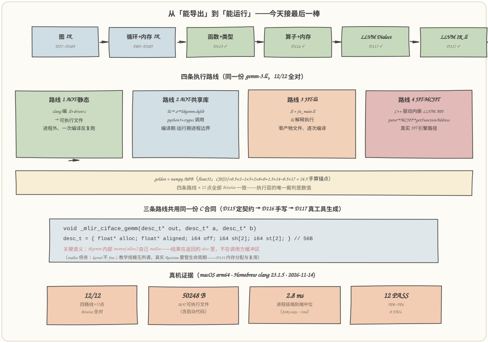
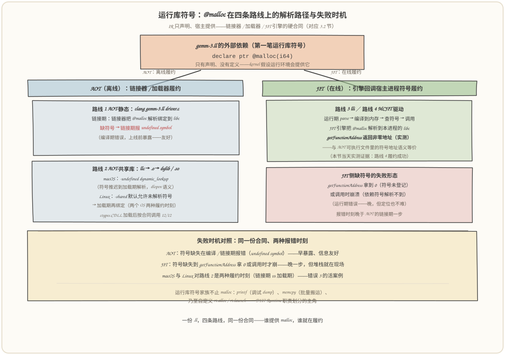
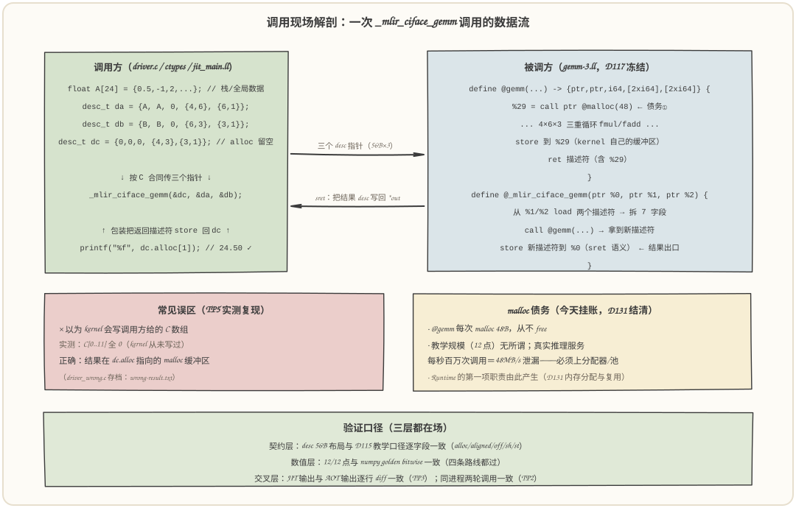
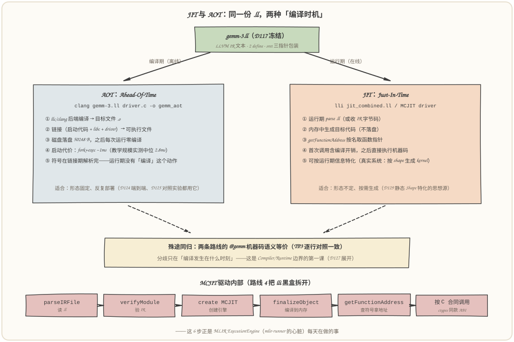

# 第 118 天：JIT 或 AOT 执行——四条路线把 D117 的 .ll 点亮成"算对的机器码"

> **今日目标**：完成本教程后，你能做到五件事——用自己的话讲清 **JIT 与 AOT 的唯一分歧点**（不是编译器不同、不是优化不同，而是"编译动作发生在离线还是在线"这一个时刻差，AOT 五步全在运行前、JIT 把③④⑤推迟到进程内首次调用前，代价是启动多一次编译、收益是可按运行期信息特化）；默写 **C 合同的三天血统**（D115 定下 56B 描述符契约 `desc_t = {alloc, aligned, off, sh[2], st[2]}` → D116 手写 `_mlir_ciface` 包装在汇编里亲眼看到两份合同 → D117 `llvm.emit_c_interface` 让真工具自动生成——今天四条路线全按这份合同调用，一个字都不用改）；独立跑通**四条执行路线**并说清各自的性格（①AOT-静态：`clang gemm-3.ll driver.c` 一次编译反复跑、50248B 落盘；②AOT-共享库：`llc → .o → libgemm.dylib`、Python ctypes 进程内调用；③JIT-lli：`lli jit_combined.ll` 零产物文件、逐次编译；④JIT-MCJIT：C++ 驱动内嵌 LLVM API，把 lli 黑盒拆成 parse→verify→create→finalize→getFunctionAddress→调用六步）；指出**结果到底在哪**——`@gemm` 内部 `memref.alloc()` 自己 `malloc(48)`，包装按 sret 语义把新描述符写回 `*out`，结果在 `dc.alloc` 指向的缓冲区里，**调用方预备的 C 数组从未被写过**（TP5 错误示范实测：C[0..11] 全 0）；最后守住**验证口径**——契约层（56B 布局逐字段与 D115 对账）、数值层（12/12 点与 numpy golden bitwise 一致 × 四条路线）、交叉层（JIT 输出与 AOT 输出逐行 diff 一致、同进程两轮调用一致），外加两笔**挂账**：malloc 债务（kernel 从不 free，教学规模无所谓、真实服务是 48MB/s 泄漏——D131 内存分配与复用结清）与 kernel 级计时（教学形状 ~百 ns，进程级 2.8ms 全是 fork+exec——D125 优化开关对照实验才做真正的计时）。
> **预计时间**：学习 40 分钟＋实践 50 分钟
> **前置准备**：clang/lli/llc + LLVM C++ 库（本文环境：macOS arm64，Homebrew LLVM 23.1.5 全家桶，Python 3.9.6＋numpy 1.26.4；D117 作者机为 Ubuntu LLVM 18.1.8——同一份 .ll 两个版本都能吃，见 5.4）。输入零新东西：`gemm-3.ll` 是 D117 冻结的导出产物（本文原样复制为 `baseline-gemm-3.ll`，一个字节没动）；贯穿数据是 4×6 @ 6×3 的 GEMM，A/B 全部手工可算（0.5 的倍数 × 整数），锚点 C[0][1] = 0.5×2 − 1×5 + 2×8 + 0×11 + 1.5×14 − 0.5×17 = **24.5**。内容上需要：D117 的七 pass 管道与 `_mlir_ciface_gemm` 包装（今天的全部输入）、D115 的描述符契约与 sret 证据（今天的合同）、D116 的 ctypes 三层验证法（今天照搬成 C/Python 双语版）。
> **今日产出**：`code/run_all.sh`（一键复现四条路线＋语义实验＋时间口径，本机实测 12 PASS / 0 FAIL）、`code/driver.c`（AOT 静态驱动：56B 描述符构造＋golden 内嵌对照）、`code/driver_wrong.c`（错误示范：外部缓冲区误区，TP5 实测存档）、`code/call_ciface.py`（ctypes 路线：同进程两轮调用验证无状态）、`code/jit_main.ll`（lli 入口：全局数据＋描述符＋读回循环，与 gemm-3.ll 拼接）、`code/mcjit_driver.cpp`（MCJIT 驱动：lli 内部六步的可见版）、`code/gen_golden.py`（numpy golden 生成器）、`code/outputs/`（report.txt 真机报告、四条路线各自的 result 文件、aot/mcjit build log、golden.txt、wrong-result.txt 误区存档）＋本文 4 张手绘图。

## 1. 今天解决什么问题？

D117 结束时管道停在"能导出"：`gemm.mlir` 过七 pass 转成纯 LLVM 方言，`mlir-translate` 吐出 `gemm-3.ll`，`llc` 编到汇编 `gemm-3.s`——但 `.s` 只是"证明可编译"，谁也没**运行**过它。今天接最后一棒：让 D113 以来导出的这份 IR 第一次真的跑起来、算出数、与参考对上账。

为什么"执行"值得单独一天？因为从"IR 正确"到"执行正确"之间还横着一整层**合同**：LLVM 侧的 `@gemm` 返回一个 56B 描述符（内部还 `malloc` 了新缓冲区），而调用方——不管是 C 程序、Python 的 ctypes、还是 lli 里手写的 `main`——都必须按**同一份 ABI 约定**构造参数、读回结果。这份合同 D115 定契约、D116 手写过一遍、D117 让真工具自动生成，但"被真实调用"今天是第一次。合同任何一处理解偏差（结果在哪个缓冲区？描述符字段什么顺序？）都不会报编译错误——只会**静默算错或读到垃圾**，这正是 D116 三层验证法存在的原因。

今天的实验设计是"一鱼四吃"：同一份 `gemm-3.ll`，走**四条执行路线**——①AOT-静态（clang 编成可执行文件）、②AOT-共享库（llc→.o→dylib，Python ctypes 调）、③JIT-lli（lli 解释执行，零产物）、④JIT-MCJIT（C++ 驱动内嵌 LLVM JIT API）。四条路线不是为炫技：它们恰好扫过"编译时机"光谱的全部采样点（离线 ↔ 在线），而且每条路线的调用方语言不同（C / Python / LLVM IR / C++），**四份独立实现都按同一份 C 合同调同一个符号**——如果合同理解有错，四条路线不可能同时对；反过来，四条路线 12/12 全对，就是对合同最硬的交叉验证。**输入：D117 冻结的一份 .ll；输出：四条可重复的执行命令、一份 12 PASS 的真机报告、两笔挂账（malloc 债务、kernel 级计时）和一张 JIT/AOT 的抉择地图。**

## 2. 先看全貌：今天的内容位于哪里？



**图 1**：看三排——**上排**是编译链路的六格栈（图 IR → 循环+内存 IR → 函数+类型 → 算子+内存 → LLVM Dialect → LLVM IR，前四格已在 D115/D116 打勾、后两格 D117 打勾），最右橙色格是今天：**执行**——链路从"文件"变成"进程"；**中排**是四条执行路线卡片（AOT-静态 / AOT-共享库 / JIT-lli / JIT-MCJIT，各带性格注记），下面金色对照带写明裁判标准：golden = numpy A@B，锚点 C[0][1]=24.5 手算可验，四条路线 × 12 点全部 bitwise 一致；**下排**先是三条路线共用的 C 合同原文（`_mlir_ciface_gemm(desc_t*, desc_t*, desc_t*)`＋56B 布局＋红色警示行：结果在返回的 desc 里、不在调用方缓冲区），底部四个数字是今天的真实证据：12/12 全对、50248B 可执行文件、2.8ms 进程级中位、12 PASS / 0 FAIL。

把今天的工作串成 5 步：

1. **盘点起跑线**（TP0）：确认 `gemm-3.ll` 的两个 `define`（`@gemm` 内核＋`_mlir_ciface_gemm` 包装）在位——包装是 D116 手写版的真工具版，sret 三指针合同原样；
2. **AOT 两条路**（TP1/TP2）：静态链接版一次编译反复跑（50248B）；共享库版编译期与运行期分进程（llc→.o→dylib，Python 加载），同进程两轮调用 12/12——kernel 无状态、可复用；
3. **JIT 两条路**（TP3/TP4）：lli 零产物逐次编译；MCJIT 驱动把 lli 黑盒拆成六步（parse→verify→create→finalize→getFunctionAddress→调用），这正是 mlir-runner 心脏 ExecutionEngine 的底层动作；
4. **语义实验**（TP5）：`driver_wrong.c` 实测"外部缓冲区误区"——kernel 的 malloc 缓冲区与调用方 C 数组是两回事，错误示范里 C[0..11] 全 0；
5. **时间口径**（TP6）：教学规模的诚实初测——进程级 2.8ms 中位几乎全是 fork+exec，kernel 本体 ~百 ns；真正的计时方法（同进程反复调用）挂账给 D125。

## 3. 核心概念

### 3.1 JIT 与 AOT：分歧点只是一个时刻

**一句话**：AOT 与 JIT 用的是同一套编译器、同一份 IR、同一个后端，唯一的区别是"编译"这个动作发生在**程序运行之前**（离线）还是**进程启动之后**（在线）。

**类比**：餐厅预制菜 vs 现炒。AOT 是预制——晚上闭店后把菜全做好，白天客人点单直接上（启动快、菜单改不了）；JIT 是现炒——客人点单那刻才下锅（首单慢，但可以问清忌口再做，甚至按客人口味调火候）。**类比边界**：餐厅的"预制/现炒"是两种产能策略，而编译器的 JIT 多出来的不只是等待——它拿到了**运行期才存在的信息**（真实 shape、真实热点、真实硬件），这些信息 AOT 阶段根本不存在，所以 JIT 有时能生成**更优**的代码（Triton/PyTorch 2.x 按 shape 缓存 kernel 就是这条线）。**技术对应**：今天路线 1/2 的编译动作发生在 `clang`/`llc` 命令行里（离线），路线 3/4 发生在 `lli` 进程内/`mcjit_driver` 的 `finalizeObject()` 里（在线）。`finalizeObject` 之后代码就在内存里，`getFunctionAddress("_mlir_ciface_gemm")` 拿到的函数指针与 AOT 可执行文件里的符号地址**语义等价**——TP3 的逐行 diff 一致就是"殊途同归"的直接证据。

**当天实测证据**：AOT 侧 `clang gemm-3.ll driver.c -O2 -o gemm_aot` 产出 50248B（含启动代码）；JIT 侧 `lli jit_combined.ll` 零产物文件；两者输出逐行一致（`C[0]=22.00 ... C[11]=27.00`）。

### 3.2 运行库符号：malloc 是第一笔"外部依赖"

**一句话**：`gemm-3.ll` 里 `declare ptr @malloc(i64)` 只有声明没有定义——kernel 不是自给自足的，它假设**运行环境**会提供 `malloc`；这种"IR 引用、宿主提供"的符号就是运行库符号（runtime symbols）。

**类比**：宜家家具说明书（IR）写着"需自备十字螺丝刀"（malloc）——说明书不管你从哪拿螺丝刀，但没有它家具装不起来。**类比边界**：家具的"自备工具"是给顾客的提示，而运行库符号是**链接器/加载器的硬合同**——AOT 路线由链接器在链接期把 `@malloc` 解析到 libc；JIT 路线由 JIT 引擎在符号解析时回调宿主进程的同名符号（lli/MCJIT 默认解析到本进程 libc）。**技术对应**：今天四条路线的 `malloc` 全部解析到系统 libc；真实 AI 编译器的运行库符号家族更大——`printf`（调试 dump）、`memcpy`（批量搬运）、乃至自定义 `rt.alloc/rt.launch`（D127 Runtime 职责划分的主角）。如果符号缺失，AOT 在链接期报 `undefined symbol`（编译期错误，友好），JIT 在 `getFunctionAddress` 时拿到 0 或调用时崩溃（运行期错误，晚但定位也不难）。

**当天实测证据**：路线 2 共享库版在 macOS 上链接要加 `-undefined dynamic_lookup`（延迟到加载期解析）；路线 4 MCJIT 的 `getFunctionAddress` 返回非零地址——`@malloc` 被 JIT 引擎自动解析到了本进程的 libc。



**图 4**：看两列一带——**顶格**是合同本身：`gemm-3.ll` 里 `declare ptr @malloc(i64)` 只有声明没有定义，谁来履约由路线决定。**左列（AOT，蓝）**：路线 1 由链接器在链接期把 `@malloc` 绑到 libc（缺符号＝链接期 `undefined symbol`，编译期错误、上线前暴露）；路线 2 的共享库在 macOS 上要 `-undefined dynamic_lookup` 推迟到加载期解析，Linux 上 `-shared` 默认允许未解析、加载期再绑定——两个 OS 对同一份合同有两种履约时刻。**右列（JIT，绿）**：路线 3/4 的 JIT 引擎在编译到内存时回调宿主进程符号，`@malloc` 解析到本进程 libc——`getFunctionAddress` 返回非零就是履约证据；缺符号则是 `getFunctionAddress` 拿 0 或调用时崩（运行期错误，晚但定位不难）。**底部金色带**：失败时刻对照——AOT 缺符号在编译/链接期报错（早、友好），JIT 缺符号到运行期才崩（晚一步但堆栈就在现场）；运行库符号家族不止 malloc，`printf`/`memcpy`/`rt.alloc` 是 D127 的主角。

### 3.3 执行语义：sret 包装与 malloc 债务

**一句话**：`_mlir_ciface_gemm` 是一层 sret（struct-return）包装——`@gemm` 返回 56B 描述符聚合超过寄存器约定，C ABI 改成"调用方传结果指针、被调方往里写"；而描述符里的 `alloc` 指针指向 kernel 内部 `memref.alloc()` 新 malloc 的缓冲区——**结果在 kernel 的缓冲区里，不在调用方预备的任何数组里**。

**类比**：快递代收点。你（调用方）给代收点（kernel）两张提货单（A/B 的描述符），代收点不往你手里塞货，而是把货放进一个**新租的储物柜**（malloc 缓冲区），然后把储物柜钥匙（新描述符）还给你。**类比边界**：现实里你可以要求"直接放我自家门口"，但 C ABI 没有这个选项——只要函数签名是"返回 memref"，包装就一定走 sret＋malloc。想改语义得改**源头 IR**（比如 `mini.matmul_bias` 那种"输出参数"风格，D85 的任务单就是 out 参数形态）。**技术对应**：包装函数的三步——从 `%1`/`%2` load 两个入参描述符、拆 7 字段调 `@gemm`、把返回的描述符 `store` 到 `%0`（`gemm-3.ll` 第 83~103 行，D117 已逐行标注）。由此产生两笔账：**①malloc 债务**——kernel 每次 malloc 48B 从不 free，教学规模（一次调用）无所谓，真实推理服务每秒百万次调用＝48MB/s 泄漏，必须由 Runtime 接管（D131）；**②误区高发**——以为 kernel 会写调用方的 C 数组，实测 `driver_wrong.c` 里 C[0..11] 全 0（`wrong-result.txt` 存档）。

**当天实测证据**：`driver.c` 正确版从 `dc.alloc` 读数 12/12 对；`driver_wrong.c` 从未 kernel 写入的 C 数组读数全 0，且 `dc.alloc` 被包装覆盖为 kernel malloc 的新指针（`0x...5180` vs 栈上 `0x...6d50`）——两份输出并排就是活的教材。



**图 3**：看三块——**上半区左右对照**：左边调用方（driver.c / ctypes / jit_main.ll 三种实现共享的调用形态）——构造数据与三份描述符、`dc.alloc` 留空传三个指针、调用后从 `dc.alloc` 读出 24.50；右边被调方（gemm-3.ll 原文）——`@gemm` 内部 `malloc(48)`（标"债务①"）、三重循环算完 store 到自己的缓冲区、包装从入参 load 描述符拆 7 字段、调 `@gemm`、把新描述符 store 到 `%0`（sret 语义＝结果出口）。中间两支箭头：下行"三个 desc 指针（56B×3）"、上行"sret：把结果 desc 写回 *out"。**下半区左（红）**误区解剖：以为 kernel 会写 C 数组→实测全 0→正确姿势从 `dc.alloc` 读（wrong-result.txt 存档）；**下半区右（金）**malloc 债务账本：每次 48B 从不 free、教学规模无所谓、真实服务 48MB/s 泄漏→D131 分配器/池接管。**底部绿带**三层验证口径：契约层（56B 布局与 D115 逐字段一致）、数值层（12/12 bitwise × 四路线）、交叉层（JIT/AOT 逐行一致＋同进程两轮一致）。

## 4. 图解核心机制



**图 2**：看三块——**顶部**是公共输入（gemm-3.ll，绿色），两条粗箭头分岔：左箭头标"编译期（离线）"进 AOT 区、右箭头标"运行期（在线）"进 JIT 区。**左区（AOT）**五步：llc/clang 后端编译→.o→链接（启动代码+libc+driver）→可执行文件落盘 50248B→每次运行零编译→符号在链接期解析完；适合形态固定反复部署（D124/D125 用它）。**右区（JIT）**五步：运行期 parse→内存中生成目标代码（不落盘）→按名取函数指针→首调含编译开销之后直接执行→可按运行期信息特化（D129 的思想源）。**中部金色带**是殊途同归结论：两条路线的 @gemm 机器码语义等价（TP3 逐行对照一致），分歧只在编译时刻——这是 Compiler/Runtime 边界的第一课（D127 展开）。**底部**是 MCJIT 六步解剖：parseIRFile→verifyModule→create MCJIT→finalizeObject→getFunctionAddress→按 C 合同调用，每步配小字注解——这六步正是 mlir-runner 心脏 ExecutionEngine 的日常。

## 5. 动手实践

### 5.1 准备文件

```
tutorials/week-017/day-118/
├── README.md                  # 本文
├── images/                    # 4 张手绘图
│   ├── 01-overview.svg        # 定位图：链路六格栈＋四路线全景
│   ├── 02-mechanism.svg       # 机制图：JIT/AOT 分岔＋MCJIT 六步
│   ├── 03-example.svg         # 现场图：sret 数据流＋malloc 债务
│   └── 04-symbol-resolution.svg # 合同图：malloc 符号解析路径＋失败时机
└── code/
    ├── baseline-gemm-3.ll     # D117 冻结导出物（原样复制，零改动）
    ├── gemm.mlir              # D117 源 IR（备份对照，今天不重跑管道）
    ├── driver.c               # 路线1：AOT 静态驱动（golden 内嵌）
    ├── driver_wrong.c         # TP5 错误示范：外部缓冲区误区
    ├── call_ciface.py         # 路线2：ctypes 调共享库（两轮验证）
    ├── jit_main.ll            # 路线3：lli 入口（与 gemm-3.ll 拼接）
    ├── mcjit_driver.cpp       # 路线4：MCJIT 驱动（lli 内部六步可见版）
    ├── gen_golden.py          # golden 生成器（numpy A@B）
    ├── gen_images.py          # 3 张 SVG 生成脚本
    ├── run_all.sh             # 一键复现 TP0~TP6
    └── outputs/               # 真机产物（二进制已清理，文本全存档）
        ├── report.txt         # 12 PASS / 0 FAIL 真机报告
        ├── golden.txt         # numpy golden 12 点
        ├── aot-result.txt     # 路线1 输出
        ├── so-result.txt      # 路线2 输出（两轮）
        ├── lli-result.txt     # 路线3 输出
        ├── mcjit-result.txt   # 路线4 输出
        ├── wrong-result.txt   # TP5 误区存档
        ├── jit_combined.ll    # 路线3 拼接后的完整模块
        └── aot-build.log / mcjit-build.log  # 编译日志
```

环境：macOS arm64、Homebrew LLVM 23.1.5（clang/lli/llc/clang++＋libLLVM 动态库）、Python 3.9.6＋numpy 1.26.4。一键复现：

```bash
cd tutorials/week-017/day-118/code && ./run_all.sh    # TP0~TP6，约 30 秒，12 PASS
```

**诚实声明**：今天的全部数字来自 2026-11-14 的一次完整运行（outputs/report.txt 是逐行日志）。与 D113~D117 的 aarch64 Linux / LLVM 18 冻结环境不同，本机是 macOS arm64 / LLVM 23——这不是"环境漂移"而是**双环境验证**：D117 冻结的 .ll 在两个版本、两种 OS 上被独立执行且结果 bitwise 一致，恰是多目标可移植性的活证据（路径/汇编格式/警告会不同，判据是 12 点数值与结构结论）。

### 5.2 编写代码

四个调用方各有一段值得细看的代码。**driver.c（路线 1）**——描述符构造与读回：

```c
typedef struct {
    float   *alloc;    /* 0  : 分配指针                     */
    float   *aligned;  /* 8  : 对齐指针（无显式对齐时 = alloc） */
    int64_t  off;      /* 16 : 元素偏移                     */
    int64_t  sh[2];    /* 24 : sizes                        */
    int64_t  st[2];    /* 40 : strides（元素个数，非字节）     */
} desc_t;              /* 合计 56B，与 D115 教学口径一致        */

desc_t da = { A, A, 0, {4, 6}, {6, 1} };
desc_t dc = { 0, 0, 0, {4, 3}, {3, 1} };   /* alloc 留空：等 kernel 填 */
_mlir_ciface_gemm(&dc, &da, &db);
printf("C[1]=%.2f\n", dc.alloc[1]);         /* 24.50：从返回缓冲区读 */
```

三个设计点：①结构体字段顺序/偏移逐字段对齐 D115 的契约（`__builtin_offsetof` 实测 0/8/16/24/40，56B——与 D115 真机 LLVM TargetData 算出的完全一致）；②`dc.alloc` 故意留空——写明"等 kernel 填"，把 sret 语义变成代码注释；③golden 数组写死在源码里（来自 gen_golden.py），对照不依赖任何外部文件。

**jit_main.ll（路线 3）**——数据内嵌＋读回循环：

```llvm
@Adesc = global { ptr, ptr, i64, [2 x i64], [2 x i64] }
         { ptr @A, ptr @A, i64 0, [2 x i64] [i64 4, i64 6], [2 x i64] [i64 6, i64 1] }
%Cdesc = global { ptr, ptr, i64, [2 x i64], [2 x i64] } zeroinitializer

define i32 @main() {
entry:
  call void @_mlir_ciface_gemm(ptr @Cdesc, ptr @Adesc, ptr @Bdesc)
  br label %loop
body:
  %cptr = load ptr, ptr @Cdesc                 ; 读回 kernel 填充的 malloc 指针
  %addr = getelementptr float, ptr %cptr, i64 %i
  %v = load float, ptr %addr
  ...
}
```

lli 的入口约定是 `@main`——所以 JIT 路线的"驱动"本身也是 LLVM IR：全局区构造 A/B 数据与描述符、`zeroinitializer` 的 Cdesc 占位、调包装后从 `@Cdesc` load 出 kernel malloc 的指针逐点打印。注意 `load ptr, ptr @Cdesc` 读的是**描述符的第一个字段**（alloc）——用 D115 学过的结构体内存布局直接读字段，不经过任何 C 编译器。

**mcjit_driver.cpp（路线 4）**——把 lli 拆开看：

```cpp
llvm::InitializeNativeTarget();               // ① 注册本机目标
auto mod = llvm::parseIRFile(argv[1], diag, ctx);   // ② parse .ll
llvm::verifyModule(*mod, &llvm::errs());      // ③ verify
auto *ee = llvm::EngineBuilder(std::move(mod))
               .setEngineKind(llvm::EngineKind::JIT)
               .setMCJITMemoryManager(std::make_unique<llvm::SectionMemoryManager>())
               .create();                     // ④ 创建 MCJIT 引擎
ee->finalizeObject();                         // ⑤ 编译到内存
uint64_t addr = ee->getFunctionAddress("_mlir_ciface_gemm");
auto *ciface = reinterpret_cast<void(*)(Desc*,Desc*,Desc*)>(addr);
ciface(&dc, &da, &db);                        // ⑥ 按同一份 C 合同调用
```

与 lli 的关系：lli 是黑盒工具，这段代码是它的内脏——六步依次对应"读 IR→验 IR→建引擎→编到内存→查符号→执行"。`getFunctionAddress` 返回的是**本进程内存里的函数地址**，`reinterpret_cast` 成函数指针直接调——JIT 的本质就这一行：运行期把符号名变成可调用的机器码地址。调用处与 driver.c 逐参数相同——第四种语言实现同一份合同。

**call_ciface.py（路线 2）**——ctypes 版复用了 D116 的 Structure 定义，新增"两轮调用"：同一进程里先後构造两组描述符各调一次，两轮都 12/12——证明 kernel 无内部状态、可安全复用（真实 Runtime 里一个 kernel 被成千上万次调用的前提）。

### 5.3 运行与观察

`./run_all.sh` 的真机输出（outputs/report.txt，12 PASS / 0 FAIL）：

```text
第 118 天：JIT 或 AOT 执行——真机报告 2026-11-14 20:03
工具链：Homebrew clang version 23.1.5
Python：Python 3.9.6  numpy：1.26.4

[TP1] 路线 1 AOT-静态：clang 编 .ll + driver.c -> 可执行文件
  [PASS] 编译链接成功（警告 -Woverride-module 见 build log，无害）
  [PASS] 12/12 点与 golden 一致
  产物大小：50248 B（含启动代码，非 kernel 本体）

[TP2] 路线 2 AOT-共享库：.ll -> .o -> libgemm.dylib/so；ctypes 调用
  [PASS] 共享库编译成功
  [PASS] ctypes 按 C 合同调用：12/12 点 bitwise 一致
  [PASS] 同一进程第二轮调用 12/12（kernel 无状态、可复用）

[TP3] 路线 3 JIT-lli：jit_main.ll 拼 gemm-3.ll，lli 解释执行（零产物文件）
  [PASS] lli 执行：12/12 点打印（C[0]=22.00 ... C[11]=27.00）
  [PASS] JIT(lli) 与 AOT 输出逐行一致——两条执行路线殊途同归

[TP4] 路线 4 JIT-MCJIT：C++ 驱动内嵌 LLVM JIT API（真实引擎路径，配 -O2）
  [PASS] MCJIT 驱动编译成功（链接 libLLVM 动态库）
  [PASS] MCJIT：12/12 点一致（opt -O2 后 JIT 编译执行）

[TP5] 执行语义实验：malloc 债务与 out 缓冲区误区
  [PASS] 错误示范未崩但读到空指针/垃圾——语义正确的失败
```

四组观察：**①对照 golden**（`lli-result.txt`）：

```text
C[0]=22.00
C[1]=24.50      ← 手算锚点：0.5×2−1×5+2×8+0+1.5×14−0.5×17
C[2]=27.00
C[3]=51.00
...（12 点，全对）
C[11]=27.00
```

**②误区现场**（`wrong-result.txt`）：

```text
C 数组 = 0.00 0.00 0.00 ...（全 0：kernel 从未写这里）
dc.alloc=0x1031e5180（kernel malloc 的新缓冲区，不是 C）
```

C 数组是静态区全零、`dc.alloc` 是堆地址——两个地址**隔着整个地址空间**，误解"kernel 会写调用方缓冲区"的人看到这行就懂了。**③JIT/AOT 殊途同归**：TP3 的 diff 显示 lli 输出与 gemm_aot 输出**逐行一致**——两套编译路径（离线 clang -O2 vs 在线 MCJIT）对同一份 IR 生成语义等价的机器码。**④时间量级**（TP6）：AOT 进程级端到端中位 2.8ms/5 次——注意口径：这里 99% 是 fork+exec＋libc 启动，4×6×3 的 kernel 本体约百 ns 量级。教学规模下**任何以"kernel 耗时"为名的结论都是噪声**，真正的 kernel 级计时（同进程反复调用、取中位数、对照多组开关）挂账 D125。

### 5.4 修改一个参数再观察

三个便宜的实验（都值得亲手做）：

**实验 A：换 LLVM 版本（18 → 23）**。把 `gemm.mlir` 用本机 LLVM 23 重跑 D117 的管道（`mlir-opt` 七 pass＋`mlir-translate`）：产物与本机直接消费 D117 冻结的 .ll **结果一致**，但 IR 文本有可见差异——LLVM 23 用 `poison` 替代 `undef`（`insertvalue {..} poison, ptr %0, 0`）、malloc 字节数被常量折叠（`i64 ptrtoint (ptr getelementptr...)` 变成直白的 `i64 48`）、gep 多了 `inbounds nuw`。结论：**IR 文本是版本方言，语义是公约数**——四条执行路线消费"同一语义"的两份文本都算出 12/12。这给"冻结产物"上了第二道保险：跨 5 个大版本、跨两种 OS，合同依然成立。

**实验 B：JIT 的首调开销**。把 `mcjit_driver.cpp` 的 `finalizeObject()` 挪到计时器里（`<chrono>` 包住）：教学模块小到编译只要 ~1ms，但把 .ll 换成 D124 的端到端大模块（或循环展开 8×），JIT 首调与后续调用差距会拉到数量级——这就是真实框架（Triton autotune、PyTorch 2.x）都给 JIT 配**缓存**的原因。

**实验 C：删掉 malloc declare**。把 `gemm-3.ll` 第一行 `declare ptr @malloc(i64)` 注释掉再走路线 1：clang 报 `undefined symbol`（链接期失败）；走路线 4：`getFunctionAddress("_mlir_ciface_gemm")` 正常，但调用时崩——运行库符号缺失在 AOT 是编译期错误、在 JIT 是运行期崩溃（3.2 节的技术对应，亲手验一遍）。

## 6. 常见错误与排查

**错误 1：以为 kernel 会写调用方缓冲区（结果全 0 或全垃圾）**。现象：`driver_wrong.c` 风格的调用——预备好 C 数组填进 desc 传出去，调用返回后读 C 数组，全 0（静态区）或上次残留（栈区）。原因：`@gemm` 的输出是 `memref.alloc()` 的新缓冲区（`gemm-3.ll` 第 21 行 `call ptr @malloc`），包装按 sret 把**新描述符**写回 `*out`——调用方的数组从头到尾没被碰。定位：打印 `dc.alloc` 的地址，与 C 数组地址比对（wrong-result.txt 里两地址明显不同）。修复：从 `dc.alloc` 读结果；若真要"就地写"语义，改源头 IR 用 out 参数风格（D85 的 `mini.matmul_bias` 任务单形态），那是 D124 端到端管线的做法。

**错误 2：LLVM IR 里 `ptr` 类型解析失败（llvmlite/旧工具链）**。现象：`parse_assembly` 报 `error: expected type` 指向 `declare ptr @malloc`。原因：opaque pointer（`ptr`）是 LLVM 15+ 的默认（15~17 过渡期可关、18 起强制），老工具链（如 llvmlite 0.43 绑定的 LLVM 14）只认 typed pointer（`float*`）。定位：报错行号永远指向第一个 `ptr`。修复：要么升级工具链（本文路线：Homebrew LLVM 23 全家桶），要么把 .ll 降级成 typed pointer 形态——但 D117 起的导出物全是 opaque，向前兼容才是正路。

**错误 3：macOS 链接共享库时 undefined symbol（malloc）**。现象：`clang -shared gemm_kernel.o -o libgemm.dylib` 报 `ld: symbol(s) not found for architecture arm64`（`@malloc` 未定义）。原因：macOS 的两段式链接默认要求符号在链接期解析，而 `.o` 里的 `malloc` 声明找不到 libc（Linux 上 `-shared` 默认允许未解析符号、加载期再绑定）。定位：`nm -u gemm_kernel.o` 列出所有未定义符号，全是运行库符号族。修复：加 `-undefined dynamic_lookup`（延迟到加载期解析，dlopen 语义）。这正是 3.2 节"运行库符号是链接器/加载器的合同"的活案例——两个 OS 对同一份合同有两种履约时刻。

**错误 4：MCJIT 编译过了但 getFunctionAddress 返回 0**。现象：驱动编译成功、运行不崩但 `addr == 0`，或直接报"符号未找到"。原因（按概率排序）：①忘了 `ee->finalizeObject()`（符号在 finalize 后才登记）——教学版最常见的坑；②符号名拼错——注意是 `_mlir_ciface_gemm`（带下划线前缀）不是 `gemm`（内部函数没走 C ABI 包装）；③模块里 symbol 在死代码区被链接器折叠。定位：在 getFunctionAddress 前打印 `mod->getFunction("_mlir_ciface_gemm")` 是否非空（IR 层有）再查引擎层（JIT 后有没有）。修复：对应补 finalize／改符号名／查 D117 导出时 `llvm.emit_c_interface` 属性是否在。

## 7. 今日练习

**必做**：

1. 把 `driver.c` 里 golden 数组的期望值改成错的（比如 C[1] 期望 24.0），重跑路线 1，观察报告从 PASS 变 FAIL——体会"验收判据写在驱动里"的含义；再改回正确值。
2. 用 `jit_main.ll` 的模式新写一个 `@main2`：不打印、只把 12 点累加成一个 f32 返回（lli 会打印返回值），手算期望值（22+24.5+27+51+57+63+49+51.5+54+23+25+27 = 474.0）验证。
3. 走一遍路线 2 的完整命令序列（llc→clang -shared→python3 call_ciface.py），然后 `nm -gU outputs/libgemm.dylib | grep ciface` 确认导出符号——这是"共享库真的在导出我们的函数"的直接证据。

**选做（挑战）**：

4. 给 `mcjit_driver.cpp` 加 `opt -O2`：用 `llvm::PassBuilder` 在 finalize 前跑一遍默认优化管线，对比加/不加的首调耗时与生成代码大小（`ee->getFunctionAddress` 拿地址后反汇编可用 `llvm-objdump`，需要先把模块写盘）。
5. 把 A/B 换成 32×32×32 的随机数据（gen_golden.py 改参数），四条路线重跑——观察哪些环节"免费"（kernel 照跑）、哪些环节要改（jit_main.ll 的全局数组、手算锚点失效、golden 生成）——体会"教学规模是设计出来的可验证性，不是偷懒"。

## 8. 今日验收

- [ ] 我能说清 JIT 与 AOT 的唯一分歧点（编译时机：离线 vs 在线），并举出"JIT 能拿到运行期信息"的一个真实系统案例（Triton/PyTorch 2.x 按 shape 缓存 kernel）
- [ ] 我独立跑通了四条执行路线（AOT-静态/AOT-共享库/JIT-lli/JIT-MCJIT），四条全部 12/12 与 golden bitwise 一致
- [ ] 我能解释结果为什么在 `dc.alloc` 指向的 malloc 缓冲区而不是调用方数组（sret 语义＋memref.alloc 的 Lowering 结果），并复述 TP5 错误示范的两个地址证据
- [ ] 我能默写 C 合同（`_mlir_ciface_gemm(desc_t*, desc_t*, desc_t*)`＋56B 布局五字段偏移 0/8/16/24/40）并说出它的三天血统（D115 定契约→D116 手写→D117 真工具生成）
- [ ] 我知道运行库符号是什么（malloc 是第一个例子）、AOT 与 JIT 对符号缺失的不同报错时机（链接期 vs 运行期），并亲手做过错误 3 的实验
- [ ] 我能列出今天挂的两笔账：malloc 债务（D131 结清）与 kernel 级计时（D125 结清），以及为什么教学规模下进程级 2.8ms 不能当 kernel 性能

## 9. 一句话总结与明天预告

今天的闭环：**问题**——D117 停在"能导出"，`.s` 只是"证明可编译"，链路缺最后一棒；**机制**——四条执行路线（AOT 静态/共享库、JIT lli/MCJIT）从"编译时机"光谱的四个采样点消费同一份 `gemm-3.ll`，全部按 D115~D117 三天铸成的 C 合同调用 `_mlir_ciface_gemm`，sret 包装把 kernel malloc 的新描述符写回 `*out`；**实践**——clang 编出 50248B 可执行文件、llc→dylib→ctypes 进程内调用、lli 零产物执行、MCJIT 驱动把 lli 拆成六步可见版；**验证**——12 PASS / 0 FAIL：四路线 × 12 点 bitwise 全对、JIT 与 AOT 输出逐行一致、同进程两轮调用一致、错误示范（外部缓冲区误区）按预期失败并存档、跨 LLVM 18/23 双环境语义收敛；**挂账**——malloc 债务（kernel 从不 free，D131 的 Runtime 分配器来接）与 kernel 级计时（教学形状 ~百 ns，D125 同进程计时法）。明天 D119 第 17 周复盘：从图 IR 到今天跑通的机器码，把七层表示的**每层保留什么、丢失什么**画成一张完整 Lowering 图——回答那个面试官最爱问的问题："为什么不能只看最终 LLVM IR 理解整个编译器？"

<!-- tutorial-review: v1 -->
