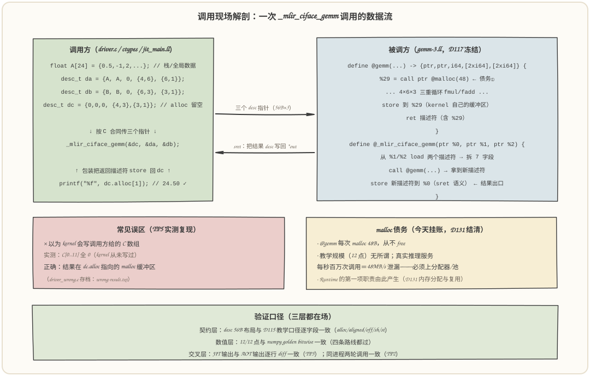

# 第 118 天技术校对报告

> 审阅环境：aarch64 Linux（Ubuntu LLVM 18.1.8，与 D117 冻结环境同版本）＋ numpy 1.26.4；路线 1/2/4 在本机以 llc＋gcc/g++＋ctypes 全部复现 12/12，路线 3（lli）复现出与冻结存档相反的结果（详见第 1 条）。涉及 LLVM 18/23 与 MLIR 的引擎归属、opaque pointer 时间线、llvmlite 版本对照等结论均核对 llvm-project 源码（llvmorg-18.1.8 与 release/23.x 两个 tag）或官方文档，未凭记忆。macOS 原机行为无法直接复跑，相关推断已注明依据与不确定点。

## 【错误】
#### 1. 路线 3 的 printf 变参未做 float→double 提升：在 Linux aarch64 上 lli 输出全 0.00，"12/12 点打印"不成立
- **原文**："[PASS] lli 执行：12/12 点打印（C[0]=22.00 ... C[11]=27.00）"
- **依据**：`code/jit_main.ll` 第 35 行把 `float %v` 不经 `fpext` 直接传给可变参数 `printf`，而 `%.2f` 按双精度读取。C 的默认参数提升（float→double）是前端职责，手写 IR 必须自己显式 `fpext`。本机实测（aarch64 Linux，Ubuntu LLVM 18.1.8）：`lli`（baseline-gemm-3.ll＋jit_main.ll 原样拼接，即 outputs/jit_combined.ll 的等价物）打印 C[0..11] 全 0.00（默认 ORC 与 `--jit-kind=mcjit` 两种引擎相同）；仅在 printf 前补 `%vd = fpext float %v to double` 后 12/12 全对。根因是 ABI 差异：AAPCS 变参与非变参 ABI 相同（llvm/lib/Target/AArch64/AArch64ISelLowering.cpp 注释 "The AAPCS variadic function ABI is identical to the non-variadic one"），f32 走 32 位 SIMD 寄存器、高 32 位为零，printf 按双精度 va_arg 读出非正规数≈0；而 Darwin 变参调用约定对 `f16/bf16/f32` 有 `CCPromoteToType<f64>`（llvm/lib/Target/AArch64/AArch64CallingConvention.td:457，release/23.x），后端经 getCopyToParts 发出值保持的 FP_EXTEND——恰好等价于 C 的默认参数提升，所以 macOS 上"碰巧"正确。连锁影响：run_all.sh 头注释"或 Linux aarch64 均可运行"、TP3 两条 PASS（`grep C[11]=27.00` 与 JIT/AOT 逐行 diff）在 Linux aarch64 上必失败；§5.4"两种 OS 上被独立执行"的可移植性口径同样被破坏（路线 1/2/4 本机实测均通过，仅路线 3 的打印断在变参 ABI 上）。冻结的 lli-result.txt 与 macOS/LLVM 23 的 Darwin 变参提升行为一致，不判定为伪造，但教程把它当作可复现结论且未提示这一跨平台坑——正是"遗漏初学者必知关键坑"的典型。修复只需一行 `fpext`。
- **置信度**：高（本机实证＋LLVM 18/23 源码两处依据；未在 macOS 原机复跑，但 Darwin CC 的提升规则足以解释冻结输出为何正确）。

#### 2. 实验 C 描述的失败现象不可能发生：注释掉 declare 是解析期错误，不是"链接期 undefined symbol"
- **原文**："**实验 C：删掉 malloc declare**。把 `gemm-3.ll` 第一行 `declare ptr @malloc(i64)` 注释掉再走路线 1：clang 报 `undefined symbol`（链接期失败）；走路线 4：`getFunctionAddress("_mlir_ciface_gemm")` 正常，但调用时崩——运行库符号缺失在 AOT 是编译期错误、在 JIT 是运行期崩溃（3.2 节的技术对应，亲手验一遍）。"
- **依据**：LLVM 文本 IR 解析器要求被调用函数先声明。本机 LLVM 18.1.8 实测：把 `declare ptr @malloc(i64)` 注释掉后 `llc`/`llvm-as` 均在 baseline-gemm-3.ll 第 21 行报 `error: use of undefined value '@malloc'`（编译期），clang 消费 .ll 走同一 LLParser，同样到不了链接期；路线 4 的 `parseIRFile` 也是同一解析器，`getFunctionAddress` 根本执行不到，"getFunctionAddress 正常，但调用时崩"同样不可能。要真正复现"AOT 链接期报 undefined symbol"，必须保留声明、把调用改成确实不存在的符号（如 `@my_malloc`）。该实验的预期结果与真实行为相反，初学者照做会看到完全不同的报错并怀疑自己的操作。
- **置信度**：高（实证＋解析器同源；clang 驱动未在本机，但其 .ll 输入路径与 llc 共用 LLParser）。

#### 3. "MCJIT 六步＝lli 内部／MLIR ExecutionEngine 的日常"引擎归属过时：两者如今默认都是 ORC JIT
- **原文**："3. **JIT 两条路**（TP3/TP4）：lli 零产物逐次编译；MCJIT 驱动把 lli 黑盒拆成六步（parse→verify→create→finalize→getFunctionAddress→调用），这正是 mlir-runner 心脏 ExecutionEngine 的底层动作；"
- **依据**：llvm/tools/lli/lli.cpp 在 llvmorg-18.1.8 与 release/23.x 中默认 jit-kind 均为 Orc（`cl::init(JITKind::Orc)`），23 的源码把 MCJIT 分支注释为 "Old lli implementation based on ExecutionEngine and MCJIT"；mlir/lib/ExecutionEngine/ExecutionEngine.cpp 在两个版本都用 `llvm::orc::LLJITBuilder` 构建（ORC/LLJIT），符号查找走 `jit->lookup()` 而非 `getFunctionAddress`。因此"把 lli 黑盒拆成 MCJIT 六步""这正是 mlir-runner 心脏 ExecutionEngine 的底层动作/日常"（§2 步骤 3、§4 图 2 图注、§5.2、mcjit_driver.cpp 头注释）对 LLVM 18/23 都不成立——正确说法是"MCJIT 是 lli 保留的旧引擎路径（`lli --jit-kind=mcjit`），六步抽象仍有教学价值"。MCJIT 驱动本身真实可跑（本机编译运行 12/12，`llvm/ExecutionEngine/MCJIT.h` 在 23.x 仍存在）。同源的还有两处"lli 解释执行"（§1 路线③与 §5.3 引用的 report.txt 原文）：lli 默认是 JIT 编译执行，`--force-interinterpret` 才是解释器，且 jit_main.ll 自己的头注释就写着"MCJIT 编译到内存"，与"解释执行"自相矛盾。
- **置信度**：高（llvm-project 18.1.8 与 release/23.x 两版本源码核实）。

#### 4. 正文引用的实测数字与冻结存档不一致（2.8ms/2.5ms、20:03/20:08、指针地址）
- **原文**："C 数组是静态区全零、`dc.alloc` 是堆地址——两个地址**隔着整个地址空间**，误解"kernel 会写调用方缓冲区"的人看到这行就懂了。**③JIT/AOT 殊途同归**：TP3 的 diff 显示 lli 输出与 gemm_aot 输出**逐行一致**——两套编译路径（离线 clang -O2 vs 在线 MCJIT）对同一份 IR 生成语义等价的机器码。**④时间量级**（TP6）：AOT 进程级端到端中位 2.8ms/5 次——注意口径：这里 99% 是 fork+exec＋libc 启动，4×6×3 的 kernel 本体约百 ns 量级。教学规模下**任何以"kernel 耗时"为名的结论都是噪声**，真正的 kernel 级计时（同进程反复调用、取中位数、对照多组开关）挂账 D125。"
- **依据**：§5.1 诚实声明称"今天的全部数字来自 2026-11-14 的一次完整运行（outputs/report.txt 是逐行日志）"，但 report.txt 第 31 行是"中位 2.5 ms / 5 次"，而"2.8ms"在正文出现 5 处（今日目标、图 1 图注、§2 步骤 5、§5.3 ④、§8 验收）且 01-overview.svg、02-mechanism.svg 两图内也写"2.8 ms"；report.txt 首行时间戳为 20:08，§5.3 引用块首行写 20:03；wrong-result.txt 存档地址为 `0x104c0d100`，§5.3 引用块写 `0x1031e5180`。最合理的解释是正文引用了另一次（20:03 的）运行而 outputs/ 冻结了 20:08 那次；但按教程自己的口径，所有引用数字应与冻结存档逐字一致，否则"冻结产物"承诺失效。顺带：今日目标"进程级 2.8ms 全是 fork+exec"的"全是"也比 §5.3 自己说的"99%"更绝对。
- **置信度**：高（逐行比对；"两次运行混合"是推断而非证据）。

#### 5. §3.3 的误区证据地址不在任何存档中，且"栈上"定性错误——C 数组是 static（BSS）
- **原文**："**当天实测证据**：`driver.c` 正确版从 `dc.alloc` 读数 12/12 对；`driver_wrong.c` 从未 kernel 写入的 C 数组读数全 0，且 `dc.alloc` 被包装覆盖为 kernel malloc 的新指针（`0x...5180` vs 栈上 `0x...6d50`）——两份输出并排就是活的教材。"
- **依据**：driver_wrong.c 第 23~24 行声明 `static float A[24], B[18];`、`static float C[12];`——C 是静态存储期（BSS，零初始化），不是栈上；§6 错误 1 也正确写明"全 0（静态区）"。存档 wrong-result.txt 只有 `dc.alloc=0x104c0d100` 一行地址，`0x...5180` 与 `0x...6d50` 都不在任何输出文件中。本机复跑（Linux）同样得到"静态区全 0＋堆地址 dc.alloc"。两个无存档地址＋错误的"栈上"定性削弱了这段"实测证据"的可信度。
- **置信度**：高（代码与存档比对＋本机复跑）。

#### 6. 练习 2 声称"lli 会打印返回值"——lli 不打印任何返回值，且退出码按 8 位截断
- **原文**："2. 用 `jit_main.ll` 的模式新写一个 `@main2`：不打印、只把 12 点累加成一个 f32 返回（lli 会打印返回值），手算期望值（22+24.5+27+51+57+63+49+51.5+54+23+25+27 = 474.0）验证。"
- **依据**：lli.cpp 的主流程执行 `Result = EE->runFunctionAsMain(...)` 后用该值调用 exit（llvm/tools/lli/lli.cpp:687 起），全程不打印。本机实测 `define i32 @main() { ret i32 474 }` 无任何输出、退出码 218（474 mod 256——exit status 只有低 8 位）。照练习 2 做会看到空输出；474.0 也不可能通过退出码核验。验证手段应改为在 IR 里打印，或明确用 `echo $?` 并解释截断。
- **置信度**：高（实测＋lli.cpp 源码）。

#### 7. 错误 2 的 opaque pointer 时间线差一个版本：typed pointer 支持在 LLVM 17 被移除，不是"18 起强制"
- **原文**："**错误 2：LLVM IR 里 `ptr` 类型解析失败（llvmlite/旧工具链）**。现象：`parse_assembly` 报 `error: expected type` 指向 `declare ptr @malloc`。原因：opaque pointer（`ptr`）是 LLVM 15+ 的默认（15~17 过渡期可关、18 起强制），老工具链（如 llvmlite 0.43 绑定的 LLVM 14）只认 typed pointer（`float*`）。定位：报错行号永远指向第一个 `ptr`。修复：要么升级工具链（本文路线：Homebrew LLVM 23 全家桶），要么把 .ll 降级成 typed pointer 形态——但 D117 起的导出物全是 opaque，向前兼容才是正路。"
- **依据**：官方文档 llvm.org/docs/OpaquePointers.html 的 Version Support：LLVM 15 默认开启（可用开关退回 typed pointer）、LLVM 16 默认、LLVM 17 "Only opaque pointers are supported"——即强制点在 17 而非 18，`float*` 文本从 17 起就无法解析。同条中"llvmlite 0.43 绑定的 LLVM 14"经核对是准确的（numba/llvmlite v0.43.0 的 ffi/build.py 要求 LLVM 14、LLVM 15 仅为实验性），"报错行号永远指向第一个 ptr"与实际报错形态一致。
- **置信度**：高（官方文档；影响范围小但属事实错误）。

#### 8. "D85 的 mini.matmul_bias 任务单／out 参数形态、D124 端到端管线也这么做"的交叉引用不实
- **原文**："**错误 1：以为 kernel 会写调用方缓冲区（结果全 0 或全垃圾）**。现象：`driver_wrong.c` 风格的调用——预备好 C 数组填进 desc 传出去，调用返回后读 C 数组，全 0（静态区）或上次残留（栈区）。原因：`@gemm` 的输出是 `memref.alloc()` 的新缓冲区（`gemm-3.ll` 第 21 行 `call ptr @malloc`），包装按 sret 把**新描述符**写回 `*out`——调用方的数组从头到尾没被碰。定位：打印 `dc.alloc` 的地址，与 C 数组地址比对（wrong-result.txt 里两地址明显不同）。修复：从 `dc.alloc` 读结果；若真要"就地写"语义，改源头 IR 用 out 参数风格（D85 的 `mini.matmul_bias` 任务单形态），那是 D124 端到端管线的做法。"
- **依据**：D85（week-013/day-085）的算子是 `mini.matmul`（README 中出现 13 次，全文无 matmul_bias/bias/out 参数内容），其任务单明确写"输出初始化：alloc 不清零，方案 B iter_args 选定"——是 alloc 风格而非 out 参数风格；全仓库"matmul_bias"只在学习计划第 50 天的 `mini.fused_matmul_bias_relu`（融合算子定义，与"out 参数任务单"无关）和本文出现。而 D124 的 README（错误 3）写明其 kernel 同样"输出在自己 malloc 的缓冲区，ciface 按 sret 把新描述符写回 *out"——与 D118 完全同构，恰恰不是"就地写"的 out 参数管线。§3.3"（比如 `mini.matmul_bias` 那种'输出参数'风格，D85 的任务单就是 out 参数形态）"同样不成立。两天指向都与实际内容相反，会误导读者对后续教程的预期。
- **置信度**：高（D85/D124 两天 README 与学习计划全文检索）。

## 【存疑】
#### 9. 实验 A 关于 LLVM 23 IR 文本差异的三处描述无法核实，且"跨两种 OS 执行"缺存档证据
- **原文**："**实验 A：换 LLVM 版本（18 → 23）**。把 `gemm.mlir` 用本机 LLVM 23 重跑 D117 的管道（`mlir-opt` 七 pass＋`mlir-translate`）：产物与本机直接消费 D117 冻结的 .ll **结果一致**，但 IR 文本有可见差异——LLVM 23 用 `poison` 替代 `undef`（`insertvalue {..} poison, ptr %0, 0`）、malloc 字节数被常量折叠（`i64 ptrtoint (ptr getelementptr...)` 变成直白的 `i64 48`）、gep 多了 `inbounds nuw`。结论：**IR 文本是版本方言，语义是公约数**——四条执行路线消费"同一语义"的两份文本都算出 12/12。这给"冻结产物"上了第二道保险：跨 5 个大版本、跨两种 OS，合同依然成立。"
- **依据**：本机只有 LLVM 18 工具链（与 D117 冻结同版），无法复跑 LLVM 23 管道核对"poison 替代 undef、malloc 字节数常量折叠成 `i64 48`、gep 加 `inbounds nuw`"三处文本差异；outputs/ 也没有 23 版导出物存档。MLIR 翻译层近年确有 undef→poison 的迁移趋势，方向可信，但三处具体差异属于"未验证的具体论断"。另外该句"跨 5 个大版本、跨两种 OS，合同依然成立"中的"两种 OS 执行"在存档中只有 macOS 一份证据（Linux 侧无任何 D118 冻结输出，且见第 1 条：路线 3 在 Linux 上会失败）。
- **置信度**：低（对三处文本差异；对"双 OS 执行无存档"为高）。

#### 10. 实验 B "教学模块小到编译只要 ~1ms"没有任何测量存档
- **原文**："**实验 B：JIT 的首调开销**。把 `mcjit_driver.cpp` 的 `finalizeObject()` 挪到计时器里（`<chrono>` 包住）：教学模块小到编译只要 ~1ms，但把 .ll 换成 D124 的端到端大模块（或循环展开 8×），JIT 首调与后续调用差距会拉到数量级——这就是真实框架（Triton autotune、PyTorch 2.x）都给 JIT 配**缓存**的原因。"
- **依据**：outputs/ 无该计时记录，正文也未给出可复现命令；小模块 JIT 编译在毫秒量级的判断合理，但"~1ms"是未验证的具体数字，与本教程"不伪造性能数据"的口径不符，建议标注为估计值或补真机测量。
- **置信度**：中（量级合理；数字未验证）。

## 【建议】
#### 11. TP5 的代码注释（"预期崩溃"）与实际行为（不崩、全 0）及报告措辞互相矛盾
- **原文**："[PASS] 错误示范未崩但读到空指针/垃圾——语义正确的失败"
- **依据**：driver_wrong.c 头注释写"本程序故意解引用 dc.alloc……预期崩溃"，run_all.sh TP5 注释写"期望：segfault 或读到 NULL"，但该程序实际不解引用 dc.alloc（只打印 C[0..2] 与指针值）、退出码 0、永不崩溃；报告措辞"读到空指针/垃圾"也不准确——实际读到的是静态零初始化数组与被包装覆盖后的堆指针。README §3.3/§6 错误 1 描述的是真实行为，建议把两处代码注释与报告措辞统一成"未崩、C 全 0、dc.alloc 已被换成堆指针"，避免读者按注释预期 segfault。
- **置信度**：高（代码阅读＋本机复跑）。

#### 12. run_all.sh TP1 的 golden"逐行 diff"分支永远为假，实际靠驱动自检兜底
- **原文**："[PASS] 12/12 点与 golden 一致"
- **依据**：脚本中 `diff -q aot-result.txt <(grep -E '^C\[' golden.txt | sed 's/^C\[/C\[/')` 两侧行数不同（13 行 vs 12 行）必不相等，且 `sed 's/^C\[/C\[/'` 是空替换；该 PASS 实际由 `gemm_aot | tail -1 | grep 12/12`（driver.c 内嵌 golden 自检）判定。功能上够用（练习 1 改错 golden 时能正确 FAIL），但与"逐行对照 golden"的字面描述不符，也让"外部裁判"退化为"自我裁判"。
- **置信度**：高（脚本阅读）。

#### 13. §3.1 的证据归因跨路线：TP3 的 diff 是 lli 与 AOT 的对照，不是 getFunctionAddress（路线 4）的证据
- **原文**："**类比**：餐厅预制菜 vs 现炒。AOT 是预制——晚上闭店后把菜全做好，白天客人点单直接上（启动快、菜单改不了）；JIT 是现炒——客人点单那刻才下锅（首单慢，但可以问清忌口再做，甚至按客人口味调火候）。**类比边界**：餐厅的"预制/现炒"是两种产能策略，而编译器的 JIT 多出来的不只是等待——它拿到了**运行期才存在的信息**（真实 shape、真实热点、真实硬件），这些信息 AOT 阶段根本不存在，所以 JIT 有时能生成**更优**的代码（Triton/PyTorch 2.x 按 shape 缓存 kernel 就是这条线）。**技术对应**：今天路线 1/2 的编译动作发生在 `clang`/`llc` 命令行里（离线），路线 3/4 发生在 `lli` 进程内/`mcjit_driver` 的 `finalizeObject()` 里（在线）。`finalizeObject` 之后代码就在内存里，`getFunctionAddress("_mlir_ciface_gemm")` 拿到的函数指针与 AOT 可执行文件里的符号地址**语义等价**——TP3 的逐行 diff 一致就是"殊途同归"的直接证据。"
- **依据**：该句主语是路线 4 的 `finalizeObject`/`getFunctionAddress`，但紧随其后的"直接证据"引的是 TP3——路线 3（lli，默认 ORC）与 AOT 的逐行 diff；路线 4 只做过与 golden 的对照（TP4），未做与 AOT 的 diff。结论方向不受影响（两条 JIT 路线殊途同归都成立），但"直接证据"应归到实际做了对照的路线，或给路线 4 补一次与 AOT 输出的 diff。
- **置信度**：中（表述/归因问题，非事实错误）。

#### 14. 练习 3 的 `nm -gU` 是 BSD/llvm-nm 选项，GNU nm 不支持 `-U`
- **原文**："3. 走一遍路线 2 的完整命令序列（llc→clang -shared→python3 call_ciface.py），然后 `nm -gU outputs/libgemm.dylib | grep ciface` 确认导出符号——这是"共享库真的在导出我们的函数"的直接证据。"
- **依据**：`-U`（只列已定义符号）存在于 macOS nm 与 llvm-nm；GNU binutils 的 nm 无 `-U`，Linux 读者照抄会报错（可用 `nm -gD` 或 `llvm-nm -gU` 替代）。教程主环境为 macOS、目标文件也是 .dylib，命令可行，但补一句平台差异说明可避免 Linux 读者在练习 3 卡壳。
- **置信度**：中（属工具常识性差异；不确定点：个别发行版 GNU nm 行为可能略有不同）。

#### 15. 图号与出现顺序不一致：图 3（§3.3）先于图 2（§4）出现
- **原文**：""
- **依据**：正文图片引用顺序是 01-overview（§2，图 1）→ 03-example（§3.3，图 3）→ 02-mechanism（§4，图 2），图号与出现顺序不匹配；现有事实约定是"图号＝文件名数字前缀"。本次配图审阅新增的 04-symbol-resolution.svg（§3.2，图 4：运行库符号解析路径与失败时机）沿用同一前缀约定插入；建议日后统一按出现顺序编号，或在导语明确"图号按文件前缀"的约定，避免读者按顺序找图时困惑。
- **置信度**：高（结构事实；新增图说明见该条）。
