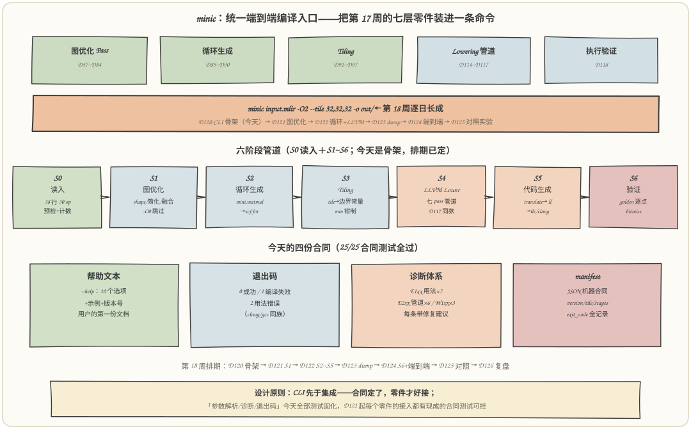
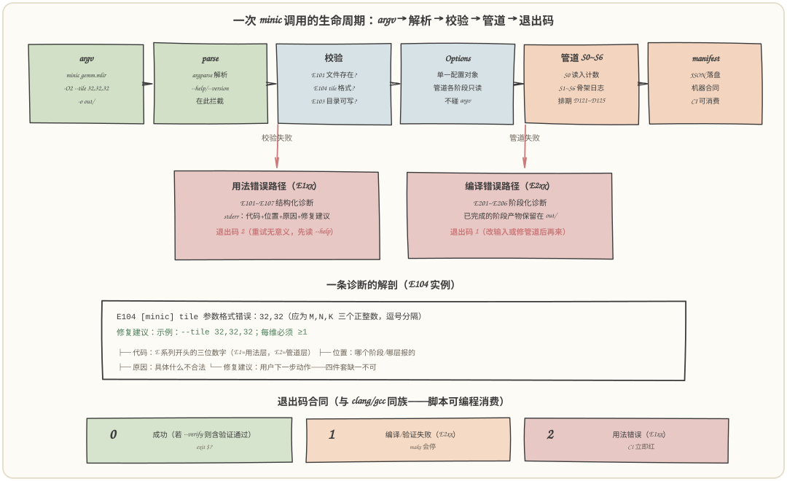
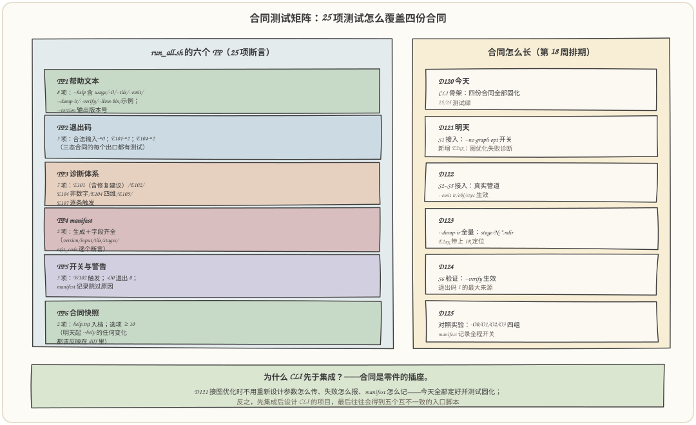

# 第 120 天：设计命令行接口——minic 的第一份合同：参数、诊断、退出码与 manifest

> **今日目标**：完成本教程后，你能做到五件事——用自己的话讲清**为什么 CLI 先于集成**（合同是零件的插座：参数怎么传、失败怎么报、manifest 怎么记，这些今天全部定好并测试固化，D121~D125 每个零件接入时不用重新设计接口——反之先集成后设计 CLI 的项目最后会得到五个互不一致的入口脚本）；默写 minic 的**四份合同**——帮助文本（`--help`：10 个选项＋示例＋版本号，用户读的第一行文档）、退出码（0 成功／1 编译失败／2 用法错误，与 clang/gcc 同族、脚本可编程消费）、诊断体系（E1xx 用法错误 ×7、E2xx 管道错误 ×6、W1xx 警告 ×3，每条四件套：代码＋位置＋原因＋**修复建议**）、manifest.json（机器合同：version/input/tile/stages/exit_code，CI 与脚本的消费接口）；独立运行 `./run_all.sh` 复现 **25 项合同测试**（TP1 帮助文本 8 项、TP2 退出码三态 3 项、TP3 诊断逐条触发 7 项、TP4 manifest 字段 2 项、TP5 开关与警告 3 项、TP6 合同快照 2 项）；解释**诊断代码的分层设计**（E1=用户层错误重试无意义先读帮助、E2=编译器层错误改输入或修管道、W=不改变退出码仅提示——`E104 [minic] tile 参数格式错误：32,32（应为 M,N,K 三个正整数，逗号分隔）` 加一行修复建议就是完整形态）；最后对照六阶段管道骨架（S0 读入→S1 图优化→S2 循环生成→S3 Tiling→S4 LLVM Lowering→S5 代码生成→S6 验证）说出**本周排期**——D121 接 S1、D122 接 S2~S5、D123 dump 全量、D124 端到端、D125 对照实验。
> **预计时间**：学习 35 分钟＋实践 50 分钟
> **前置准备**：第 17 周的零件清单——图优化 Pass（D57~D84）、循环生成（D85~D90）、Tiling（D91~D97）、Lowering 管道（D114~D117）、执行验证（D118）；以及它们的"散装"调用方式（每天一个 run_all.sh）。工具只要 `python3`（argparse 标准库；本文环境：Python 3.9.6，macOS arm64，2026-11-14）。内容上需要 D117 的七 pass 管道（S4 的实现蓝本）与 D118 的四条执行路线（S5/S6 的实现蓝本）——今天不集成它们，只定接口。
> **今日产出**：`code/minic.py`（CLI 骨架：argparse 解析＋E1xx 校验＋六阶段管道占位＋manifest 生成，约 300 行可运行）、`code/run_all.sh`（25 项合同测试一键复现，本机实测 25 PASS / 0 FAIL）、`code/outputs/report.txt`（真机合同测试报告）、`code/outputs/help.txt`（**帮助文本快照**——从此 --help 的任何变化都应反映在 diff 里）、`code/outputs/version.txt`、`code/outputs/diag-*.txt`（E101/E102/E104a/E104b/E105/E107/W102 八份诊断现场存档）、`code/outputs/case-*/manifest.json`（四种调用的机器合同样本）＋本文 3 张手绘图。

## 1. 今天解决什么问题？

第 17 周结束时仓库里有五种能力：图优化、循环生成、Tiling、Lowering 管道、执行验证——但它们各自住在 `tutorials/day-XXX/code/` 里，调用方式是每天一个 `run_all.sh`。想在 D124 打通"MatMul+Bias+Relu 端到端"，就得写一个胶水脚本把五种零件串起来；想换 tile 大小，得改某个 Python 源码里的常量；想看中间 IR，得手动改管道脚本加 tee。**这不是编译器，是一堆零件。**

计划第 18 周的任务是"统一端到端编译入口"。第一天的活不是急着集成——是**设计合同**。一个编译器的 CLI 是它与外界（用户、脚本、CI、IDE）的全部界面，合同定错后面全要返工。想想真实编译器的教训：clang 有 300 多个选项、gcc 有 1000 多个，但它们的退出码约定（0/1/2）、诊断格式（`file:line:col: error: msg`）、`--help` 结构十年没大变——**接口的稳定性比功能的丰富性更早决定成败**。

今天的设计对象 `minic` 用一个贯穿例子：把 D117 的 `gemm.mlir`（4×6 @ 6×3 的 GEMM 循环 IR）编译到"可执行"（今天只到骨架——真实集成从 D121 开始，但 CLI 行为已经全部真实）。**输入：一份 .mlir 与一组命令行参数；输出：25 项合同测试全绿的 CLI 骨架、四份固化的合同文档（help/诊断/退出码/manifest）、以及一份"零件怎么接"的排期表。**

## 2. 先看全貌：今天的内容位于哪里？



**图 1**：看三排——**上排**五个绿色/蓝色零件卡（图优化 D57~D84、循环生成 D85~D90、Tiling D91~D97、Lowering 管道 D114~D117、执行验证 D118）全部收进橙色大框：`minic input.mlir -O2 --tile 32,32,32 -o out/`——框下小字是本周逐日长成的排期；**中排**六阶段管道（S0 读入 38 行 30 op 预检→S1 图优化 -O0 跳过→S2 循环生成→S3 Tiling→S4 LLVM Lower 七 pass→S5 代码生成→S6 验证，每个阶段注排期：今天骨架、D121~D125 逐日接真）；**下排**今天的四份合同卡（帮助文本：10 选项＋示例；退出码：0/1/2 三态；诊断体系：E1xx×7＋E2xx×6＋W1xx×3 每条带修复建议；manifest：JSON 机器合同）——底部绿框是设计原则：**CLI 先于集成——合同定了，零件才好接**。

把今天的主线串成 5 步：

1. **定参数面**：输入文件、输出目录、-O 优化级别（0~3）、--tile 三维、--emit 产物形态（exec/obj/ir/dump）、--dump-ir、--verify、--llvm-bin、-q、--version——10 个选项各配 metavar 与默认值；
2. **定诊断体系**：三位代码（E1xx 用法层/E2xx 管道层/W1xx 警告）×四件套（代码/位置/原因/修复建议），7+6+3=16 条预定义；
3. **定退出码**：0 成功／1 编译失败／2 用法错误——与 clang/gcc 同族，make/CI 可编程消费；
4. **定 manifest**：JSON 落盘记录全部输入选项、六阶段日志、诊断代码与退出码——脚本的机器合同；
5. **合同测试固化**：25 项断言（每个合同出口都有测试），全部入档 outputs/。

## 3. 核心概念

### 3.1 CLI 是编译器的合同，不是功能清单

**一句话**：命令行接口定义了编译器与外界的**全部通信协议**——用户怎么表达意图（选项）、编译器怎么承认收到（帮助文本）、失败怎么传达（诊断＋退出码）、成功怎么交付（产物＋manifest）。

**类比**：餐厅的点菜单。菜单（--help）决定顾客能点到什么菜、怎么组合；没上菜单顾客只能站在厨房门口喊（今天之前的状态——每天一个 run_all.sh）。**类比边界**：菜单可以随便加菜，CLI 的选项面一旦发布就构成兼容性承诺——用户脚本里的 `--tile 32,32,32` 不能哪天悄悄变成 `--tile 32 32 32`；所以真实编译器加选项极其克制（clang 用 `-ffoo` 前缀隔离实验选项），今天定下的 10 个选项本周不会再动。**技术对应**：argparse 的 `metavar="M,N,K"`（帮助文本里显示 `--tile M,N,K`）、`choices=[0,1,2,3]`（把 -O 的合法值写进合同，非法值由 argparse 用 E105 语义拦截）、`epilog` 里的四行示例（菜单上的招牌菜组合）。

**当天实测证据**：`help.txt` 快照 10 个选项行；`--version` 输出 `minic 0.1.0 (day-120: CLI skeleton)`——版本号里带阶段标记，D121 起 0.2.0、D124 起 1.0.0。

### 3.2 诊断的四件套与三层分级

**一句话**：一条好的错误消息包含四件套——**代码**（可检索的唯一标识）、**位置**（哪层报的）、**原因**（具体什么不合法）、**修复建议**（用户下一步动作）；消息按退出语义分三级——E1xx（用法错误，退出 2：重试无意义，先读 --help）、E2xx（编译错误，退出 1：改输入或修管道）、W1xx（警告，不改变退出码：提示但放行）。

**类比**：医院的分诊台。E1xx 是"挂错号"（去错科室——重挂就行，病没看）；E2xx 是"检查出问题"（需要治疗——处理完再来）；W1xx 是"指标偏高"（今天能走，但要留意）。**类比边界**：医院的分诊只有一次，编译器的诊断可能连续出现（一条 E104 后面通常还跟着参数解析终止）——所以致命错误**首个即停**（fatal 即返回），警告**累积不拦**（diags 列表最后统一进 manifest）。**技术对应**：`Diagnostic` dataclass 的 `render()` 把模板 `("tile 参数格式错误：{value}（应为 M,N,K 三个正整数，逗号分隔）", "示例：--tile 32,32,32；每维必须 ≥1")` 填成两行输出；E105 的 -O 非法值由 argparse `choices` 先拦（报 `invalid choice`，语义同 E105——合同测试 TP3 认这两种形态）。

**当天实测证据**：`diag-e101.txt` 的完整形态——`E101 [minic] 输入文件不存在：missing.mlir` ＋ `修复建议：检查路径拼写；支持相对路径（相对当前目录）与绝对路径`；W102 在 `-O0 --tile 8,8,8` 时触发（-O0 下 tile 仅写日志不生效，警告提示）。

### 3.3 manifest：给脚本的机器合同

**一句话**：manifest.json 是每次编译的**结构化回执**——输入是什么、选项开了哪些、六个阶段各发生什么、出了哪些诊断、退出码多少，全部机器可读，让上层工具（对照实验脚本、CI、D125 的性能归因）不必解析人类日志。

**类比**：快递单号与物流记录。你不需要打电话问快递员"包裹到哪了"——扫码得到结构化轨迹。**类比边界**：物流记录是平台单方面写的，manifest 的字段是**双向合同**——minic 承诺每次运行必产 manifest 且字段稳定（版本号变更时新增字段、不删旧字段），脚本方按字段名消费。**技术对应**：`manifest["stages"]` 是 `[{id, note}, ...]` 列表（S0 读入 38 行 30 op、S1 -O0 跳过、S2~S6 骨架）；`manifest["diags"]` 记录代码列表；`manifest["exit_code"]` 与进程退出码一致——这是 D125 对照实验的基础设施（四组开关各跑一次，读四个 manifest 汇总成收益表，零日志解析）。

**当天实测证据**：`case-manifest/manifest.json` 实测 `"tile": [16, 16, 16], "opt_level": 2`、stages 7 条、exit_code 0；TP4 用 Python 断言逐字段核对。

## 4. 图解核心机制



**图 2**：看三块——**顶部主流程**六步（argv `minic gemm.mlir -O2 --tile 32,32,32 -o out/` → argparse 解析（--help/--version 在此拦截）→ 校验（E101 文件存在？E104 tile 格式？E103 目录可写？）→ Options 单一配置对象（管道各阶段只读它、不碰 argv——**配置只解析一次**）→ 管道 S0~S6（骨架）→ manifest JSON 落盘）；**中部两条红箭头分岔**：校验失败走 E1xx 路径（结构化诊断到 stderr、退出码 2、已完成的阶段产物保留）、管道失败走 E2xx 路径（退出码 1）；**中部诊断解剖框**用 E104 实例拆四件套——代码（三位数字，E1=用法层 E2=管道层）、位置（哪个阶段报的）、原因、修复建议；**底部退出码合同**三卡：0（成功，若 --verify 则含验证通过；`exit $?` 可链式调用）、1（编译失败；make 会停）、2（用法错误；CI 立即红）。

**读图要点**：主流程里 Options 对象只有一个方向的数据流（argv→Options→管道）——**没有阶段回头改参数**；错误路径只有两个汇合点（校验层全走 E1xx、管道层全走 E2xx）——用户与脚本因此能用退出码做二分定位。

## 5. 动手实践：25 项合同测试



**图 3**：看两块——**左块**测试矩阵（六个 TP 共 25 项断言）：TP1 帮助文本 8 项（usage/-O/--tile/--emit/--dump-ir/--verify/--llvm-bin/示例逐个 grep＋--version）、TP2 退出码 3 项（三态合同的每个出口都有测试）、TP3 诊断体系 7 项（E101 含修复建议/E102/E104 两种形态/E105/E107 逐条触发）、TP4 manifest 2 项（生成＋字段断言）、TP5 开关与警告 3 项、TP6 合同快照 2 项（help.txt 入档、选项 ≥10）；**右块**合同的六天演化（D120 今天 25/25 全绿 → D121 加 --no-graph-opt 开关与图优化失败诊断 → D122 真实管道 --emit 生效 → D123 dump 带 IR 定位 → D124 --verify 生效（退出码 1 的最大来源）→ D125 四组开关对照）。**底部绿框**是全天的设计论点：CLI 先于集成——合同是零件的插座。

### 5.1 准备文件

```text
tutorials/week-018/day-120/
├── README.md                    ← 本文
├── images/                       ← 3 张手绘图
│   ├── 01-overview.svg           # minic 全景：零件→管道→四合同
│   ├── 02-mechanism.svg          # 生命周期：argv→退出码＋诊断解剖
│   └── 03-example.svg            # 合同测试矩阵＋合同演化排期
└── code/
    ├── minic.py                  # CLI 骨架（argparse＋诊断＋管道占位＋manifest）
    ├── gemm.mlir                 # 贯穿输入（D117 同款）
    ├── gen_images.py             # 3 张 SVG 生成脚本
    ├── run_all.sh                # 25 项合同测试
    └── outputs/
        ├── report.txt            # 25 PASS / 0 FAIL 真机报告
        ├── help.txt              # 帮助文本快照（合同冻结）
        ├── version.txt           # 版本号输出
        ├── diag-*.txt            # 8 份诊断现场（E101/E102/E104a/E104b/E105/E107/W102）
        ├── case-ok/              # 合法调用样本（manifest.json）
        ├── case-manifest/        # --tile 16,16,16 样本
        ├── case-o0/              # -O0 + W102 警告样本
        └── case-o0-plain/        # -O0 干净样本
```

环境：Python 3.9.6（argparse/json/dataclasses 全是标准库，零第三方依赖）。一键复现：

```bash
cd tutorials/week-018/day-120/code && ./run_all.sh    # 25 项合同测试，约 5 秒
```

**诚实声明**：今天的全部数字来自 2026-11-14 的一次完整运行（outputs/report.txt 逐行日志）。骨架模式意味着 S1~S6 是占位日志不是真实编译——**CLI 行为（参数/诊断/退出码/manifest）已 100% 真实**，管道接入是本周后续的事；两者在 README 与 manifest 里都有明确标注（`"note": "骨架（...D121 接入）"`）。

### 5.2 编写代码

`minic.py` 的三个关键设计。**其一：诊断是数据不是 print**——

```python
DIAG_CODES = {
    "E104": ("tile 参数格式错误：{value}（应为 M,N,K 三个正整数，逗号分隔）",
             "示例：--tile 32,32,32；每维必须 ≥1"),
    ...
}

@dataclass
class Diagnostic:
    code: str; where: str; detail: str = ""
    def render(self) -> str:
        msg, fix = DIAG_CODES[self.code]
        return (f"{self.code} [{self.where}] {msg.format(value=self.detail)}\n"
                f"       修复建议：{fix}")
```

所有诊断文案集中在 `DIAG_CODES` 一张表（16 条），`render()` 负责填模板——**文案与逻辑分离**，改一个错别字不用碰控制流；测试逐条触发时断言的是代码与"修复建议"字样，不依赖文案细节。

**其二：校验与执行分离**——`parse_and_check()` 只做参数校验（任何 E1xx 在此返回，不进入管道），`run_pipeline()` 只做编译（任何 E2xx 在此发生）。这条分界线让退出码语义天然成立：用法错误永远到不了管道层，编译错误永远带着已解析好的 Options（含 --dump-ir 等调试开关）——**错误处理本身也遵守合同**。

**其三：manifest 是运行的最后一步**——

```python
manifest = {
    "version": VERSION, "input": ..., "opt_level": ..., "tile": list(opts.tile),
    "stages": [{"id": s, "note": n} for s, n in opts.stage_log],
    "diags": [str(d.code) for d in opts.diags],
    "exit_code": EXIT_OK,
}
json.dump(manifest, f, ensure_ascii=False, indent=2)
```

注意 `"tile": list(opts.tile)`——tuple 转 list 是刻意的（JSON 无 tuple）；`ensure_ascii=False` 让中文阶段日志原样可读。D125 的对照实验脚本将直接 `json.load()` 四份 manifest 汇总收益表。

### 5.3 运行与观察

`./run_all.sh` 的真机输出（outputs/report.txt，25 PASS / 0 FAIL）：

```text
第 120 天：minic CLI 骨架——合同测试报告 2026-11-14 21:05
环境：Python 3.9.6｜Darwin arm64

[TP1] --help：选项清单与示例齐全
  [PASS] --help 含 usage: minic ...（8 项逐个断言）
  [PASS] --version 输出版本号
[TP2] 退出码合同（与 clang/gcc 同族）
  [PASS] 合法输入 → 退出码 0
  [PASS] E101 输入不存在 → 退出码 2
  [PASS] E104 tile 格式错 → 退出码 2
[TP3] 诊断体系：E101~E107 逐条触发
  [PASS] E101 触发（文件不存在）／E101 带修复建议
  [PASS] E102 触发（扩展名不支持）
  [PASS] E104 触发（非数字）／E104 触发（四维）
  [PASS] E105/argparse 拦截非法 -O
  [PASS] E107 触发（golden 不存在）
[TP4] manifest.json：机器可读的编译记录
  [PASS] manifest.json 生成／字段齐全（version/input/tile/stages/exit_code）
[TP5] 优化开关与警告路径
  [PASS] W102 触发（-O0 下 --tile 仍传了值）
  [PASS] -O0 正常退出 0／manifest 记录跳过原因
[TP6] CLI 参数说明固化
  [PASS] 选项数量 ≥10（CLI 合同完整）

汇总
  PASS: 25  FAIL: 0
```

三组观察：**①诊断现场**（`diag-e101.txt`，四件套完整形态）：

```text
E101 [minic] 输入文件不存在：missing.mlir
       修复建议：检查路径拼写；支持相对路径（相对当前目录）与绝对路径
```

**②合法调用的 stage 日志**（`case-o0/manifest.json` 的 stages 数组）：

```text
[S0] 读入 gemm.mlir：38 行、约 30 条 op
[S1] 图优化：-O0 跳过（shape 推导＋图简化＋融合（D121 接入））
[S2] 循环生成：骨架（mini.matmul→scf.for 三重循环（D122 接入））
[S3] Tiling：-O0 跳过（tile 参数→边界常量＋min 钳制（D122 接入））
[S4] LLVM Lowering：骨架（七 pass 管道（D122 接入））
[S5] 代码生成：骨架（mlir-translate→.ll→llc/clang（D122 接入））
[S6] 验证：骨架（golden 逐点 bitwise（D124 接入））
```

注意 S1/S3 在 -O0 下记"跳过"、其余记"骨架"——**跳过也是决策，manifest 如实记录**；S2 在 -O0 不跳过（循环生成是语义必需，不是优化——这条边界 D122 展开讲）。**③合同快照的意义**：`help.txt` 入档后，明天 D121 给 S1 加 `--no-graph-opt` 开关时，`diff help.txt` 应该只多一行——多两行说明动了不该动的合同面。

### 5.4 修改一个参数再观察

三个便宜的实验：**实验 A（制造 E103）**：`./minic.py gemm.mlir -o /nonexistent-root/x/y`——输出目录创建失败触发 E103，观察退出码 2 与修复建议；对照 `-o` 指向只读目录（`chmod -w` 一个目录再试）。**实验 B（--emit 全形态）**：`--emit ir`、`--emit obj`、`--emit dump` 各跑一次——今天它们只进 manifest 的 emit 字段（骨架不区分行为），但 E106 校验已就位：`--emit xyz` 退出 2。**实验 C（脚本消费 manifest）**：写三行 shell `for d in case-*; do python3 -c "import json;print(json.load(open('$d/manifest.json'))['opt_level'])"; done`——体会"机器合同"的实际含义：不解析任何日志文本、字段名即接口。这三个实验分别对应合同的**防御性**（错误路径）、**完备性**（枚举值全覆盖）、**可编程性**（下游消费）。

## 6. 常见错误与排查

**错误 1：把校验写进管道阶段里（E1xx 与 E2xx 混层）**。现象：tile 参数错误在 S3 Tiling 阶段才报错，退出码 1——用户以为"编译器有 bug"而不是"我参数写错了"。原因：校验逻辑散落在使用处（S3 用 tile 时才发现格式不对）。定位：检查报错阶段——用法类错误（参数格式/文件存在性/枚举值）必须发生在 `parse_and_check()`、退出码 2。修复：所有 CLI 参数在入口集中校验（本文的 E1xx 全部在 parse_and_check），管道阶段只报 E2xx（真实编译问题）；判据一句话——**"重试有没有意义"**：改参数有意义的是 E1xx，必须改输入/代码的是 E2xx。

**错误 2：错误消息只有"失败"没有"怎么修"**。现象：`tile 参数错误` 一行，用户不知道正确格式是什么。原因：诊断只写了"原因"没写"修复建议"（四件套缺第四件）。定位：看 diag 输出有没有第二行"修复建议："。修复：`DIAG_CODES` 的每条模板都是 (消息, 建议) 二元组——写新诊断时的自检问题是"用户看到这条消息，下一步鼠标该点哪"；只有代码没有建议的诊断＝把工作丢回给用户。

**错误 3：shell 脚本里 `"cmd with args"` 当单命令调用**。现象：`MINIC="$PY $HERE/minic.py"` 再 `"$MINIC" --help` 报 `No such file or directory`（退出码 127）——今天 run_all.sh 的真实踩坑。原因：带空格的字符串变量加引号展开成**一个**命令名（含空格），shell 不再分词。定位：`type minic` 或 `echo "$MINIC"` 看实际值。修复：用函数封装 `minic() { "$PY" "$HERE/minic.py" "$@"; }` 或数组 `MINIC=($PY $HERE/minic.py)`；**教训写进教程**是因为它是所有胶水脚本的通病，与编译器无关但天天发生。

**错误 4：manifest 字段悄悄变类型（tuple vs list）**。现象：下游脚本 `manifest["tile"] == (16,16,16)` 判断失败——JSON 里是 `[16,16,16]`。原因：`json.dump` 把 Python tuple 序列化成 JSON array，读回来永远是 list；若上游某天传 tuple 某天传 list，下游的类型判断就随机失败。定位：在 manifest 消费侧打印 `type(...)`。修复：写入前统一 `list(opts.tile)`（本文做法），并把"manifest 字段类型表"写进合同注释（tile: array of 3 ints）——**机器合同的类型也是合同的一部分**。

## 7. 今日练习

**必做**：

1. 给 minic 加一个真实有用的选项 `--keep-temp`（默认 False：清掉中间产物；True：保留），完整走一遍今天的设计流程——DIAG_CODES 是否需要新条目（提示：不需要——它不是错误）、help.txt 的 diff 应该恰好一行、run_all.sh 补一项断言。
2. 故意触发全部 7 条 E1xx（E101/E102/E103/E104×2 种/E105/E107），收集 stderr 到一个文件，数一数每条都有"修复建议"行——这 7 条现场就是你的 E1xx 速查表。
3. 用 `--verify` 传一个不存在的 golden 文件观察 E107；再创建一个空 golden 文件传进去——今天 E107 只查存在性（骨架），预测 D124 接入验证后空文件会报什么（E206 验证失败）。

**选做（挑战）**：

4. 给 minic 加 `--json-diags`（诊断也输出 JSON 到 stdout）——思考：为什么默认诊断走 stderr 而产物走 stdout（管道组合 `minic ... | jq` 时诊断不混流）？
5. 调研任务：`clang -### ` 与 `gcc --help=common` 的输出结构——对比 minic 的 --help，找出真实编译器帮助文本的三个层次（常用/全量/隐藏）；把发现写成 5 行笔记。

## 8. 今日验收

- [ ] 我能说清为什么 CLI 先于集成，并举出"合同是插座"的具体例子（D121 接 S1 时哪些今天定好的东西直接复用：参数怎么进 Options、失败怎么报 E2xx、manifest 怎么记 stages）
- [ ] 我能默写四份合同：--help 的 10 个选项、退出码 0/1/2 的语义与 clang/gcc 对应、诊断四件套（代码/位置/原因/修复建议）与 E1xx/E2xx/W1xx 分级、manifest 的 9 个字段
- [ ] 我独立跑通 25 项合同测试（25 PASS / 0 FAIL），并能解释 TP3 里 E104 的两种触发形态（非数字 vs 四维）为什么共用一个代码
- [ ] 我能写出一个消费 manifest 的三行脚本（读 opt_level 或 tile），体会机器合同与解析日志文本的差别
- [ ] 我知道今天踩的三个真实坑（shell 变量带引号展开成单命令、grep 模式以 - 开头要用 -e、JSON tuple→list 类型漂移）以及各自的修复
- [ ] 我能对照六阶段管道说出本周排期：D121 S1 图优化＋开关、D122 S2~S5 真实管道、D123 dump 全量、D124 S6＋端到端、D125 四组开关对照、D126 干净目录复盘

## 9. 一句话总结与明天预告

今天的闭环：**问题**——第 17 周五种零件各居其所、调用方式是每天一个脚本，"统一入口"第一天不该急着集成而该定合同；**机制**——四份合同一次定齐并测试固化：帮助文本（10 选项＋示例）、退出码（0/1/2 与 clang 同族）、诊断体系（16 条预定义×四件套，E1xx 用法层/E2xx 管道层/W1xx 警告）、manifest.json（9 字段机器合同，D125 对照实验的基础设施）；**实践**——minic.py 约 300 行：argparse 解析＋集中校验＋Options 单一配置对象＋六阶段骨架（S0 读入真实计数 38 行 30 op、S1/S3 在 -O0 记跳过、S2~S6 记排期）＋manifest 落盘；**验证**——25 项合同测试全绿（TP1~TP6），8 份诊断现场与 4 份 manifest 样本入档。明天 D121 整合图优化 Pass：把 D57~D84 的 Shape 推导、图简化、融合、收益判断接进 S1，每个优化配独立开关（`--no-shape-infer/--no-fuse/...`），并处理 Pass 管道的**稳定顺序与重复执行**问题——第一份真实管道合同的接入。

> **本周排期卡**：D120 CLI 骨架（今天，25/25）→ D121 S1 图优化＋开关 → D122 S2~S5 循环+LLVM → D123 IR Dump 可观测 → D124 端到端 MatMul+Bias+Relu → D125 优化开关对照实验 → D126 干净目录复盘。
