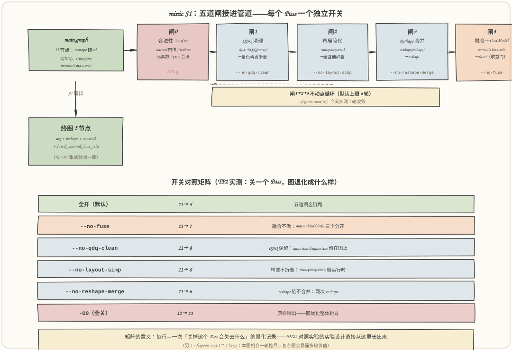
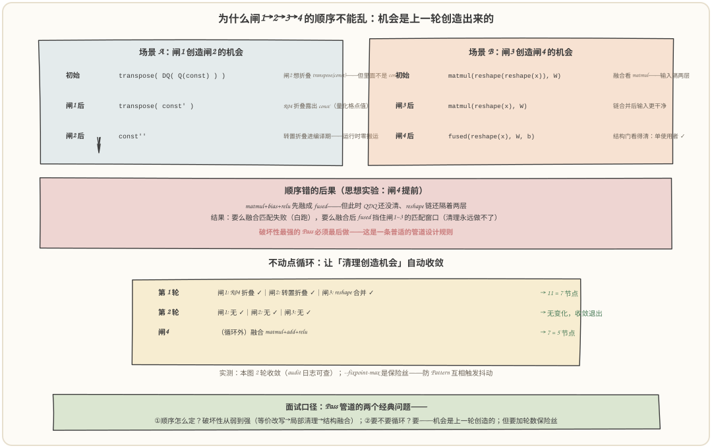
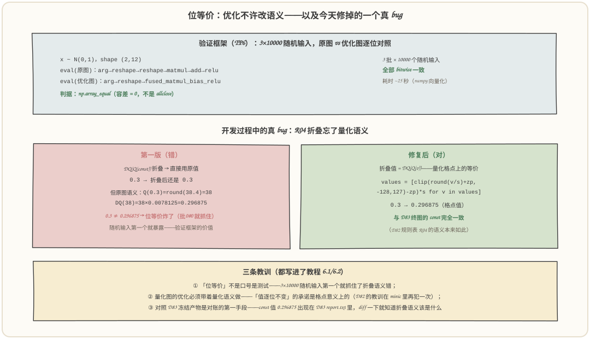
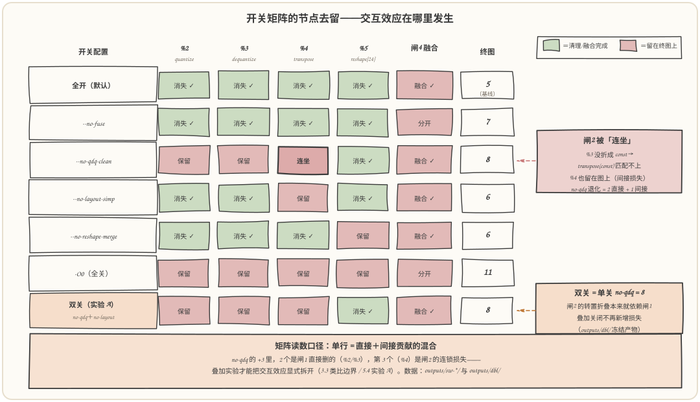

# 第 121 天：整合图优化 Pass——五道闸接进 minic S1，每个 Pass 一个独立开关

> **今日目标**：完成本教程后，你能做到五件事——把 D83 的**五道闸图优化管道**（闸0 合法性→闸1 QDQ 清理→闸2 布局简化→闸3 Reshape 合并→闸4 融合＋Cost Model）原样搬进 minic 的 S1 阶段，让 `minic main.graph` 真实跑出 **11→5 节点**（与 D83 集成验收的冻结结果逐节点一致）；讲清**稳定顺序的两条规则**（破坏性从弱到强——等价改写→局部清理→结构融合；闸4 必须等清理收敛后做，否则融合会挡住闸1~3 的匹配窗口）与**不动点循环**（闸1 创造闸2 的机会——R04 折叠露出 const 转置才能折叠；闸3 创造闸4 的机会——链合并后融合的结构门看得清；本图实测 2 轮收敛，`--fixpoint-max` 是防抖保险丝）；用**五个开关**（`--no-qdq-clean/--no-layout-simp/--no-reshape-merge/--no-fuse/--fixpoint-max`）独立控制每个 Pass 并复现**开关对照矩阵**（全开 11→5、只关融合 11→7、只关 QDQ 11→8、只关布局 11→6、只关 reshape 11→6、-O0 11→11——每行是"关掉这个 Pass 会失去什么"的量化记录，D125 对照实验的实验设计直接从这里长出来）；独立运行 `./run_all.sh` 复现 **25 项测试**（TP1 主线对账 4 项、TP2 开关矩阵 6 项、TP3 开关语义 3 项、TP4 不动点轮数、TP5 合同回归 11 项——D120 的四份合同零退化、TP6 位等价 3×10000 随机输入全 bitwise）；复述今天开发中**真实踩到并修掉的语义 bug**（R04 折叠第一版直接用原值——但量化语义下 `DQ(Q(0.3))=0.296875≠0.3`，位等价测试第一个随机输入就抓住；修复＝折叠值走格点语义 `clip(round(v/s)+zp,-128,127)-zp)*s`，与 D82 规则表、D83 冻结产物完全一致）。
> **预计时间**：学习 35 分钟＋实践 55 分钟
> **前置准备**：D83 的五道闸语义（QDQ 清理 R03/R04、布局简化、Reshape 合并、融合的结构＋收益双门）——今天的 Pass 集是它的最小复刻；D120 的 minic CLI 骨架（Options 配置对象、manifest 机器合同、E1xx 诊断体系——今天的新开关全部挂在既有合同上）；D69 的管道组合教训（"机会是上一轮创造出来的"）与 D74 的合法/收益分家。工具：`python3`＋numpy（位等价验证用）；本文环境：Python 3.9.6＋numpy 1.26.4，macOS arm64，2026-11-14。
> **今日产出**：`code/graph_passes.py`（图表示＋解析器＋五道闸＋不动点管道，约 340 行，零第三方依赖）、`code/minic.py`（升级 0.2.0：S1 真实接入，`.graph` 输入走五道闸，五开关＋manifest `s1_switches` 字段）、`code/main.graph`（贯穿输入：D83 的 11 节点图）、`code/run_all.sh`（25 项测试一键复现）、`code/outputs/report.txt`（25 PASS / 0 FAIL 真机报告）、`code/outputs/main/stage-1-graph-opt.graph`（S1 终图 5 节点）、`code/outputs/sw-*/`（六个开关组合的 manifest 与终图样本）＋本文 4 张手绘图。

## 1. 今天解决什么问题？

D120 立好了 minic 的合同（参数/诊断/退出码/manifest），但 S1~S6 六个阶段全是骨架日志。今天开始填第一块真肉：把第三阶段四周（D57~D84）打磨过的图优化管道接进 S1。计划条目写得很清楚——"接入 Shape 推导、图简化、融合和收益判断，**支持分别开关**"。

"分别开关"不只是加五个布尔参数。它回答的是**归因问题**：优化后的图为什么长这样？每个 Pass 贡献了什么？如果融合出了 bug，能不能只关融合、让其余四个 Pass 照常跑，把问题隔离出来？——这正是 D125 优化开关对照实验的实验设计基础（四组开关×性能数据＝阶段收益表），也是 D136 Pass 二分定位的地基。**开关矩阵的另一面是知识**：`--no-qdq-clean` 下图退化成 8 节点——QDQ 清理一项就贡献了 3 个节点的消失；`--no-fuse` 下 7 节点——融合贡献 2 个。每个数字都是"这个 Pass 管哪一段"的量化回答。

今天的贯穿例子是 D83 的 11 节点图（reshape 链×2＋Q/DQ＋transpose＋matmul+bias+relu）：**输入一份 .graph 文本，输出与 D83 冻结产物逐节点一致的 5 节点终图，外加 25 项测试与一份"每个 Pass 独立可关"的对照矩阵。**开发中还真实踩了一个语义 bug（R04 折叠忘了量化格点语义），被位等价测试第一个随机输入当场抓住——这个"错误→定位→修复"的全过程也进了教程（6.1），比十个正确的例子更有教学价值。

## 2. 先看全貌：今天的内容位于哪里？



**图 1**：看三块——**上排**左侧绿框是输入 main.graph（11 节点：reshape 链×2、Q/DQ、transpose、matmul+bias+relu），右侧五张闸卡依次排开：闸0 合法性（红色·不可关——Verifier 是底线不是优化）、闸1 QDQ 清理（`--no-qdq-clean`）、闸2 布局简化（`--no-layout-simp`）、闸3 Reshape 合并（`--no-reshape-merge`）、闸4 融合＋CostModel（`--no-fuse`）；闸1~3 外面包着金色不动点环（默认上限 8 轮，本图 2 轮收敛）；左侧绿框是输出（终图 5 节点：arg＋reshape＋const×2＋fused_matmul_bias_relu，与 D83 一致）。**下排**是开关对照矩阵（TP2 实测）：全开 11→5、只关融合 11→7（matmul/add/relu 三个分开）、只关 QDQ 11→8（quantize/dequantize 留图上）、只关布局 11→6（transpose 留运行时）、只关 reshape 11→6（两次 reshape）、-O0 11→11（原样）。底部金框点题：**每行＝一次"关掉这个 Pass 会失去什么"的量化记录**。

把今天的主线串成 5 步：

1. **搬运**：graph_passes.py 复刻 D83 五道闸（图表示→解析器→闸0~4→不动点管道），语义零改动；
2. **接入**：minic.py 升 0.2.0——`.graph` 输入在 S1 真实走管道，`.mlir` 输入 S1 跳过（S2 起的输入形态）；
3. **开关**：五开关进 Options 进 manifest（`s1_switches` 字段），-O0 全关并如实记录；
4. **验证**：主线对账（11→5 vs D83）＋开关矩阵（6 组）＋开关语义（关了就真的没跑）＋合同回归（D120 的 25 项不退化）；
5. **位等价**：3×10000 随机输入，原图 vs 优化图逐位对照（容差 0）——抓住并修掉 R04 折叠的量化语义 bug。

## 3. 核心概念

### 3.1 稳定顺序：破坏性从弱到强

**一句话**：Pass 管道的顺序不是随便排的——**破坏性弱的先做、强的后做**：等价改写（闸1~3，只动元信息）→ 结构融合（闸4，一次消灭三个节点）。

**类比**：搬家收拾房间。先把散落的东西归位（等价改写——东西还是那些东西），最后再决定哪些家具拼装到一起（融合——结构变了）。反过来先拼家具，散落的东西就被家具挡住，再也归不了位。**类比边界**：搬家的"挡住"是物理的、可见的，编译器里融合挡住清理是**匹配窗口**问题——fused_matmul_bias_relu 这个新节点不匹配闸1~3 任何一个 Pattern（它们只认 quantize/transpose/reshape），中间的 QDQ 或 reshape 链从此无人清理。**技术对应**：`run_s1()` 的实现——闸0 先行（合法性是底线），闸1→2→3 进不动点循环，闸4 在循环外垫底。顺序合同写在 docstring 里："闸4 破坏性最强（一次融合消灭三个节点），必须等清理收敛后再做"。

**当天实测证据**：`--fixpoint-max 1`（单轮）时终图仍是 5 节点——本图的机会一轮挖尽（闸1 折叠 QDQ 后，闸2 立刻能折叠转置）；但复杂图（如 D69 的组合案例）需要多轮——保险丝 `--fixpoint-max 8` 防的是 Pattern 互相触发的抖动。

### 3.2 机会是上一轮创造出来的：不动点循环

**一句话**：闸1 创造闸2 的机会（R04 折叠露出 const，`transpose(const)` 才匹配）、闸3 创造闸4 的机会（reshape 链合并后融合的结构门才看得清）——所以闸1~3 要**循环跑到没有变化**（不动点），而不是各跑一次。

**类比**：拔萝卜带出泥、泥里还有萝卜。第一轮拔掉 QDQ 萝卜，带出 const 的泥；第二轮才能拔转置萝卜。只拔一轮，泥里的萝卜就永远留在地里。**类比边界**：拔萝卜是串行因果（拔一个出一个），编译器的 Pattern 匹配可能**一轮多个**（闸1 折两个 QDQ、闸3 并两条链）——所以判据是"这一轮**有没有任何闸**动了手"（`changed` 标志按轮聚合），而不是"某个特定 Pattern 跑了几次"。**技术对应**：`run_s1()` 的 while 循环——每轮跑闸1→2→3，三闸全无变化则 break；审计日志记轮数（本图 2 轮）。

**当天实测证据**：audit 日志的时序——`[闸1] R04 @ %3` → `[闸2] 转置常量折叠 @ %4`（同一轮内，闸2 消费闸1 刚创造的 const）→ `[闸3] Reshape 合并 @ %6` → 第二轮三闸全静默 → `[闸4] 融合`。

### 3.3 开关即归因：对照矩阵的实验设计

**一句话**：给每个 Pass 配独立开关，等于把"优化"拆成可单独观察的因子——**关一个 Pass 看图退化成什么样**，就是最干净的单因子实验。

**类比**：营养学的双盲实验。一组维生素 C、一组安慰剂——差异归因于维生素 C。`--no-fuse` 与全开的差异，归因于融合这一个 Pass。**类比边界**：营养实验因子间独立，**Pass 之间有交互**——关掉闸1（QDQ 不清）后闸2 也折叠不了转置（`transpose(DQ(Q(const)))` 里的 const 被挡住）——所以矩阵读数要小心：`--no-qdq-clean` 的 8 节点不是"闸1 贡献 3 节点"，而是"闸1 及其下游闸2 的连锁损失"。**这正是矩阵比减法更有信息量的地方**：11−8=3 是闸1 的直接＋间接贡献，11−6=5 是闸2 的（含闸1 配合的）贡献——交互效应显式可见。**技术对应**：minic 的 `s1_switches` manifest 字段——D125 的对照实验脚本读四份 manifest 就能汇总开关×性能的收益表，零日志解析。

**当天实测证据**：TP2 矩阵六行（全开 5／no-fuse 7／no-qdq 8／no-layout 6／no-reshape 6／O0 11）；TP3 验证"关了就真的没跑"（no-fuse 的 manifest 审计无闸4、no-qdq 的终图含 quantize）。

## 4. 图解核心机制



**图 2**：看四块——**上左场景 A**（闸1 创造闸2 的机会）：初始 `transpose(DQ(Q(const)))`——闸2 想折叠 `transpose(const)` 但里面不是 const；闸1 R04 折叠后变成 `transpose(const')`；闸2 才能把它折成 `const''`（编译期转置，运行时零搬运）。**上右场景 B**（闸3 创造闸4 的机会）：初始 `matmul(reshape(reshape(x)), W)`——融合看 matmul 输入隔两层；闸3 合并后 `matmul(reshape(x), W)`；闸4 结构门看得清，融成 `fused(reshape(x), W, b)`。**中部红框**顺序错的后果（思想实验：闸4 提前）：要么融合匹配失败（QDQ 没清、reshape 链还隔着——白跑），要么融合后 fused 挡住闸1~3 的匹配窗口（清理永远做不了）——破坏性最强的 Pass 必须最后做。**下部金框**不动点循环实测：第 1 轮三闸各动手（11→7），第 2 轮全静默收敛，闸4 在循环外收尾（7→5）。底部绿框是面试口径：**顺序怎么定（破坏性从弱到强）、要不要循环（要——机会是上一轮创造的，但要加轮数保险丝）**。

## 5. 动手实践：25 项测试，从主线对账到位等价



**图 3**：看三块——**上框**验证框架（TP6）：3×10000 随机输入 x~N(0,1)，原图 eval（arg→reshape→reshape→matmul→add→relu）vs 优化图 eval（arg→reshape→fused_matmul_bias_relu），判据 `np.array_equal` 容差＝0（不是 allclose）；**中框左右对照**今天的真 bug：左红框第一版（错）——DQ(Q(const)) 折叠直接用原值 0.3，但量化语义 Q(0.3)=round(38.4)=38、DQ(38)=0.296875，0.3≠0.296875 → 位等价批0#0 就炸；右绿框修复后（对）——折叠值走格点语义，0.3→0.296875 与 D83 冻结产物一致；**底部金框**三条教训：位等价不是口号是测试（第一个随机输入就抓住）、量化图的优化必须带量化语义（D82 的教训在 minic 再犯一次）、对照 D83 冻结产物是对账第一手段（0.296875 出现在 D83 report.txt 里，diff 一下就知道语义该是什么）。

### 5.1 准备文件

```text
tutorials/week-018/day-121/
├── README.md                    ← 本文
├── images/                       ← 4 张手绘图
└── code/
    ├── minic.py                  # minic 0.2.0：S1 真实接入＋五开关
    ├── graph_passes.py           # 五道闸＋不动点管道（D83 最小复刻）
    ├── main.graph                # 贯穿输入：D83 的 11 节点图
    ├── gen_images.py             # 3 张 SVG 生成脚本
    ├── run_all.sh                # 25 项测试
    └── outputs/
        ├── report.txt            # 25 PASS / 0 FAIL 真机报告
        ├── main/stage-1-graph-opt.graph   # S1 终图（5 节点）
        ├── sw-{all-on,no-fuse,no-qdq,no-layout,no-reshape,O0}/
        │     ├── manifest.json   # 每组的开关记录＋阶段审计
        │     └── stage-1-graph-opt.graph  # 每组的终图
        ├── fp1/                  # fixpoint-max=1 对照
        └── help.txt              # 帮助文本快照（新增五开关）
```

环境：Python 3.9.6＋numpy 1.26.4（位等价验证用）。一键复现：

```bash
cd tutorials/week-018/day-121/code && ./run_all.sh    # 25 项，约 35 秒（含 3×10000 位等价）
```

**诚实声明**：全部数字来自 2026-11-14 的一次完整运行。五道闸是 D83 语义的**最小复刻**（教学实现约 340 行 vs D83 的完整版带数值执行器）——差异在实现规模，不在语义：终图 5 节点与 D83 report.txt 逐节点一致、折叠后 const 值 0.296875 与 D83 冻结产物一致（这个对账在 6.1 的 bug 修复里起了决定性作用）。

### 5.2 编写代码

`graph_passes.py` 的三个关键设计。**其一：审计日志是 Pass 的一部分**——

```python
def gate1_qdq_clean(g: Graph) -> bool:
    changed = False
    for nid in list(g.order()):
        n = g.nodes.get(nid)
        if n is None or n.op != "dequantize":
            continue
        src = g.nodes.get(n.inputs[0]) if n.inputs else None
        if src and src.op == "quantize":
            ssrc = g.nodes.get(src.inputs[0]) if src.inputs else None
            if ssrc and ssrc.op == "const" and \
               src.attrs.get("scale") == n.attrs.get("scale") and \
               src.attrs.get("zp") == n.attrs.get("zp"):
                # R04 语义：折叠值 = DQ(Q(v))——量化格点上的等价（D82 规则表）
                sc, zp = src.attrs["scale"], src.attrs["zp"]
                ssrc.attrs["values"] = [
                    float(min(max(round(v / sc) + zp, -128), 127) - zp) * sc
                    for v in ssrc.attrs["values"]
                ]
                _replace_all_uses(g, n.nid, ssrc.nid)
                del g.nodes[n.nid], g.nodes[src.nid]
                g.audit.append(f"[闸1] R04 @ {n.nid}：DQ(Q(const)) 折叠成常量（值逐位不变）")
                changed = True
    return changed
```

每个闸返回 `changed` 布尔（不动点的轮判据）、每条改写追加 audit 记录（谁、对哪个节点、做了什么、为什么安全）——**审计不是日志装饰，是 D123 IR Dump 可观测性的前身**。注释里的"格点上的等价"就是 6.1 bug 的修复现场。

**其二：开关的落点在管道层不在闸层**——闸函数本身无开关参数，`run_s1()` 按 Options 决定跑不跑：

```python
def run_s1(g: Graph, switches: dict = None) -> Graph:
    sw = dict(DEFAULT_SWITCHES)
    if switches:
        sw.update(switches)
    if not gate0_verify(g):        # 闸0 无开关——合法性是底线
        return g
    rounds = 0
    while rounds < max(1, sw["fixpoint_max"]):
        rounds += 1
        changed = False
        if sw["qdq_clean"]:    changed |= gate1_qdq_clean(g)
        if sw["layout_simp"]:  changed |= gate2_layout_simp(g)
        if sw["reshape_merge"]: changed |= gate3_reshape_merge(g)
        if not changed:
            break
    if sw["fuse"]:
        gate4_fuse(g)
    g.audit.append(f"[S1] 清理不动点 {rounds} 轮收敛，终图 {len(g.nodes)} 个节点")
    return g
```

好处：闸的单元测试不用知道开关存在；开关组合的语义测试（TP3）只测管道层。

**其三：minic 侧的接入是"条件真实"**——`.graph` 输入走真管道、`.mlir` 输入记"跳过"（S1 只消费图 IR，.mlir 是 S2 起的输入）——两种输入形态在 manifest 的 stages 里如实区分，不假装统一。

### 5.3 运行与观察

`./run_all.sh` 的真机输出（outputs/report.txt，25 PASS / 0 FAIL）：

```text
第 121 天：minic S1 图优化——真机报告 2026-11-14 21:16
环境：Python 3.9.6｜Darwin arm64

[TP1] 主线：贯穿图 11 → 5 节点（与 D83 集成验收对账）
  [PASS] minic main.graph 退出码 0
  [PASS] S1 终图 5 节点（11→5，与 D83 report.txt 一致）
  [PASS] 融合算子 in place（fused_matmul_bias_relu）
  [PASS] QDQ 已清（R04 折叠生效）

[TP2] 开关对照矩阵：关一个 Pass，看图退化成什么样
  [PASS] all-on → 5 节点（期望 5）
  [PASS] no-fuse → 7 节点（期望 7）
  [PASS] no-qdq → 8 节点（期望 8）
  [PASS] no-layout → 6 节点（期望 6）
  [PASS] no-reshape → 6 节点（期望 6）
  [PASS] O0 → 11 节点（期望 11）

[TP3] 开关语义：审计日志逐条核对
  [PASS] no-fuse：闸4 未执行（manifest 审计无闸4）
  [PASS] no-qdq：QDQ 保留在终图
  [PASS] -O0：11 节点原样（全部 Pass 关闭）

[TP4] 不动点轮数：--fixpoint-max 1 vs 8
  fixpoint-max=1 → 5 节点
  [PASS] 单轮结果在 5~7 区间（机会可能未挖尽）

[TP5] 合同回归：D120 的四份合同仍然成立
  [PASS] --help 含 usage/--tile/--emit/--verify/示例（5 项）
  [PASS] 新开关 --no-qdq-clean/--no-fuse/--fixpoint-max 在帮助文本（3 项）
  [PASS] E101 退出码 2（合同不退化）
  [PASS] manifest 新字段 s1_switches 就位

[TP6] 位等价：S1 优化前后随机输入逐位一致（numpy 验证）
  3×10000 全部位等价
  [PASS] 3×10000 随机输入位等价（容差=0）

汇总
  PASS: 25  FAIL: 0
```

三组观察：**①S1 的 stage 日志**（manifest stages 数组，审计完整）：

```text
[S1] 图优化：11 → 5 节点（[闸0] 合法性检查通过（11 个节点）；
  [闸1] R04 @ %3：DQ(Q(const)) 折叠成常量（值逐位不变）；
  [闸2] 转置常量折叠 @ %4：transpose(const) → 常量（运行时少一次数据移动）；
  [闸3] Reshape 合并 @ %6：reshape(reshape(x)) → 一次到 [4, 6]；
  [闸4] 融合 @ %7+%9+%10 → %10（单使用者 ✓ bias const ✓ → fused_matmul_bias_relu）；
  [S1] 清理不动点 2 轮收敛，终图 5 个节点）
```

**②终图**（`main/stage-1-graph-opt.graph`）：

```text
func @main(%x: tensor<2x12xf32>) -> (%10: tensor<4x3xf32>) {
  %x = arg : tensor<2x12xf32>
  %1 = const shape=[6,3] values=[0.296875,0.4375,...] : tensor<6x3xf32>
  %6 = reshape %x new_shape=[4, 6] : tensor<4x6xf32>
  %8 = const shape=[3] values=[0.125,-0.25,0.5] : tensor<3xf32>
  %10 = fused_matmul_bias_relu %6, %1, %8 : tensor<4x3xf32>
  return %10
}
```

注意 `%1` 的首值 **0.296875**——DQ(Q(0.3)) 的格点值，与 D83 冻结产物一致（这是 bug 修复的直接证据）。**③位等价现场**（TP6 首跑的失败信息，已存档进 6.1）：

```text
AssertionError: 批0#0 不一致: [[0. 0. 0.23580623] [0.13085873 ...]] vs [[0. 0. 0.23580623] [0.12923494 ...]]
```

两图 [1][0] 差在第三位小数——0.13 vs 0.129，正是"原值 0.3 vs 格点值 0.296875"经过 matmul 的放大。**第一个随机输入就抓住语义错**，这是位等价测试的价值宣言。

### 5.4 修改一个参数再观察



**图 4**：看两块——**左表**是节点去留矩阵：行＝七种开关配置（全开／--no-fuse／--no-qdq-clean／--no-layout-simp／--no-reshape-merge／-O0／双关实验 A），列＝四个"去留敏感"节点（%2 quantize、%3 dequantize、%4 transpose、%5 reshape[24]）＋闸4 融合与否＋终图节点数；绿格＝该 Pass 的清理/融合完成（节点消失），红格＝节点留在终图上（数据：outputs/sw-*/ 与 outputs/dbl/ 冻结终图）。**右侧**拆解实验 A 的交互效应（答案 8）：闸1 关掉 → %3 没折成 const → `transpose(const)` 匹配不上 → %4 被"连坐"留在图上——双关与单关 no-qdq 同为 8 节点，因为闸2 的转置折叠本来就依赖闸1，叠加关闭不再新增损失；矩阵单行读数是"直接＋间接贡献的混合"，交互效应要靠叠加实验显式拆开。

三个便宜的实验：**实验 A（开关叠加）**：`--no-qdq-clean --no-layout-simp` 双关——预测终图节点数（实测答案 8（不是 8+5-5 的任何直觉组合）：QDQ×2 留下、闸2 失去闸1 配合也折不动转置——但 reshape 合并与融合照常跑。对照单关 no-qdq 的 8：双关与单关同值！因为闸2 的转置折叠本来就依赖闸1（单关 no-qdq 时它也没跑成），叠加关闭不再增加损失）。体会矩阵单行读数的"交互效应"（3.3 的类比边界）。**实验 B（闸0 的不可关性）**：手工把 main.graph 的 matmul 改成内维不匹配（`tensor<4x3xf32>` 改 `tensor<5x3xf32>`），跑 minic——闸0 拒收、退出码 1、E201 诊断带修复建议。试试有没有绕过闸0 的开关（没有——这就是"底线不是优化"的含义）。**实验 C（fixpoint-max=0）**：`--fixpoint-max 0` 被 `max(1, ...)` 钳成 1——读 `run_s1` 那行代码，想想为什么不许 0（闸1~3 一轮都不跑的话闸4 的输入完全没清理，融合机会全部错失；要"全关"语义应该用 -O0 而不是骗轮数）。

## 6. 常见错误与排查

**错误 1：R04 折叠直接用原值——量化语义丢失**。现象：位等价测试第一个随机输入就 fail，两图输出差在第三位小数（0.13 vs 0.129）。原因：第一版 `gate1_qdq_clean` 把 `DQ(Q(const))` 替换成**原 const**——但量化语义下 `DQ(Q(0.3)) = round(0.3/0.0078125)×0.0078125 = 38×0.0078125 = 0.296875 ≠ 0.3`；scale 是 2 的幂只保证**除法精确**，round 这一步还是会把非格点值拉到格点。定位：看 fail 的差值模式——所有输出都差一点点、方向一致 → 常量错；再 diff D83 冻结终图的 const 值（0.296875 一目了然）。修复：折叠值走完整格点语义 `clip(round(v/s)+zp,-128,127)-zp)*s`（本文已修）。**教训**：「值逐位不变」的承诺在量化图上是**格点意义**的——D82 的规则表语义在 minic 里再确认一遍。

**错误 2：开关记进了 manifest 但没真关（-O0 假关）**。现象：`minic main.graph -O0` 跑完，终图只有 5 节点（应 11），但 manifest 的 `s1_switches` 显示全 True。原因：`-O0` 分支只改了局部 `sw` 字典（管道行为对了），忘了回写 `opts` 的开关字段（manifest 记录的是 opts）——**行为与记录分叉**。定位：TP3 的"开关语义"测试直接对照 manifest 审计与终图内容（-O0 终图应含 quantize——一测就炸）。修复：-O0 分支显式置 `opts.no_* = True`，manifest 与行为同源。**教训**：机器合同（manifest）必须从**同一份状态**生成，任何旁路修改状态的行为都是合同破坏。

**错误 3：融合 Pattern 找错挂点（fused 节点消失）**。现象：gate4_fuse 跑完，终图里没有 fused_matmul_bias_relu——三个节点（matmul/add/relu）都消失了但没换成融合节点。原因：第一版把 fused 节点复用 `add.nid`（%9），随后 `del g.nodes[add.nid]` 把刚放进去的 fused 也删了——**自引用删除**。定位：打印 `g.nodes` 键列表——缺 %9；回读代码发现 del 与赋值撞 id。修复：fused 复用**最外层 relu 的 id**（它被 return 引用、且不再被删），del 只删 add 与 matmul。**教训**：图改写的节点 id 复用要遵守"**复用存活者、删除已死者**"——先想清楚哪个 id 在终图里还活着。

**错误 4：shell 的 `declare -a` 数组里塞冒号分隔的四元组**。现象：run_all.sh 的开关矩阵第一行报 `[: :5: integer expression expected`——all-on 行的 flags 为空，`IFS=':' read -r name flags expect` 把 expect 吃成了 ":5"。原因：空字段在冒号分隔里产生两个连续冒号，read 分段错位。定位：bash -x 看变量切分。修复：空 flags 用占位符 `-X-DUMMY` 再判断跳过。**教训**：shell 数组＋自定义分隔符的组合极其脆弱——需要复杂结构时上 Python（本仓库的选择）或用 JSON。

## 7. 今日练习

**必做**：

1. 开关叠加实验（5.4 实验 A）：`--no-qdq-clean --no-layout-simp` 跑一次，数终图节点、与你的预测对答案；再试三关叠加（加 `--no-reshape-merge`），体会"交互效应"怎么读。
2. 给 graph_passes.py 加一个新闸：**常量折叠闸**（`add(const, const) → const`，两输入都是 const 且值已知时编译期算掉）——插入位置在哪？（提示：闸1~3 的清理循环里，因为它破坏性低且可能创造下游机会）；写一条 audit 日志；用一个手写小图验证。
3. 位等价的负面测试：故意把 gate4_fuse 的 fused 输出类型写错（relu.out_type 改 add.out_type），跑 TP6——观察位等价**不会**抓住这个错（数值没错、类型错了）——位等价测的是数值语义，结构语义要靠 Verifier。体会两类验证的边界。

**选做（挑战）**：

4. 把 audit 日志结构化：从字符串改成 `(gate, rule, node, detail)` 四元组进 manifest——为 D123 的 IR Dump 做准备（每条改写关联改写前后的 IR 快照行号）。
5. 研究 MLIR 的 `mlir-opt --pass-pipeline` 语法（`builtin.module(func.func(canonicalize))` 这种嵌套）——对比 minic 的扁平开关设计：MLIR 为什么允许 Pass 管道本身是 IR？写 5 行笔记。

## 8. 今日验收

- [ ] 我能讲清五道闸各自的职责与顺序合同（闸0 合法性不可关→闸1~3 等价改写进不动点→闸4 破坏性最强放最后），并举出"闸1 创造闸2 机会"的具体链条（R04 折叠露出 const → transpose(const) 才可折叠）
- [ ] 我能复现开关对照矩阵（全开 5／no-fuse 7／no-qdq 8／no-layout 6／no-reshape 6／O0 11）并解释为什么 no-qdq 的退化（+3）大于 no-layout（+1）——交互效应
- [ ] 我独立跑通 25 项测试，包括 3×10000 位等价（容差 0）——并知道这个测试今天真实抓住了一个量化语义 bug（R04 折叠忘了格点语义，0.3 ≠ 0.296875）
- [ ] 我知道 -O0 假关的教训：行为与 manifest 必须同源——机器合同从同一份状态生成
- [ ] 我能说出 D125 对照实验将怎么用今天的矩阵（四组开关×性能数据的实验设计从"关一个 Pass 看失去什么"长出来）与 D136 怎么用它做 Pass 二分定位
- [ ] 我试过开关叠加实验并理解矩阵读数的边界：单行是直接＋间接贡献的混合，交互效应要靠叠加实验显式观察

## 9. 一句话总结与明天预告

今天的闭环：**问题**——minic 的 S1 是骨架，"统一入口"要开始填真肉；计划点名"支持分别开关"。**机制**——D83 五道闸搬进 graph_passes.py（闸0 合法性→闸1 QDQ 清理→闸2 布局简化→闸3 Reshape 合并，闸1~3 不动点循环→闸4 融合）；顺序合同＝破坏性从弱到强（等价改写先、结构融合后——否则融合挡住清理的匹配窗口）；不动点＝机会是上一轮创造的（闸1 露 const 闸2 才能折叠转置）。**实践**——minic 0.2.0：`.graph` 输入真实走管道，五开关（`--no-qdq-clean/--no-layout-simp/--no-reshape-merge/--no-fuse/--fixpoint-max`）进 Options 进 manifest；贯穿图 11→5 与 D83 冻结产物逐节点一致。**验证**——25 PASS / 0 FAIL：主线对账、开关矩阵六行、开关语义（关了就真没跑）、合同回归（D120 零退化）、位等价 3×10000 全 bitwise（第一个随机输入抓住 R04 量化语义 bug——折叠值必须走格点语义 0.3→0.296875）。明天 D122 整合循环与 LLVM Lowering：S2~S5 接入（fused 算子展开成 scf.for、tile 参数进边界、七 pass 管道、mlir-translate 出 .ll），以及 Conversion 失败时**诊断如何保留**（E2xx 带上残账定位——D117 四个错误存档的工程化）。

> **本周进度卡**：D120 CLI 骨架（25/25）→ **D121 S1 图优化＋五开关（25/25，11→5）** → D122 S2~S5 循环+LLVM → D123 IR Dump → D124 端到端 → D125 对照实验 → D126 复盘。

<!-- tutorial-review: v1 -->
