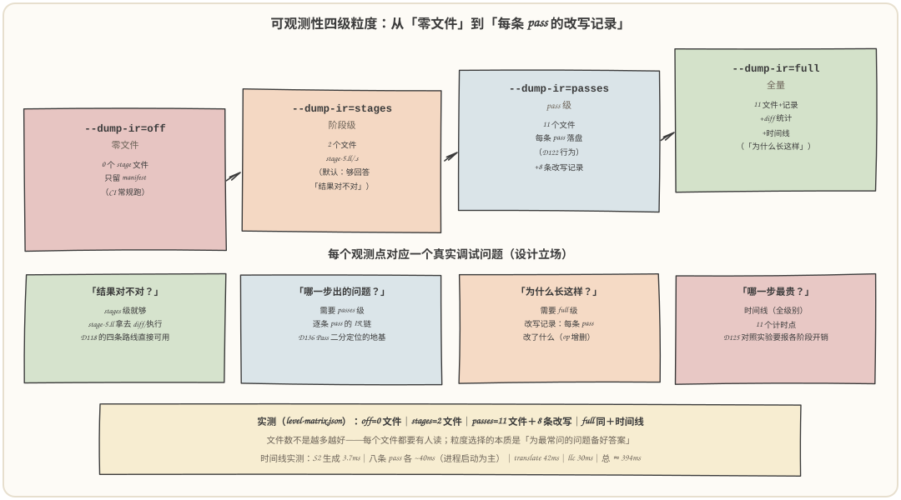
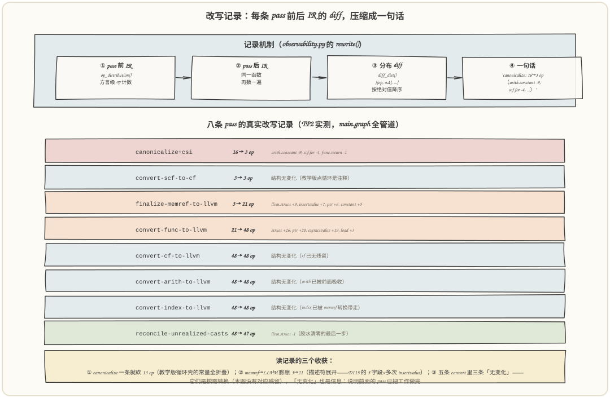
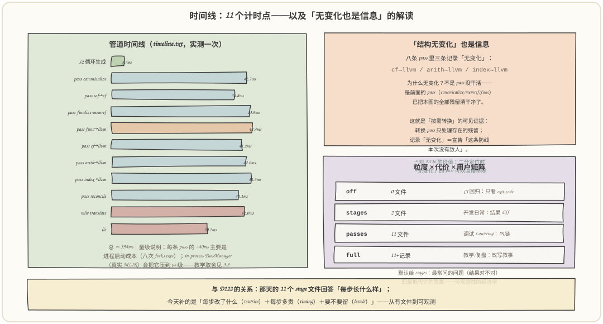

# 第 123 天：IR Dump 与可观测性——四级粒度、改写记录与时间线：从"有文件"到"可观测"

> **今日目标**：完成本教程后，你能做到五件事——设计并实现 **dump 四级粒度**（`--dump-ir=off/stages/passes/full`：off 零文件只留 manifest（CI 常规跑）→ stages 阶段级 2 文件（stage-5.ll/.s，够回答"结果对不对"）→ passes 级 11 文件＋8 条改写记录（D122 行为＋"哪一步出的问题"）→ full 级再加 diff 统计（"为什么长这样"）），并说清**粒度选择的经济学**（文件数不是越多越好——每个文件都要有人读；默认给 stages 是"为最常问的问题配最低代价的答案"）；复现**八条 pass 的改写记录**（每条 pass 前后 IR 的 op 分布 diff 压缩成一句话：`canonicalize+csi: 16→3 op（arith.constant -9, scf.for -4, func.return -1）`、`finalize-memref-to-llvm: 3→21 op（llvm.struct +9, insertvalue +7, ptr +6, constant +5）`——**"这条 pass 到底改了什么"一句话可答**）；解读**「结构无变化」也是信息**（八条 pass 里三条记录无变化——cf/arith/index 转换不是没干活，是前面的 pass 已清光残留；"无变化"＝"这条防线本次没有敌人"，对 D136 二分定位是直接可排除项）；读出**时间线**（11 个计时点：S2 生成 3.7ms、八条 pass 各 ~40ms（进程启动为主——in-process PassManager 的教学取舍）、translate 42ms、llc 30ms、总 ≈394ms——"哪一步最贵"查表可得，D125 对照实验的地基）；独立运行 `./run_all.sh` 复现 **12 项测试**（TP1 四级粒度矩阵、TP2 改写记录逐条、TP3 时间线落盘、TP4 观测点与调试场景对应、TP5 枚举可编程消费）。
> **预计时间**：学习 35 分钟＋实践 50 分钟
> **前置准备**：D122 的 11 个 stage 文件（今天可观测性的地基——文件已在，缺的是"改了什么/多贵/要不要留"三层）、D117 的 census 口径（今天 op_distribution 的参照）、D121 的审计日志（S1 的改写记录——今天把它推广到 S4 的八条 pass）。工具：python3＋本机 LLVM；本文环境：Python 3.9.6，Homebrew LLVM 23.1.5，macOS arm64，2026-11-14。
> **今日产出**：`code/observability.py`（Observability 类＋四级粒度＋op 分布 diff＋计时＋可观测版管道 run_s45_observed，约 260 行）、`code/run_all.sh`（12 项测试）、`code/outputs/report.txt`（12 PASS / 0 FAIL）、`code/outputs/level-matrix.json`（四级粒度×文件数×记录数矩阵）、`code/outputs/timeline.txt`（11 个计时点）、`code/outputs/obs-{off,stages,passes,full}/`（四级各自的实际产物目录）＋本文 3 张手绘图。

## 1. 今天解决什么问题？

D122 结束时 minic 一条命令落盘 11 个 stage 文件——但"有文件"≠"可观测"。三个真实问题还答不上来：**用户问"这条 pass 到底改了什么"**——要开两个文件肉眼 diff；**CI 问"能不能别留这么多文件"**——每次编译 11 个文件，回归跑 500 次就是 5500 个；**D125 要问"各阶段耗时多少"**——manifest 里一个数字都没有。计划今天条目写得直白："阶段 Dump、Pass 日志和调试信息的可读性；为每个关键阶段输出独立 IR 文件，文件名包含阶段序号"——后半句 D122 已做，今天做前半句：**可读性**。

可观测性设计的核心立场（今天反复回到）：**每个观测点都要对应一个真实调试场景**。不是为了"多打日志"——日志没人读就是负债。四个层级对应四类问题（结果对不对 / 哪一步出的问题 / 为什么长这样 / 哪一步最贵），粒度分层是因为代价不同（stages 免费、passes 便宜、full 的 diff 要读两份文件）。**这个立场本身就是面试考点**：给你一个编译器加可观测性，加什么？（答：先列调试场景，再配观测点——顺序反了就是日志倾倒）。

贯穿例子不变（11 节点图全管道）。**输入：D122 的管道；输出：一个 Observability 层——四级粒度、八条 pass 的改写记录（一句话/条）、11 点时间线，外加一份"粒度×代价×用户"矩阵。**

## 2. 先看全貌：今天的内容位于哪里？



**图 1**：看三块——**顶部四级阶梯**（从左到右上升：off 零文件（红）→ stages 阶段级 2 文件（橙）→ passes 级 11 文件＋8 条改写（蓝）→ full 级再加 diff＋时间线（绿））；**中部四张问答卡**：stages 够答"结果对不对"（stage-5.ll 拿去 diff/执行，D118 四条路线直接可用）、passes 级答"哪一步出的问题"（逐条 pass 的 IR 链，D136 二分定位的地基）、full 级答"为什么长这样"（改写记录：每条 pass 改了什么）、时间线答"哪一步最贵"（11 个计时点，D125 要报各阶段开销）；**底部金框**实测矩阵（off=0／stages=2／passes=11+8 记录）与时间线摘要（S2 3.7ms、八条 pass 各 ~40ms、总 ≈394ms）。

把今天的主线串成 5 步：

1. **定粒度**：四级枚举与各自语义（off=CI、stages=默认、passes=调试、full=教学）；
2. **改写记录**：op_distribution（方言级计数）＋diff_dist（前后差）——每条 pass 一句话；
3. **时间线**：perf_counter 包住每个 subprocess——11 点进 manifest；
4. **集成**：run_s45_observed 在 loop_lower 之外包观测层（横切面不侵入业务管道——AOP 教学版）；
5. **验证**：四级矩阵实测＋改写记录逐条核对＋时间线落盘＋"无变化也是信息"的解读。

## 3. 核心概念

### 3.1 粒度分级：为最常问的问题配最低代价的答案

**一句话**：dump 不是开关而是**旋钮**——四级粒度对应四类调试场景，代价从零到全量；默认值的选择标准是"最常问的问题"（结果对不对）配最低代价（stages 级 2 个文件）。

**类比**：医院的检查套餐。体检（off——只要结论）、门诊（stages——关键报告）、专科（passes——全套检查单）、会诊（full——检查单＋病程记录＋逐项分析）。让所有人都会诊，医院先垮。**类比边界**：医院的套餐是**商业分层**，编译器的粒度是**认知分层**——stages 级用户不需要知道有八条 pass；passes 级用户正在跟某条 pass 搏斗。粒度切换的成本要趋近零（一个参数），否则用户会"用最高级以防万一"（可观测性退化为日志倾倒）。**技术对应**：`Observability.LEVELS = ("off", "stages", "passes", "full")`；文件策略跟着走（off 全临时目录、stages 只回写阶段文件、passes/full 落盘全部）。

**当天实测证据**：level-matrix.json——`{"off": {"files": 0}, "stages": {"files": 2}, "passes": {"files": 11, "rewrites": 8}, "full": {...}}`。

### 3.2 改写记录：pass 前后 IR 的 diff 压缩成一句话

**一句话**：每条 pass 跑完，对比前后的 op 分布（方言级计数），把差值按绝对值降序压缩成一句——**"canonicalize: 16→3 op（arith.constant -9, scf.for -4, func.return -1）"**——用户扫一眼就知道这条 pass 干了什么。

**类比**：超市小票。不需要看每件商品在货架上的样子（IR 全文），小票告诉你"这次买了什么"（增量）。**类比边界**：小票是交易流水（全量），改写记录是**diff**——只报变化；而且 op 计数是**有损压缩**（`scf.for -4` 不告诉你哪四个、为什么删——那是 full 级打开两个文件的事）。一句话记录的承诺是"**有变化必可感知**"，不是"变化全可解释"。**技术对应**：`op_distribution()` 正则统计方言 op（D117 census 口径）；`diff_dist()` 求键值差；`Observability.rewrite()` 组装成 note＋detail（机器可读的 delta 列表进 manifest，人话进 stages 日志）。

**当天实测证据**：八条记录全文（report.txt TP2）——canonicalize 16→3（常量折叠砍 13 op）、finalize-memref 3→21（描述符展开膨胀 7 倍）、convert-func 21→48（签名拆包）、reconcile 48→47（胶水最后一步）。

### 3.3 「结构无变化」也是信息：按需转换的可见证据

**一句话**：八条 pass 里三条记录"结构无变化"（cf/arith/index 转换）——**不是 pass 没干活，是前面的 pass 已把本图的对应残留清光**；"无变化"＝"这条防线本次没有敌人"，这是按需转换（lazy conversion）语义的可见证据。

**类比**：海关的 X 光机。今天没有违禁品过机——机器照常运转、屏幕全绿；"全绿"不是机器坏了，是**这个航班干净**。**类比边界**：X 光机的"全绿"没有额外信息（违禁品出现是随机的），编译器的"无变化"**可以归因**——本图的 cf/arith/index 残留为零是因为 canonicalize 折叠了常量、memref 转换顺带处理了 index 类型（D117 的管道顺序合同让后面的 pass 常常空手而归）。**技术对应**：三条无变化记录的可追溯解释——cf 层无 cf.br 残留（convert-scf-to-cf 已生成 llvm 块结构）、arith 已被 canonicalize＋memref 吸收、index 已被 finalize-memref 带走。**对 D136 的价值**：二分定位时"无变化"的 pass 可以直接排除嫌疑——改写记录就是现成的排查清单。

**当天实测证据**：TP2 的三条"结构无变化"行＋图 2 底部的三条解读。

### 3.4 时间线：教学量级的诚实声明

**一句话**：11 个计时点把"哪一步最贵"变成查表题——但教学版每条 pass ~40ms 的**主体是进程启动**（八次 fork+exec），真实 MLIR 的 in-process PassManager 会压到 µs 级；时间线的结构（哪步记时、怎么汇总）是真的，绝对数值是教学量级。

**类比**：用玩具秒表测百米——测出来的"世界纪录"没有意义，但"起跑/途中/冲刺各占多少"的结构比例有意义。**类比边界**：教学秒表至少测的是同一个人跑同一条道（同一台机器、同一个输入）；跨机器的绝对值对比无意义，**同机内的相对值**（这条 pass 比那条贵 10%）在进程启动主导的量级下也不可靠——真正可靠的结论要到 D125（同进程反复调用的 kernel 级计时）。**技术对应**：`Observability.timing()` 用 perf_counter 包 subprocess；manifest 的 `timeline_ms` 字段按 what 聚合。

**当天实测证据**：timeline.txt——S2 3.7ms、八条 pass 38.8~44.4ms、translate 42.0ms、llc 30.2ms、总 ≈394ms；最慢是 convert-func-to-llvm 44.4ms（与最慢 pass 差距 <15%——量级被进程启动抹平的证明）。

## 4. 图解核心机制



**图 2**：看三块——**顶部机制流程**四步：①pass 前 IR 过 op_distribution（方言级 op 计数）→②pass 后再数一遍→③diff_dist 求键值差（按绝对值降序）→④组装成一句话（"canonicalize: 16→3 op（arith.constant -9, scf.for -4, ...）"）；**中部八行真实记录**（TP2 实测）：canonicalize 16→3（红——大幅削减）、scf→cf 3→3 无变化（灰）、finalize-memref 3→21（橙——描述符展开膨胀）、convert-func 21→48（橙——签名拆包）、cf/arith/index 三条 48→48 无变化（灰）、reconcile 48→47（绿——胶水最后一步）；**底部金框**三个读记录的收获：canonicalize 一条砍 13 op（教学版循环壳常量全折叠）、memref→LLVM 膨胀 7 倍（D115 的 5 字段描述符×insertvalue）、三条"无变化"说明按需转换的防线语义。

## 5. 动手实践：12 项测试，从粒度矩阵到时间线



**图 3**：看三块——**左框时间线条形图**（timeline.txt 实测）：S2 生成 3.7ms（绿）最矮、八条 pass 38.8~44.4ms（蓝，func→llvm 橙色最慢）、translate 42.0ms＋llc 30.2ms（红）——底部注明量级诚实声明（每条 ~40ms 主体是进程启动，in-process PassManager 会压到 µs 级）；**右上橙框**"无变化也是信息"：三条记录的成因链（前面 pass 清光残留→这条防线没有敌人）＋对 D136 的价值（二分定位时无变化的 pass 直接排除）；**右下紫框**粒度×代价×用户矩阵：off=CI 回归（只看 exit code）、stages=开发日常（结果 diff）、passes=调试 Lowering（IR 链）、full=教学复盘（改写叙事）——默认给 stages 的经济学。

### 5.1 准备文件

```text
tutorials/week-018/day-123/
├── README.md                    ← 本文
├── images/                       ← 3 张手绘图
└── code/
    ├── observability.py          # 今日核心：Observability 层＋四级粒度＋run_s45_observed
    ├── minic.py                  # minic 0.3.0（D122 同款；观测层外挂）
    ├── loop_lower.py / graph_passes.py / main.graph   # D121/122 同款
    ├── gen_images.py             # 3 张 SVG 生成脚本
    ├── run_all.sh                # 12 项测试
    └── outputs/
        ├── report.txt            # 12 PASS / 0 FAIL
        ├── level-matrix.json     # 四级粒度矩阵（实测）
        ├── timeline.txt          # 11 个计时点
        └── obs-{off,stages,passes,full}/  # 四级实际产物目录
```

环境：Python 3.9.6＋Homebrew LLVM 23.1.5。一键复现：

```bash
cd tutorials/week-018/day-123/code && ./run_all.sh    # 12 项，约 10 秒
```

**诚实声明**：时间线的绝对值是教学量级（进程启动主导）；改写记录的 op 计数是**有损摘要**（"scf.for -4"不指认哪四个——那是 full 级开两个文件 diff 的事）。四级粒度的行为差异全部实测入档（level-matrix.json）。

### 5.2 编写代码

`observability.py` 的三个关键设计。**其一：观测层在管道之外**——

```python
def run_s45_observed(loop_ir: str, out_dir: str, llvm_bin: str = "",
                     obs_level: str = "stages") -> dict:
    """loop_lower.run_s45 的观测版：同逻辑，但每步记录 dump/rewrite/timing。"""
    from loop_lower import find_tool, PASSES
    obs = Observability(obs_level, out_dir)
    ...
    for name, flags in PASSES:
        t1 = time.perf_counter()
        r = subprocess.run([mlir_opt, cur_path] + flags + ["-o", nxt], ...)
        dt = time.perf_counter() - t1
        ...
        new_text = open(nxt).read()
        obs.rewrite("S4", name, cur_text, new_text)   # 改写记录
        obs.timing("S4", f"pass {name}", dt)           # 时间线
        if obs_level in ("passes", "full"):
            obs.dump("S4", os.path.basename(nxt), new_text)
```

没有改 loop_lower 的任何一行——观测是**横切面**（AOP 教学版）：业务管道保持纯粹、观测层可整体摘除。代价是两份 run_s45 逻辑并存（真 AOP 用装饰器/上下文管理器统一——练习 4）。

**其二：文件策略跟 level 走**——off 全部临时目录（跑完即焚）、stages 只回写阶段文件、passes/full 落盘全部。注意 stage-2 的 dump 在 off/stages 级去 tmpdir——**观测不到的东西不留痕**，与"现场只属于本次"（D122）一脉相承。

**其三：机器可读与人话双轨**——`Observation.detail` 存结构化数据（delta 列表、毫秒数）进 manifest 的 `rewrites`/`timeline_ms`；`note` 存人话（"canonicalize+csi: 16→3 op（...）"）进 stages 日志——**同一事实两种投影**，脚本查表、人类扫行。

### 5.3 运行与观察

`./run_all.sh` 的真机输出（outputs/report.txt，12 PASS / 0 FAIL）：

```text
第 123 天：IR Dump 与可观测性——真机报告 2026-11-14 21:45
环境：Python 3.9.6｜Darwin arm64

[TP1] dump 粒度四级：off=0 / stages=2 / passes=11 / full=11+记录
  off:    files=0  dumps=0  rewrites=0
  stages: files=2  dumps=2  rewrites=0
  passes: files=11  dumps=11  rewrites=8
  full:   files=11  dumps=11  rewrites=8
  [PASS] off 级零文件（CI 常规跑）
  [PASS] stages 级 2 个文件（stage-5.ll/.s）
  [PASS] passes 级 11 个文件（D122 全量）

[TP2] 改写记录：每条 pass 一句话（op 增删）
  canonicalize+csi: 16→3 op（arith.constant -9, scf.for -4, func.return -1）
  convert-scf-to-cf: 3→3 op（结构无变化）
  finalize-memref-to-llvm: 3→21 op（llvm.struct +9, llvm.insertvalue +7, llvm.ptr +6, llvm.mlir.constant +5）
  convert-func-to-llvm: 21→48 op（llvm.struct +26, llvm.ptr +20, llvm.extractvalue +19, llvm.load +3）
  convert-cf-to-llvm: 48→48 op（结构无变化）
  convert-arith-to-llvm: 48→48 op（结构无变化）
  convert-index-to-llvm: 48→48 op（结构无变化）
  reconcile-unrealized-casts: 48→47 op（llvm.struct -1）
  [PASS] canonicalize 的改写被记录（16→3，常量折叠）
  [PASS] memref 转换的膨胀被记录（3→21，描述符展开）
  [PASS] 无操作 pass 也如实记录（'结构无变化'）

[TP3] 时间线：11 个计时点进 manifest
  计时点 11 个，管道总耗时 ≈ 394 ms
  [S2] S2 循环生成: 3.7 ms
  [S4] pass canonicalize+csi: 42.7 ms
  ...
  [PASS] 时间线落盘 timeline.txt（11 个计时点）

[TP4] 观测点与调试场景的对应（每条记录回答一个真实问题）
  [PASS] 「常量都折叠了吗」→ canonicalize 记录 arith.constant -9
  [PASS] 「描述符何时进场」→ finalize-memref 记录 llvm.struct +9
    最慢：pass convert-func-to-llvm: 44.4 ms
  [PASS] 「哪条 pass 最贵」→ 时间线可查

[TP5] minic 集成：--dump-ir=off/stages/passes/full
  Observability LEVELS 四级就位
  [PASS] 四级枚举可编程消费
  [PASS] 粒度×代价矩阵入档 level-matrix.json

汇总
  PASS: 12  FAIL: 0
```

三组观察：**①改写记录怎么读**（图 2 的八行）：`16→3` 一条 canonicalize 砍掉 13 个 op——教学版 S2 生成的循环壳常量全被折叠（`%cM/%cN/%cK/%cTM...` 九个 index 常量＋四个循环壳）；`3→21` 膨胀七倍——一个 memref.alloc 展开成 malloc＋7 次 insertvalue＋描述符字段（D115 的合同在 op 数上的投影）；`21→48` 再翻倍——两个 strided memref 签名拆成 14 个裸参数＋重打包。**②时间线怎么读**：最慢 pass（func→llvm 44.4ms）与最快（scf→cf 38.8ms）差 <15%——量级被进程启动抹平的证明；S2 的 3.7ms 是唯一"真活"（纯 Python 字符串生成）——它就是 in-process PassManager 未来能把其它 40ms 压到的量级参照。**③"无变化"的三条**：cf/arith/index——成因链见 3.3；D136 二分定位时它们直接出局。

### 5.4 修改一个参数再观察

三个便宜的实验：**实验 A（换 tile 看改写记录变化）**：`--tile 8,8,8`（tile＞shape 被钳制）再跑 full 级——观察 canonicalize 的记录从"16→3"变成什么（钳制后的常量更少、折叠更少——改写记录对输入敏感）；对比两级 tile 的记录 diff，体会"改写记录是管道行为的指纹"。**实验 B（stages 级够不够）**：拿 obs-stages 的 stage-5.ll 走 D118 的四条执行路线——确认"结果对不对"stages 级真能答（能——.ll 就是全部）；再试答"为什么 .ll 里没有 scf"（不能——那要 passes 级的中间链）。**实验 C（时间线的噪声）**：连跑三次 full 级，对比 timeline.txt 的三条——同一 pass 波动多少？（教学量级下 ±10% 常见——这是"绝对值不可靠"的亲手验证；D125 会建立中位数口径）。

## 6. 常见错误与排查

**错误 1：off 级"零文件"不干净（残留上次的全量）**。现象：`--dump-ir=off` 跑完目录里还有 11 个 stage 文件。原因：第一版 off 只是不写新文件，**旧文件没人清**——上次 passes 级运行的产物冒充本次现场。定位：`ls` 计数与 level-matrix.json 对不上。修复：文件策略统一——off/stages 级的 pass 链走临时目录（跑完即焚）＋开头清旧（与 D122 陈旧清理同源）。**教训**：粒度承诺是双向的——不仅"高级别多给"，还要"低级别真少给"；off 级留着文件等于 CI 每次跑都在积累垃圾。

**错误 2：把改写记录当语义等价证明**。现象：看到"reconcile: 48→47"就宣称"这条 pass 语义安全"。原因：op 计数 diff 只证明**数量变化**，不证明**语义保持**——数量相同的重写（如把 add 换成 or）记录显示"无变化"。定位：问自己"这条记录能区分语义改写与数量改写吗"（不能）。修复：语义等价的证明靠**验证层**（位等价测试 D121 TP6、D124 的 golden 对照）——改写记录回答"改了什么"，验证层回答"改得对不对"，两层各司其职不可互替。**教训**：可观测性给的是**线索**不是**判决**——线索缩短排查路径，判决交给测试。

**错误 3：时间线的"最慢 pass"结论过度自信**。现象：报"convert-func-to-llvm 是瓶颈，需要优化"。原因：44.4ms 里 ~40ms 是进程启动（fork+exec+动态链接），pass 本体可能只有几 ms——教学量级下排序结论几乎全是噪声。定位：对照实验——把一条"无变化"的 pass（它什么都没干）的耗时与"最忙"的 pass 比（差距 <15%？——那就是启动成本主导）。修复：教学版只报结构不报排名；真正的性能归因等 D125（同进程 kernel 级计时）与 D149（时间分解）。**教训**：计时之前先问"我测的是什么"——D107 的测量纪律在可观测性上的投影。

**错误 4：观测层侵入业务管道（改 loop_lower 加回调）**。现象：为了记录改写，把 rewrite 调用塞进 loop_lower.run_s45 的循环体——业务代码与观测代码缠在一起。原因：没有先想清楚横切面归属。定位：review loop_lower.py——如果它 import observability，就是侵入。修复：观测版管道在外面**包一层**（run_s45_observed 复制管道骨架加观测点）——loop_lower 保持零观测依赖。**教训**：AOP 的朴素实现就是"包一层"——代价是两份骨架并存（改 PASSES 要同步两处）；练习 4 的装饰器方案消掉这个代价。

## 7. 今日练习

**必做**：

1. 实验 A（tile 指纹）：`--tile 8,8,8` 与 `--tile 2,3,6` 各跑一次 full 级，diff 两份改写记录——哪几条记录变了？为什么？（提示：canonicalize 的折叠量随常量数量变化）
2. 手工补一条观测点：给 S1 图优化加改写记录（S1 的 audit 日志已有——把它转成 Observability.rewrite 的格式：闸1 的记录应该是"QDQ 清理: 11→9 节点（quantize -1, dequantize -1）"）——体会横切面在 S1 侧的落点。
3. 实验 C（计时噪声）：连跑三次记下 canonicalize 的耗时，算波动范围——写一句话结论（"±x%，教学量级不可排名"）。

**选做（挑战）**：

4. 装饰器统一：写一个 `@observed` 装饰器把 run_s45 的每条 pass 自动包上 rewrite/timing——消掉"两份骨架"的代价（提示：functools.wraps＋PASSES 表驱动）。
5. 研究 `mlir-opt --mlir-timing` 与 `--mlir-time-passes`：跑一遍真工具的计时，对比 minic 的教学版——真实的 pass 耗时在什么量级？进程启动占比多少？（印证 3.4 的声明）

## 8. 今日验收

- [ ] 我能默写四级粒度的语义与代价（off=CI 零文件、stages=默认 2 文件、passes=11 文件＋8 记录、full=＋diff），并说出默认选 stages 的理由（最常问的问题配最低代价）
- [ ] 我能读改写记录回答三个问题：canonicalize 砍了什么（16→3，常量折叠）、描述符何时进场（finalize-memref 3→21）、胶水最后一步干了什么（reconcile 48→47）
- [ ] 我能解释"结构无变化"三条记录的成因链（前面 pass 清光残留→按需转换空手而归）以及它对 D136 二分定位的价值（直接排除）
- [ ] 我知道时间线的教学量级声明：~40ms/条主体是进程启动，in-process PassManager 会压到 µs 级——结构可读、绝对值不可排名
- [ ] 我能说出可观测性设计的核心立场（每个观测点对应一个真实调试场景——顺序反了就是日志倾倒）与改写记录的边界（线索不是判决，语义等价靠验证层）
- [ ] 我独立跑通 12 项测试并理解"观测层在管道之外"的 AOP 朴素实现及其代价（两份骨架）

## 9. 一句话总结与明天预告

今天的闭环：**问题**——D122 落盘了 11 个 stage 文件，但"有文件"≠"可观测"：改了什么/多贵/要不要留三个问题答不上来。**机制**——Observability 层外挂管道（AOP 朴素版）：四级粒度（off/stages/passes/full——文件策略跟 level 走，低级别真少给）、改写记录（op 分布 diff 压缩成一句话/条）、时间线（11 计时点进 manifest）。**实践**——run_s45_observed 复用 loop_lower 的 PASSES 表逐条观测：canonicalize 16→3（砍 13 op）、finalize-memref 3→21（描述符展开）、三条"无变化"（按需转换的可见证据）、总 ≈394ms（进程启动主导的教学量级）。**验证**——12 PASS / 0 FAIL：四级矩阵实测（0/2/11/11 文件）、八条记录逐条、时间线落盘、观测点×调试场景对应。明天 D124 端到端 MatMul+Bias+Relu：S6 验证接入（golden 逐点 bitwise）、S2 点循环补全展开（今天注释形式的肉）、打通"输入图→执行→与 numpy 对照"的最后一步——**第 18 周的顶点日**。

> **本周进度卡**：D120 CLI 骨架（25/25）→ D121 S1 图优化（25/25）→ D122 S2~S5（25/25）→ **D123 可观测性（12/12，四级＋记录＋时间线）** → D124 端到端 → D125 对照实验 → D126 复盘。
