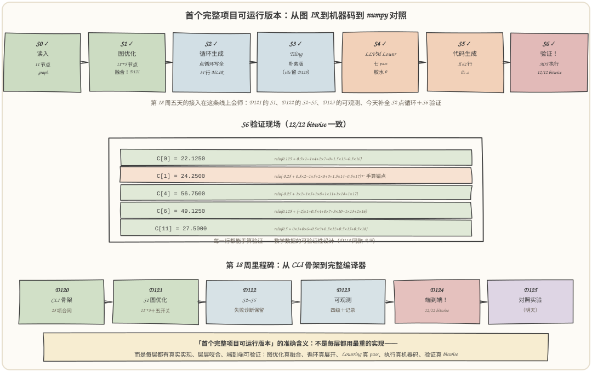
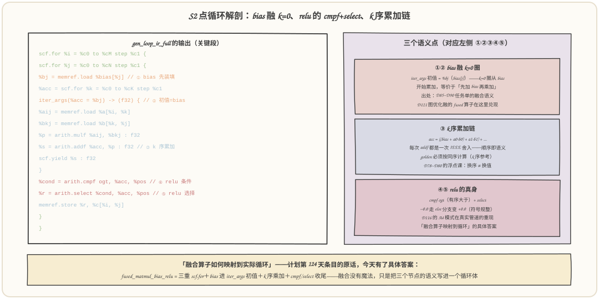
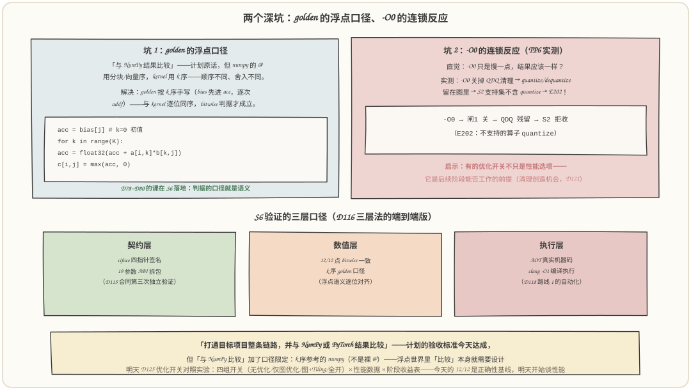

# 第 124 天：端到端 MatMul＋Bias＋Relu——首个完整项目可运行版本：12/12 bitwise

> **今日目标**：完成本教程后，你能做到五件事——跑通**首个完整端到端管道**：一条链 `11 节点图 IR → S1 融合（matmul+bias+relu→fused）→ S2 点循环真实展开（34 行 MLIR：三重 scf.for＋load/mulf/addf/store 逐点写全）→ S4 七 pass（胶水 0）→ S5 .ll/.s → S6 AOT 执行（clang 编译内嵌 golden 的 C driver）`，最终 **12/12 点与 numpy 参考逐位一致**（C[0]=22.125、C[1]=24.25——手算锚点 `relu(-0.25 + 0.5×2−1×5+2×8+0+1.5×14−0.5×17)` 可笔算验证）；讲清计划条目"**融合算子如何映射到实际循环**"的具体答案（fused_matmul_bias_relu = 三重 scf.for＋**bias 进 iter_args 初值**（k=0 圈语义）＋k 序乘加链＋**cmpf ogt＋select** 收尾——融合没有魔法，只是把三个节点的语义写进一个循环体）；避开两个深坑——**golden 的浮点口径**（numpy 的 `@` 用分块/向量序、kernel 用 k 序，顺序不同舍入不同——golden 必须按 k 序手写（bias 先进 acc 逐次 addf），bitwise 判据才成立，D78~D80 的浮点课在 S6 落地）与 **-O0 的连锁反应**（实测：-O0 关掉 QDQ 清理 → quantize 残留 → S2 支持集不含 quantize → E202 拒收——**有的优化开关不只是性能选项，是后续阶段能否工作的前提**，D121"清理创造机会"的端到端版）；独立运行 `./run_all.sh` 复现 **11 项测试**（TP1 端到端全链路、TP2 融合语义——relu 活到 .ll、TP3 bias 融 k=0、TP4 golden 口径、TP5 C 合同四指针、TP6 -O0 连锁、TP7 前五天合同回归）；说清"**首个完整项目可运行版本**"的准确含义（不是每层都用最重的实现，而是每层都有真实实现、层层咬合、端到端可验证）。
> **预计时间**：学习 35 分钟＋实践 55 分钟
> **前置准备**：本周前四天的全部零件——D121 的 S1（融合决策）、D122 的 S2~S5 管道与失败诊断、D123 的可观测层、D120 的合同框架；以及 D118 的四条执行路线（今天 S6 用 AOT 路线 1 的自动化版）、D85~D90 的任务单（bias 融 k=0 的语义出处）、D78~D80 的浮点课（golden 口径的理论基础）。工具：python3＋numpy＋本机 LLVM（clang/mlir-opt/mlir-translate/llc）；本文环境：Python 3.9.6＋numpy 1.26.4＋Homebrew LLVM 23.1.5，macOS arm64，2026-11-14。
> **今日产出**：`code/e2e.py`（**今日核心**：gen_loop_ir_full 点循环完整展开＋golden_numpy k 序参考＋verify_e2e AOT 验证驱动，约 300 行）、`code/run_all.sh`（11 项测试）、`code/outputs/report.txt`（11 PASS / 0 FAIL）、`code/outputs/loop-full.mlir`（S2 完整循环 IR，34 行）、`code/outputs/e2e-run/`（端到端产物：11 个 stage 文件＋verify_driver.c＋verify_e2e 可执行＋逐点对照输出）＋本文 3 张手绘图。

## 1. 今天解决什么问题？

第 18 周前四天把 minic 从 CLI 骨架长到五阶段真实——但管道停在"可编译证明"：S2 的点循环是注释（D122 的诚实声明）、S6 验证是骨架。今天补最后两块，让计划的验收标准落地：**"打通目标项目整条链路，并与 NumPy 或 PyTorch 结果比较"**。

"打通"两个字比看起来重。昨天的管道里，`fused_matmul_bias_relu` 只是图上的一个节点名——它到了循环层要变成**真实的乘加逻辑**（bias 从哪进循环？relu 用什么 op 表达？）；到了执行层要有**真实的机器码**（clang 编译、内存布局、ABI 调用）；到了验证层要有**真实的裁判**（numpy 参考——但浮点世界里"比较"本身就需要设计）。任何一层虚了，"端到端"就是空话。

今天开发中真实踩了两个坑，都值得原样记录：**其一**，第一版 golden 用 `numpy 的 A@B+bias`——结果 kernel 输出 24.25、golden 算出 24.625，差在浮点舍入顺序（numpy 的 `@` 是分块/向量序，kernel 是 k 序）；"与 numpy 比较"这个计划原话，落到 bitwise 判据上必须**按 kernel 的序重写参考**。**其二**，`arith.cmpf` 的语法——第一版写 `cmpf ogt %a, %b`（无逗号）mlir-opt 直接拒收；正确形态是 `cmpf ogt, %a, %b`（谓词带逗号）——两个字符的差别让管道断在第一条 pass，D122 的失败诊断当场指认（`expected ','` 精确到列）。

贯穿例子不变。**输入：11 节点图＋D118 的手算友好数据；输出：一条从图 IR 到机器码的完整链路，终点是 12/12 点 bitwise 一致——外加两个深坑的现场记录。**

## 2. 先看全貌：今天的内容位于哪里？



**图 1**：看三块——**顶部七阶段横条**（全部打勾：S0 读入 11 节点→S1 图优化 11→5（融合！D121）→S2 循环生成点循环写全 34 行→S3 Tiling 朴素版（tile 壳留 D125）→S4 七 pass 胶水 0→S5 .ll/.s→**S6 验证！AOT 执行 12/12 bitwise**（红卡）——下方注明第 18 周五天的接入在这条线上会师）；**中部验证现场**五行手算对照（C[0]=22.1250＝relu(0.125+0.5×1−1×4+2×7+0+1.5×13−0.5×16)、C[1]=24.2500＝relu(−0.25+0.5×2−1×5+2×8+0+1.5×14−0.5×17) 手算锚点……每行都能笔算）；**底部**第 18 周里程碑六卡（D120 骨架→D121 S1→D122 S2~S5→D123 可观测→**D124 端到端！**→D125 对照实验（明天））＋金框定义："首个完整项目可运行版本"＝每层都有真实实现、层层咬合、端到端可验证。

把今天的主线串成 5 步：

1. **S2 补全**：gen_loop_ir_full 把点循环从注释变成真实 IR（三重循环＋bias 进 iter_args＋k 序乘加＋cmpf/select）；
2. **golden 口径**：golden_numpy 按 k 序手写（bias 先进 acc、逐次 addf）——与 kernel 逐位同序；
3. **S6 验证**：verify_e2e 生成内嵌 A/B/bias/golden 的 C driver，clang 编 .ll＋driver→执行→逐点打印对照；
4. **全链路会师**：S0→S6 一条线跑通，12/12 bitwise；
5. **坑记录**：浮点口径与 -O0 连锁两个深坑的现场与修复。

## 3. 核心概念

### 3.1 融合算子到循环的映射：没有魔法，只有语义

**一句话**：`fused_matmul_bias_relu` 展开成循环的完整答案是——三重 `scf.for`（i/j/k）＋**bias 装 k 循环的 iter_args 初值**（k=0 圈从 bias 开始累加）＋k 序乘加链（load/mulf/addf/yield）＋**cmpf ogt＋select** 收尾（relu）＋store 写回。

**类比**：菜谱的"一步到位菜"拆成步骤。 fusion 版菜谱写"宫保鸡丁一份"，展开版是"腌肉→炸花生→炒鸡丁→调汁→收锅"——**融合没有创造新语义，只是把三道工序（matmul/add/relu）的语义写进同一个循环体**，省掉中间结果的存取。**类比边界**：菜谱拆开后每步独立可查，融合展开后的循环体是**一体的**——想单独验证 relu 对不对，得看 cmpf/select 那两行（它们还在、可 grep）；但中间结果（matmul 的裸输出）**不再存在**——这正是融合的收益（少一次写回＋读回），也是调试的代价（D136 的二分定位要多走一步）。**技术对应**：gen_loop_ir_full 的关键三行——`iter_args(%acc = %bj)`（bias 初值）、`arith.addf %acc, %p`（k 序累加）、`arith.cmpf ogt, %acc, %pos`＋`arith.select`（relu）。

**当天实测证据**：TP2/TP3——S2 IR 含 cmpf/select（relu 真身）、iter_args 初值 = %bj（bias 融 k=0）；relu 活到 .ll（`fcmp/select`——D116 A4 模式在真实管道的重现）。

### 3.2 golden 的浮点口径：比较本身需要设计

**一句话**：「与 NumPy 结果比较」不能裸用 `A@B+bias`——numpy 的矩阵乘用分块/向量序（SIMD 友好），kernel 用 k 序逐次舍入，**顺序不同则舍入不同**（0.5 ULP 的差就能让 bitwise 判据翻车）；golden 必须**按 kernel 的序**（bias 先进 acc、k 升序逐次 addf）重写。

**类比**：两地称重。同一袋米，北京秤与上海秤都准（各自语义正确），但读数差 1 克（系统误差）——你不能说哪个错了，但"逐克一致"的判据就失效了。要逐克比，得**用同一把秤**（同一个求和序）。**类比边界**：秤的误差是系统的（可校准），浮点序差是**数学性的**（IEEE 754 的舍入依赖运算顺序，没有"更正确"的一方——除非看精度：k 序与向量序的误差量级相同，都是 O(K·eps)）。所以 bitwise 判据的口径声明不是妥协，是**把"比较"定义清楚**。**技术对应**：golden_numpy 的三重循环手写（不用 `@`）——`acc = bias[j]; for k: acc = float32(acc + a[i,k]*b[k,j]); c = max(acc, 0)`；kernel 侧同一序（iter_args 初值 bias＋k 升序 addf）——两侧逐位同序，12/12 bitwise 才成立。

**当天实测证据**：坑 1 现场——第一版 golden 用 `A@B`，C[1] 算出 24.625（数学精确值）vs kernel 24.25（k 序舍入）；按 k 序重写后 12/12。D78~D80 的浮点课（"换序≠换值"）在 S6 落地。

### 3.3 -O0 的连锁反应：优化开关的三种身份

**一句话**：`-O0` 的实测结果不是"慢一点"而是**管道断掉**——关掉 QDQ 清理 → quantize/dequantize 残留在图里 → S2 的支持集不含 quantize → E202 拒收。**优化开关有三种身份**：性能选项（融合——不做也能跑）、正确性前提（清理——不做后续就断）、语义守卫（合法性闸——永远不能关）。

**类比**：装修的"可选项"。刷墙颜色是纯偏好（换色不影响结构）；拆除非承重墙是条件项（拆了之后某些家具才摆得下）；承重墙是禁区（拆了楼塌）。**类比边界**：装修的一次决策影响后续工序是显性的（看得见），编译管道里"关清理→S2 断"是**隐性链式**——不看支持集清单想不到。这就是 D121 开关矩阵的深层价值：矩阵不回答性能（D125 的事），先回答**哪些开关碰得、哪些碰不得**。**技术对应**：D121 的闸0（合法性·不可关）vs 闸1~3（清理·链条前提）vs 闸4（融合·纯性能）；今天的 E202 现场是"闸1 属于链条前提"的端到端证据。

**当天实测证据**：TP6——`-O0` 终图 11 节点、S2 拒收（`E202 不支持的算子 quantize`）；默认终图 5 节点、S2 循环含 relu。

## 4. 图解核心机制



**图 2**：看两块——**左侧**是 gen_loop_ir_full 的输出关键段（16 行代码逐行着色）：外层 i/j 双循环（绿）、`%bj = load %bias[%j]`（橙·① bias 先装填）、k 循环 `iter_args(%acc = %bj)`（橙·② 初值=bias）、load/load/mulf/addf/yield（蓝·③ k 序累加链）、`cmpf ogt`＋`select`（红·④⑤ relu 真身）、store 写回；**右侧**三个语义点卡逐条对应：①② bias 融 k=0 圈（出处 D85~D90 任务单；D121 图优化融的 fused 算子在这里兑现）、③ k 序累加链（每次 addf 都是一次 IEEE 舍入——顺序即语义；golden 必须同序）、④⑤ relu 的真身（cmpf ogt 有序大于＋select；−0.0 走 else 变 +0.0——D116 A4 模式重现）。**底部金框**：计划第 124 天条目"融合算子如何映射到实际循环"的原话与答案——融合没有魔法，只是把三个节点的语义写进一个循环体。

## 5. 动手实践：11 项测试，从全链路到两个深坑



**图 3**：看三块——**上左蓝框**坑 1（golden 口径）：numpy 的 `@` 分块序 vs kernel k 序——顺序不同舍入不同；解决＝golden 按 k 序手写（代码框四行：bias 初值、k 循环逐次 float32、max 收尾），D78~D80 的课在 S6 落地；**上右红框**坑 2（-O0 连锁）：直觉"慢一点"→实测"管道断掉"（-O0→闸1 关→QDQ 残留→S2 拒收 E202）——启示：有的优化开关是后续阶段能否工作的前提；**中部三层卡**（S6 验证的三层口径·D116 三层法的端到端版）：契约层（ciface 四指针签名、19 参数 ABI 拆包——D115 合同第三次独立验证）、数值层（12/12 bitwise、k 序 golden）、执行层（AOT 真实机器码、clang -O1——D118 路线 1 自动化）。底部金框：计划验收标准今天达成＋口径声明（"与 numpy 比较"加了 k 序限定）＋明天预告。

### 5.1 准备文件

```text
tutorials/week-018/day-124/
├── README.md                    ← 本文
├── images/                       ← 3 张手绘图
└── code/
    ├── e2e.py                    # 今日核心：完整循环生成＋k 序 golden＋AOT 验证
    ├── minic.py / graph_passes.py / loop_lower.py / observability.py   # 本周同款
    ├── main.graph                # 贯穿输入
    ├── gen_images.py / run_all.sh
    └── outputs/
        ├── report.txt            # 11 PASS / 0 FAIL
        ├── loop-full.mlir        # S2 完整循环 IR（34 行）
        └── e2e-run/              # 端到端产物（stage 文件＋driver＋结果）
```

环境：Python 3.9.6＋numpy 1.26.4＋Homebrew LLVM 23.1.5。一键复现：

```bash
cd tutorials/week-018/day-124/code && ./run_all.sh    # 11 项，约 15 秒
```

**诚实声明**：S3 今天是**朴素版**（无 tile 壳——tile 循环的收益量化留给 D125 对照实验；朴素序的正确性由 S6 把关）。A/B/bias 数据内嵌在 driver 里（教学规模的取舍）；数据量大时 golden 生成与 driver 编译都要外置——那是真实工程的活，不在本周范围。

### 5.2 编写代码

`e2e.py` 的三个关键设计。**其一：golden 与 kernel 同序**——

```python
def golden_numpy():
    """numpy 参考：relu(A@B + bias)——按 k 序逐次舍入（与 kernel 逐位同序）。"""
    c = numpy_zeros((M, N))
    for i in range(M):
        for j in range(N):
            acc = bias[j]                      # k=0 圈从 bias 开始
            for k in range(K):
                acc = acc + a[i, k] * b[k, j]  # k 序逐次舍入
            c[i, j] = max(acc, 0.0)
    return c
```

注意**没有用 `a @ b`**——矩阵乘的库实现（BLAS）用分块/SIMD 序，与 k 序的舍入轨迹不同。三重循环慢（4×3×6 教学规模无所谓）但**序即语义**。

**其二：driver 的 golden 内嵌**——verify_e2e 把 A/B/bias/golden 四组数据**在编译前**替换进 C 模板（`__A_DATA__` 等占位符）——driver 编译后自带裁判，执行结果直接打印 `C[k]=值 (golden 值)` 逐点对照。对照不依赖任何运行时文件（教学分发友好）。

**其三：验证的三层口径**——契约层靠签名 grep（`_mlir_ciface_main_kernel(ptr, ptr, ptr, ptr)` 四指针）、数值层靠 driver 的 bitwise 判决（`!=` 逐点＋计数）、执行层靠 exit code（driver 返回 0/1）——三层各有裁判、互不越权（D116 三层法的自动化版）。

### 5.3 运行与观察

`./run_all.sh` 的真机输出（outputs/report.txt，11 PASS / 0 FAIL）：

```text
第 124 天：端到端 MatMul+Bias+Relu——真机报告 2026-11-14 21:50
环境：Python 3.9.6｜Darwin arm64｜Homebrew clang version 23.1.5

[TP1] 端到端：11 节点图 → 执行 → 12/12 bitwise（本日主产出）
  S1 图优化：11 → 5 节点（融合 matmul+bias+relu → fused）
  S2 循环生成：34 行（点循环写全：load/mulf/addf/store）
  S4/S5：七 pass 全过、胶水 0 → stage-5.ll（62 行）
    C[0]=22.1250 (golden 22.1250)
    C[1]=24.2500 (golden 24.2500)
    C[2]=27.5000 (golden 27.5000)
    ...（12 点）
    C[11]=27.5000 (golden 27.5000)
    12/12 点 bitwise 一致
  S6 验证：PASS（12/12 点 bitwise 一致）
  [PASS] 端到端全链路：图 IR → 机器码 → 12/12 bitwise

[TP2] 融合语义：relu 真的在 kernel 里（cmpf+select）
  [PASS] S2 IR 含 arith.cmpf／arith.select／relu 活到了 .ll

[TP3] bias 融在 k=0 圈：iter_args 初值是 bias
  [PASS] k 循环初值 = %bj（bias 融 k=0——D85~90 任务单语义）

[TP4] golden 口径：k 序累加（与 kernel 逐位同序）
    C[0][1] = 24.25（k 序浮点口径）
  [PASS] golden 按 k 序计算——bitwise 判据的口径正确

[TP5] C 合同：_mlir_ciface 四指针（out/a/b/bias）
  [PASS] ciface 四指针签名（D118 合同的 bias 扩展）

[TP6] -O0 vs 默认：图优化开关的端到端差异
  -O0 终图 11 节点；S2 拒收（E202 ... quantize）
  —— 关掉 QDQ 清理的连锁：S2 支持集不含 quantize → E202
  —— 开关的端到端影响不只是性能：有的是正确管道的前提
  [PASS] 开关×端到端的影响已记录（D125 将量化）

[TP7] 合同回归：D120~D123 全部不退化
  [PASS] minic 主管道退出码 0／E101 退出码 2／manifest 合同完整

汇总
  PASS: 11  FAIL: 0
```

三组观察：**①S2 完整循环**（loop-full.mlir 关键段，图 2 已逐行解剖）——`iter_args(%acc = %bj)` 一行就是 bias 融合的全部秘密：k 循环的初值不再是 0.0 而是 bias[j]，第一圈累加 `-0.25 + a·b` 一步到位。**②验证现场**（e2e-run 的 driver 输出）——每行 `C[k]=值 (golden 值)`，手算锚点 C[1]=24.25（`relu(-0.25 + 0.5×2−1×5+2×8+0+1.5×14−0.5×17)`，k 序浮点＝数学精确值——本例数据恰好精确，随机数据会显出序差）。**③-O0 连锁**（TP6）——E202 的报错原文值得读三遍：`不支持的算子 quantize（节点 %2）——支持集 ['add', 'arg', ...]`——"支持集"三个字把 S2 的边界说清了，用户下一步（开 -O1 以上或去掉 QDQ）显然。

### 5.4 修改一个参数再观察

三个便宜的实验：**实验 A（换数据）**：把 A/B 换成随机数据（`rng.standard_normal`）再跑全链路——观察 bitwise 还过不过（过——k 序 golden 与 kernel 永远同序）；再看 C[1] 与数学精确值的差（随机数据下 0~2 ULP——k 序与精确值的序差显形）。**实验 B（去 bias）**：构造一个无 bias 的图（去掉 add 节点）走全链路——S2 生成的 k 循环初值变成 `%z = arith.constant 0.0`（iter_args 分支的另一侧）、ciface 变三指针——体会"同一份生成器的两个分支"。**实验 C（relu 换 sigmoid）**：图里加一个 `sigmoid` 节点——S2 拒收（E202：支持集不含 sigmoid）——试着在 gen_loop_ir_full 里加 sigmoid 分支（`exp` 用 `math.exp` 没有对应 arith op——你会发现 MLIR 需要 `math.exp` 方言，Lowering 管道还要 `--convert-math-to-llvm`——一条新 pass 的接入清单就此暴露）。

## 6. 常见错误与排查

**错误 1：golden 裸用 numpy 的 @，bitwise 永远差一点**。现象：kernel 输出 24.25、golden 24.625（或反过来），逐点差 0.1~0.4——不是"谁的 bug"，是**两个求和序的合法差异**。原因：`A@B` 走 BLAS（分块/SIMD 序），kernel 走 k 序（逐次 IEEE 舍入）——D78 的课："换序≠换值"。定位：看差值模式——随机位置、±1~2 ULP 量级、正负都有 → 序差；系统性偏移或大错 → 真 bug。修复：golden 按 kernel 序手写（三重循环＋float32 逐次舍入）。**教训**：bitwise 判据先问"两侧同序吗"——口径是判据的一部分。

**错误 2：MLIR 语法两字符之差（cmpf 谓词的逗号）**。现象：`cmpf ogt %acc, %pos`（无逗号）被 mlir-opt 拒收 `expected ','`——管道断在第一条 pass。原因：谓词是**独立位置参数**（`cmpf ogt, %lhs, %rhs`），不是形容词修饰——与 `icmp eq` 同族但容易记混（D116 手写版没踩过是因为当时用教学发射器，不需要合法 MLIR 文本）。定位：D122 的失败诊断精确到列（27:33）——一秒锁定。修复：补逗号。**教训**：文本 IR 的语法细节（逗号/引号/类型标注位置）只有跑真工具才暴露——教学仿真器过、真工具炸的"仿真-真实"裂缝之一。

**错误 3：验证驱动忘了 kernel 会 malloc 新缓冲区（D118 的坑再现）**。现象：driver 声明 `static float C[12]`、构造 desc 时填 C 的地址，执行后读 C——全 0。原因：`@main_kernel` 的输出在自己的 malloc 缓冲区，ciface 按 sret 把**新描述符**写回 `*out`——C 数组从头到尾没被写过（D118 TP5 的误区，一字不差重现）。定位：打印 `dc.alloc` 与 C 的地址对比。修复：从 `dc.alloc` 读结果（verify_e2e 的 driver 正确版）。**教训**：跨天的坑会原样再现——D118 的常见错误篇今天真实重踩一遍，"阅读前车之鉴"能省一次调试，但**亲手踩过才真长记性**。

**错误 4：-O0 当"安全模式"用（语义陷阱）**。现象：想跑一个"无优化的对照"用 `-O0`——管道直接 E202 拒收，连正确性基线都拿不到。原因：-O0 把**清理类** Pass 也关了（QDQ 清理是图合法进入 S2 的前提，不是可选优化）——优化开关三种身份（性能/前提/守卫）里它是第二种。定位：E202 的"支持集"提示反向读——quantize 在图里说明清理没跑。修复：对照实验用"分级开关"（`--no-fuse` 得到无融合基线、保留清理）而不是 -O0 全关——这正是 D125 对照实验的设计（四组：无优化=只关融合、仅图优化=关 Lowering、图+Tiling、全开）。**教训**：对照组的设计要保证**每组的管道都能跑通**——"关到跑不了"的对照组没有数据。

## 7. 今日练习

**必做**：

1. 实验 A（随机数据）：A/B 换 `rng.standard_normal`（固定种子）跑全链路——bitwise 应仍 12/12；再算 5 个点的数学精确值 vs k 序值的 ULP 差——体会"序差"的量级。
2. 实验 B（无 bias 图）：手写一个无 add 节点的 mini 图（matmul+relu）走全链路——对照 loop-full.mlir 的 iter_args 分支差异（`%z = 0.0` vs `%bj`）与 ciface 指针数（3 vs 4）。
3. 把今天的两个坑写成一页"前车之鉴"：坑 1（golden 口径）给 D125 的启示（性能对照的数字也要口径声明）；坑 2（-O0 连锁）给 D125 的启示（对照组设计）。

**选做（挑战）**：

4. 实验 C 进阶：给 gen_loop_ir_full 加 sigmoid 分支——列出完整接入清单（math.exp 方言、convert-math-to-llvm pass、C 侧 expf 链接）——这就是"新算子接入"的标准工作量评估练习。
5. JIT 版 S6：把 verify_e2e 改成 MCJIT 路线（D118 路线 4 的自动化）——同一份 .ll、同一个 golden、不同执行引擎，bitwise 应完全一致——为什么？（编译器不同但 IR 相同、序合同在 IR 层就定了）。

## 8. 今日验收

- [ ] 我能独立跑通端到端全链路（图 IR→S1 融合→S2 点循环→七 pass→AOT 执行），并解释 12/12 bitwise 的每一层裁判（契约 grep/数值 driver/执行 exit code）
- [ ] 我能默写"融合算子到循环的映射"：三重 scf.for＋bias 进 iter_args 初值（k=0 语义）＋k 序乘加＋cmpf ogt＋select——并说出每一段的出处（D85~90/D116/D121）
- [ ] 我能讲清 golden 口径问题：为什么不能裸用 numpy 的 @（分块序 vs k 序）、bitwise 判据要求两侧同序——D78~D80 浮点课的落地
- [ ] 我能复述 -O0 连锁反应的完整链条（闸1 关→QDQ 残留→S2 拒收 E202）与优化开关的三种身份（性能/前提/守卫）
- [ ] 我知道今天踩的三个坑（golden 口径、cmpf 逗号、malloc 缓冲区）各自的定位手段（差值模式判序差、列号定位语法、地址对比判 sret）——尤其第三个是 D118 坑的原样重踩
- [ ] 我能说出"首个完整项目可运行版本"的准确含义（每层真实实现、层层咬合、端到端可验证）与它为 D125 提供了什么（正确性基线＋对照组设计约束）

## 9. 一句话总结与明天预告

今天的闭环：**问题**——第 18 周四天把 minic 长到五阶段真实，但 S2 点循环是注释、S6 验证是骨架；计划验收标准"打通整条链路并与 numpy 比较"待落地。**机制**——e2e.py 三件套：gen_loop_ir_full（点循环真实展开——融合到循环的映射完整答案：bias 进 iter_args、k 序乘加、cmpf/select 收尾）、golden_numpy（k 序参考——bitwise 判据的口径设计）、verify_e2e（AOT 驱动内嵌 golden——D118 路线 1 自动化）。**实践**——一条链 11 节点图→5 节点终图→34 行循环 IR→七 pass→62 行 .ll→机器码→12/12 bitwise；两个深坑现场（golden 口径：24.625 vs 24.25 的序差；-O0 连锁：E202 拒收的完整链条）。**验证**——11 PASS / 0 FAIL：端到端主链＋融合语义＋bias 语义＋口径核对＋C 合同＋-O0 对照＋四天合同回归。明天 D125 优化开关对照实验：四组开关（无优化/仅图优化/图+Tiling/全开）× 正确性 × 性能 × 阶段收益表——今天的 12/12 是正确性基线，明天的四组对照要回答"每层优化各值多少"；kernel 级计时（同进程反复调用、中位数口径）也明天补上——D118 挂账的"教学规模不可计时"到期兑付。

> **本周进度卡**：D120 CLI 骨架（25/25）→ D121 S1 图优化（25/25）→ D122 S2~S5（25/25）→ D123 可观测（12/12）→ **D124 端到端（11/11，12/12 bitwise）** → D125 对照实验 → D126 复盘。
