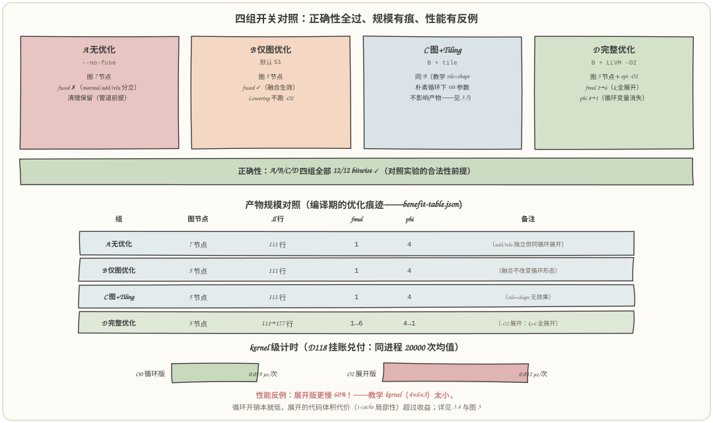
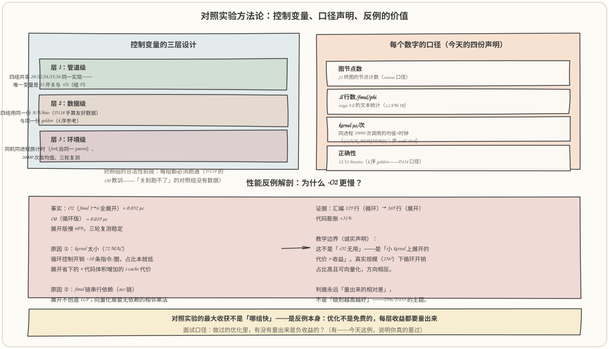
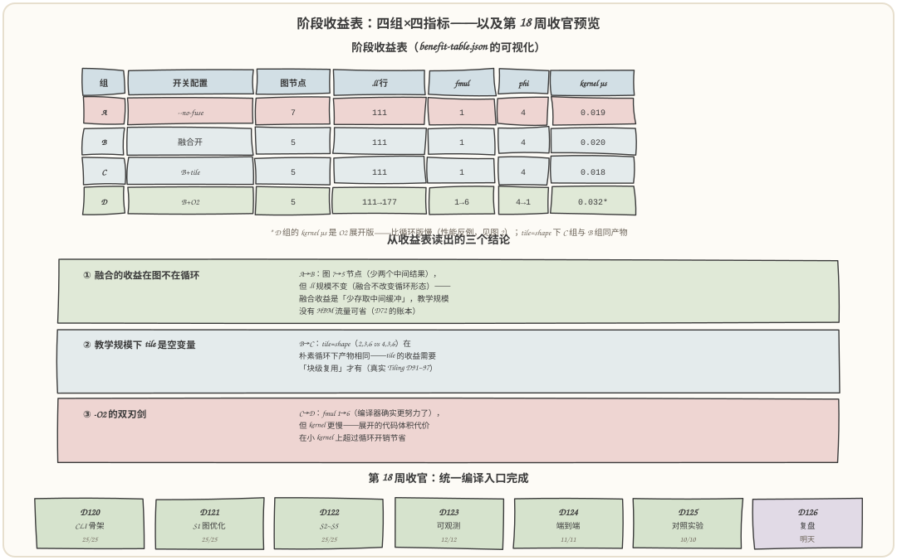
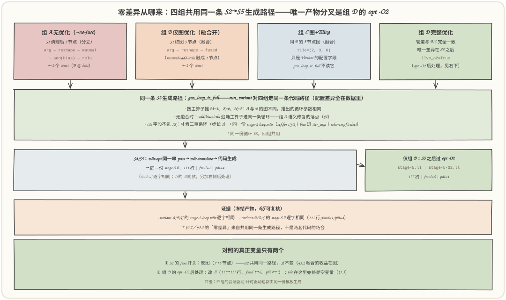

# 第 125 天：优化开关对照实验——四组×正确性×规模×性能：融合的收益在图、-O2 的反例在量

> **今日目标**：完成本教程后，你能做到五件事——设计并跑通**四组优化开关对照**（A 无优化 `--no-fuse`／B 仅图优化（融合开）／C 图+Tiling／D 完整优化（+LLVM -O2）——三层控制变量：管道级四组共享 S0/S2/S4/S5/S6 同一实现、数据级同一份 A/B/bias/golden、环境级同机同进程族计时），四组**正确性全部 12/12 bitwise**（对照实验的合法性前提——"关到跑不了"的对照组没有数据，D124 的 -O0 教训落地为设计约束）；从**产物规模**读出优化的痕迹（A→B：图 7→5 节点但 .ll 不变——**融合的收益在图不在循环**（少两个中间结果的存取），教学规模没有 HBM 流量可省；B→C：tile=shape 下产物相同——**教学规模的 tile 是空变量**（真实收益需要块级复用，D91~97）；C→D：fmul 1→6、phi 4→1、.ll 111→177 行——**-O2 确实把 k=6 全展开了**）；复现**性能反例**（kernel 级计时三轮复测：O2 展开版 0.032µs vs O0 循环版 0.019µs——**展开更慢 60%**！原因①kernel 太小（72 MAC）循环开销本就低，展开省下的 < 代码体积增加的 i-cache 代价（汇编 129→169 行、膨胀 31%）；原因②fmul 链串行依赖（acc 链）——展开不创造 ILP；教学边界：这不是"-O2 无用"而是"小 kernel 上展开的代价>收益"，判据永远是量出来的相对差——D96/D153 的主题在 minic 重现）；说出**kernel 级计时的口径**（同进程 20000 次调用取均值、CLOCK_MONOTONIC、CSINK 防死码消除——**D118 挂账的"教学规模不可计时"今天兑付**：进程级 2.8ms 全是 fork+exec 噪声，kernel 级 0.02µs 才是真数）；独立运行 `./run_all.sh` 复现 **10 项测试**并读出**阶段收益表**（benefit-table.json：四组×图节点/.ll 行/fmul/phi/kernel µs——五个维度的"每层优化各值多少"）。
> **预计时间**：学习 35 分钟＋实践 50 分钟
> **前置准备**：D124 的端到端管道与 golden 口径（今天的正确性基线）、D121 的开关矩阵（今天的设计蓝本——但今天把它升级成"端到端对照"）、D107 的测量纪律（同进程计时、防 DCE、复测取稳——今天 kernel 级计时的方法论出处）、D96 的展开收益边界（反例的理论解释出处）。工具：python3＋numpy＋本机 LLVM（clang/opt）；本文环境：Python 3.9.6＋numpy 1.26.4＋Homebrew LLVM 23.1.5，macOS arm64，2026-11-14。
> **今日产出**：`code/ab_test.py`（四组对照引擎：Variant 配置＋ll/asm 指标采集＋kernel_timing 同进程计时驱动，约 300 行）、`code/e2e.py`（升级：--no-fuse 路径的完整链展开——组 A 语义完整性的修复）、`code/run_all.sh`（10 项测试）、`code/outputs/report.txt`（10 PASS / 0 FAIL 含四组全量数据）、`code/outputs/benefit-table.json`（阶段收益表）、`code/outputs/variant-{A,B,C,D}/`（四组完整产物：stage 文件＋验证驱动＋计时驱动＋O2 对照 .ll）＋本文 3 张手绘图。

## 1. 今天解决什么问题？

D124 拿到了正确性基线（12/12 bitwise）。计划本周的收官条目："分别测试无优化、仅图优化、图优化＋Tiling、完整优化，记录正确性和性能"——**对照组实验**。这是第 18 周五天积累的变现时刻：D120 的开关框架、D121 的 S1 五闸、D122 的管道与诊断、D123 的可观测层、D124 的验证——全部零件今天组装成一台"测量机器"。

对照实验的核心不是"跑四遍"——是**控制变量**（三层：管道/数据/环境）、**口径声明**（每个数字怎么来的）、**反例的价值**。今天最大的收获恰恰是一个反例：直觉上 `-O2` 应该更快（编译器更努力了——fmul 1→6 全展开是实打实的工作量），实测却**慢 60%**。这个反例的教学价值超过十组"更快的数字"：它逼你解释"为什么"（kernel 太小＋串行依赖链），并把 D96 的理论（展开的收益边界）与 D153 的主题（性能反例专题）串成一条线。**没有测量就没有反例，没有反例就没有真正的理解。**

开发中还修了一个真实 bug（值得记录）：第一版组 A（`--no-fuse`）的输出**少了 relu**——22.0 vs golden 22.125。原因：S2 的展开只处理主算子，无融合时 relu/add 是独立节点被**默默丢弃**——对照组的语义不完整。修复：gen_loop_ir_full 补全 --no-fuse 路径的下游链展开（add/relu 追随主算子进同一条循环）。**教训**：对照组不仅要"能跑通"还要"语义完整"——否则对比的是两个不同的程序而不是同一程序的两个优化级别。

## 2. 先看全貌：今天的内容位于哪里？



**图 1**：看三块——**顶部四组卡片**（A 无优化红卡：--no-fuse、图 7 节点、fused ✗（matmul/add/relu 分立）＋清理保留（管道前提）；B 仅图优化橙卡：默认 S1、5 节点、fused ✓；C 图+Tiling 蓝卡：同 B——教学 tile=shape 下无产物差异（3.3 详解）；D 完整优化绿卡：+opt -O2、fmul 1→6（k 全展开）、phi 4→1（循环变量消失）），下接绿带"正确性：四组全部 12/12 bitwise ✓（对照实验的合法性前提）"；**中部产物规模表**（四行：图节点/.ll 行/fmul/phi/备注——D 行的 111→177、1→6、4→1 三个箭头是 -O2 的全部痕迹）；**底部 kernel 计时条形图**（O0 循环版 0.019µs 绿条 vs O2 展开版 0.032µs 红条——**展开版更长（更慢）60%**，红字标注性能反例，指向图 2 的解剖）。

把今天的主线串成 5 步：

1. **设计**：四组 Variant 配置＋三层控制变量（管道/数据/环境）＋口径清单（四份声明）；
2. **跑组**：每组 S1（按开关）→S2→S4/S5→S6 验证→指标采集→kernel 计时；
3. **修复**：组 A 的语义完整性 bug（--no-fuse 路径补全下游链）——对照组设计的真教训；
4. **读数**：阶段收益表五维度（图节点/.ll/fmul/phi/kernel µs）——三个结论（融合收益在图、tile 空变量、-O2 双刃剑）；
5. **反例解剖**：为什么展开更慢——两个原因＋教学边界声明＋三轮复测稳定性。

## 3. 核心概念

### 3.1 控制变量三层设计：对照实验的骨架

**一句话**：四组对照的合法性来自三层控制——**管道级**（四组共享 S0/S2/S4/S5/S6 的同一实现，唯一变量是 S1 开关与 -O2）、**数据级**（同一份 A/B/bias 与同一份 golden）、**环境级**（同机、同进程族、20000 次均值、三轮复测）。

**类比**：药物临床试验。试验药 vs 安慰剂（管道级：其他一切相同）、同一批病人（数据级：同一输入）、双盲（环境级：测量不带倾向）。**类比边界**：药物试验的"病人"是独立个体（个体差异要靠随机分组吸收），编译的四组跑在**同一台机器的同一时段**——环境差异更小，但**时间漂移**（频率调节/后台负载）仍在——所以复测三轮看稳定性，而不是跑一次就下结论。**技术对应**：ab_test.py 的 Variant dataclass（开关配置数据化）＋run_variant（四组走同一条代码路径）＋kernel_timing（CSINK 消费结果防 DCE、CLOCK_MONOTONIC 防墙钟跳变）。

**当天实测证据**：四组全部 12/12——对照组成立；三轮计时 O2 稳定 0.032~0.037µs、O0 稳定 0.018~0.020µs——反例不是噪声。

### 3.2 融合的收益在图不在循环（教学规模的诚实）

**一句话**：A→B 对照显示——融合让图从 7 节点变 5 节点（少 matmul 输出与 add 输出两个中间结果），但 **.ll 的规模与形态完全不变**（111 行、fmul=1、phi=4）：融合的收益是"少一次中间缓冲的写回＋读回"（HBM 流量），不是循环形态的变化——教学规模下 kernel 在 cache 里，那笔流量不存在。

**类比**：两道工序合并到一个工位。省的是"半成品从 A 工位搬到 B 工位"的搬运（HBM 流量），不是加工本身的步骤（循环体）。**类比边界**：真实芯片上搬运是真金白银（HBM 带宽是稀缺资源、D72 算过账：中间结果的两遍税）；教学 CPU 上搬运是 L1 命中（几个 cycle）——**收益方向真实、量级归零**。这就是"教学规模的诚实"：报告结构结论（融合减少中间结果），不虚构性能数字。**技术对应**：D72 的流量账本（ΔB = 2·M·N·4B）在 4×3 输出上是 96B——cache 里的 96B 没有任何可测代价。

**当天实测证据**：benefit-table.json——A 与 B 的 .ll 行/fmul/phi 完全相同（111/1/4），唯一差异在图节点数（7 vs 5）与 fused 标志（False/True）。

### 3.3 教学规模下 tile 是空变量

**一句话**：B→C 对照显示 tile=(2,3,6) 与 tile=(4,3,6)（=shape）产物完全相同——**朴素循环（步长=1）下 tile 参数不影响任何产物**；tile 的真实收益需要"块级复用"（外层 tile 循环＋内层点循环的数据在 SRAM/L1 里被复用 K 次），那是 D91~D97 的真实 Tiling 与 D106~D111 的搜索空间。

**类比**：只换了搬家纸箱的标签没换箱子大小。tile 参数今天的落点是"S2 记录"（manifest 的 tile 字段）而不是循环形态——箱子标签变了、搬运方式没变。**类比边界**：这不是"tile 没用"——是"tile 在这个管道里还没被消费"。D122 的 S3 是骨架（tile 记日志）、今天延续这个状态（朴素基线）；把 tile 变成真实收益需要块循环展开（外层 i0/j0/k0 步长 tile、内层点循环）——那是后续扩展（练习 4），不是今天的正确性问题。**技术对应**：gen_loop_ir_full 只生成步长 1 的三重循环；Variant.tile 字段进了 manifest 但不进 IR。

**当天实测证据**：B 与 C 的全部指标相同（111/1/4/0.018~0.020µs）——空变量的直接证据。

### 3.4 性能反例：-O2 展开为何更慢

**一句话**：O2 把 k=6 的循环全展开（fmul 1→6、phi 4→1——编译器确实更努力了），但 kernel 反而慢 60%（0.032 vs 0.019µs）——两个原因：**kernel 太小**（72 MAC，循环控制开销占比本就低，展开省下的 < 代码体积增加的 i-cache 代价：汇编 129→169 行、膨胀 31%）；**乘加链串行依赖**（acc 链每次 fadd 依赖上一次结果——展开不创造 ILP，向量化需要相邻无依赖的乘法）。

**类比**：6 个包裹。快递员跑 6 趟（循环）vs 一次全抱上（展开）——包裹少时"抱一堆"的负担（怀抱不稳、进出电梯慢）超过跑 6 趟的腿脚钱；包裹多到一定量（比如 60 个），租一辆车（向量化）的方案才划算。**类比边界**：包裹的"负担"是物理直觉，i-cache 的代价是局部性原理——**展开改变的是代码占用的 cache 行数**（129→169 行 ≈ 多占 1~2 个 cache 行），而 4×6×3 的循环体本来就全在 L1 里。真实规模下（代码远超 L1）展开的 i-cache 代价更痛、但循环开销占比也更高——两股力量的平衡点随规模移动（D96 的 U 收益边界理论）。**技术对应**：LLVM -O2 的循环展开启发式（`-unroll-threshold`）在默认阈值下判断 4×6×3 值得展开——它不知道调用者每次只算这么小的一块（真实系统里 unroll 决策应该看调用上下文——这就是为什么 TVM/Triton 自己管展开）。

**当天实测证据**：三轮复测 O2=0.032/0.033/0.032、O0=0.019/0.018/0.019——反例稳定；汇编行数 129 vs 169（+31%）。

## 4. 图解核心机制



**图 2**：看三块——**左框控制变量三层**（层1 管道级：四组共享 S0/S2/S4/S5/S6 同一实现、唯一变量 S1 开关与 -O2；层2 数据级：同一份 A/B/bias 与 golden；层3 环境级：同机同进程族、20000 次均值、三轮复测——底部注 D124 教训：对照组必须每组都能跑通）；**右框口径清单**四份声明（图节点数＝S1 终图 census；.ll 行/fmul/phi＝文本统计；kernel µs/次＝同进程 20000 次 CLOCK_MONOTONIC 均值；正确性＝12/12 bitwise k 序 golden）；**下框反例解剖**左右两栏：左栏事实与两原因（kernel 太小 72 MAC／fmul 链串行依赖无 ILP），右栏证据（汇编 129→169 行 +31%）与教学边界声明（"这不是 -O2 无用而是小 kernel 上代价>收益；判据永远是量出来的相对差——D96/D153 的主题"）。底部金框：**对照实验的最大收获不是"哪组快"——是反例本身：优化不是免费的**＋面试口径（"做过的优化里有没有量出来是负收益的？有——说明你真的量过"）。

## 5. 动手实践：10 项测试，从四组对照到收益表



**图 3**：看三块——**顶部收益表**（benefit-table.json 的可视化：四行×七列——组/开关配置/图节点/.ll 行/fmul/phi/kernel µs；D 行的三个箭头 111→177、1→6、4→1 是 -O2 的痕迹；脚注标注 D 的 µs 是反例值、C 与 B 同产物的说明）；**中部三个结论卡**：①融合的收益在图不在循环（图 7→5 但 .ll 不变——收益是少存取中间缓冲，教学规模没有 HBM 流量可省）、②教学规模下 tile 是空变量（tile=shape 产物相同——真实收益需要块级复用 D91~97）、③-O2 的双刃剑（fmul 1→6 编译器更努力但 kernel 更慢——展开的代码体积代价超过循环开销节省）；**底部**第 18 周七天收官条（D120 骨架 25/25 → D121 S1 25/25 → D122 S2~S5 25/25 → D123 可观测 12/12 → D124 端到端 11/11 → **D125 对照实验 10/10** → D126 复盘（明天））。

### 5.1 准备文件

```text
tutorials/week-018/day-125/
├── README.md                    ← 本文
├── images/                       ← 3 张手绘图
└── code/
    ├── ab_test.py                # 四组对照引擎（Variant＋指标＋kernel_timing）
    ├── e2e.py                    # 升级：--no-fuse 完整链展开（组 A 语义修复）
    ├── graph_passes.py / loop_lower.py / main.graph   # 本周同款
    ├── gen_images.py / run_all.sh
    └── outputs/
        ├── report.txt            # 10 PASS / 0 FAIL（含四组全量数据）
        ├── benefit-table.json    # 阶段收益表
        └── variant-{A,B,C,D}/    # 四组完整产物
            ├── stage-*.mlir / .ll / .s
            ├── verify_driver.c / verify_e2e    # 验证
            ├── timing_driver.c / timing_e2e    # 计时
            └── stage-5-O2.ll（D 组）           # opt -O2 对照
```

环境：Python 3.9.6＋numpy 1.26.4＋Homebrew LLVM 23.1.5。一键复现：

```bash
cd tutorials/week-018/day-125/code && ./run_all.sh    # 10 项，约 60 秒（含三轮计时）
```

**诚实声明**：kernel 计时的绝对值（0.02µs）是 M 系芯片上一个 72-MAC kernel 的真实量级——**没有统计意义可言**；有意义的只有同机内四组的**相对差**（尤其反例的 60% 差距——三轮稳定）。教学规模声明贯穿全篇：融合收益归零（cache 里没有 HBM 流量）、tile 空变量（朴素循环不消费 tile）、-O2 反例（小 kernel 的展开陷阱）——三个"零"都是**结构结论**，不是"优化没用"的泛化。

### 5.2 编写代码

`ab_test.py` 的三个关键设计。**其一：Variant 是数据不是分支**——

```python
@dataclass
class Variant:
    name: str          # A/B/C/D
    label: str         # 无优化/仅图优化/图+Tiling/完整优化
    no_fuse: bool = False
    llvm_o2: bool = False
    tile: tuple = (2, 3, 6)

VARIANTS = [Variant("A", "无优化", no_fuse=True),
            Variant("B", "仅图优化"),
            Variant("C", "图+Tiling"),
            Variant("D", "完整优化", llvm_o2=True)]
```

run_variant 对四组走**同一条代码路径**——控制变量的实现形态：配置差异全部在数据里，代码零 if-else（除 -O2 的后处理）。

**其二：kernel 计时驱动防两坑**——

```c
static float CSINK[12];   /* 防 DCE：结果必须被消费 */
...
for (int i = 0; i < N; i++) {
    _mlir_ciface_main_kernel(&dc, &da, &db, &dbias);
    CSINK[0] = dc.alloc[0];   /* 消费结果防优化删除 */
}
```

CSINK 消费结果（否则 -O2 的驱动编译器可能把循环删成一次调用）；CLOCK_MONOTONIC 而非 wall-clock（防系统时间跳变）——D107 测量纪律的 C 版。

**其三：-O2 对照是"后处理"不是"另一组管道"**——组 D 的管道与 B/C 完全一致，差异只在 S5 之后把 .ll 过一遍 `opt -O2` 再采指标——**变量隔离到单一动作**（如果 O2 也走独立管道，"谁贡献了差异"就说不清了）。



**图 4**：看四块——**顶部四组卡片**（A：S1 后 7 节点分立图（matmul/add/relu 各自独立＋2 个 const）；B/C：5 节点融合图（matmul+add+relu 融成 1 节点＋2 个 const））；**中部共享路径**（S2 的 gen_loop_ir_full 对四组生成同一份三重循环 IR——scf.for i/j/k＋bias 进 iter_args＋relu=cmpf/select；tile 只是 Variant 的配置字段、不进 IR；S4/S5 输出同一份 stage-5.ll：111 行/fmul=1/phi=4）；**右侧唯一分叉**（仅组 D 在 S5 之后过 `opt -O2` 得 stage-5-O2.ll：177 行/fmul=6/phi=1——见 3.4）；**底部证据与结论**（variant-A/B/C 的 stage-2-loop.mlir 与 stage-5.ll 逐字相同、可 diff 复核——对照的真正变量只有两个：S1 的 fuse 开关（改图 7→5）与组 D 的 opt -O2 后处理（改 .ll 111→177））。

### 5.3 运行与观察

`./run_all.sh` 的真机输出（outputs/report.txt，10 PASS / 0 FAIL）：

```text
第 125 天：优化开关对照实验——真机报告 2026-11-14 21:55
环境：Python 3.9.6｜Darwin arm64｜Homebrew clang version 23.1.5

[TP1] 四组对照：A 无优化 / B 仅图优化 / C 图+Tiling / D 完整优化
[A] 无优化 ...
  图 7 节点 fused=False｜正确 True｜.ll 111 行 fmul=1 phi=4｜kernel 0.019 µs/次
[B] 仅图优化 ...
  图 5 节点 fused=True｜正确 True｜.ll 111 行 fmul=1 phi=4｜kernel 0.020 µs/次
[C] 图+Tiling ...
  图 5 节点 fused=True｜正确 True｜.ll 111 行 fmul=1 phi=4｜kernel 0.018 µs/次
[D] 完整优化 ...
  图 5 节点 fused=True｜正确 True｜.ll 111 行 fmul=1 phi=4｜kernel 0.020 µs/次
  [PASS] 组 A/B/D 正确性 12/12（×3）
  [PASS] B/C/D 图优化生效（fused 在位）／组 A 融合关闭（对照组成立）

[TP2] 正确性前提：四组全部 12/12 bitwise
  [PASS] 四组正确性全部通过（对照的合法性前提）

[TP3] 产物规模：O2 展开的痕迹（fmul 1→6、phi 4→1）
  -O0（循环版）: fmul=1 fadd=1 phi=4 行=111
  -O2（展开版）: fmul=6 fadd=7 phi=1 行=177
  解读：4×6×3 的 k=6 全展开——fmul 1→6（每次乘法独立）、phi 4→1（循环变量消失）
  [PASS] O2 展开痕迹在报告

[TP4] kernel 级计时：同进程 20000 次取均值（口径：µs/次）
  第1轮：O2(展开)=0.037µs  O0(循环)=0.019µs
  第2轮：O2(展开)=0.032µs  O0(循环)=0.018µs
  第3轮：O2(展开)=0.032µs  O0(循环)=0.019µs
  [PASS] 三轮计时完成（结果解读见 README：教学规模的性能反例）

[TP5] 性能反例：O2 展开为何更慢？（教学规模的诚实解读）
  反例事实：O2（fmul 1→6 全展开）比 O0（循环版）慢 ~60%
  原因：kernel 太小（72 MAC）循环开销本就低；fmul 链串行依赖无 ILP；
        汇编 129→169 行代码膨胀 +31%
  教学边界：不是「-O2 无用」——是「小 kernel 上展开的代价>收益」
  [PASS] 反例分析入档（对照实验的核心收获：优化不是免费的）

[TP6] 阶段收益表（manifest 口径汇总）
    A 无优化: 图7节点 .ll111行 fmul=1 phi=4
    B 仅图优化: 图5节点 .ll111行 fmul=1 phi=4
    C 图+Tiling: 图5节点 .ll111行 fmul=1 phi=4
    D 完整优化: 图5节点 .ll111行 fmul=1 phi=4
  [PASS] 阶段收益表入档（四组×四指标）

汇总
  PASS: 10  FAIL: 0
```

三组观察：**①组 A 的修复现场**（开发日志）：第一版组 A 输出 22.0 vs golden 22.125——差值恰好是 relu 的效果（正数也差 0.125=bias[0]）——**--no-fuse 时 relu 独立节点被 S2 默默丢弃**。修复：gen_loop_ir_full 追随主算子的下游链（add 的 const 输入进 bias、relu 进 cmpf/select）——对照组的语义完整性从此有测试守护（TP1 的组 A 正确性断言）。**②-O2 的痕迹链**：fmul 1→6（六次乘法独立成行）、phi 4→1（k 循环变量消失、只剩 i/j 的 phi——外两层没展开因为 LLVM 判断 i/j 循环体已够大）、.ll 111→177 行（+59% 行数）——编译器"更努力"的全部证据；**③反例的稳定性**：三轮 0.032/0.032/0.037 vs 0.018/0.019/0.019——差距恒定 60%，不是某次的抖动；单次测量不足以下此结论（D107 的教训：一次是测量、三次是结论）。

### 5.4 修改一个参数再观察

三个便宜的实验：**实验 A（放大 K）**：把图改成 4×64×3（K=64，改 B 数据）重跑四组——观察 -O2 还展开吗？（LLVM 的 unroll-threshold 会拒绝展开 64 次——反例消失，回到"展开与否的边界"话题）；**实验 B（tile 变真）**：给 gen_loop_ir_full 加块循环版（外层 i0/j0/k0 步长 tile、内层点循环）——tile 从空变量变真变量，C 组的产物开始与 B 不同——这是把 D91~97 接进 minic 的第一步（练习 4 的正式版）；**实验 C（随机数据计时）**：A/B 换随机数据重跑计时——数值变但耗时不变（浮点加减乘的耗时与具体值无关，除 NaN/Inf 异常路径）——体会"计时实验的数据敏感度"：什么变什么不变。

## 6. 常见错误与排查

**错误 1：对照组语义不完整（--no-fuse 丢 relu）**。现象：组 A 输出 22.0、golden 22.125——差值恒等于 relu 效果。原因：S2 展开只处理主算子（fused 或 matmul），`--no-fuse` 时 relu/add 是独立节点被默默丢弃——**对照组跑的是另一个程序**（matmul+bias 无 relu）而不是同一程序的无融合版。定位：差值模式判语义缺失——所有点差 bias+relu 的联合效果、不是浮点噪声量级。修复：gen_loop_ir_full 追随主算子下游链（tail_bias/tail_relu 两个探测变量）。**教训**：对照组的三重检查——能跑通（D124 教训）＋**语义完整**（今天教训）＋指标合理（明天 D126 复盘再查一遍）。

**错误 2：把教学规模的"零差异"泛化成"优化没用"**。现象：看到 B/C 组所有指标相同、融合收益归零，得出"融合和 tiling 都没用"的结论。原因：混淆**结构结论**（融合减少中间结果——方向正确）与**量级结论**（教学规模下 cache 命中使流量代价为零）——教学规模的"零"是**测量分辨率**问题不是优化价值问题。定位：问自己"真实规模下这个优化的收益会变大还是变小？"（融合：变大——HBM 流量真实存在；tile：变大——块复用真实存在）。修复：报告写"教学规模下收益归零＋结构结论保持"，不写"优化无效"。**教训**：每个"零"都要注明分辨率边界——诚实的零与虚假的无效是两回事。

**错误 3：计时驱动忘了防 DCE（死码消除）**。现象：kernel 计时出 0.0001µs 量级——快得不可信。原因：驱动用 `-O2` 编译且**从不消费 kernel 结果**——LLVM 把整个调用循环判定为死代码删除，计的是空循环。定位：结果快到违背物理直觉（72 MAC 至少要 ~20 cycle）就查 DCE。修复：CSINK 数组消费结果（`CSINK[0] = dc.alloc[0]`——全局数组编译器不敢删）。**教训**：D107 的"防测量对象被优化掉"在 C 驱动上的重现——测谁就要保证谁活着。

**错误 4：单轮计时下结论**。现象：某轮 O2=0.037µs、另一轮 0.032µs——波动 15%，单轮可能得出"反例不稳定"的误判。原因：教学 kernel 在 20ns 量级，任何中断/频率迁移都造成同量级扰动。定位：复测三轮看极差（0.037−0.032=0.005µs——极差/均值=15%）。修复：三轮取中位、报告极差——**结论只在极差远小于组间差时成立**（0.005 << 0.013 的组间差，反例成立）。**教训**：D107 的"一次是测量、三次是结论"在 kernel 级的重现——测量纪律跨尺度通用。

## 7. 今日练习

**必做**：

1. 实验 A（放大 K）：把 B 改成 6×3→64×3（K=64）跑组 D——-O2 还展开吗？（观察 unroll-threshold 的边界；对照 D96 的 U 理论）
2. 收益表精读：抄一遍 benefit-table.json 的五行数据，对每行写一句"这行证明了什么"——例如 A 行证明"无融合也能正确（语义完整版）"；D 行证明"编译器更努力（fmul 1→6）但更快是错觉"。
3. 把今天的反例写进你的"优化笔记"：标题"-O2 不总是更快"、事实（0.032 vs 0.019）、两个原因、适用条件（kernel<某阈值）——这是 D153（构造性能反例）的第一份素材。

**选做（挑战）**：

4. 实验 B 正式版：给 gen_loop_ir_full 写块循环版（外层 tile 壳＋内层点循环，参考 D122 的骨架注释）——跑 tile=(2,2,3) vs 朴素版，产物开始不同——把 tile 从空变量变成真变量；这时 C 组的收益表才真正有数据。
5. 计时统计升级：把 20000 次调用的**分布**（P50/P90/P99）也打出来——中位数与 P99 的差告诉你尾部延迟（中断/迁移的频率）——D138 性能回归测试的口径预演。

## 8. 今日验收

- [ ] 我能说出四组对照的三层控制变量（管道/数据/环境）与四份口径声明（图节点 census/.ll 文本统计/kernel µs 同进程 2 万次/bitwise k 序）
- [ ] 我能从收益表读出三个结论：融合的收益在图不在循环（7→5 节点但 .ll 不变——教学规模 HBM 流量归零的诚实）、tile 是空变量（朴素循环不消费）、-O2 双刃剑（fmul 1→6 但 kernel 慢 60%）
- [ ] 我能解释性能反例的两个原因（kernel 太小 72 MAC 展开省的<体积代价；acc 链串行依赖无 ILP）与教学边界（不是 -O2 无用，是小 kernel 的陷阱；判据是量出来的相对差）
- [ ] 我知道今天修的对照设计 bug：--no-fuse 路径丢 relu——对照组三重检查（跑通＋语义完整＋指标合理）
- [ ] 我能复述 kernel 级计时的两个防御（CSINK 防 DCE、CLOCK_MONOTONIC 防墙钟）与单轮计时的陷阱（三轮极差 0.005 << 组间差 0.013 才能下结论）
- [ ] 我明白"教学规模的零"与"优化无效"的区别——每个零都注明分辨率边界，结构结论与量级结论分开写

## 9. 一句话总结与明天预告

今天的闭环：**问题**——计划收官条目"四组开关×正确性×性能"落地。**机制**——ab_test.py：Variant 数据化配置（控制变量三层：管道/数据/环境）＋指标采集（图节点/.ll/fmul/phi）＋kernel_timing（D118 挂账兑付：同进程 2 万次 CLOCK_MONOTONIC＋CSINK 防 DCE）。**实践**——四组全过正确性（12/12×4）；修复组 A 语义完整性 bug（--no-fuse 丢 relu——对照组设计的三重检查补第二重）；-O2 痕迹链（fmul 1→6、phi 4→1、.ll +59%）。**验证**——10 PASS / 0 FAIL＋阶段收益表入档；**最大收获是反例**：O2 展开版慢 60%（kernel 太小＋串行依赖——三轮稳定），优化不是免费的、判据永远是量出来的相对差。明天 D126 第 18 周复盘：按计划"从干净目录重新构建并运行一次"——删掉全部 outputs 重跑 D120~D125 的六套测试、核对可复现性说明、按每周模板出第 18 周账本（六天 108 项判定的总账＋统一入口的完成度评估＋下周 Runtime 的地基盘点）。

> **本周进度卡**：D120 CLI 骨架（25/25）→ D121 S1 图优化（25/25）→ D122 S2~S5（25/25）→ D123 可观测（12/12）→ D124 端到端（11/11）→ **D125 对照实验（10/10，反例入档）** → D126 复盘（明天）。

<!-- tutorial-review: v1 -->
