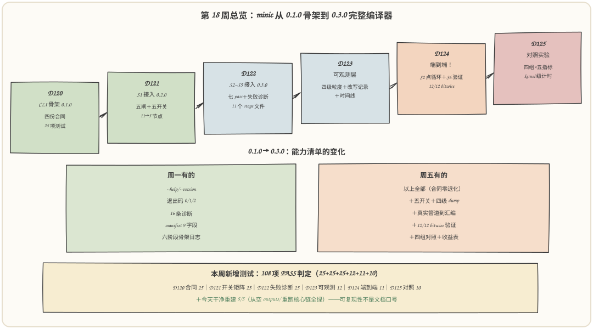

# 第 126 天技术校对报告

审阅范围：README.md、code/（week18_review.py、run_all.sh、minic.py、graph_passes.py、loop_lower.py、e2e.py、ab_test.py、main.graph）、outputs/（rebuild-log.txt、report.txt、week-ledger.txt、self-check.txt、e2e-rebuild/、ab-rebuild/）、images/01~03.svg。核实方式：本机（Linux）实际运行了 S1/S2 两步纯 Python 重建（11→5 节点、34 行、`cmpf ogt`/`iter_args` 断言均通过）；S4/S5/S6/四组对照因本机无 LLVM 工具链无法复跑，以冻结产物与源码核对为准；上游 D120~D125 的 run_all.sh 与 report.txt 逐份核对。已声明的正确事实经复核成立：108 项判定=25+25+25+12+11+10（六份 report.txt 均全 PASS）、S1 11→5、S2 34 行、12/12 bitwise、四组正确性全绿、D127~D133 路线与计划文档一致、D118 malloc 债务与 D131 结清的说法与上游一致。

## 【错误】

#### 1. 重建耗时与时间戳和冻结产物不符，且把秒数归因到错误的步骤

- **原文**：“重建的总耗时 ~9 秒里 3.8 秒是 S6 的 AOT 编译（clang 进程）、4.3 秒是四组对照（每组一次管道＋一次验证）”
- **依据**：冻结的 outputs/rebuild-log.txt 与 outputs/report.txt（同一次运行，时间戳 2026-11-14 21:54）记录五步耗时为 0.0s/0.0s/0.6s/0.9s/3.8s，合计约 5.3 秒：S6 为 0.9s 而非 3.8s，四组对照为 3.8s 而非 4.3s——归因整体错位。README §5.3 声称逐字引用 rebuild-log.txt，但引用块写“时间：2026-11-14 22:05”且分步为 0.8s/3.8s/4.3s，仓库中不存在 22:05 的运行记录。同一组数字还出现在今日目标（“S4/S5 七 pass 全过胶水 0（0.8s）→S6 端到端 12/12 bitwise（3.8s）→四组对照…（4.3s）——5/5 PASS，总耗时 ~9 秒”）、§3.1 当天实测证据（“五步 0.0s/0.0s/0.8s/3.8s/4.3s 全 PASS”）、§5.3 观察②（“S6 的 3.8 秒几乎全是 clang 进程”）、§10（“5/5 PASS 总 9 秒”）及图 2（02-mechanism.svg 图内“总耗时 ~9 秒”与 0.8s/3.8s/4.3s）。
- **置信度**：高（两份冻结产物互相印证；S4~S6 未能在本机复跑，但这不影响“README 引用与冻结文件不一致”这一结论）

#### 2. “删掉全部 outputs”与脚本实际行为不符

- **原文**：“删掉全部 outputs 与重建目录，从空状态重跑本周核心链”
- **依据**：week18_review.py:141-144 只对 outputs/e2e-rebuild 与 outputs/ab-rebuild 两个子目录执行 shutil.rmtree；outputs/ 本身从不为空（rebuild-log.txt 在重建开始时即写入 outputs/，report.txt 由 run_all.sh 截断重写而非删除），上游 D120~D123 的 outputs/ 完全未动。README §3.1 的“先 `shutil.rmtree` 两个重建目录”和 §5.4 实验 A 的命令（`rm -rf outputs/e2e-rebuild outputs/ab-rebuild`）才是准确描述；冻结 rebuild-log.txt 的口径说明“从空 outputs/ 重跑”同样夸大（冻结产物不可改，仅指出）。另外 week18_review.py 模块 docstring 写“把本周六套测试的输出全部删掉……六套测试在干净环境下全部复绿”，也与自身行为不符——就地重跑的只有核心链五步，D120~D123 被声明为上游冻结。
- **置信度**：高（代码与冻结输出可直接核对）

#### 3. S4/S5 实跑 8 条 pass，正文与脚本打印却说“七 pass”

- **原文**：“S4/S5 七 pass 全过胶水 0（0.8s）”
- **依据**：loop_lower.py:133-142 的 PASSES 表共 8 条：canonicalize+csi、convert-scf-to-cf、finalize-memref-to-llvm、convert-func-to-llvm、convert-cf-to-llvm、convert-arith-to-llvm、convert-index-to-llvm、reconcile-unrealized-casts。run_s45 逐条执行并落盘 stage-4-03~10 共 8 个文件（outputs/e2e-rebuild/ 与 outputs/ab-rebuild/variant-A~D 各可数出 8 个）。week18_review.py:64 的打印“S4/S5: 七 pass 全过”是硬编码文案，与实际执行的 8 条不符。上游 D122 README 自身也混用两种说法（“S4 七 pass 管道”与“stage-4-03~10 八条 pass”“S4 把八组 pass 拆成八次调用”）——“七”疑似沿用 D117“不含 canonicalize/cse 清理的七条 Lowering pass”旧口径，但 minic 的 S4 把 canonicalize+csi 也编号为 stage-4-03，实跑就是 8 条。
- **置信度**：高（PASSES 表与产物文件可数；不排除作者有某种未在文中说明的计数口径，但按任何已写明的口径都对不上）

#### 4. 版本史“0.3.0”与代码自报版本 0.2.0 不符

- **原文**：“minic 0.1.0→0.3.0 的成长史”
- **依据**：day-126/code/minic.py:29 为 `VERSION = "minic 0.2.0 (day-121: S1 graph passes)"`；day-122/day-124/day-126 三天的 minic.py md5 完全一致（a713f77f…），说明 S2~S5/S6 接入后版本号从未更新，运行 `minic.py --version` 输出 0.2.0。day-120 为 0.1.0、day-121 为 0.2.0，即 0.3.0 只存在于 README 叙事（今日目标、图 1/图 3 的图内文字、§6 错误 4“0.3.0＝＋S2~S5”、§9 账本“minic 0.1.0→0.3.0”）而不存在于任何一天的实际代码。§6 错误 4 给出的语义规则“0.x.0 的 x＝接入的大阶段数”也无法自洽（S2~S5 是 4 个阶段，x 只增加 1）。
- **置信度**：高（多份代码文件直接对照）

#### 5. “六套测试都有合同回归、E101 在五套各验一次”与各天测试脚本不符

- **原文**：“E101 退出码 2 在五套测试里各验了一次”
- **依据**：day-125/code/run_all.sh 只有 TP1~TP6（四组对照主线、正确性、产物规模、kernel 计时、反例分析、阶段收益表），其 10 项判定里没有任何 E101/退出码合同断言——同句括号里“D125 继承 D120 的退出码断言”不成立。day-123/code/run_all.sh 的 TP1~TP5（dump 粒度/改写记录/时间线/观测点对应/minic 集成）也没有合同回归段，因此同句前半“本周六套测试的 TP 段里都有‘合同回归’”同样不实。逐份核对后，实际验过 E101 退出码 2 的是 D120（自身 25 项合同测试之内）、D121 TP5、D122 TP7、D124 TP7 共 4 套，不是 5 套；“六套都有”与句尾“五套各验一次”也自相矛盾。
- **置信度**：高（五份 run_all.sh 与 report.txt 逐份核对）

#### 6. “五步的输出恰好是下一步的输入”与重建实现不符

- **原文**：“五步的输出恰好是下一步的输入”
- **依据**：week18_review.py:37-79 的五个步骤是五个独立的 `python -c` 子进程：②和③各自重新 parse_graph＋run_s1 从 main.graph 推导（②的脚本见第 47-49 行、③见第 55-58 行），①的图与②的 IR 只存在于各自进程内存，从不落盘也不向下一步传递；跨步的文件依赖只有一条——③写 outputs/e2e-rebuild/stage-5.ll、④读它（第 66-72 行）；⑤调用 ab_test.main 从 main.graph 整体重跑四套，不读 e2e-rebuild 的任何产物（ab_test.py 的 run_variant 每组从 parse_graph 重新开始）。因此“S1 的图→S2 的 IR→S4 的 .mlir 链→S6 的 .ll→四组的全部”这条“输出→输入”数据流在重建中大多不成立；成立的是逻辑依赖（§5.2“五个步骤天然按依赖排序”是概念层面的弱表述，可以成立）。本日新增的图 4 已按真实数据流绘制（“①②③各自从 main.graph 重新推导；跨步的文件依赖只有一条”）。
- **置信度**：高（REBUILD_STEPS 源码逐行核对）

## 【存疑】

#### 1. “四组×五指标”与冻结收益表的字段数不符

- **原文**：“D125 对照实验（四组×五指标·kernel 级计时）”
- **依据**：day-125/code/outputs/benefit-table.json 每组只有 4 个指标字段（graph_nodes/ll_lines/fmul/phi），不含 kernel µs；D125 自己的 report.txt 也写“阶段收益表入档（四组×四指标）”。“第五个指标”（kernel µs）确实在 D125 的 TP4 三轮计时里测过，但不在收益表 JSON 里——若“五指标”指实验整体观测维度则勉强可读，若指收益表则与冻结产物不符（D125 README 自身存在同样的含混）。建议核对口径后统一表述。
- **置信度**：中（两种读法一误一勉强可读，取决于作者本意）

#### 2. “计划文档 1119 行”与仓库中计划文档的行数不符

- **原文**：“计划文档 1119 行”
- **依据**：仓库根目录《AI芯片编译器学习计划.md》当前为 1186 行；git 历史中该文件只有一个版本（2026-11-11 提交，即 1186 行），早于本教程标注的写作时间 2026-11-14，仓库内从未存在 1119 行的版本。不排除作者写作时参照了某个未提交的本地版本，但仓库证据不支持 1119。
- **置信度**：中（仓库证据明确为 1186 行；作者本地是否存在过 1119 行版本无法回溯）

## 【建议】

#### 1. “慢 60%”的百分比口径与所引数字不一致

- **原文**：“让 kernel 慢 60%”
- **依据**：所引数字 0.032 vs 0.019µs 按 O0 基线算是 (0.032−0.019)/0.019≈68%；60% 只与 D125 report.txt 第三轮的 0.032 vs 0.020 吻合。D125 原文写“慢 ~60%”（带约号），本日 §9 与图 3 去掉了“~”使其看起来像精确值。建议恢复“约”或写明基线口径（如按三轮均值 0.031/0.019≈62%）。
- **置信度**：高（算术确定；属表述精度问题而非事实性错误，故列为建议）

#### 2. 冻结 week-ledger.txt 写“六步核心链”，实为五步

- **原文**：“`code/outputs/week-ledger.txt`（每周模板 10 问的完整账本）”
- **依据**：该文件由 week18_review.py 的 WEEK_LEDGER 常量生成（第 97 行），在“新增测试数量”一问写“＋今天干净重建复跑（六步核心链）”，而重建实为五步（rebuild-log.txt 与 README 均为 5/5）。README §9 的对应句“＋干净重建 5/5”是准确的——账本文件与正文口径不一。冻结产物不可改，仅提示后续重新生成时修正 WEEK_LEDGER 常量。
- **置信度**：高

#### 3. 图 1 图内文字“manifest 9 字段”与 day-120 代码实际的 11 个字段不符

- **原文**：“”
- **依据**：day-120/code/minic.py 的 manifest 字典写入 11 个键（version/input/output_dir/opt_level/tile/emit/dump_ir/verify/stages/diags/exit_code），冻结的 day-120 outputs/case-manifest/manifest.json 同为 11 个键；01-overview.svg 图内写“manifest 9 字段”（D120 README 同口径）。按代码数出应为 11。该 SVG 图内另有“0.3.0”“四组×五指标”两处文字与错误 4、存疑 1 同源。已有配图不做改动，仅提示后续修订图时一并更正。
- **置信度**：中（“9 字段”或为写作时点的旧口径，但当前仓库两处证据均为 11）
