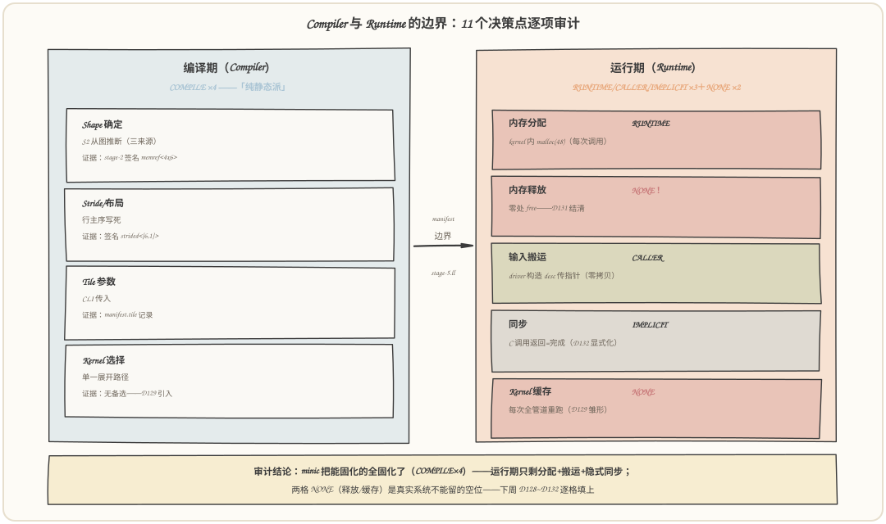

# 第 127 天技术校对报告

> 审阅视角：AI 芯片编译器工程师（十年）。方法：通读 README、`code/`（responsibility.py / run_all.sh / gen_images.py）、全部冻结产物（report.txt、responsibility-table.txt/.json、self-check.txt）与 3 张 SVG；在隔离临时目录里保持真实目录结构复跑了 `run_all.sh`（未触碰仓库冻结文件，运行后清理）；逐行核验了 TP2/TP3 引用的上游证据（week-018/day-124 `e2e-run/` 与 day-126 `e2e-rebuild/` 的 stage-5.ll / stage-2-loop.mlir / verify_driver.c，两份 stage-5.ll 逐字节一致）；跨天核对了 D115/D118/D122/D124/D125/D126；对外部系统的存疑点在线查证了 apache/tvm（main 与 v0.17.0）与 pytorch（main 与 v2.5.0）的源码。无法在线核实的版本细节已在置信度里注明。

## 【错误】

#### 1. run_all.sh 的上游产物相对路径解析不到，一键复现实际得 4 PASS / 2 FAIL，与“9 项全过”的承诺矛盾
- **原文**：“cd tutorials/week-019/day-127/code && ./run_all.sh    # 9 项，约 3 秒”
- **依据**：run_all.sh:27-28 写的是 `$HERE/../../day-124/code/outputs/e2e-run/stage-5.ll` 与 `$HERE/../../day-126/code/outputs/e2e-rebuild/stage-5.ll`，而 `$HERE` 是 `tutorials/week-019/day-127/code`，`$HERE/../..` 解析到 `tutorials/week-019`——`week-019/day-124`、`week-019/day-126` 均不存在（124/126 在 week-018），正确相对路径应为 `$HERE/../../../week-018/day-124/...`。我在隔离副本里删除 outputs 后实际运行：TP2 报 `[FAIL] 找不到 stage-5.ll 证据`、TP3 报 `[FAIL] 无 stage-2-loop.mlir 证据`，汇总 4 PASS / 2 FAIL、退出码 1。因此冻结的 `outputs/report.txt`（9 PASS / 0 FAIL）不可能由当前提交的脚本在当前仓库布局下产出，§5.3、今日产出与 §9 的“9 PASS / 0 FAIL”及“一键复现”承诺均不成立（TP2/TP3 断言本身对冻结产物的判定是对的——是找产物的路径断了）。
- **置信度**：高——隔离目录实测复现（Python 3.11.4 / Linux aarch64），并用 `ls ../../day-124`（不存在）与 `ls ../../../week-018/day-124/code/outputs/e2e-run/stage-5.ll`（存在）双向验证了路径解析。

#### 2. 审计表证据引用的 malloc 行 SSA 寄存器号不对：实际是 %39，不是 %20
- **原文**：“kernel 内 memref.alloc → malloc(48)，每次调用都分配（stage-5.ll: %20 = call @malloc）”
- **依据**：day-124 与 day-126 两份冻结 stage-5.ll（逐字节相同）第 26 行均为 `%39 = call ptr @malloc(i64 48)`；`%20` 在该文件里是 `_mlir_ciface_main_kernel` 中第 112 行的 `extractvalue ... %13, 4, 1`（拆 bias 描述符的指令），与 malloc 无关。run_all.sh 的 grep 模式 `call ptr @malloc` 计数 1、`call void @free` 计数 0，两条归属结论（RUNTIME 分配 / NONE 释放）本身成立，但“哪条指令是证据”这一行与产物不符——读者按表索骥去 .ll 里找 `%20` 会找到一条不相关的指令。
- **置信度**：高——对两份冻结产物直接 grep 核对；`%39` 与 `%20` 在文件中的实际身份均逐行确认。

#### 3. “shape 内联成循环边界常量”引用的指令同样不对：实际是 %49 = icmp slt i64 %48, 4
- **原文**：“shape 内联成 `icmp slt i64 %38, 4`”
- **依据**：两份冻结 stage-5.ll 第 38 行均为 `%49 = icmp slt i64 %48, 4`；`%38` 是第 25 行的 `insertvalue { ptr, ptr, i64, [2 x i64], [2 x i64] } %37, i64 %6, 4, 1`（组装 A 描述符），不是循环边界比较。同一处引用还在今日目标（“在 .ll 里内联成循环边界常量 `icmp slt i64 %38, 4`”）、§5.3 三组观察②（“`icmp slt i64 %38, 4` 的 4 就是 M”）与 run_all.sh:45 的注释里重复出现，寄存器号四处皆错；run_all.sh 实际只 grep `icmp slt i64`（无寄存器号）所以测试仍 PASS，掩盖了引用错误。结论（shape 固化为常量 4/3/6）本身成立。
- **置信度**：高——直接核对冻结产物，`%49`/`%48`/`%38` 的实际指令均逐行确认。

#### 4. “构造三份 56B 描述符”不成立：bias 的描述符是 40B
- **原文**：“①准备输入 A/B/bias、构造三份 56B 描述符（CALLER 职责——搬运在 CPU 上是零拷贝）”
- **依据**：冻结 verify_driver.c 里 A/B 用 `desc2_t`（2×ptr＋i64＋sh[2]＋st[2]＝56B），bias 用 `desc1_t`（sh[1]＋st[1]＝40B）；stage-5.ll 的 wrapper 对 bias 也确实是 `load { ptr, ptr, i64, [1 x i64], [1 x i64] }`。本日前置引用的 D115 自己写明“rank1 是 40B”。正确表述应为“两份 56B（A/B）＋一份 40B（bias）”；图 2（02-runtime-flow.svg）图内的“构造 desc（56B×3）”带着同一错误。后文“wrapper 拆描述符成 14+5 个裸参数”（7＋7＋5）与 malloc(48)＝4×3×4B 均与产物一致，不受此条影响。
- **置信度**：高——driver 源码、stage-5.ll 类型文本、D115 教程三处互证。

#### 5. “COMPILE×4……TEST×1”的分布合计是 10 而非 11，与当天主产出表格自相矛盾
- **原文**：“minic 的实际分布是 COMPILE×4、RUNTIME×1、CALLER×1、IMPLICIT×1、NONE×2、TEST×1（验证是开发期职责不进运行期热路径）”
- **依据**：11 个决策点的第 11 项“错误诊断与恢复”在冻结主产出 responsibility-table.txt 里的归属是 COMPILE——按表逐行计数实际是 COMPILE×5；4＋1＋1＋1＋2＋1＝10，恰好漏掉这一项。同一矛盾还有两处：①表格自身的“归属统计”段写“COMPILE ×4（Shape/Stride/Tile/Kernel选择）”，与它上方 11 行里数出来的 5 行 COMPILE 不一致（self-check 用“COMPILE ≥ 4”作断言，5≥4 恰好掩盖了问题）；②§1 说“D130 通用回退（错误恢复从 NONE 变 RUNTIME）”、冻结表“核心结论③”同款——但表内该行归属写的是 COMPILE（评注“编译期诊断已完备；运行期恢复（D130 回退）下周见”），同一个决策点的“当前归属”在表内表外说法打架。修法二选一：第 11 行拆成“诊断=COMPILE／恢复=NONE”并同步统计，或把分布改为 COMPILE×5；现状必改其一。
- **置信度**：高——对冻结表逐行计数；§1/§3.1/§8/表格统计段四处原文均可逐字复核。

## 【存疑】

#### 1. 选做题指路“TVM 的 TVMArray 结构在 include/tvm/runtime/ndarray.h”与当前 tvm 仓库对不上
- **原文**：“4. 实验 C（源码考证）：TVM 的 TVMArray 结构（GitHub tvm repo 的 include/tvm/runtime/ndarray.h）——验证审计表"调用方给 TVMArray"那一行的准确性；写 5 行考证笔记。”
- **依据**：在线查证（2026-11-28）：apache/tvm main 分支的 include/tvm/runtime/ 只剩 disco/、extra_base.h、timing.h、vm/——ndarray.h 已随头文件重整移走，“GitHub tvm repo 默认（main）”口径下该路径 404；v0.17.0 里该文件存在，但其中没有名为 TVMArray 的结构——`typedef DLTensor* TVMArrayHandle` 在 c_runtime_api.h，DLTensor 本体来自 DLPack，ndarray.h 定义的是 C++ 侧的 NDArray/Container（内嵌 DLTensor）。TVMArray 作为独立 struct 是 2018 年 DLPack 迁移前的旧形态。建议把指路改为 c_runtime_api.h（TVMArrayHandle/TVMArrayAlloc/TVMArrayFree）＋ dlpack.h（DLTensor），或注明所参照的版本号。
- **置信度**：高（main 与 v0.17.0 均已在线核实）；不确定点：若作者参照的是 v0.17~v0.19 一带（ndarray.h 尚在原位），路径“当时存在”，但“TVMArray 结构”这一类型名在任何版本的 ndarray.h 里都找不到。

#### 2. “缓存命中直接跑、miss 回退 eager”把 PyTorch 2.x 的实际行为简化过头
- **原文**：“缓存命中直接跑、miss 回退 eager——**D130 通用回退的思想源头**”
- **依据**：查证 torch/_dynamo/config.py（main）：shape miss 的默认路径是**重编译**——`assume_static_by_default = True`（首次按静态 shape 特化）、`automatic_dynamic_shapes = True`（同一维度第二次变化后以动态 shape 重编译）；真正回退 eager 的触发条件是重编译超限（`recompile_limit = 8`、`accumulated_recompile_limit = 256`，配置注释原话"disable (for a function) when cache reaches this size"）、graph break 或 `suppress_errors`。把“miss→eager”当成默认行为，恰好跳过了 D130 更值得借鉴的一级：“重编译（特化）→超限→eager 兜底”。
- **置信度**：高（机制从 PyTorch 源码核实）；不确定点：具体默认数值随版本变动（历史上 cache_size_limit 曾为 64），但“先重编译、超限才 eager”的行为结构稳定。

#### 3. “lru_cache 按 shape 缓存”点名的机制不准确
- **原文**：“（PyTorch 2.x：JIT 按 shape 特化编译＋lru_cache 按 shape 缓存＋回退 eager 解释器）”
- **依据**：Dynamo 的按 shape 缓存是挂在每个代码对象上的 guard 缓存条目（CacheEntry，靠 shape 守卫命中、受 recompile_limit 约束），不是 `functools.lru_cache`；Inductor 的编译产物另走 FX graph cache 落盘。冻结表“真实系统”列的“Triton: @lru_cache 按 (shape,dtype) 缓存”同样不准：Triton 的 JITFunction 按特化键在进程内字典缓存＋磁盘 cache dir（~/.triton/cache），也不是 @lru_cache。教学上保留“缓存”这个抽象没问题，但把实现机制点名成 lru_cache 会把实验 C 的源码考证引向错误的位置。
- **置信度**：中——Dynamo 的 CacheEntry/guard 机制与 Triton 的 JITFunction.cache 结构未能逐行在线核对当前版本，但“两者都不是 lru_cache”与两个项目的公开文档一致；不确定点主要在措辞严厉程度（若作者本意是“LRU 式淘汰”而非具体 API，则属表述歧义）。

#### 4. “JIT……进程退出即失”对 PyTorch 2.x 近期版本过于绝对
- **原文**：“编译器的 JIT 发生在**每个进程内部**（首次调用触发、进程退出即失）”
- **依据**：Dynamo 的守卫缓存确实进程内易失；但 torch/_inductor/config.py（v2.5.0）中 `fx_graph_cache = os.environ.get("TORCHINDUCTOR_FX_GRAPH_CACHE", "0" if is_fbcode() else "1")`——Inductor 的 FX graph 缓存开源版默认开启、落盘跨进程复用，加上 Triton cache dir，“进程退出即失”对 PyTorch 2.x 只剩一半成立（“首次调用在进程内触发”这一半仍对）。句末“所以缓存还要考虑持久化（TVM 的磁盘 cache、Triton 的 cache dir）”已承认持久化，但把 PyTorch 自身排除在外会低估它的缓存层级。
- **置信度**：中——fx_graph_cache 默认值在 v2.5.0 源码核实；更早版本（约 2.0~2.3）默认关闭，若按“PyTorch 2.x 早期”口径则原文成立，属版本时效问题。

#### 5. “D125 证明教学版不消费 tile”把 D125 的结论范围放大了
- **原文**：“Tile 参数（CLI 传入——manifest.tile 记录、但 D125 证明教学版不消费）”
- **依据**：不消费 tile 的是 D124~126 e2e 复刻路径的 `gen_loop_ir_full`（只生成步长 1 的三重循环；D125 原文明说“gen_loop_ir_full 只生成步长 1 的三重循环；Variant.tile 字段进了 manifest 但不进 IR”）；而 minic CLI 自己的 S2（loop_lower.py 的 `gen_loop_ir(g, tile=...)`）是消费 tile 的——D122 冻结产物 outputs/main/stage-2-loop.mlir 里就有 `%cTM = arith.constant 2` 与 `scf.for %i0 = %c0 to %cM step %cTM`（tile [2,3,6] 落进循环步长）。按字面理解“教学版（＝minic 管道）不消费”与 D122 的产物矛盾；准确说法是“e2e 复刻路径不消费，minic S2 把 tile 消费成步长（D125 的对照实验走的是前者）”。对“归属＝COMPILE”的审计结论无影响。
- **置信度**：高（两份冻结产物都在仓库内可直接核对）；归为存疑而非错误，是因为“教学版”一词在仓库里指代模糊，作者可能专指 e2e 复刻路径。

#### 6. 审计表“真实系统”列的 AutoTVM 条目写成“运行期 autotune”，与 AutoTVM 的离线调优设计不符
- **原文**：“审计表的"真实系统"列来自公开文档的常识性总结（TVM 的 TVMArray/磁盘缓存、PyTorch 2.x 的 torch.compile 行为）——**不是源码考证**”
- **依据**：python/tvm/autotvm（v0.17.0，`__init__.py` 与模块结构在线核实）是 tuner＋measure（LocalRunner/RPCRunner 在目标机上量测候选配置）＋database（调优记录落盘），编译期 ApplyHistoryBest 应用最优配置——autotune 是**编译前的离线阶段**，推理运行期不做 autotune；写成“运行期 autotune”会把“Tile 参数选择”这一决策点的真实系统对照划错边。同列还有两处建议在实验 C 里一并复核：“Triton: @lru_cache 按 (shape,dtype) 缓存”（见存疑 3）与“cuDNN: 运行期选 NHWC/NCHW”（布局由调用方在张量描述符里指定，cuDNN 是按给定布局选算法）。README 已声明该列“不是源码考证”，本条按实验 C 的目标给出复核清单。
- **置信度**：高（autotvm 模块结构在线核实）；cuDNN/Triton 两条为常识级核对，未逐 API 查文档。

## 【建议】

#### 1. §5.3 引用的“真机输出”首行时间戳与冻结 report.txt 不一致
- **原文**：“第 127 天：Compiler/Runtime 职责——真机报告 2026-11-14 22:15”
- **依据**：冻结的 outputs/report.txt 首行是“2026-11-14 21:59”，其余各行与引用块一致。引用块自称“`./run_all.sh` 的真机输出（outputs/report.txt，9 PASS / 0 FAIL）”，引用应与冻结文件逐字一致；结合错误 1 的路径问题，该引用块很可能来自另一版本的脚本或另一次运行。
- **置信度**：高。

#### 2. responsibility-table.txt 两处机器输出瑕疵：双前缀与过度概括的 stride 证据
- **原文**：“`code/outputs/responsibility-table.txt`（**今日主产出：职责划分表**——每决策点带 minic 证据/真实对照/评注）”
- **依据**：①“验证（结果对不对）”行的“真实系统”字段渲染成“真实系统：真实系统：UT 层面做……”——TABLE 数据串自带“真实系统：”前缀，render_table 又加了一遍（其余 10 行无此问题，冻结输出与当前代码复跑逐字节一致，属生成逻辑小 bug）；②“Stride/布局确定”行的证据写“S2 签名 strided<[K,1]> 写死行主序”，实际只有 A 是 strided<[K,1]>，B 是 strided<[N,1]>、bias 是 strided<[1]>（e2e.py 逐参数生成签名）。两者不影响归属结论，但当天口径是“每行都能照着 grep 复核”，值得清理。
- **置信度**：高（冻结产物与代码双向核对）。

#### 3. 图 1/图 2 的图内文字带着正文同款错误数字，且图 1 标题的“11 个决策点”只画了 9 格
- **原文**：“”
- **依据**：01-overview.svg 图内写“COMPILE ×4”、标题“11 个决策点逐项审计”，但左栏 4 格＋右栏 5 格共 9 格（缺“验证（TEST）”与“错误诊断与恢复”两格）——与错误 5 同源；02-runtime-flow.svg 图内“构造 desc（56B×3）”与错误 4 同源。修正错误 4/5 的正文时应同步改 gen_images.py 的 fig1/fig2 并重生成冻结 SVG（本次审阅未动）。
- **置信度**：高。
