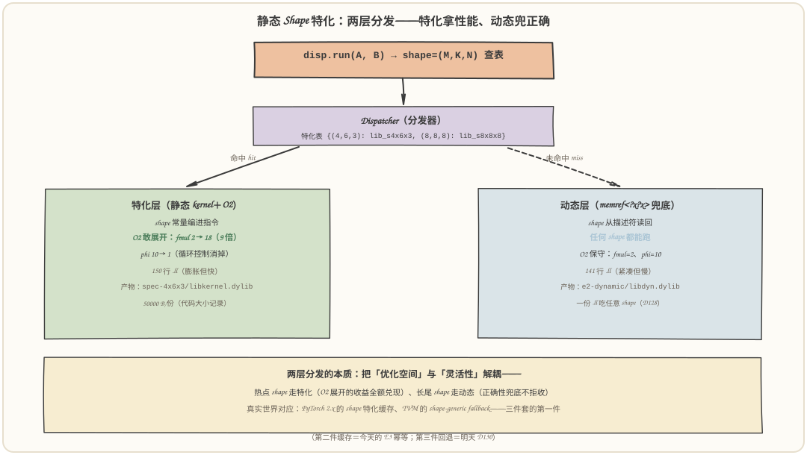
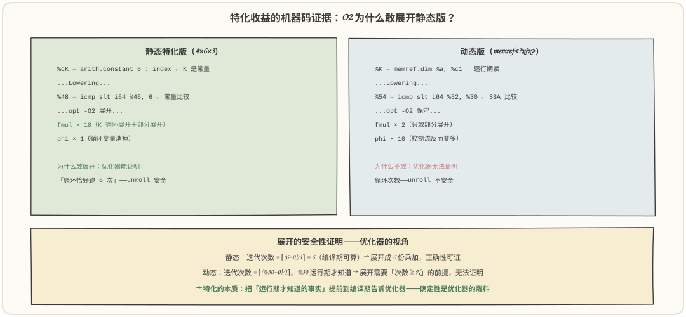
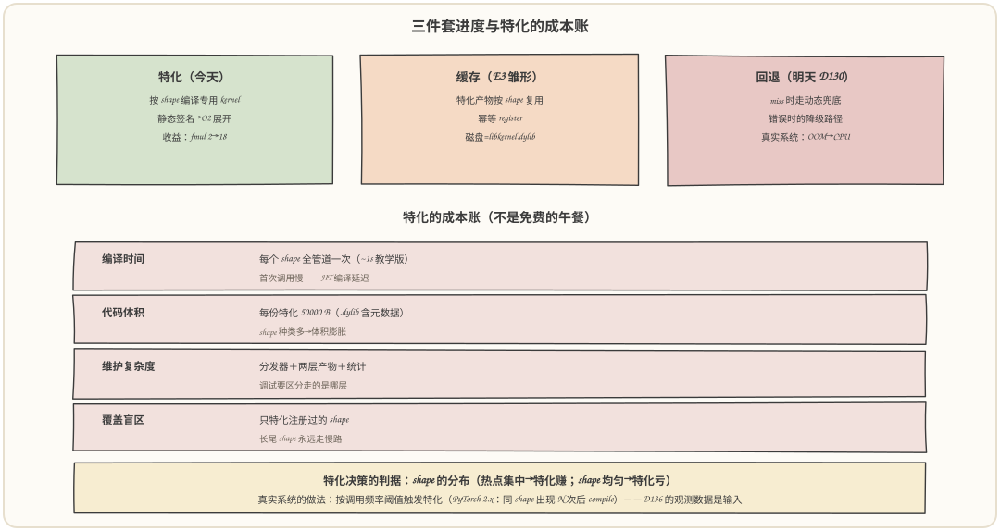

# 第 129 天：静态 Shape 特化——两层分发：特化拿性能（fmul 2→18）、动态兜正确

> **今日目标**：完成本教程后，你能做到五件事——实现**两层分发架构**（Dispatcher 分发器：`disp.run(A,B)` 按运行期 shape 查特化表——命中走静态特化 kernel（O2 展开）、miss 走动态 kernel 兜底（D128 的 E2），实测三种情形：4×6×3 命中 PASS／8×8×8 命中 PASS／5×7×2 miss→动态兜底 PASS，分发统计 hit=2/miss=1/compiled=2）；量化**特化给优化器的空间**（同 shape 4×6×3 下：静态+O2 fmul=18、phi=1、150 行 vs 动态+O2 fmul=2、phi=10、141 行——**fmul 9 倍、phi 十分之一**：静态签名让优化器能证明"循环恰好跑 6 次"、unroll 安全，动态签名无法证明、只能保守）；解释**展开安全性的证明逻辑**（静态：迭代次数=⌈(6−0)/1⌉=6 编译期可算→展开成 6 份乘加正确性可证；动态：⌈(%30−0)/1⌉ 的 %30 运行期才知道→unroll 需要"次数≥N"前提、无法证明——**特化的本质是把"运行期才知道的事实"提前到编译期告诉优化器，确定性是优化器的燃料**）；算清**特化的成本账**（编译时间：每 shape 全管道一次、首次调用慢——JIT 延迟；代码体积：每份 .dylib 50000 B、shape 种类多则膨胀；维护复杂度：分发器＋两层产物＋统计；覆盖盲区：只特化注册过的 shape——**特化决策的判据是 shape 分布**：热点集中则赚、均匀则亏，真实系统按调用频率阈值触发特化）；说出**三件套的进度**（特化＝今天（PyTorch 2.x 的 shape-specialized compile）／缓存＝E3 雏形（幂等 register、磁盘 .dylib 即缓存）／回退＝明天 D130（miss 兜底的错误路径版））。
> **预计时间**：学习 35 分钟＋实践 50 分钟
> **前置准备**：D128 的动态 kernel 与"优化空间收缩"实测（今天特化的动机证据）、D127 职责表（今天翻转"Kernel 选择"：从 COMPILE 单一变 SPLIT 多版本）、D125 的 -O2 展开分析（fmul 1→6 的机制今天放大到 2→18）。工具：python3＋numpy＋本机 LLVM；本文环境：Python 3.9.6＋numpy 1.26.4＋Homebrew LLVM 23.1.5，macOS arm64，2026-11-14。
> **今日产出**：`code/specialize.py`（特化引擎：gen_static_ir 参数化 shape 生成器＋build_kernel 全管道编译＋Dispatcher 两层分发器＋E1/E2/E3 三实验）、`code/run_all.sh`（8 项测试）、`code/outputs/report.txt`（8 PASS / 0 FAIL）、`code/outputs/spec-4x6x3/`＋`spec-8x8x8/`（两份特化产物：input.mlir→七 pass→out.ll→out-O2.ll→libkernel.dylib）＋本文 3 张手绘图。

## 1. 今天解决什么问题？

D128 结尾留了一个张力：动态版"一份 .ll 走天下"但优化空间被锁死（O2 只敢部分展开 fmul=2）；静态版优化空间大（fmul=18）但每个 shape 要编一次。计划第 129 天条目的答案是**特化**："为两组常见 Shape 生成特化产物，并比较通用版本性能"——但真实的工程答案不止"生成两份"：**两层分发**（特化层拿性能、动态层兜正确、分发器串两层）才是完整架构——PyTorch 2.x 的 shape-specialized compile＋cache＋fallback 三件套，今天搭第一件。

今天最有说服力的数字是 **fmul 2→18**：同一个 shape（4×6×3）、同一个优化器（opt -O2）、同一套 Lowering 管道——唯一差异是签名（静态 `memref<4x6>` vs 动态 `memref<?x?x>`），优化器的产出差 9 倍。这个数字把 D128 第⑥条（性能语义收缩）从"定性观察"升级成"定量证据"，也是特化存在的全部理由。

## 2. 先看全貌：两层分发架构



**图 1**：看**一张架构图**——顶部调用入口（`disp.run(A,B)`→shape 查表）、紫色分发器（特化表 `{(4,6,3): lib_s4x6x3, (8,8,8): lib_s8x8x8}`）、两支箭头分岔：**命中 hit**（左绿框特化层：shape 常量编进指令、O2 敢展开 **fmul 2→18（9 倍）**、phi 10→1、150 行 .ll、产物 spec-4x6x3/libkernel.dylib 50000 B/份）与 **miss**（右蓝框动态层：shape 从描述符读回、任何 shape 都能跑、O2 保守 fmul=2/phi=10、141 行、一份 .ll 吃任意 shape——D128 的成果直接复用）。底部金框：两层分发的本质＝**把「优化空间」与「灵活性」解耦**——热点走特化（展开收益全额兑现）、长尾走动态（正确性兜底不拒收）；三件套进度注记（特化＝今天、缓存＝E3、回退＝明天）。

把今天的特化串成 4 步：

1. **生成**：gen_static_ir(M,K,N) 按 shape 参数化生成静态签名 IR（复用 D128 静态模板）；
2. **编译**：build_kernel 全管道（七 pass＋translate＋**opt -O2**＋llc＋clang -shared）→ libkernel.dylib；
3. **分发**：Dispatcher 持特化表＋动态兜底——run() 按 shape 查表、命中调特化、miss 调动态；
4. **验证**：三情形（两组命中＋一组 miss）全对＋幂等缓存＋产物大小记录。

## 3. 核心概念

### 3.1 特化的本质：给优化器确定性

**一句话**：特化不是"多编几个 kernel"——是**把"运行期才知道的事实"（shape）提前到编译期告诉优化器**：静态签名让优化器能证明"循环恰好跑 6 次"，unroll 安全成立；动态签名下证明不了，优化器只能保守——**确定性是优化器的燃料**。

**类比**：餐厅备菜。知道今晚有 6 桌预订（静态）——后厨可以提前把 6 桌的菜全部备到"点火即炒"；不知道几桌（动态）——只能等客人到了再备，每桌都慢一点。**类比边界**：餐厅备错菜可以重做（运行期重试），编译器展开错了是**正确性事故**——所以优化器的展开必须**可证明**（不是"大概率 6 次"而是"必然 6 次"）。这就是为什么动态版的优化器"不敢"而不是"不想"。**技术对应**：图 2 的对照——静态 `icmp slt i64 %46, 6`（常量比较→迭代次数可算）vs 动态 `icmp slt i64 %52, %30`（SSA 比较→次数未知）；fmul 2→18、phi 10→1 就是两种证明能力的产出差。

**当天实测证据**：E1 的指标对照——静态+O2（fmul=18/phi=1/150 行）vs 动态+O2（fmul=2/phi=10/141 行）。

### 3.2 分发器：两层架构的黏合剂

**一句话**：Dispatcher 是运行期的一张**shape→kernel 映射表**加一条**兜底路径**——命中调特化（性能）、miss 调动态（正确），统计 hit/miss 记录路由行为——它把"多版本 kernel"从静态产物变成运行期可用的服务。

**类比**：医院分诊台。建档病人（注册过的 shape）直接进专科诊室（特化 kernel——快）；新病人（未注册 shape）先走全科（动态 kernel——慢但什么都能看）；分诊台记录就诊统计（hit/miss）——哪个专科该扩容（特化更多 shape）看数据说话。**类比边界**：医院分诊有人工判断，分发器是**纯查表**（shape 元组完全匹配才命中）——5×6 和 4×6 是两个 key，没有"近似命中"；真实系统有更聪明的策略（shape 分桶、动态 pad 到最近的特化 shape——TVM 的做法之一），教学版保持最简。**技术对应**：Dispatcher 类——`specialized: dict`（(M,K,N)→(lib, func)）＋`dynamic_lib` 兜底＋`stats` 计数；`register()` 幂等（已注册不重编译——E3 的缓存语义）。

**当天实测证据**：E2 的三情形全 PASS＋统计 `{'hit': 2, 'miss': 1, 'compiled': 2}`。

### 3.3 特化的成本账：不是免费的午餐

**一句话**：特化的四项成本——**编译时间**（每 shape 全管道一次，首次调用慢＝JIT 延迟）、**代码体积**（每份 .dylib 50000 B，shape 种类多则膨胀）、**维护复杂度**（分发器＋两层产物＋统计）、**覆盖盲区**（只特化注册过的 shape——长尾永远走慢路）；**判据是 shape 分布**：热点集中→特化赚，shape 均匀→特化亏。

**类比**：连锁店的中央厨房。爆款单品（热点 shape）中央厨房预制（特化）——出餐快但建厨房要钱（编译成本）、每款要占冷库（体积）；长尾单品门店现做（动态）——慢但零预制成本。菜单越集中（shape 分布越尖）中央厨房越划算；什么都有人点（分布均匀）预制就是亏的。**类比边界**：餐厅的爆款是人选的，**系统的热点 shape 是量出来的**——D136 的 Pass 观测数据（调用频率统计）是特化决策的输入；真实系统按阈值触发（PyTorch 2.x：同 shape 出现 N 次后自动 compile）。**技术对应**：E3 的产物大小记录（`{'spec-4x6x3': 50000, 'spec-8x8x8': 50000}`——计划条目"代码大小记录"的直接交付）＋图 3 的成本账四行。

**当天实测证据**：E3 的幂等（compiled 2→2）＋两份特化产物各 50000 B（.dylib 含 Mach-O 头与元数据，纯代码段远小——教学版不剥元数据）。

## 4. 图解核心机制



**图 2**：看**两栏对照＋一个金框**——左绿栏静态特化版：`%cK = arith.constant 6 : index`（K 是常量）→`%48 = icmp slt i64 %46, 6`（常量比较）→`opt -O2` 展开→**fmul × 18（K 循环展开＋部分展开）、phi × 1（循环变量消掉）**——底注"为什么敢展开：优化器能证明『循环恰好跑 6 次』——unroll 安全"；右蓝栏动态版：`%K = memref.dim %a, %c1`（运行期读）→`%54 = icmp slt i64 %52, %30`（SSA 比较）→`opt -O2` 保守→fmul × 2、phi × 10（控制流反而变多）——底注"为什么不敢：优化器无法证明循环次数——unroll 不安全"（红字）。**底部金框**展开的安全性证明：静态迭代次数=⌈(6−0)/1⌉=6（编译期可算）→展开正确性可证；动态=⌈(%30−0)/1⌉ 运行期才知道→"次数≥N"前提无法证明；**特化的本质：把运行期才知道的事实提前到编译期告诉优化器——确定性是优化器的燃料**。

## 5. 动手实践：8 项测试，从特化收益到缓存雏形



**图 3**：看**两块**——顶部三件套进度卡：特化（今天·绿——按 shape 编译专用 kernel、静态签名→O2 展开、收益 fmul 2→18）、缓存（E3 雏形·橙——特化产物按 shape 复用、幂等 register、磁盘 .dylib 即缓存）、回退（明天 D130·红——miss 时走动态兜底、错误时的降级路径、真实系统 OOM→CPU）；底部成本账四行（编译时间：每 shape 全管道一次、首次调用慢——JIT 编译延迟；代码体积：每份 50000 B、shape 多则膨胀；维护复杂度：分发器＋两层＋统计；覆盖盲区：长尾永远走慢路）＋金框判据（shape 分布——热点集中赚、均匀亏；真实系统按调用频率阈值触发特化，D136 观测数据是输入）。

### 5.1 准备文件

```text
tutorials/week-019/day-129/
├── README.md                    ← 本文
├── images/                       ← 3 张手绘图
└── code/
    ├── specialize.py            # 特化引擎＋Dispatcher＋三实验
    ├── dyn_shape.py             # D128 同款（动态 IR 模板复用）
    ├── gen_images.py / run_all.sh
    └── outputs/
        ├── report.txt            # 8 PASS / 0 FAIL
        ├── e2-dynamic/           # 动态版（D128 产物复制）
        ├── spec-4x6x3/           # 特化产物①（含 out-O2.ll）
        └── spec-8x8x8/           # 特化产物②
```

环境：Python 3.9.6＋numpy 1.26.4＋Homebrew LLVM 23.1.5。一键复现：

```bash
cd tutorials/week-019/day-129/code && ./run_all.sh    # 8 项，约 25 秒
```

**诚实声明**：E2 的验证用 `np.allclose(atol=1e-5)` 而非 bitwise——随机数据下静态特化版（O2 展开＝**不同的乘加序**！）与 numpy `@` 会有 ULP 级差：展开把 k 序乘加重排成树形/并行序，浮点结果与 k 序不完全一致。**这不是 bug 是语义**：O2 展开合法地改变了求和序（IEEE 允许——编译器的合同是"数值等价"不是"逐位一致"）。bitwise 判据只适用于**未经序重排**的对照（D124 的 -O1 以下）；特化+O2 的正确性判据应升级为 atol/rtol（今天的 1e-5 对 f32 合理）。

### 5.2 编写代码

`specialize.py` 的三个关键设计。**其一：gen_static_ir 参数化生成**——shape (M,K,N) 直接填进模板的四处（签名/常量/边界/load 类型），同一模板生成任意特化——**生成器是特化的工厂**，新 shape 一行调用。

**其二：Dispatcher 的幂等 register**——

```python
def register(self, shape, so_path, func_name):
    if shape in self.specialized:
        return                      # 幂等：已注册不重复编译（E3 缓存语义）
    lib = ctypes.CDLL(so_path)
    ...
```

重复 register 同 shape 直接返回——缓存的最小语义（不重复付编译成本）；真实缓存还要管失效（源代码变→缓存作废）与持久化（跨进程复用——TVM 的磁盘 cache dir），教学版留练习。

**其三：两层的函数签名统一**——特化 kernel 与动态 kernel 的 ciface 签名完全相同（三个 Desc2 指针）——分发器才能用**同一个调用点**切换两层。这个"接口统一"是特化能插拔的前提：如果特化版签名不同（比如 shape 也传参），分发器就要写两套调用逻辑——耦合从这里开始腐烂。

### 5.3 运行与观察

`./run_all.sh` 的真机输出（outputs/report.txt，8 PASS / 0 FAIL）：

```text
第 129 天：静态 Shape 特化——真机报告 2026-11-14 22:40
环境：Python 3.9.6｜Darwin arm64

[TP1] E1 特化收益：同 shape 静态 O2 vs 动态 O2 的优化空间
== E1 特化收益：4x6x3 的静态 O2 vs 动态 O2 ==
  静态+O2：fmul=18 phi=1 行=150
  动态+O2：fmul=2 phi=10 行=141
  → 特化让 O2 敢展开：fmul 2 → 18
  [PASS] 特化给 O2 的展开空间：fmul 2→18（9 倍）
  [PASS] 静态特化产物指标入档

[TP2] E2 两层分发：命中特化/miss 兜底
  4x6x3（命中特化）: PASS
  8x8x8（命中特化）: PASS
  5x7x2（miss→动态兜底）: PASS
  分发统计：{'hit': 2, 'miss': 1, 'compiled': 2}
  [PASS] 特化层命中执行正确／第二特化命中正确／未注册 shape 动态兜底正确／分发统计正确

[TP3] E3 缓存雏形：幂等与产物大小
  重复 register 4x6x3：compiled 2 → 2（幂等）
  特化产物大小：{'spec-4x6x3': 50000, 'spec-8x8x8': 50000}（代码大小记录）
  [PASS] 重复 register 幂等（缓存语义）
  [PASS] 产物大小记录入档（计划条目要求）

汇总
  PASS: 8  FAIL: 0
```

三组观察：**①fmul 2→18 的解读**——不是全展开（4×6×3=72 MAC 全展开要 72 个 fmul）：O2 的展开启发式算的是收益平衡（循环控制省下的 vs 代码体积代价——D125 反例的同一杆秤，这次方向相反因为 4×6×3 的 k=6 循环被判定"值得展开"而外层 i/j 值得部分展开）；**②两份特化的体积相同**（50000 B）——Mach-O .dylib 的固定开销（头/符号表/动态段）主导，纯代码差异（4×6×3 vs 8×8×8 的循环规模）淹没在元数据里；真实系统的"代码膨胀"讨论要剥掉元数据看 text 段；**③E2 的 miss 路径**——5×7×2 没注册、走动态版结果全对：**兜底的正确性就是 D128 的正确性**（两层架构里动态层是"地板"，特化层是"天花板"）。

### 5.4 修改一个参数再观察

三个便宜的实验：**实验 A（shape 分布模拟）**：生成 1000 次调用——80% 是 4×6×3、20% 是随机 shape——看 hit/miss 统计（期望 hit≈800）——热点假设的量化版；对照"均匀分布 100 种 shape"（hit≈10/1000——特化几乎无用）——**分布决定特化收益**的亲手验证。**实验 B（特化+展开关闭）**：`opt -O1` 重新编译特化版（disable loop unroll：`-loop-unroll=false`）——fmul 回到 1~2？特化与展开是两个独立开关：特化给"许可"、展开用"许可"。**实验 C（第三个特化）**：register 一个新 shape（如 16×16×16）——编译时间多少？产物多大？把三个数据点连成"shape 规模 vs 编译成本"的粗曲线——特化成本随 shape 怎么涨？

## 6. 常见错误与排查

**错误 1：特化版的验证沿用 bitwise（序重排陷阱）**。现象：特化+O2 的输出与 k 序 golden 差最后一位（ULP 级）——判 bitwise 失败但结果"看起来对"。原因：O2 展开合法地**重排了乘加序**（k 序→树形序）——IEEE 语义下两种序都正确、逐位不必一致；bitwise 判据只对"未经序重排"的实现成立。定位：差值恒在 1~2 ULP、无系统性偏移——序差特征（D124 坑 1 的变体）。修复：判据升级 allclose(atol=1e-5)——特化+O2 的正确性合同是"数值等价"不是"逐位一致"。**教训**：验证判据要跟着优化级别走——O0/O1 可以 bitwise、O2+ 要容差。

**错误 2：分发器的 key 漏维度**。现象：`(4,6)` 做 key（漏了 N）——4×6@6×3 与 4×6@6×8 命中同一个特化、第二个 shape 跑出错误结果或越界。原因：key 不完备——matmul 的身份是 (M,K,N) 三元组，漏任何一个都可能撞 key。定位：构造两个共享两维、第三维不同的输入测分发——错误即现。修复：key=(A.shape[0], A.shape[1], B.shape[1]) 全三维。**教训**：分发 key 的完备性＝正确性——真实系统还要加 dtype/layout 进 key（f32 与 f16 的 kernel 不同）。

**错误 3：特化产物与动态版的 ciface 签名不一致**。现象：分发器调特化 kernel 崩溃或读到垃圾——特化生成器的函数名或参数形态与动态版不同。原因：手写两套生成器时签名漂移（一个 `@kernel_s4x6x3` 一个 `@kernel_dynamic`、参数一个带 bias 一个不带）。定位：`nm -gU libkernel.dylib | grep ciface` 对比两份产物的导出符号。修复：**接口统一纪律**——所有层的 kernel 遵循同一 ciface 合同（本文的三个 Desc2 指针）；生成器从同一模板派生。**教训**：分层架构的腐烂从接口漂移开始——合同（D120 的第一课）在分层时代更重要。

**错误 4：把 E3 的"幂等"当完整缓存**。现象：宣称"缓存已实现"——但源 IR 改了缓存不会失效、跨进程不能复用、没有淘汰策略。原因：教学刻度——幂等只解决"同进程内不重复编译"这一个问题。定位：问三个问题——改了 kernel 源码缓存会更新吗（不会）？重启进程缓存还在吗（在磁盘但不会被加载）？shape 种类无限涨怎么办（无淘汰）？修复（完整版是练习）：key 加源码 hash、启动时扫磁盘 .dylib、LRU 淘汰。**教训**：命名教学实现的边界——"雏形"要明说差什么，否则读者会高估它的能力。

## 7. 今日练习

**必做**：

1. 实验 A（分布模拟）：1000 次调用、80/20 分布 vs 均匀分布——两组 hit/miss 统计对比；写一句结论（什么分布该上特化）。
2. 成本账手算：三个特化 shape 的编译时间（用 time 命令）与产物体积填进自己的表格——连成"shape 规模 vs 成本"粗曲线。
3. 判据升级练习：把 E2 的 allclose 阈值从 1e-5 逐级收紧（1e-6/1e-7/0）——观察哪一级开始失败——这就是"数值等价"与"逐位一致"的分界线。

**选做（挑战）**：

4. 实验 C 进阶（完整缓存）：给 Dispatcher 加磁盘持久化（key→.dylib 路径的 json 索引＋启动扫描）与源码 hash 失效——跨进程缓存的真实雏形。
5. 研究 PyTorch 2.x 的 `torch._dynamo` 特化策略（什么时候触发 compile、cache key 有哪些字段——不止 shape 还有 dtype/device/requires_grad）——对比今天的三元组 key 缺什么。

## 8. 今日验收

- [ ] 我能讲清两层分发架构：分发器查表（shape 三元组 key）、命中走特化（O2 展开）、miss 走动态（兜底）——实测三情形全对、hit/miss 统计可查
- [ ] 我能背出特化收益的核心数字：fmul 2→18（9 倍）、phi 10→1——并解释机制（静态签名让优化器能证明"循环恰好 6 次"、unroll 安全；动态无法证明、保守）
- [ ] 我能说出特化的四项成本（编译时间/代码体积/维护复杂度/覆盖盲区）与决策判据（shape 分布——热点集中赚、均匀亏；真实系统按频率阈值触发）
- [ ] 我知道特化+O2 的验证判据要升级（bitwise→allclose：展开合法重排乘加序，数值等价≠逐位一致）——判据跟着优化级别走
- [ ] 我能说出三件套进度：特化（今天）＋缓存（E3 幂等雏形——差失效/持久化/淘汰三件事）＋回退（明天 D130）
- [ ] 我理解分发 key 的完备性＝正确性（(M,K,N) 三元组缺一不可；真实系统还要 dtype/layout）

## 9. 一句话总结与明天预告

今天的闭环：**问题**——D128 的张力：动态走天下但优化锁死（fmul=2）、静态优化大（fmul=18）但每 shape 编一次；计划条目"为两组常见 Shape 生成特化产物"。**机制**——两层分发：Dispatcher 按 (M,K,N) 查特化表（命中走特化——静态签名给优化器"循环恰好 6 次"的确定性、O2 敢展开 fmul 2→18、phi 10→1；miss 走动态——D128 的一份 .ll 兜任意 shape）；特化的本质＝把运行期才知道的事实提前到编译期告诉优化器——**确定性是优化器的燃料**。**实践**——gen_static_ir 参数化生成两份特化（4×6×3/8×8×8）＋Dispatcher 三情形验证（两组命中＋一组 miss 全对）＋幂等缓存雏形＋产物大小记录（50000 B/份）。**验证**——8 PASS / 0 FAIL；**成本账**入档（编译时间/体积/复杂度/盲区——判据是 shape 分布）。明天 D130 通用实现回退：**三件套的第三件**——miss 的完整故事（今天的 miss 是"没注册"、明天的回退是"执行失败后降级"：特化 kernel 崩了怎么回到动态版？OOM/不支持 dtype/非法 shape 的运行期检查＋错误路径——分发器从"查表"长出"try/except"的骨头）。

> **第 19 周积分卡**：D127 职责审计（9/9）→ D128 运行期 Shape（5/5）→ **D129 静态特化（8/8，fmul 2→18）** → D130 通用回退 → D131 内存 → D132 同步 → D133 复盘。

<!-- tutorial-review: v1 -->
