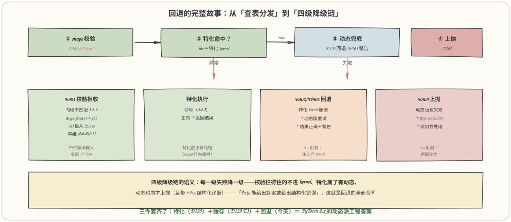
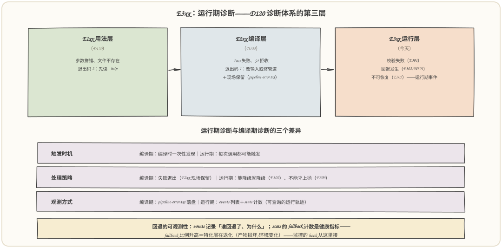
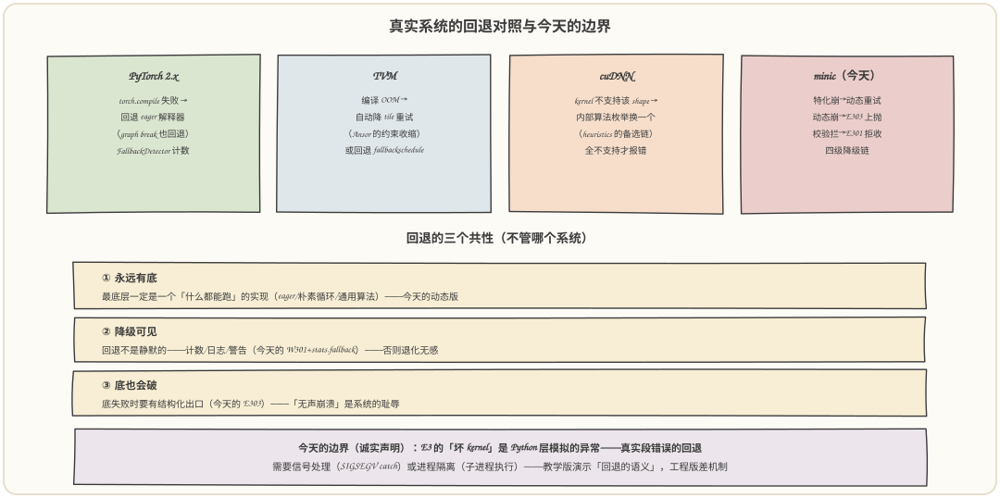
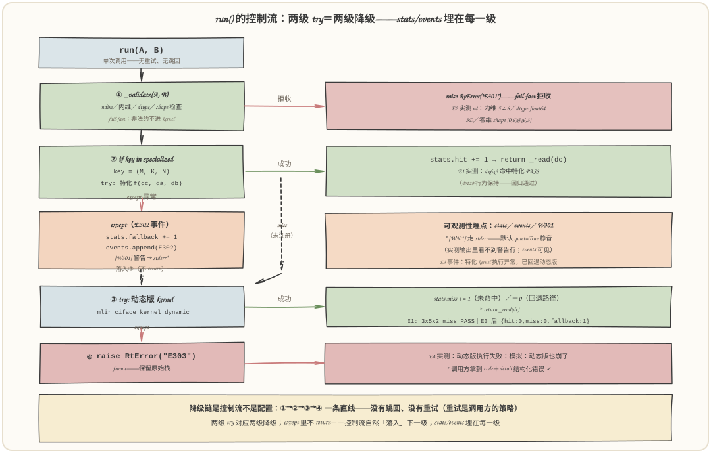

# 第 130 天：通用实现回退——四级降级链：校验拒收→特化执行→异常回退→结构化上抛

> **今日目标**：完成本教程后，你能做到五件事——实现**四级降级链**（①shape 校验：E301 fail-fast 拦住非法输入——内维不匹配/dtype 非 f32/3D 输入/零维，四种实测全部拒收；②特化命中：正常路径走 D129 的特化 kernel；③**E302/W301 回退**：特化 kernel 执行异常→动态版重试→结果正确＋性能降级警告——实测注入坏 kernel 后回退 PASS；④E303 上抛：动态版也失败→结构化 RtError 给调用方）；定义 **E3xx 运行期诊断**（D120 E1xx 用法层／D122 E2xx 编译层之后的第三层：E301 校验/E302 回退/E303 不可恢复＋W301 性能降级警告——运行期诊断与编译期的三个差异：触发时机（每次调用 vs 编译一次）、处理策略（能降级就降级 vs 失败退出）、观测方式（events＋stats vs pipeline-error.txt 落盘））；说出**回退的三个共性**（①永远有底——最底层一定是"什么都能跑"的实现（eager/朴素循环/今天的动态版）；②降级可见——回退不是静默的（W301 警告＋stats.fallback 计数，否则退化无感）；③底也会破——底失败时要有结构化出口（E303），"无声崩溃"是系统的耻辱）；对照**四个真实系统的回退**（PyTorch 2.x：compile 失败→eager 解释器＋FallbackDetector 计数；TVM：OOM→自动降 tile 重试或 fallback schedule；cuDNN：kernel 不支持→内部算法枚举换一个；minic：四级降级链）；声明**今天的边界**（E3 的"坏 kernel"是 Python 层模拟异常——真实段错误的回退需要信号处理（SIGSEGV catch）或进程隔离（子进程执行），教学版演示"回退的语义"、工程版差机制）；宣告**三件套齐了**（特化（D129）＋缓存（D129 E3）＋回退（今天）＝动态派的完整工程答案）。
> **预计时间**：学习 30 分钟＋实践 45 分钟
> **前置准备**：D129 的两层分发（今天在其上叠校验与回退）、D120 的诊断体系（E1xx/E2xx 的分层思想今天长出第三层）、D128 实验 C 的"非法 shape 探测"（今天 E301 校验的动机）。工具：python3＋numpy＋本机 LLVM＋D129 的两份产物；本文环境：Python 3.9.6＋numpy 1.26.4＋Homebrew LLVM 23.1.5，macOS arm64，2026-11-14。
> **今日产出**：`code/fallback.py`（RuntimeWithFallback：校验→特化→回退→上抛四级链＋E3xx 诊断＋events/stats 可观测）、`code/run_all.sh`（6 项测试）、`code/outputs/report.txt`（6 PASS / 0 FAIL）、四条路径的完整实测记录＋本文 3 张手绘图。

## 1. 今天解决什么问题？

D129 的 miss 是"没注册"——一条**正常**路径（长尾 shape 走动态版，天经地义）。但真实运行期还有**异常**路径：特化 kernel 莫名崩溃（产物损坏、环境变化、指针失效）怎么办？调用方传了非法 shape（越界/错 dtype）怎么办？动态版也失败怎么办？计划第 130 天条目："实现简单分发：命中特化配置则使用特化版本，否则走通用版本"——分发 D129 已做，今天补"**未命中之后的完整故事**"：校验、回退、上抛。

回退为什么值得一天？因为**它是系统能不能"永远给出答案"的分水岭**。没有回退的系统：特化崩了＝服务崩了（用户看到 segfault）；有回退的系统：特化崩了→动态版顶上→结果晚一点但正确→同时发出警告（下次修）。PyTorch 2.x 能在生产环境用 torch.compile 的底气就是"compile 失败随时回 eager"——**激进优化的安全网**。今天把这张安全网在 minic 上织出来。

## 2. 先看全貌：四级降级链



**图 1**：看**一条链＋四张详情卡**——顶部主链：①shape 校验（E301 fail-fast）→②特化命中？（hit→特化 kernel／miss→③动态兜底）→异常（红箭头下跳）→③动态兜底（E302 回退/W301 警告）→失败→④上抛（E303）；四张详情卡：E301 校验拒收（四种非法输入全部 fail-fast——E2 实测×4）、特化执行（正常路径——D129 行为保持）、E302/W301 回退（特化崩→动态重试→结果正确＋警告——E3 实测注入坏 kernel 回退 PASS）、E303 上抛（两层全崩→结构化 RtError——E4 实测）；**底部金框**：四级降级链的语义——每一级失败降一级、"永远能给出答案或给出结构化错误"就是回退的全部合同；**绿字宣告**三件套齐了（特化＋缓存＋回退＝PyTorch 2.x 的动态派工程答案）。

把今天的回退串成 4 步：

1. **校验**：`_validate()` 检查 ndim/内维/dtype/零维——四种非法输入 E301 拒收（fail-fast：非法的不进 kernel）；
2. **执行**：命中特化正常跑（D129 行为零变化——回归通过）；
3. **回退**：特化异常被 catch→E302 记录→动态版重试→W301 性能降级警告；
4. **上抛**：动态版也崩→E303 RtError——调用方拿到结构化错误（代码＋细节）。

## 3. 核心概念

### 3.1 回退的语义：永远有答案或结构化错误

**一句话**：回退系统的合同是——**合法输入永远有输出**（特化崩了动态顶）或**结构化错误**（E301/E303——代码＋细节，不是 segfault）——"无声崩溃"是系统的耻辱。

**类比**：医院的急诊分级。轻症（非法输入）分诊台直接劝返（E301——"这里看不了，去对面"）；普通病走专科（特化）；专科设备坏了（特化异常）转全科继续看（E302 回退）并登记设备故障（W301）；全科也没药（E303）正式告知转院（上抛）——**每一步患者都知道自己在哪、发生了什么**。**类比边界**：医疗的分诊有人工裁量，回退链是**机械的**——条件触发、逐级下跳、不跳级也不折返（E303 上抛后不会"再试一次特化"——重试策略是调用方的事，Runtime 只保证单次调用的确定性）。**技术对应**：RuntimeWithFallback.run() 的 try/except 结构——特化层 except 捕获后**落入动态层**（不是 return None）；动态层 except 转 RtError("E303") raise——两级 try 对应两级降级。

**当天实测证据**：E3 的注入实验——BombLib 抛 RuntimeError→回退动态→输出正确＋stats.fallback=1＋events 记录"特化 kernel 执行异常，已回退动态版"。

### 3.2 E3xx：运行期诊断的三个差异

**一句话**：运行期诊断（E3xx）与编译期诊断（E1xx/E2xx）有三处本质不同——**触发时机**（每次调用都可能触发 vs 编译时一次性）、**处理策略**（能降级就降级 vs 失败退出）、**观测方式**（events 列表＋stats 计数（可查询的运行轨迹）vs pipeline-error.txt 落盘）。

**类比**：安检 vs 随车医生。机场安检（编译期）——一次通过终身有效（编译产物不再查）；随车医生（运行期）——每站都要巡视、小病车上治（回退）、大病送医院（上抛）、巡诊记录随身（events）。**类比边界**：安检的"一次通过"依赖**输入不变**（编译时的输入与运行时相同——静态系统的前提）；动态系统输入每次变——校验必须每次做（E301 在 run() 里不在编译里）。**技术对应**：W301 与 E302 的分工——E302 是**事件**（发生了回退、记入 events）、W301 是**警告**（性能降级了、stderr 提示但不改变行为）；stats 的四个计数（hit/miss/fallback/rejected）是健康指标——**fallback 比例升高＝特化层在退化**（产物损坏/环境变化）——监控的 hook 从这里接。

**当天实测证据**：E2 的四种拒收（E301×4）＋E3 的 events[0]（"特化 kernel 执行异常，已回退动态版：模拟：特化 kernel 段错误"）＋stats（`{'hit': 0, 'miss': 0, 'fallback': 1, 'rejected': 0}`）。

### 3.3 回退的三个共性（跨系统不变式）

**一句话**：不管 PyTorch/TVM/cuDNN/minic——回退系统有三个共性：**永远有底**（最底层一定是"什么都能跑"的实现）、**降级可见**（回退不是静默的）、**底也会破**（底失败要有结构化出口）。

**类比**：大楼的消防体系。常备消防通道（永远有底——不通电梯也能下楼）、警报器（降级可见——火警不靠猜）、避难层（底也会破——通道也堵时的最后方案＋明确标识）。**类比边界**：消防通道是**建筑时**建好的（编译期预置），回退的"底"也是编译期就准备好的（动态版 kernel 与特化版**同时编译**——运行期没有"现场编一个底"的余裕，JIT 也需要时间预算）。**技术对应**：图 3 的四系统对照——PyTorch 的 eager（底）＋FallbackDetector（可见）＋异常传播（出口）；TVM 的 fallback schedule；cuDNN 的算法枚举链；minic 的动态版＋W301＋E303——**四个系统、同一个骨架**。

**当天实测证据**：E1（底的行为保持——动态版照常跑 miss 的 shape）＋E3（可见——警告与计数）＋E4（出口——E303 结构化上抛）。

## 4. 图解核心机制



**图 2**：看**三层诊断卡＋三个差异行**——三层卡：E1xx 用法层（D120·绿——参数拼错/文件不存在、退出码 2 先读 --help）、E2xx 编译层（D122·蓝——Pass 失败/S2 拒收、退出码 1＋现场保留 pipeline-error.txt）、**E3xx 运行层（今天·橙——E301 校验/E302 回退/W301 警告/E303 不可恢复）**；三个差异行（紫框）：触发时机（编译时一次 vs 每次调用）、处理策略（失败退出 vs 能降级就降级）、观测方式（.txt 落盘 vs events＋stats 运行轨迹）；**底部金框**：回退的可观测性——events 记录"谁回退了、为什么"；stats.fallback 是健康指标——比例升高＝特化层退化——**监控的 hook 从这里接**。

## 5. 动手实践：6 项测试，四条路径全通



**图 3**：看**四系统卡＋三个共性＋边界声明**——四系统卡：PyTorch 2.x（compile 失败→eager 回退＋FallbackDetector）、TVM（OOM→自动降 tile 重试/fallback schedule）、cuDNN（kernel 不支持→算法枚举换一个）、minic（四级降级链）；三个共性金框：永远有底／降级可见／底也会破；**底部紫框**今天的边界（诚实声明）：E3 的"坏 kernel"是 Python 层模拟的异常——真实段错误的回退需要信号处理（SIGSEGV catch）或进程隔离（子进程执行）——教学版演示"回退的语义"、工程版差机制。

### 5.1 准备文件

```text
tutorials/week-019/day-130/
├── README.md                    ← 本文
├── images/                       ← 3 张手绘图
└── code/
    ├── fallback.py              # RuntimeWithFallback 四级降级链
    ├── specialize.py / dyn_shape.py     # D129 同款（产物复用）
    ├── gen_images.py / run_all.sh
    └── outputs/
        ├── report.txt            # 6 PASS / 0 FAIL
        ├── e2-dynamic/           # 动态版（含 libdyn.dylib）
        └── spec-4x6x3/           # 特化版
```

环境：Python 3.9.6＋numpy 1.26.4＋Homebrew LLVM 23.1.5。一键复现：

```bash
cd tutorials/week-019/day-130/code && ./run_all.sh    # 6 项，约 15 秒
```

**诚实声明**：E3/E4 的异常是 Python 层注入的（BombLib/BombDynamic）——演示回退的**语义**（捕获→降级→记录）；真实世界的 kernel 崩溃多是段错误（C 层信号，Python 的 try/except 接不住）——工程级回退需要 signal.signal(SIGSEGV) 或子进程隔离，教学版刻意避开这两个重机制（它们会把教程变成操作系统课）。

### 5.2 编写代码

`fallback.py` 的关键设计——**降级链是控制流不是配置**：

```python
def run(self, A, B):
    self._validate(A, B)                    # ① E301 fail-fast
    key = (A.shape[0], A.shape[1], B.shape[1])
    da, db = make_desc(A), make_desc(B)
    if key in self.specialized:             # ② 特化命中
        _, f = self.specialized[key]
        dc = Desc2()
        try:
            f(ctypes.byref(dc), ctypes.byref(da), ctypes.byref(db))
            self.stats["hit"] += 1
            return self._read(dc)
        except Exception as e:              # E302：捕获→降级（落入③）
            self.stats["fallback"] += 1
            self.events.append(...)
    dc = Desc2()                            # ③ 动态兜底
    try:
        self.dynamic_lib._mlir_ciface_kernel_dynamic(...)
        return self._read(dc)
    except Exception as e:
        raise RtError("E303", ...) from e   # ④ 上抛
```

四级是一条**直线**：validate→try 特化→except 落入动态→except 转 E303——没有跳回、没有重试（重试是调用方的策略）；stats 与 events 埋在每一级——**可观测性是链的一部分**不是事后补的。



**图 4**：看**左列主链＋右列出口卡**——左列是 `run()` 的真实控制流：①`_validate`（红箭头右出＝E301 拒收）→②命中特化的 try（绿箭头右出＝hit＋1 返回；红箭头下跳＝异常进 except）→except 记 E302 事件＋stats.fallback＋W301（**虚线箭头"落入③"——except 里不 return，控制流自然继续往下**；右侧虚线旁路＝miss 未注册直接进③）→③动态版 try（绿箭头右出＝返回；红箭头下跳）→④`raise RtError("E303") from e`；右列出口卡逐级标注实测证据：E2×4 拒收／E1 命中 PASS／E1 miss PASS（**注意 miss 计数的两种情况：未命中路径 +1、回退路径 +0——这就是 E3 统计里 miss=0 的原因**）／E4 上抛 ✓；橙卡是可观测性埋点汇总（[W301] 走 stderr、默认 quiet=True 静音——实测输出里看不到警告行，events 与 stats 可见）。

### 5.3 运行与观察

`./run_all.sh` 的真机输出（6 PASS / 0 FAIL）：

```text
第 130 天：通用实现回退——真机报告 2026-11-14 22:55
环境：Python 3.9.6｜Darwin arm64

[TP1~TP4] 四条路径：正常/校验/回退/上抛
== E1 正常路径：命中与 miss（D129 行为保持）==
  4x6x3 命中特化: PASS
  3x5x2 miss 动态: PASS
== E2 校验路径：非法输入的 fail-fast（E301）==
  内维不匹配: 拒收 ✓（E301: 内维不匹配 5≠6）
  dtype 非法: 拒收 ✓（E301: dtype 只支持 f32（float64/float64））
  3D 输入: 拒收 ✓（E301: A.ndim=3, B=2（只支持 2D））
  零维: 拒收 ✓（E301: 零维 shape (0, 6)@(6, 3)）
  四种非法输入全部 fail-fast（rejected=4）
== E3 回退路径：特化异常→动态重试（E302→W301）==
  特化崩溃→动态重试: PASS（回退成功）
  统计: {'hit': 0, 'miss': 0, 'fallback': 1, 'rejected': 0}
  事件: 特化 kernel 执行异常，已回退动态版：模拟：特化 kernel 段错误
== E4 不可恢复路径：动态版也失败（E303 上抛）==
  两层全崩→上抛 E303: 动态版执行失败：模拟：动态版也崩了 ✓
四条路径全通：正常（hit/miss）→校验（E301）→回退（E302/W301）→上抛（E303）
三件套齐了：特化（D129）＋缓存（D129 E3）＋回退（今天）
  [PASS] E1 正常路径（命中特化）／E1 正常路径（miss 动态）
  [PASS] E2 校验路径（4 种 E301 拒收）
  [PASS] E3 回退路径（E302→W301 降级重试）
  [PASS] E4 不可恢复路径（E303 上抛）
  [PASS] 三件套完整性断言
```

三组观察：**①校验的顺序**——`_validate` 在分发**之前**：非法输入根本不进 kernel（越界 shape 进 kernel 是段错误不是异常——校验是挡在段错误前的墙）；**②回退的代价记账**——W301 警告"性能降级"：回退成功≠没有代价（动态版慢 9 倍 fmul 视角的损失）——**降级可见**包含"看见了代价"；**③stats 的监控语义**——`fallback=1` 单次无意义、`fallback/total` 比例才有意义——健康系统的该比例应趋近 0，持续增长就是特化层退化的警报。

### 5.4 修改一个参数再观察

三个便宜的实验：**实验 A（校验覆盖率审计）**：给 `_validate` 数一数漏了什么（NaN/Inf 输入？非连续内存的数组（strides 里有 padding）？）——各写一行"要不要拦、为什么"；**实验 B（重试策略）**：在调用方写"E303 时 sleep 1s 重试一次"——观察重试成功与否（教学版的 BombDynamic 永远崩——重试也无用；但把 Bomb 换成"偶发失败"（随机抛）就能看到重试的价值）——**重试是调用方策略**不是 Runtime 职责的分界线；**实验 C（回退链加深）**：注册第三个层次（比如"CPU 朴素 Python 版"做最终底）——动态版也崩时落到纯 Python 计算——四级变五级；讨论：每加一级的收益与复杂度怎么权衡？

## 6. 常见错误与排查

**错误 1：校验放在 kernel 里做（越界已发生）**。现象：想"让 kernel 自己检查 shape"——但越界 load 已经是段错误，Python 层根本接不住。原因：校验时机错了——kernel 内的检查发生在**越界访问之后**（或需要额外指令每个循环都查——性能灾难）。定位：把非法 shape 传给没有校验的版本——直接 segfault（不是异常）。修复：校验在**调用边界**（`_validate` 在 run() 最前）——fail-fast：非法的不进 kernel。**教训**：运行期检查的黄金位置是**边界**——进了 kernel 就太晚（段错误）或在循环里（太慢）。

**错误 2：回退吞掉异常不留痕**。现象：except 里直接调动态版、不记 events 不打警告——回退"成功"但没人知道发生过。原因：把回退当成"容错"而不是"降级"——容错追求无感、降级必须可见（性能变了！）。定位：检查 stats.fallback 与 events——空的就是吞了。修复：except 三件事——记事件（E302）、计数（stats）、告警（W301）——**然后**才降级。**教训**：静默回退是定时炸弹——特化层坏了没人修，某天动态版也坏就全崩。

**错误 3：E303 上抛裸 Exception**。现象：动态版失败时 `raise RuntimeError(e)`——调用方拿到一串无结构的英文栈。原因：上抛没有走诊断体系——RtError 的 code/detail 结构丢了。定位：`except RtError` 能接住吗？裸 RuntimeError 接不住（类型不对）。修复：`raise RtError("E303", ...) from e`——保持链（from e 保留原始栈）＋结构化（code 可编程消费）。**教训**：错误出口的合同与正常出口同样重要——E3xx 是调用方的编程接口。

**错误 4：把回退当万能药（重试风暴）**。现象：调用方"E303 就重试"——如果失败原因是持续性的（产物真坏了），重试只是把崩溃推迟一秒、还翻倍了负载。原因：重试适合**偶发**失败（网络抖动/内存瞬时紧张），不适合**持续**失败（代码 bug/产物损坏）。定位：重试一次成功了吗？连续失败两次以上就是持续性问题。修复：重试上限＋失败后退避（exponential backoff）＋连续失败报警——**回退是 Runtime 的职责、重试策略是调用方的职责、熔断是系统的职责**——三层分开。

## 7. 今日练习

**必做**：

1. 实验 A（校验审计）：给 `_validate` 列漏项清单（NaN/Inf/非连续 stride/超大 shape）——每项写"拦/不拦"与理由；给两个最重要的补上实现。
2. 四级链默写：合上代码画降级链（①→②→③→④、每级的触发条件与出口）——漏了哪级重读 3.1。
3. 三共性＋四系统对照脱稿：不看图 3 复述"永远有底/降级可见/底也会破"并各配一个真实系统例子。

**选做（挑战）**：

4. 实验 B（重试策略）：把 Bomb 改成"10% 概率失败"（随机抛）——调用方写"最多重试 3 次＋退避"——统计成功率与平均延迟；再改成"100% 失败"看重试的浪费——数据化"重试适合偶发不适合持续"。
5. SIGSEGV 捕获研究：查 Python 的 `signal` 模块与 `faulthandler`——为什么纯 Python 接不住段错误（信号在 C 栈上触发）？子进程隔离方案的轮廓（fork+exec+exit code 检查）——写 5 行机制笔记。

## 8. 今日验收

- [ ] 我能画出四级降级链：①校验（E301 fail-fast）→②特化（正常 hit）→③回退（E302 捕获→动态重试→W301 警告）→④上抛（E303 结构化）——每级的触发条件与出口
- [ ] 我实测过四条路径：正常×2（命中/miss）、校验×4（内维/dtype/3D/零维全拒收）、回退（注入坏 kernel 重试成功）、上抛（两层全崩 E303）——6 PASS
- [ ] 我能说出 E3xx 与 E1xx/E2xx 的三个差异（触发时机/处理策略/观测方式）与 W301 的分工（事件 E302 vs 警告 W301）
- [ ] 我能复述回退三共性（永远有底/降级可见/底也会破）并各配真实系统例子（PyTorch eager/FallbackDetector/异常传播）
- [ ] 我知道校验的黄金位置是调用边界（进 kernel 就太晚——段错误；循环里就太慢）与重试的三层分界（回退=Runtime、重试=调用方、熔断=系统）
- [ ] 我能声明今天的边界：Python 层模拟异常 vs 真实段错误（信号处理/进程隔离的工程方案）——教学语义与工程机制的差别

## 9. 一句话总结与明天预告

今天的闭环：**问题**——D129 的 miss 是正常路径，异常路径（特化崩/非法输入/全崩）没有答案；计划条目"命中特化则用特化、否则走通用"。**机制**——四级降级链：校验（E301 fail-fast，四种非法全拒）→特化（正常）→**回退**（E302 捕获→动态重试→W301 性能降级警告）→上抛（E303 结构化 RtError）；E3xx 运行期诊断补全 D120 的三层体系（用法/编译/运行）。**共性**——永远有底/降级可见/底也会破（PyTorch/TVM/cuDNN/minic 四系统同骨架）。**验证**——6 PASS / 0 FAIL：四条路径全通＋三件套完整性断言（特化＋缓存＋回退齐了）。明天 D131 内存分配与复用：**D118 挂了三天的 malloc 债务结清日**——kernel 每次 malloc(48) 从不 free 的泄漏模式（真实服务＝48MB/s）用**分配器/池**接管：预分配＋复用＋生命周期管理；D127 审计表"内存释放=NONE"的空格终于有人填。

> **第 19 周积分卡**：D127 职责审计（9/9）→ D128 运行期 Shape（5/5）→ D129 静态特化（8/8）→ **D130 通用回退（6/6，四路径全通）** → D131 内存 → D132 同步 → D133 复盘。

<!-- tutorial-review: v1 -->
