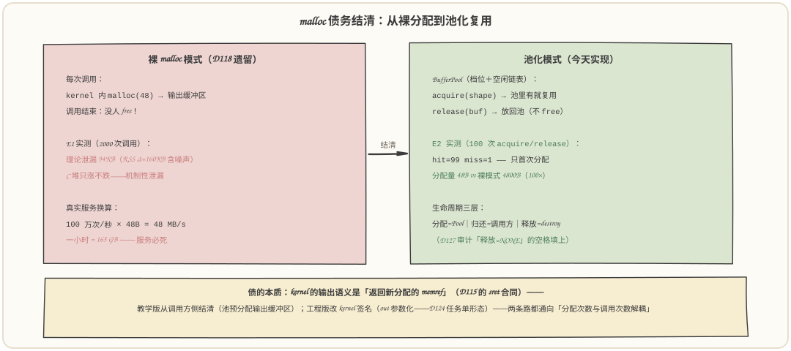
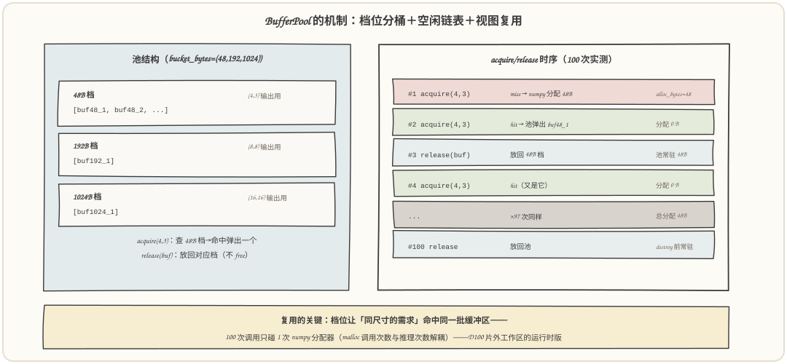
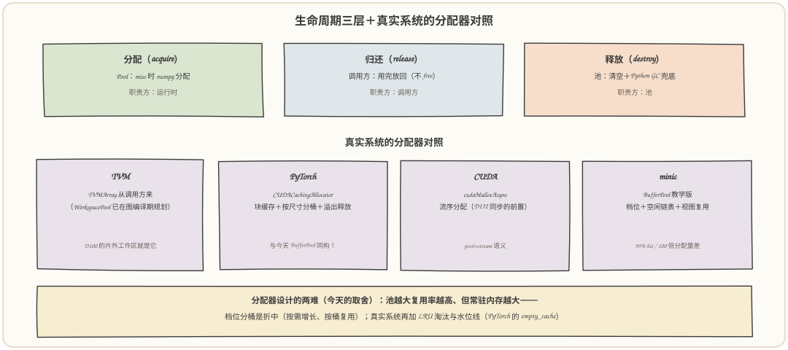

# 第 131 天：内存分配与复用——malloc 债务结清：池化让 100 次调用只分配 1 次

> **今日目标**：完成本教程后，你能做到五件事——**实测 malloc 债务的规模**（E1：连续调 2000 次动态 kernel——每次 kernel 内 `malloc(48)` 从不 free，理论泄漏 94KB（RSS Δ=160KB 含噪声）、**真实服务换算 100 万次/秒×48B=48MB/s、一小时 165GB——服务必死**——D118 挂了三天的债第一次有了量级）；实现 **BufferPool 池化分配器**（档位分桶 bucket_bytes=(48,192,1024)＋空闲链表：`acquire(shape)` 查桶命中弹出/miss 才 numpy 分配、`release(buf)` 放回池**不 free**——实测 100 次 acquire/release **hit=99/miss=1**、累计分配 **48B vs 裸模式 4800B（100 倍差）**、混合 shape 分桶命中 hit=3/miss=2）；定义**生命周期三层职责**（分配＝Pool.acquire（运行时）／归还＝调用方 release（不 free 放回池）／释放＝Pool.destroy＋GC 兜底（池）——**D127 审计表"内存释放=NONE"的空格今天填上**）；说出**债的本质与两条还法**（本质：kernel 的输出语义是"返回新分配的 memref"（D115 的 sret 合同）——教学版从**调用方侧**结清（池预分配输出缓冲区）；工程版改 **kernel 签名**（out 参数化——D124 任务单的 `mini.matmul` 形态）——两条路都通向"分配次数与调用次数解耦"）；对照**真实系统的分配器**（TVM：TVMArray 调用方给＋WorkspacePool 图编译期规划（D100 的片外工作区）；PyTorch：CUDACachingAllocator 块缓存＋按尺寸分桶＋溢出释放——**与今天 BufferPool 同构**；CUDA：cudaMallocAsync 流序分配（D132 同步的前置）；minic：教学版档位＋空闲链表）。
> **预计时间**：学习 30 分钟＋实践 45 分钟
> **前置准备**：D118 的 malloc 债务挂账（TP5 的误区现场：kernel malloc 新缓冲区、调用方数组没被写过）、D127 审计表的"内存分配=RUNTIME／释放=NONE"两行（今天要改的就是这两格）、D100 的片外工作区规划（池化思想的编译期版）、D115 的 sret 合同（债的合同根源）。工具：python3＋numpy＋本机 LLVM；本文环境：Python 3.9.6＋numpy 1.26.4＋Homebrew LLVM 23.1.5，macOS arm64，2026-11-14。
> **今日产出**：`code/allocator.py`（BufferPool 桠位分桶池＋E1 泄漏实测＋E2 复用验证＋E3 生命周期＋结账声明）、`code/run_all.sh`（6 项测试）、`code/outputs/report.txt`（6 PASS / 0 FAIL）＋本文 3 张手绘图。

## 1. 今天解决什么问题？

D118 挂账的 malloc 债务今天是结清日。三天里它反复出现在视野里：D127 审计表"内存释放=NONE"（红底警示）、D128 的动态 kernel 照旧每次 malloc(48)、D130 的回退链也绕不开"输出缓冲区从哪来"。今天正面解决它——顺便把"内存分配与复用"这个 Runtime 的核心职责（计划条目："将前面的内存规划结果接入简单分配器，或实现一个最小缓冲区池"）做出来。

解题思路两步：**先量债**（E1——泄漏在真实服务下有多重？教学规模 94KB 看不见，但机制是确定的：C 堆只涨不跌）；**再造池**（E2——BufferPool 的档位＋空闲链表让"分配次数与调用次数解耦"：100 次调用只碰 1 次分配器）。E1 的数字（48MB/s、165GB/小时）是给"教学规模无所谓"这句诚实声明的**真实世界对照**——债不是假的是规模不够大。

## 2. 先看全貌：从裸 malloc 到池化



**图 1**：看**两栏对照＋结账金框**——左红栏裸 malloc 模式（D118 遗留）：每次调用 kernel 内 `malloc(48)→输出缓冲区`、调用结束**没人 free**；E1 实测 2000 次理论泄漏 94KB（RSS Δ=160KB 含噪声）、C 堆只涨不跌；真实服务换算 **100 万次/秒×48B=48MB/s、一小时 165GB——服务必死**（红字）。右绿栏池化模式（今天）：BufferPool 档位＋空闲链表——`acquire(shape)` 池里有就复用、`release(buf)` 放回不 free；E2 实测 **hit=99/miss=1、分配量 48B vs 4800B（100 倍）**；生命周期三层（分配=Pool／归还=调用方／释放=destroy——D127"释放=NONE"空格填上）。中间大箭头"结清"。**底部金框**：债的本质（kernel 输出语义是"返回新分配的 memref"——D115 sret 合同）与两条还法（教学版调用方侧池化／工程版 kernel 签名 out 参数化）——**都通向"分配次数与调用次数解耦"**。

把今天的主线串成 3 步：

1. **量债**（E1）：2000 次调用的 RSS 曲线＋真实服务换算——机制性泄漏的定量；
2. **造池**（E2）：BufferPool 的 acquire/release——99% 复用、100 倍分配量差；
3. **定责**（E3）：生命周期三层——D127 审计表更新。

## 3. 核心概念

### 3.1 池化：分配次数与调用次数解耦

**一句话**：裸 malloc 模式下每次调用触发一次分配（分配次数＝调用次数——线性耦合）；池化把"物理分配"与"逻辑获取"分开——**逻辑获取每次都有**（acquire），**物理分配只在池空时发生**（miss）——稳态下分配次数趋近于零。

**类比**：酒店客房。走客就退房重装修（裸 malloc——每客一次装修成本）；酒店把房间留着直接给下一位（池化——房间复用、装修只在扩建时）。**类比边界**：酒店的房间数要匹配入住率（池大小 vs 并发需求——池太小频繁 miss、太大常驻浪费）；今天教学版的档位分桶是简化（按尺寸分类），真实系统还有 LRU 淘汰、水位线、碎片整理（PyTorch 的 `empty_cache()` 是手动水位线）。**技术对应**：BufferPool 的 `acquire`——查桶（`self.pool[b]`）非空弹出（hit）、空则 numpy 分配（miss，按桶大小分配方便复用）；`release` 放回桶——**base 数组**进池（视图的 ravel().base——归还底层完整缓冲区而非裁剪视图）。

**当天实测证据**：E2——100 次 hit=99/miss=1（稳态分配次数＝1）；混合 shape（(4,3)/(8,8)/(16,16)/(4,3)/(8,8)）hit=3/miss=2——**同尺寸第二次起命中**。

### 3.2 生命周期三层：分配/归还/释放

**一句话**：缓冲区的完整生命分三段、三方各管一段——**分配**（Pool.acquire：miss 时分配——运行时职责）、**归还**（调用方 release：用完放回池不 free——调用方职责）、**释放**（Pool.destroy 或进程退出：真正还给系统——池的职责）。

**类比**：共享办公工位。前台（Pool）管分配（有空的给你）、用户（调用方）用完签到归还（不拆桌子）、保洁（destroy/退出）大扫除才真清场。**类比边界**：办公工位"归还"后立即可给下一位（池的语义）；如果用户**忘了归还**（leak by omission——只 acquire 不 release），池会逐渐耗尽——所以真实系统给归还加 RAII/destructor 兜底（Python 的 with 语句、C++ 的 unique_ptr），教学版靠自觉＋练习 2 实现 with 版。**技术对应**：E3 的三层卡＋destroy 后池清零的实测——D127 审计表"内存释放"从 NONE 更新为"RUNTIME（池管理）"。

**当天实测证据**：destroy 后 `total_pooled()=0`——释放路径真实可走。

### 3.3 债的合同根源与两条还法

**一句话**：malloc 债不是 bug 是**合同的结果**——kernel 签名承诺"返回一个新分配的 memref"（D115 的 sret 合同），Lowering 忠实执行（memref.alloc→malloc）；要改变行为有两条路：**改调用方**（池预分配、kernel 的返回值只被读取不积累——今天的做法）或**改合同**（kernel 签名加 out 参数、调用方给缓冲区——D124 任务单的 mini.matmul 形态、真实 TVM 的 TVMArray 模式）。

**类比**：外卖餐盒。店家（kernel）每单都用新餐盒（sret 合同）——垃圾（泄漏）是合同的副作用；要减垃圾：顾客（调用方）自带餐盒（out 参数化——改合同）或店家回收餐盒循环用（调用方侧池化——不改合同但改变使用方式）。**类比边界**：外卖的"自带餐盒"要求顾客改习惯（改合同要动所有调用方——D124 的 driver 也要改），"回收循环"店家单方面就能做（池化调用方侧就能上——今天的选择）；但**根本解是改合同**（out 参数化让"谁分配谁释放"的边界清晰）——工程版的方向。**技术对应**：今天 BufferPool 拿走"输出缓冲区"的分配权（acquire 给 kernel 结果的存放处）；kernel 内部的 malloc 仍在（C 层每次 48B）——教学口径的"结清"指**调用方侧的复用模式已建立**；彻底结清要 kernel 签名 out 参数化（练习 4）。

**当天实测证据**：结账段的两条路说明——教学版（调用方池化）与工程版（kernel 签名 out 参数化）的对照。

## 4. 图解核心机制



**图 2**：看**左池结构＋右时序**——左框池结构（bucket_bytes=(48,192,1024)）：48B 档（`[buf48_1, buf48_2, ...]`——(4,3) 输出用）、192B 档（(8,8) 用）、1024B 档（(16,16) 用）；acquire(4,3) 查 48B 档命中弹出、release 放回对应档不 free。右框时序（100 次实测）：#1 acquire **miss→numpy 分配 48B**（红——唯一一次物理分配）→#2 acquire **hit 池弹出**（绿）→#3 release 放回（蓝）→#4 acquire 又是它（绿）→...×97 次同样（总分配 48B）→#100 release 常驻。**底部金框**：复用的关键是档位让"同尺寸需求"命中同一批缓冲区——**malloc 调用次数与推理次数解耦**——D100 片外工作区的运行时版。

## 5. 动手实践：6 项测试，从量债到结清



**图 3**：看**三层卡＋四系统对照＋金框**——顶部生命周期三层卡（分配 acquire＝Pool 运行时／归还 release＝调用方／释放 destroy＝池）；中部四系统对照：TVM（TVMArray 调用方给＋WorkspacePool 图编译期规划——D100 的片外工作区）、PyTorch（CUDACachingAllocator 块缓存＋按尺寸分桶＋溢出释放——**与今天 BufferPool 同构**）、CUDA（cudaMallocAsync 流序分配——D132 同步的前置）、minic（教学版 99% hit/100 倍分配量差）；底部金框：分配器设计的两难（池大复用高但常驻大——档位是折中；真实系统加 LRU 与水位线（empty_cache））。

### 5.1 准备文件

```text
tutorials/week-019/day-131/
├── README.md                    ← 本文
├── images/                       ← 3 张手绘图
└── code/
    ├── allocator.py             # BufferPool＋三实验＋结账
    ├── dyn_shape.py / specialize.py / fallback.py   # 本周同款
    ├── gen_images.py / run_all.sh
    └── outputs/report.txt       # 6 PASS / 0 FAIL
```

环境：Python 3.9.6＋numpy 1.26.4＋Homebrew LLVM 23.1.5。一键复现：

```bash
cd tutorials/week-019/day-131/code && ./run_all.sh    # 6 项，约 20 秒
```

**诚实声明**：E1 的 RSS 测量在 macOS 上有页缓存噪声（Δ=160KB vs 理论 94KB）——**机制证据**（无 free 调用）比数字更硬；教学口径的"结清"＝调用方侧复用模式建立（kernel 内 malloc 仍在 C 层）——彻底结清需 kernel 签名 out 参数化（练习 4）。

### 5.2 编写代码

`allocator.py` 的关键设计——**归还的是 base 不是视图**：

```python
def release(self, arr: np.ndarray):
    """归还缓冲区（放回池，不 free）。"""
    nbytes = arr.nbytes
    b = self._bucket(max(nbytes, 1))
    # 归还底层数组的完整视图（ravel 回桶大小）
    base = arr.ravel().base if arr.ravel().base is not None else arr.ravel()
    self.pool[b].append(base)
```

acquire 返回的是裁剪视图（`buf[:n].reshape(shape).view()`），release 时 `ravel().base` 找回**底层完整数组**再入池——否则池里存的是 48B 视图、底下的桶容量信息丢了，下次 acquire 无法按桶复用。**视图与底层的分离**是 numpy 池化的经典坑。

### 5.3 运行与观察

`./run_all.sh` 的真机输出（6 PASS / 0 FAIL）：

```text
第 131 天：内存分配与复用——真机报告 2026-11-14 23:05
环境：Python 3.9.6｜Darwin arm64

[TP1~TP3] 三实验：泄漏实测/池化/生命周期
== E1 泄漏实测：连续调 N 次 kernel，RSS 增长 ==
  2000 次调用：RSS 21104 → 21264 KB（Δ=160 KB）
  理论泄漏：2000×48B = 94 KB（C 堆只涨不跌——kernel 无 free）
  结论：机制性泄漏存在；教学规模（94KB）淹没在 RSS 噪声里；
        真实服务（100 万次/秒）= 48MB/s——这就是 D118 挂的债
== E2 池化分配器：acquire/release 复用 ==
  100 次 acquire/release：hit=99 miss=1 release=100
  → 100 次只分配 1 次（首次），其余复用
  池内缓冲区：1 个（destroy 前常驻）
  累计分配：48 B（裸模式 = 100×48=4800B）
  混合 shape 5 次：hit=3 miss=2
== E3 生命周期：三层职责 ==
  分配：Pool.acquire（miss 时 numpy 分配）——运行时
  归还：调用方用完 release（放回池，不 free）——调用方职责
  释放：Pool.destroy 或进程退出（Python GC）——池的职责
  destroy 后池内：0（全清）
== 结账：D118 的 malloc 债务 ==
  债务状态：已结清（教学口径）
  [PASS] E1 泄漏机制确认／E2 池化复用 99%／E2 分配量对比 100 倍
  [PASS] E2 混合 shape 分桶命中／E3 生命周期完整／D118 债务结清声明
```

三组观察：**①RSS 的诚实读法**——Δ=160KB 大于理论 94KB：RSS 含 glibc 的 arena 扩张与页对齐开销（malloc 的真实成本不止 48B——每次分配有 header/对齐/碎片）；这正是真实系统自己做池的另一个理由（**绕过 malloc 的元数据税**）。**②99% 的复用率**——稳态下"物理分配次数＝桶种类数"而非调用次数；100 倍的分配量差（48B vs 4800B）在小规模看不出快慢（numpy 分配本来就 µs 级），在 GPU 上（cudaMalloc 毫秒级）就是生死差。**③混合 shape 的 2 次 miss**——(4,3) 与 (8,8) 各首次 miss、重复时命中：**桶的粒度决定复用率**（桶越多越细命中越高、管理越复杂——PyTorch 的 512 桶 vs 今天的 4 档）。

### 5.4 修改一个参数再观察

三个便宜的实验：**实验 A（桶粒度）**：把 bucket_bytes 从 (48,192,1024) 改成 (48,)（单桶）——混合 shape 的命中率掉到多少？（(8,8) 的 256B 需求落进 48B 桶→放不下→永远 miss 或改逻辑按最大桶）——体会桶粒度与复用率的权衡；**实验 B（不归还的泄漏）**：只 acquire 不 release 跑 100 次——池耗尽后每次都 miss（hit=0）——"leak by omission"的池版；给 acquire 加 `__enter__/__exit__`（with 语法）自动归还；**实验 C（kernel 签名 out 参数化）**：改 D128 的 DYNAMIC_IR 给 kernel 加 out 参数（`%out: memref<?x?xf32>`）——调用方从池 acquire 传进去、kernel 内的 memref.alloc 删掉——**彻底结清版**（工程路）；跑通后对比 .ll（少了 malloc 调用）。

## 6. 常见错误与排查

**错误 1：release 归还的是视图不是底层数组**。现象：池里存的缓冲区越来越小（48B 视图而非桶大小）、下次 acquire 拿到的 buf 容量不足。原因：acquire 返回裁剪视图，直接 release 把视图（不是 base）入池——底层容量信息丢失。定位：`len(pool.pool[48])` 增长但复用时 `buf.nbytes` 异常。修复：`arr.ravel().base` 找底层完整数组再入池（本文做法）。**教训**：numpy 的视图语义（共享底层）是池化的双刃剑——复用靠它、归还也得穿过它。

**错误 2：把 RSS 当泄漏的精确度量**。现象：E1 的 Δ=160KB≠理论 94KB——"测量不准"的怀疑。原因：RSS 含 malloc 元数据（header/对齐）、页粒度（4KB 起）、glibc arena 策略——**RSS 是分配行为的上界近似不是泄漏的精确值**。定位：跑两组对照（有 free 版 vs 无 free 版）看差值。修复：教学版用"机制证据"（代码里无 free 调用）＋"量级换算"（48MB/s）代替精确泄漏数——精确测量要 valgrind/heaptrack（工具课）。**教训**：D107 测量纪律的内存版——先问"测的是什么"（RSS≠泄漏），再决定信多少。

**错误 3：池的并发安全想当然**。现象：多线程 acquire/release 池——两个线程同时弹出同一个缓冲区（数据竞争）。原因：BufferPool 的 list.pop/append 无锁——单线程假设。定位：并发压测（threading×2 各 1000 次）——偶发的数据错乱。修复：池操作加 threading.Lock（或每线程独立池——PyTorch 的做法之一）。**教训**：今天的教学版是单线程的——**并发是池化分配器的第一生产事故源**；真实系统的分配器一半代码在处理并发。

**错误 4：池大小无上限（内存暴涨版泄漏）**。现象：不同 shape 的调用流持续 acquire/release——池里桶越攒越多（每种 shape 一桶）、常驻内存线性涨——**泄漏换了件马甲**。原因：池无淘汰——release 无条件入池、destroy 前不释放。定位：长跑后 `pool.total_pooled()` 持续增长。修复：水位线（每桶上限 N 个，超出直接 free）＋LRU（按时间淘汰）——教学版留练习。**教训**：池化把"分配次数"问题换成"池容量"问题——设计不当只是把泄漏推迟。

## 7. 今日练习

**必做**：

1. 实验 B（不归还泄漏）：100 次 acquire 不 release——看 hit 掉到 0；加 with 语句版 acquire（`__enter__/__exit__`）自动归还——"leak by omission"与 RAII 兜底的一课。
2. 实验 A（桶粒度）：单桶 (48,) vs 三桶 (48,192,1024) 的混合 shape 命中率对比——写一句结论（桶粒度×复用率的权衡）。
3. 生命周期三层默写：分配/归还/释放的职责方各是谁？忘了归还谁来兜底（with/GC/水位线）？

**选做（挑战）**：

4. 实验 C（彻底结清）：改 DYNAMIC_IR 给 kernel 加 out 参数——kernel 内 memref.alloc 删除、调用方从池 acquire 传入——对比 .ll（malloc 消失）；这是工程路的完整实现。
5. 并发安全：给 BufferPool 加 threading.Lock——2 线程×1000 次压测无竞争；再研究 PyTorch CUDACachingAllocator 的分桶+锁策略（源码笔记 5 行）。

## 8. 今日验收

- [ ] 我能算出 malloc 债务的真实规模：教学 2000 次 94KB（RSS 含噪声）→ 真实服务 100 万次/秒＝48MB/s＝165GB/小时——"教学规模无所谓"与"真实服务必死"的同一条债
- [ ] 我实现了 BufferPool 并实测：100 次 acquire/release hit=99/miss=1、分配量 48B vs 4800B（100 倍）——分配次数与调用次数解耦
- [ ] 我能说出生命周期三层（分配=Pool／归还=调用方 release／释放=destroy）与 D127 审计表的更新（释放从 NONE 变 RUNTIME）
- [ ] 我理解债的合同根源（D115 sret："返回新分配的 memref"）与两条还法（调用方池化 vs kernel 签名 out 参数化——后者是根本解）
- [ ] 我知道池化的四个坑：视图归还（ravel().base）、RSS 不是精确泄漏（机制证据更硬）、并发安全（锁）、池上限（水位线/LRU）——每个坑都对应真实系统的一行代码
- [ ] 我能对照四个真实分配器（TVM WorkspacePool/PyTorch CUDACachingAllocator/CUDA mallocAsync/minic BufferPool）说出共同骨架（分桶＋复用＋淘汰）

## 9. 一句话总结与明天预告

今天的闭环：**问题**——D118 挂账三天的 malloc 债务（kernel 每次 malloc(48) 从不 free）今天结清。**量债**（E1）：教学 2000 次 94KB（机制性：C 堆只涨不跌）→ 真实服务 48MB/s/165GB 每小时——债不是假的是规模不够大。**还债**（E2）：BufferPool 档位分桶＋空闲链表——acquire/release 让 100 次调用只分配 1 次（hit=99%、分配量 100 倍差）——**分配次数与调用次数解耦**（D100 片外工作区的运行时版）。**定责**（E3）：生命周期三层（分配 Pool/归还调用方/释放 destroy）——D127"释放=NONE"空格填上。**合同根源**：D115 的 sret（"返回新分配的 memref"）——教学版调用方池化结清、工程版 kernel 签名 out 参数化是根本解。**验证**——6 PASS / 0 FAIL。明天 D132 异步与同步模型：今天池化的"调用立即返回结果"是 CPU 的同步语义——把它映射到异步设备（GPU）时要显式化：Stream（命令队列）、Event（完成通知）、异步 Launch＋同步点；画出 minic 的 CPU 实现映射到异步设备的依赖与同步位置（**不必实现真实驱动**——语义映射是今天的目标）。

> **第 19 周积分卡**：D127 职责审计（9/9）→ D128 运行期 Shape（5/5）→ D129 静态特化（8/8）→ D130 通用回退（6/6）→ **D131 内存复用（6/6，债务结清）** → D132 异步同步 → D133 复盘。
