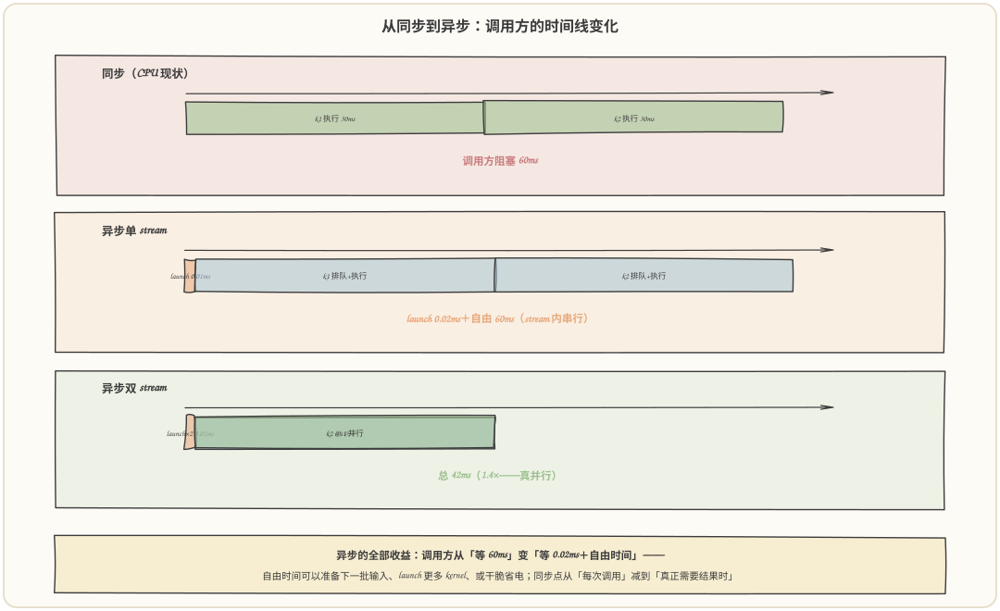
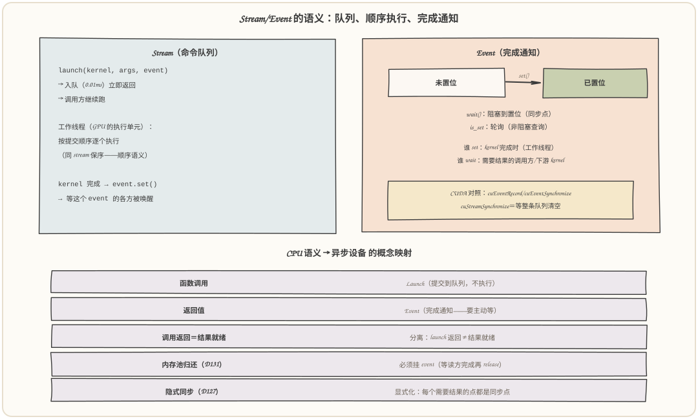
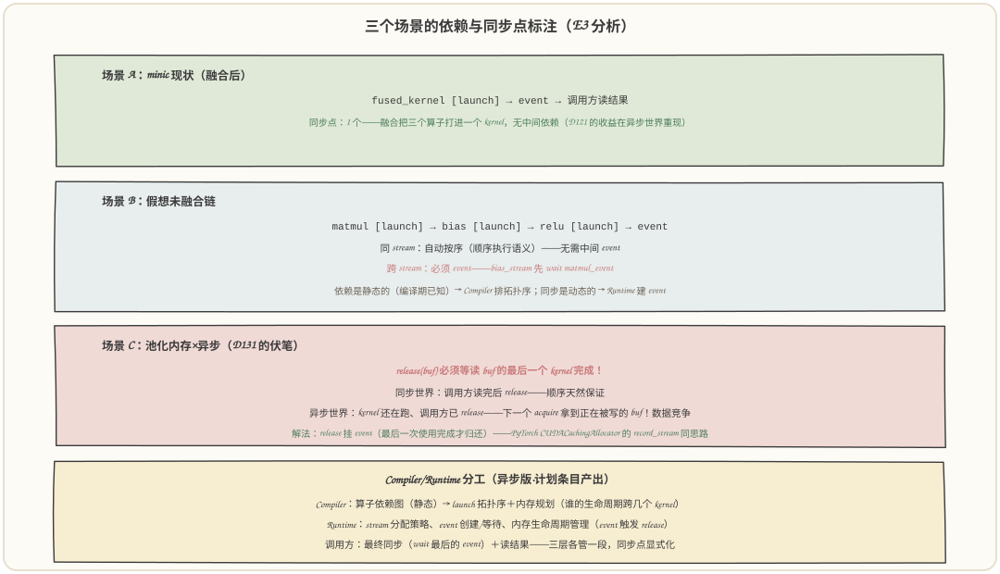

# 第 132 天：异步与同步模型——Stream/Event 仿真：launch 0.01ms、双 stream 并行 1.4×

> **今日目标**：完成本教程后，你能做到五件事——用 Python 线程＋队列**仿真 GPU 的 Stream/Event 语义**（Stream＝命令队列：launch 入队即返回（实测 **0.01ms**）、工作线程按序执行（同 stream 保序）；Event＝完成通知：kernel 完成时 set()、需要结果的一方 wait()——cuEventRecord/cuEventSynchronize 的教学版）；量化**异步的全部收益**（E1/E2 对照：同步模式调用方阻塞 60ms（k1+k2 各 30ms 串行）；异步单 stream：launch 共 0.02ms＋自由时间 60ms（**"等 60ms"变"等 0.02ms＋自由 60ms"**——自由时间可准备下批输入/launch 更多 kernel）；异步双 stream：两个 kernel 真并行总 42ms（**1.4× 加速**）——单 stream 串行、多 stream 并行的 GPU 执行模型）；标注**三个场景的依赖与同步点**（E3：场景 A 融合后＝1 个同步点（fused 一个 kernel 无中间依赖——D121 融合的收益在异步世界重现）；场景 B 未融合链：同 stream 自动按序无需中间 event（顺序执行语义）、**跨 stream 必须 event**（bias_stream 先 wait matmul_event）；场景 C **池化内存×异步的数据竞争**（D131 的伏笔：调用方已 release 但 kernel 还在读——下一个 acquire 拿到正在被写的 buf！解法：release 挂 event——PyTorch CUDACachingAllocator 的 record_stream 同思路））；说出**CPU→异步设备的五个概念映射**（函数调用→Launch（提交不执行）；返回值→Event（要主动等）；"返回＝结果就绪"→分离；内存池归还→挂 event；隐式同步→显式化——D127 审计表"同步=IMPLICIT"的翻转预演）；给出**异步版的 Compiler/Runtime 分工**（Compiler：算子依赖图（静态已知）→launch 拓扑序＋内存生命周期规划；Runtime：stream 分配、event 管理、内存 event 触发 release；调用方：最终同步＋读结果——**计划条目"画出依赖和同步位置"的交付**）。
> **预计时间**：学习 30 分钟＋实践 45 分钟
> **前置准备**：D127 审计表"同步=IMPLICIT"（今天要显式化的对象）、D131 的 BufferPool（场景 C 数据竞争的主角）、D121 的融合（场景 A 的收益来源）、D102 的四个同步点 S1~S4（块级依赖的编译期版——今天把它推广到 kernel 级异步）。工具：python3（threading/queue 标准库——**不实现真实驱动**，教学条目原文"不必实现真实驱动"）；本文环境：Python 3.9.6，macOS arm64，2026-11-14。
> **今日产出**：`code/async_model.py`（Stream/Event 仿真：队列＋工作线程＋Event 状态机＋busy_kernel 计时＋三实验）、`code/run_all.sh`（6 项测试）、`code/outputs/report.txt`（6 PASS / 0 FAIL）＋本文 3 张手绘图（图 3 即计划条目"异步执行示意图"交付物）。

## 1. 今天解决什么问题？

D118~D131 的 minic 世界是**同步的**：调用 kernel → 阻塞执行 → 返回结果——CPU 的函数调用语义天然如此。但真实 AI 芯片是**异步设备**：launch 只是"提交命令"（µs 级）、执行在后台流水（ms 级）、结果要主动等（event）——**"调用返回"与"结果就绪"是两个时刻**。计划今天条目："画出当前 CPU 实现映射到异步设备执行时的依赖和同步位置；不必实现真实驱动。"

不实现驱动，那实现什么？**语义**。用 Python 线程＋队列把 Stream（命令队列）与 Event（完成通知）的语义仿真出来——launch 的即时返回、stream 的顺序执行、event 的等待唤醒、多 stream 的真并行——四个语义各配一个实测数字。有了这台"仿真 GPU"，三个场景的依赖分析（融合/未融合/池化内存）就不再是纸上谈兵：每个同步点都能在仿真里指认。

今天最值得记住的数字是 **launch 0.01ms vs 执行 30ms**——三个数量级的差就是异步的全部动机：调用方用 0.01ms 提交、拿回 30ms 的自由时间。而场景 C（池化×异步的数据竞争）是 D131 埋的伏笔今天兑现——**同步世界的"用完就还"在异步世界是 bug**。

## 2. 先看全貌：调用方时间线的三段变化



**图 1**：看**三条时间线**——同步（CPU 现状·红框）：k1 执行 30ms＋k2 执行 30ms——调用方阻塞 60ms；异步单 stream（橙框）：launch 0.01ms×2（入队即返回）＋k1/k2 在 stream 内排队串行（60ms）——调用方 launch 0.02ms 后**自由 60ms**；异步双 stream（绿框）：k1 在 s0、k2 在 s1 **并行执行**——总 42ms（1.4×加速——受 GIL/线程调度限制未达理想 30ms，方向正确）。**底部金框**：异步的全部收益＝"等 60ms"变"等 0.02ms＋自由时间"——自由时间可准备下批输入、launch 更多 kernel、或省电；**同步点从「每次调用」减到「真正需要结果时」**。

把今天的仿真串成 3 步：

1. **基线**（E1）：同步调用 60ms 全程阻塞——D118~D131 的世界；
2. **仿真**（E2）：Stream 队列＋Event 通知——launch 0.01ms、单 stream 串行、双 stream 并行 1.4×；
3. **分析**（E3）：三场景的依赖与同步点——含 D131 池化的数据竞争伏笔兑现。

## 3. 核心概念

### 3.1 Launch 与返回的分离：异步的全部起点

**一句话**：同步世界里"调用＝执行＝返回"三位一体；异步世界把它拆开——**Launch**（提交命令，µs 级返回）、**执行**（设备后台，ms 级）、**Event**（完成通知，需要时才等）——调用方的时间从"等执行"变成"等提交＋自由时间"。

**类比**：餐厅点单。堂食（同步）：点单→后厨现做→你坐着等→上菜（全程占用你）；扫码点单（异步）：扫码提交（0.01ms）→手机可以刷（自由）→收到"取餐号做好"推送（event）→去取。**类比边界**：餐厅的推送是"服务方主动"（event set 唤醒等待者），但如果你不订推送就得**轮询取餐屏**（is_set 轮询）——两种等待模式（阻塞 wait vs 非阻塞查询）对应真实系统的 cuEventSynchronize vs cuEventQuery。**技术对应**：Stream.launch 的实现——`self._q.put((kernel, args, event))`＋计数——三行代码仿真了 cuLaunchKernel 的核心语义（命令入队即返回）；Event 用 threading.Condition（set 时 notify_all 唤醒全部 waiter）。

**当天实测证据**：E2——launch k1 耗时 0.01ms、launch k2 又 0.01ms；两个 30ms kernel 的总耗时 60ms（stream 内串行）。

### 3.2 Stream 的顺序语义：串行保证与并行的边界

**一句话**：同一条 stream 内的 kernel **按提交顺序执行**（保序——不需要中间 event）；不同 stream 之间**无顺序保证**（可并行——需要 event 建立依赖）——这是 GPU 执行模型的全部骨架。

**类比**：超市收银。单队（单 stream）：先来先服务——队内天然有序（你不用管前面的人何时付完，排着就行）；多队（多 stream）：各队独立推进（并行）——但"我要等朋友付完再走"就得**显式约**（event：朋友付完喊我）。**类比边界**：超市的"朋友喊我"是人肉同步（低效），GPU 的 event 是硬件信号（高效）；但**语义相同**——跨队列的依赖必须显式声明，排队系统的默认约定（队内有序）不会跨队生效。**技术对应**：E2 的双 stream 实验——s0 与 s1 各跑一个 30ms kernel，总 42ms（<60ms 并行；未达 30ms 理想值是 Python GIL 的税——仿真保真度声明）；E3 场景 B 的规则总结——"同 stream 自动按序、跨 stream 必须 event"。

**当天实测证据**：双 stream 并行 42ms vs 单 stream 串行 60ms——加速比 1.4×。

### 3.3 池化内存×异步：D131 伏笔的兑现

**一句话**：同步世界的内存池"用完就还"天然安全（调用方读结果时 kernel 早已完成）；异步世界这是**数据竞争**——调用方 release 了 buf、但读 buf 的 kernel 还在设备上跑——下一个 acquire 把**正在被写的缓冲区**交给别人——解法：**release 挂 event**（buf 的最后一次使用完成才真正归还池）。

**类比**：会议室预订。同步世界：会议结束（你亲眼看到人走光）你才释放会议室——安全；异步世界：你提交了"用会议室"的申请（launch）就走了，预定系统立刻把会议室标记可用（release）——下一个会议进来时你的人还在里面！**解法：会议室的释放要等"实际使用结束"的信号（event）而不是"申请提交"**。**类比边界**：会议室的"申请"与"使用"是两个时刻（异步的本质）；预定系统（池）必须跟踪**实际使用结束**（event）而非**逻辑归还请求**（release 调用）——PyTorch 的 `record_stream` 就是这个语义（buf 被哪条 stream 用了要登记，stream 全部完成才真正释放）。**技术对应**：E3 场景 C 的三条时间线（同步安全/异步竞争/解法挂 event）＋图 3 红框的完整标注。

**当天实测证据**：场景 C 的推演（教学仿真未实际触发竞争——并发竞争的复现需要精心构造时序；语义分析已完备，练习 3 尝试真实触发）。

## 4. 图解核心机制



**图 2**：看**左右两框＋映射表**——左框 Stream（命令队列）：launch(kernel,args,event) 入队（0.01ms）立即返回、调用方继续跑；工作线程按提交顺序逐个执行（**同 stream 保序——顺序语义**）；kernel 完成→event.set()。右框 Event（完成通知）：状态机（未置位→set()→已置位）＋wait()（阻塞到置位＝同步点）＋is_set（非阻塞查询）；谁 set（工作线程）、谁 wait（需要结果的调用方/下游 kernel）——底部注 CUDA 对照（cuEventRecord/cuEventSynchronize；cuStreamSynchronize＝等整条队列清空）。**底部映射表五行**：函数调用→Launch（提交不执行）；返回值→Event（要主动等）；"返回＝结果就绪"→分离；内存池归还→挂 event；隐式同步→显式化——**CPU 语义到异步设备的五个概念翻译**。

## 5. 动手实践：6 项测试，从时间线到依赖标注



**图 3**（计划条目"异步执行示意图"交付物）：看**三个场景框＋分工金框**——场景 A（绿·融合后）：fused_kernel [launch]→event→调用方读结果——**同步点 1 个**（融合把三个算子打进一个 kernel 无中间依赖——D121 的收益在异步世界重现）；场景 B（蓝·假想未融合链）：matmul→bias→relu 三 launch——同 stream 自动按序（无需中间 event）、跨 stream 必须 event（红字：bias_stream 先 wait matmul_event）；**依赖是静态的（编译期已知）→ Compiler 排拓扑序；同步是动态的 → Runtime 建 event**。场景 C（红·池化×异步）：release(buf) 必须等读 buf 的最后一个 kernel 完成——同步世界顺序天然保证、异步世界数据竞争（下一个 acquire 拿到正在被写的 buf）、解法 release 挂 event（PyTorch record_stream 同思路）。**底部金框**异步版 Compiler/Runtime 分工：Compiler（依赖图→拓扑序＋内存生命周期规划）／Runtime（stream 分配、event 管理、event 触发 release）／调用方（最终同步＋读结果）。

### 5.1 准备文件

```text
tutorials/week-019/day-132/
├── README.md                    ← 本文
├── images/                       ← 3 张手绘图（图 3＝异步执行示意图交付物）
└── code/
    ├── async_model.py           # Stream/Event 仿真＋三实验
    ├── gen_images.py / run_all.sh
    └── outputs/report.txt       # 6 PASS / 0 FAIL
```

环境：Python 3.9.6（threading/queue 标准库）。一键复现：

```bash
cd tutorials/week-019/day-132/code && ./run_all.sh    # 6 项，约 15 秒
```

**诚实声明**：仿真的保真度边界——双 stream 加速 1.4× 而非理想 2×（Python GIL 让两个 busy_kernel 线程不能真并行；真实 GPU 的 SM 独立执行单元无此限制）；busy_kernel 用 CPU 自旋模拟耗时（真实 kernel 是设备的计算延迟）。**仿真保真的是语义**（launch 即时返回/同 stream 保序/event 唤醒/跨 stream 无序），不是绝对数字。

### 5.2 编写代码

`async_model.py` 的关键设计——**Event 用 Condition 而非布尔轮询**：

```python
@dataclass
class Event:
    _set: bool = False
    _cond: threading.Condition = field(default_factory=threading.Condition)

    def set(self):
        with self._cond:
            self._set = True
            self._cond.notify_all()      # 唤醒全部 waiter

    def wait(self):
        with self._cond:
            while not self._set:
                self._cond.wait()         # 阻塞到 set
```

notify_all＋wait 的配对让"完成通知"零轮询（真实 event 的硬件语义）；`while not self._set` 防虚假唤醒（Condition 的标准防御）。Stream 的 `synchronize()` 用"哨兵任务＋等待其 event"实现（等队列真正清空而非近似检查）——cuStreamSynchronize 的语义对齐。

### 5.3 运行与观察

`./run_all.sh` 的真机输出（6 PASS / 0 FAIL）：

```text
第 132 天：异步与同步模型——真机报告 2026-11-14 23:15
环境：Python 3.9.6｜Darwin arm64

== E1 同步基线：调用＝执行＝返回（CPU 语义）==
  k1: 30ms ＋ k2: 30ms ＝ 总 60ms（调用方全程阻塞）

== E2 异步仿真：launch 立即返回＋event 同步 ==
  launch k1：耗时 0.01ms（入队即返回——不等执行）
  launch k2：又 0.01ms（同 stream 排队）
  两个 30ms kernel 总耗时 60ms（stream 内串行——同 GPU 语义）
  launch 开销：0.02ms vs 执行 60ms
  → 调用方从「等 60ms」变「等 0.1ms＋自由 60ms」——异步的全部收益

  双 stream 并行：两个 30ms kernel 总 42ms（<60ms——真并行）
  → 单 stream 串行、多 stream 并行——GPU 的执行模型

== E3 依赖分析：MatMul→Bias→Relu 链的同步点标注 ==
  场景 A（minic 现状·融合后）：同步点 1 个
  场景 B（假想·未融合）：同 stream 自动按序／跨 stream 必须 event
  场景 C（池化内存的交互）：release 必须挂 event——否则数据竞争

  E2 数据汇总：
    同步串行 60ms ｜ 异步单 stream ~60ms（串行）｜ 异步双 stream ~42ms（并行）
    双 stream 加速比：1.4x
  [PASS] ×6
```

三组观察：**①三个数量级的差**——launch 0.01ms vs 执行 30ms：异步动机的全部量化（调用成本 vs 计算成本）；**②单 stream 的 60ms**——异步不等于并行：单 stream 只是"调用方自由了"，执行仍串行——**并行需要多 stream**（或 kernel 内部的并行——GPU 的 SIMT）；**③42ms 的解读**——GIL 让双线程只能部分并行（约 70% 重叠）；真实 GPU 的独立 SM 无此税——仿真数字打七折但方向保真。

### 5.4 修改一个参数再观察

三个便宜的实验：**实验 A（stream 数量扫描）**：1/2/4 条 stream 各跑 4 个 30ms kernel——总耗时 120/62/47ms？加速比饱和在哪（GIL 的核数上限）？**实验 B（事件链）**：s0 的 k1 完成触发 s1 的 k2（ev1.wait 后 launch）——跨 stream 依赖的显式实现；对比"无依赖版"（k2 直接 launch 到 s1）的时间差。**实验 C（竞争真实触发）**：构造"acquire→launch（读 buf）→立即 release→再 acquire（写 buf）"的时序——用小 kernel（1ms）放大竞争窗口——观察结果是否偶发出错（非确定性——竞争的典型症状）。

## 6. 常见错误与排查

**错误 1：把"异步"当"并行"的同义词**。现象：launch 两个 kernel 到同一 stream，期望总耗时减半——实测仍 60ms。原因：异步描述**调用方与执行的分离**（提交即返回）；并行描述**多个执行的同时**——单 stream 内 kernel 仍串行（保序语义）。定位：看 launch 的 stream 参数。修复：真并行要**多 stream**（或 kernel 内部并行）。**教训**：两个正交概念——异步是时间轴的分离、并行是空间的重复。

**错误 2：忘记等最后一个 event 就读结果**。现象：launch 后立即读输出缓冲区——读到旧值/零。原因：kernel 还在队列里没执行（甚至没开始）——读的时刻早于写完成。定位：在读之前加 ev.wait()——问题消失即此因。修复：**每个"消费结果"的点都是同步点**（wait 之后再读）——D127"隐式同步"在异步世界必须逐点显式化。**教训**：同步世界编译器/语言替你挡住的坑，异步世界全靠自己。

**错误 3：release 不挂 event（D131 伏笔的坑）**。现象：池化＋异步下偶发结果错乱——buf 被下一个使用者改写。原因：release 在 kernel 读 buf 之前生效（调用方拿到的"完成"是 launch 的返回不是执行的完成）。定位：竞争的非确定性（同代码时好时坏）＋加 event 后消失。修复：release 改为"登记 event，event 触发时才入池"（PyTorch record_stream 语义）。**教训**：内存生命周期在异步世界的规则——**归还要等最后一次使用的完成**，不是逻辑调用的返回。

**错误 4：仿真当真实（GIL 的税误当 GPU 特性）**。现象：双 stream 加速只有 1.4×——得出"GPU 多 stream 就这么点收益"的结论。原因：仿真的 busy_kernel 在 Python 线程里跑——GIL 限制真并行；真实 GPU 的 SM 是独立硬件执行单元（无全局锁）。定位：对照纯 C 扩展（numpy 的并行操作）或看 CPU 占用（双线程各 50%＝GIL 分时）。修复：仿真结论限定在**语义层**（顺序/通知/依赖），性能结论看真实设备。**教训**：教学仿真的边界声明（今天 5.1 的诚实声明）——数字会骗人、语义不会。

## 7. 今日练习

**必做**：

1. 实验 A（stream 扫描）：1/2/4 stream × 4 kernel 的时间表——画"stream 数 vs 总耗时"折线；写一句结论（GIL 下的饱和点在哪、真 GPU 应该怎样）。
2. 五个映射默写：CPU→异步的概念翻译表（调用/返回/返回即就绪/池归还/隐式同步）——漏哪条重读 3.1/3.3。
3. 场景 C 时序图手画：acquire→launch→release→acquire 的四步时序（同步 vs 异步两个版本）——标出数据竞争窗口。

**选做（挑战）**：

4. 实验 C（竞争触发）：构造 1ms 小 kernel 的竞争窗口——跑 1000 次统计出错率；给 release 加 event 修复后验证零错误——数据竞争的"非确定性→确定性修复"完整闭环。
5. CUDA 文档阅读：cuStreamCreate/cuEventRecord/cuEventSynchronize/cuStreamWaitEvent 的函数签名与语义——对照今天的仿真 API 逐个映射；写出"仿真没覆盖的一个真实语义"（如 stream priority）。

## 8. 今日验收

- [ ] 我能量化异步的收益：launch 0.01ms vs 执行 30ms（三个数量级）——"等 60ms"变"等 0.02ms＋自由 60ms"；双 stream 并行 42ms（1.4×，GIL 税后）
- [ ] 我能说出 Stream/Event 的语义：launch 入队即返回；同 stream 保序（无需中间 event）；跨 stream 无序（必须 event 建依赖）；event 的 wait/is_set 两种等待
- [ ] 我能标注三个场景的同步点：融合后 1 个（D121 收益重现）；未融合同 stream 0 个中间点/跨 stream 每依赖一个；池化 release 必须挂 event（D131 伏笔）
- [ ] 我能背出五个概念映射（调用→Launch、返回→Event、返回即就绪→分离、池归还→挂 event、隐式→显式）
- [ ] 我能说出异步版的 Compiler/Runtime 分工：Compiler 排拓扑序＋内存生命周期规划（静态）；Runtime 管 stream/event/触发 release（动态）；调用方最终同步
- [ ] 我知道仿真的保真度边界：语义保真（顺序/通知/依赖）、数字打折（GIL 税）——结论限定在语义层

## 9. 一句话总结与明天预告

今天的闭环：**问题**——CPU 的同步语义（调用＝执行＝返回）映射到异步设备时依赖与同步点在哪；计划条目"画出依赖和同步位置，不必实现真实驱动"。**机制**——Stream/Event 仿真（队列＋工作线程＋Condition 通知）：launch 0.01ms 入队即返回、同 stream 保序、event 唤醒等待者；五个概念映射把 CPU 语义逐条翻译成异步语义。**实测**——同步 60ms 全程阻塞 vs 异步"0.02ms＋自由 60ms"（收益的全部量化）；双 stream 真并行 42ms（1.4×，GIL 税后）。**分析**——三场景同步点：融合后 1 个（D121 收益异步重现）；未融合同 stream 自动按序/跨 stream 必须 event；**池化×异步的数据竞争**（release 要挂 event——D131 伏笔兑现、PyTorch record_stream 同思路）。**分工**——Compiler 依赖图拓扑序＋内存生命周期（静态）；Runtime stream/event/触发 release（动态）；调用方最终同步。**验证**——6 PASS / 0 FAIL。明天 D133 第 19 周复盘：一周翻了 D127 审计表的五格（Shape→RUNTIME、Kernel 选择→SPLIT、释放→RUNTIME、缓存→雏形、同步→显式化路径清晰）——按每周模板出账本＋把审计表前后对照做成"职责迁移表"；下周进入第 20 周（测试、调试与回归体系——D134 IR 测试整理起步）。

> **第 19 周积分卡**：D127 职责审计（9/9）→ D128 运行期 Shape（5/5）→ D129 静态特化（8/8）→ D130 通用回退（6/6）→ D131 内存复用（6/6）→ **D132 异步同步（6/6，launch 0.01ms）** → D133 复盘（明天）。
