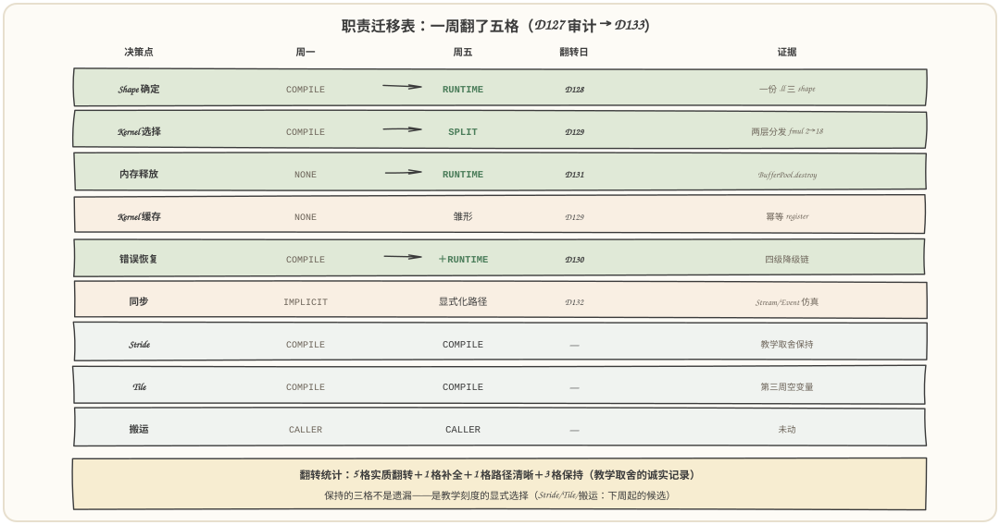
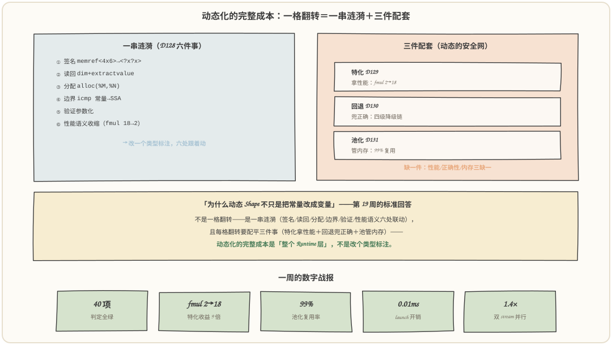
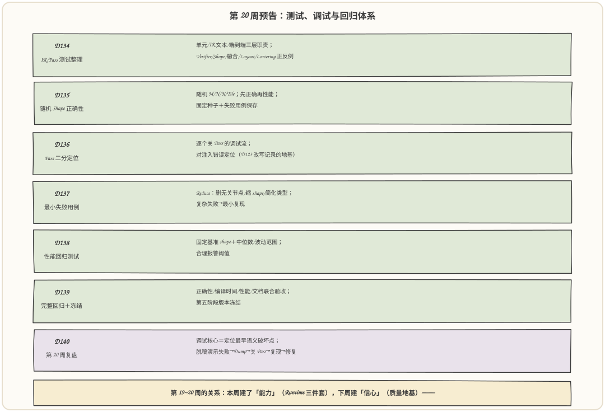

# 第 133 天：第 19 周复盘——职责迁移表：一周翻了五格，动态化的完整成本是整个 Runtime 层

> **今日目标**：完成本教程后，你能做到五件事——对照 **D127 审计表的前后变化**产出职责迁移表（11 决策点：**5 格实质翻转**——Shape 确定 COMPILE→RUNTIME（D128·一份 .ll 三 shape）、Kernel 选择 COMPILE→SPLIT（D129·两层分发 fmul 2→18）、内存释放 NONE→RUNTIME（D131·BufferPool）、错误恢复 COMPILE→＋RUNTIME（D130·四级降级链）、Kernel 缓存 NONE→雏形（D129·幂等）；**1 格路径清晰**——同步 IMPLICIT→显式化（D132·Stream/Event）；**3 格保持**——Stride/Tile/搬运（教学取舍的诚实记录，不是遗漏）；**2 格不变**——分配 RUNTIME 语义不变＋池化（D131）、验证 TEST）；给出**「为什么动态 Shape 不只是把常量改成变量」的第 19 周标准回答**（不是一格翻转——是**一串涟漪**（D128 六件事：签名/读回/分配/边界/验证/性能语义），且每格翻转要**配平三件事**（特化拿性能＋回退兜正确＋池管内存）——**动态化的完整成本是「整个 Runtime 层」，不是改个类型标注**——计划 D133 条目原话的答案）；数出**一周的数字战报**（40 项判定全绿（9+5+8+6+6+6）、特化收益 fmul 2→18（9 倍）、池化复用 99%、launch 开销 0.01ms、双 stream 并行 1.4×）；按每周模板出**第 19 周账本**（目标/产出/测试/核心问题（Compiler/Runtime 边界怎么划——动态化完整成本）/根因（静态派性能好但每 shape 编一次；动态派灵活但优化空间收缩＋要自建运行时保障）/验证（每格翻转都有实测数字）/对照（fmul 2 vs 18——确定性是优化器的燃料）/讲清与讲不清/下周目标）；预览**第 20 周路线**（D134 IR/Pass 测试整理→D135 随机 Shape→D136 Pass 二分定位→D137 最小失败用例→D138 性能回归→D139 完整回归与冻结→D140 复盘——**调试核心＝定位最早语义破坏点**）。
> **预计时间**：学习 30 分钟＋实践 35 分钟
> **前置准备**：本周六天的产出（迁移表的证据链）、每周复盘模板、D127 的审计表（今天的前列）。工具：python3。本文环境：Python 3.9.6，macOS arm64，2026-11-14。
> **今日产出**：`code/week19_review.py`（迁移表＋账本生成器＋自检）、`code/outputs/migration-table.txt`（**主产出：职责迁移表**）、`code/outputs/week-ledger.txt`（每周模板账本）＋本文 3 张手绘图。

## 1. 今天解决什么问题？

第 19 周六天围绕一个主题：**Runtime 与动态 Shape**。D127 先审计（11 决策点各归谁）、D128~D132 逐格动刀（Shape 翻转、Kernel 特化分发、回退链、内存池、异步仿真）。复盘日的两件事：**对照**（周一的审计表 vs 周五的现实——哪些格翻了、哪些没动、为什么）与**回答计划的问题**（D133 条目原话："解释'为什么动态 Shape 不只是把常量改成变量'"——这句话在 D128 的图 3 列了六件事，今天要给出一周的完整版答案）。

迁移表是最合适的复盘载体：**每行一个决策点、三列对照（周一/周五/翻转日）、末列证据**——翻转的五格背后是本周 40 项测试；保持的三格也是答案的一部分（教学取舍的显式记录——不是所有格都该翻，"知道什么不动"与"知道什么动了"同样重要）。

## 2. 先看全貌：职责迁移表



**图 1**：看**九行迁移表**——五绿行（实质翻转）：Shape 确定 COMPILE→RUNTIME（D128·一份 .ll 三 shape）、Kernel 选择 COMPILE→SPLIT（D129·两层分发 fmul 2→18）、内存释放 NONE→RUNTIME（D131·BufferPool.destroy）、错误恢复 COMPILE→＋RUNTIME（D130·四级降级链）、Kernel 缓存 NONE→雏形（D129·幂等 register）；一橙行（路径清晰）：同步 IMPLICIT→显式化路径（D132·Stream/Event 仿真）；三灰行（保持）：Stride/Tile/搬运——**教学取舍的诚实记录**。每行末列证据可查（outputs/ 的具体文件）。**底部金框**：翻转统计（5+1+3）＋"保持的三格不是遗漏——是教学刻度的显式选择"。

把今天的复盘串成 3 步：

1. **对照**：迁移表（周一审计 vs 周五现实）；
2. **回答**：动态化完整成本的标准答案（涟漪＋配套）；
3. **预览**：第 20 周路线（质量地基）。

## 3. 核心概念

### 3.1 迁移表：职责演进的记账方式

**一句话**：把 D127 的静态审计表在周末**再填一遍**——前后两列对照、翻转行标证据、保持行标理由——职责迁移表就是 Runtime 层的"变更日志"。

**类比**：公司组织架构调整前后对照表。哪些职责换了部门（翻转）、哪些新设（NONE→有主）、哪些维持不变（含理由）——一张表讲清组织演进。**类比边界**：组织调整有人的因素（抵抗/磨合），职责迁移是**纯工程决策**——每格翻转都该有触发条件（需求）与配套（安全网），没有配套的翻转是裸奔（D128 翻 Shape 后如果没有 D129 特化补性能、D130 回退补正确性，动态化就是净损失）。**技术对应**：图 1 的九行三列＋本周六天的 outputs 证据链。

**当天实测证据**：migration-table.txt——五格翻转各带翻转日与证据；三格保持各有理由（Stride 教学取舍/Tile 空变量/搬运零拷贝天然合理）。

### 3.2 动态化的完整成本：标准答案的三层结构

**一句话**：**「为什么动态 Shape 不只是把常量改成变量」**的完整答案分三层——**涟漪**（改一个类型标注，六处跟着动：签名/读回/分配/边界/验证/性能语义）、**配套**（缺一不可的三件：特化拿性能＋回退兜正确＋池管内存）、**本质**（动态化的完整成本是「整个 Runtime 层」——这正是第 19 周存在的原因）。

**类比**：把"常量改成变量"想成"把固定餐桌换成折叠桌"——换桌本身五分钟（签名），但餐厅要重新设计动线（涟漪）、要配折叠桌的存储间（配套）、要培训服务员收放流程（本质：整套运营体系）。**类比边界**：餐厅可以只换一张桌试试（局部试点），编译器的动态化**没有局部版**——签名一变下游全变（六件事是编译管道的串联结构决定的）；"试点"的正确单位是**决策点**（一次翻一格——本周的节奏），不是"半个动态"。**技术对应**：图 2 的左右两框（六涟漪＋三配套）＋金框标准答案。

**当天实测证据**：一周的数字战报——40 项判定（每格翻转都有测试背书）、fmul 2→18（特化补的性能差）、99% 复用（池补的内存差）、四级降级链（回退补的正确性差）。

### 3.3 保持的三格：不动的决策也是决策

**一句话**：迁移表里"保持"的三行（Stride/Tile/搬运）与翻转的五行同样重要——**教学刻度的显式选择**：Stride 行主序写死（布局自由的完整故事在 D57~D68，minic 不重复）、Tile 是 D125 证实的空变量（朴素循环不消费）、搬运是 CPU 零拷贝的天然合理——三格都有"为什么不动"的一句理由。

**类比**：装修清单上"保留"项与"改造"项并列——保留原木地板（质量好何必换）与拆除非承重墙（有明确收益）都是决策；只列改造项的清单会让后来者误以为"保留是因为没想到"。**类比边界**：装修的保留是一次性决定，工程项目的"保持"要**周期复审**——下周（测试周）或第六阶段（扩展方向）可能翻转它们（比如块循环 Tiling 的 minic 化一直是"讲不清"清单里的常客）。**技术对应**：图 1 三行灰底＋各自理由；账本的"仍然讲不清楚的问题"段列了三格的潜在翻转路径。

**当天实测证据**：账本"仍然讲不清楚"清单——块循环 Tiling、跨进程缓存失效、SIGSEGV 回退、多 stream 调度——每项都是"保持格"的潜在翻转工作。

## 4. 图解核心机制



**图 2**：看**左右两框＋金框＋数字带**——左框一串涟漪（D128 六件事逐条）：①签名 `memref<4x6>`→`<?x?x>`、②读回 dim+extractvalue、③分配 alloc(%M,%N)、④边界 icmp 常量→SSA、⑤验证参数化、⑥性能语义收缩（fmul 18→2）——底注"改一个类型标注，六处跟着动"；右框三件配套：特化 D129（拿性能 fmul 2→18）、回退 D130（兜正确·四级降级链）、池化 D131（管内存·99% 复用）——底注"缺一件：性能/正确性/内存三缺一"。**中部金框**标准答案全文（不是一格翻转——是一串涟漪＋配平三件事——**动态化的完整成本是「整个 Runtime 层」**）。**底部数字带**五张卡：40 项判定全绿／fmul 2→18 特化收益 9 倍／99% 池化复用／0.01ms launch 开销／1.4× 双 stream 并行。

## 5. 动手实践：迁移表与账本



**图 3**：看**七天路线卡**——D134 IR/Pass 测试整理（单元/IR 文本/端到端三层职责；Verifier/Shape/融合/Layout/Lowering 正反例）、D135 随机 Shape 正确性（随机 M/N/K/Tile、先正确再性能、固定种子＋失败保存）、D136 Pass 二分定位（逐个关 Pass 的调试流、对注入错误定位——D123 改写记录的地基）、D137 最小失败用例（Reduce：删无关节点/缩 shape/简化类型）、D138 性能回归测试（固定基准＋中位数/波动范围＋合理阈值）、D139 完整回归＋冻结（正确性/编译时间/性能/文档联合验收——**第五阶段版本冻结**）、D140 第 20 周复盘（调试核心＝定位最早语义破坏点；脱稿演示失败→Dump→关 Pass→复现→修复）。**底部金框**：第 19~20 周的关系——本周建了**能力**（Runtime 三件套），下周建**信心**（质量地基）。

### 5.1 准备文件

```text
tutorials/week-019/day-133/
├── README.md                    ← 本文
├── images/                       ← 3 张手绘图
└── code/
    ├── week19_review.py         # 迁移表＋账本生成
    ├── gen_images.py / run_all.sh
    └── outputs/
        ├── migration-table.txt  # 主产出：职责迁移表
        ├── week-ledger.txt      # 每周模板账本
        └── report.txt           # 自检 3/3
```

一键复现：

```bash
cd tutorials/week-019/day-133/code && ./run_all.sh    # 3 项自检，约 2 秒
```

### 5.2 关键内容摘录

迁移表的核心段（migration-table.txt）：

```text
决策点              周一(D127)    周五(今天)      翻转日    证据
─────────────────────────────────────────────────────────────────
Shape 确定          COMPILE       RUNTIME        D128     memref<?x?x>＋dim 读回
                                                              一份 .ll 三 shape
Kernel 选择         COMPILE       SPLIT          D129     两层分发＋fmul 2→18
内存释放            NONE          RUNTIME        D131     BufferPool.destroy
同步                IMPLICIT      显式化路径      D132     Stream/Event 仿真
Kernel 缓存        NONE          雏形           D129     幂等 register
错误诊断与恢复      COMPILE       COMPILE+RUNTIME D130    E301/E302/E303
─────────────────────────────────────────────────────────────────
翻转统计：5 格实质翻转＋1 格补全（释放）＋1 格路径清晰（同步）
         3 格保持（教学取舍的诚实记录）
```

账本的"标准回答"段（week-ledger.txt）——计划 D133 条目"解释'为什么动态 Shape 不只是把常量改成变量'"的完整答案：

```text
不是一格翻转——是一串涟漪（D128 六件事：签名/读回/分配/边界/验证/性能语义），
且每格翻转要配平三件事（D129 特化拿性能＋D130 回退兜正确＋D131 池管内存）——
动态化的完整成本是「整个 Runtime 层」，不是改个类型标注。
```

### 5.3 修改一个参数再观察

两个便宜的实验：**实验 A（复审保持格）**：对着迁移表的三个"保持"行各写一行"什么时候该翻"（Stride：当教学覆盖布局变换的完整链时；Tile：当块循环进 minic 时；搬运：当目标变 GPU 时）——把"不动"变成"待命"；**实验 B（账本脱稿）**：合上 week-ledger.txt，讲三分钟"第 19 周的核心问题与答案"——讲不出细节的段落重读对应天。

## 6. 常见错误与排查

**错误 1：迁移表只列翻转不列保持**。现象：表格五行的"战果"很漂亮——读的人以为"没列的就是没想过"。原因：复盘只挑变化（报喜倾向）。定位：数一数 11 格只写了 5 格。修复：保持的三行显式列出＋各配理由（图 1 的做法）。**教训**：变更日志的价值一半在"改了什么"、一半在"**确认什么不用改**"。

**错误 2：标准答案背成口号**。现象：能背"不只是改常量"但说不出六件事与三配套。原因：只记结论没记结构。定位：自问"涟漪有哪几件？配套有哪三件？"。修复：图 2 的两框默写——六涟漪（签名/读回/分配/边界/验证/性能）＋三配套（特化/回退/池化）。**教训**：面试口径的可验证形式是"结构＋数字"（六件＋三件＋fmul 2→18），不是一句警句。

**错误 3：把"讲不清"清单当失败记录**。现象：账本里"仍然讲不清楚的问题"四条被读成"这周没做好"。原因：混淆**已知未知**（列出来待办）与**未知未知**（压根没意识到）。定位：看每条是否配了"下一步"（块循环 Tiling→第 20 周后；SIGSEGV 回退→工程版）。修复：每条"讲不清"配一个去向——**已知未知是路线图，不是负债表**。

## 7. 今日练习

**必做**：

1. 实验 A（复审保持格）：三个"保持"行各写一行"翻转条件"——把不动的决策变成待命的决策。
2. 迁移表脱稿：画九行三列（凭记忆填周一/周五/翻转日）——漏哪行重读哪天的 README。
3. 标准答案三层复述：涟漪（六件）→配套（三件）→本质（整个 Runtime 层）——对着空气讲两分钟。

**选做（挑战）**：

4. 给迁移表加"代价"列：每格翻转付了什么（编译时间/复杂度/测试量）——本周每格的代价其实是 40 项测试里的具体几项，把它们数出来。
5. 预写第 20 周的"审计表"：测试周的 11 个决策点会是什么（比如"错误定位/复现/回归基线/阈值"各归谁）——下周的地图今天先画草稿。

## 8. 今日验收

- [ ] 我能默画职责迁移表：5 格翻转（Shape/KERNEL 选择/释放/恢复/缓存）＋1 格路径（同步）＋3 格保持（Stride/Tile/搬运）＋各格证据
- [ ] 我能脱稿讲"为什么动态 Shape 不只是把常量改成变量"的三层答案：六涟漪＋三配套＋本质（整个 Runtime 层）
- [ ] 我能背出本周数字战报：40 项判定、fmul 2→18、99% 复用、0.01ms launch、1.4× 双 stream
- [ ] 我知道保持的三格不是遗漏而是教学取舍——且每格都该有"翻转条件"（什么时候该动它）
- [ ] 我能说出第 19~20 周的关系：能力（三件套）→信心（质量地基）；下周七天的主题逐日可述

## 9. 一句话总结与明天预告

今天的闭环：**对照**——迁移表把 D127 的静态审计与周五的现实并排放：5 格实质翻转（Shape→RUNTIME、Kernel→SPLIT、释放→RUNTIME、恢复→＋RUNTIME、缓存→雏形）、1 格路径清晰（同步）、3 格保持（教学取舍）——每格带证据与理由。**回答**——计划 D133 的"为什么动态 Shape 不只是把常量改成变量"有了标准答案：一串涟漪（六件事）＋配平三件（特化/回退/池）＝**动态化的完整成本是整个 Runtime 层**。**战报**——40 项判定全绿、fmul 2→18、99% 复用、0.01ms launch、1.4× 并行。**账本**——每周模板十问齐全；"讲不清"清单四条各配去向（已知未知是路线图）。明天进入第 20 周：D134 IR 与 Pass 测试整理——单元测试、IR 文本测试和端到端测试的三层职责划分；为 Verifier、Shape、融合、Layout、Lowering 补齐正反例——**本周 40 项判定的组织化升级**（从"每天的测试"到"体系的测试金字塔"）。

> **第 19 周收官**：D127 审计（9/9）→ D128 Shape（5/5）→ D129 特化（8/8）→ D130 回退（6/6）→ D131 池化（6/6）→ D132 异步（6/6）→ **D133 复盘（迁移表＋标准答案）**。下一站：测试、调试与回归体系。
