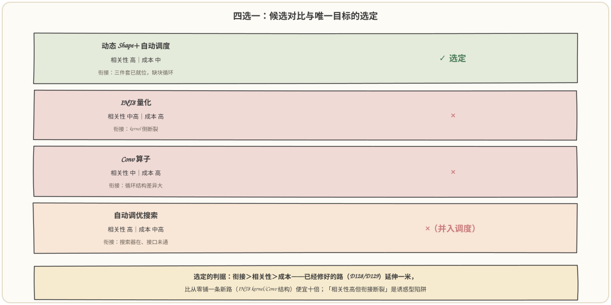
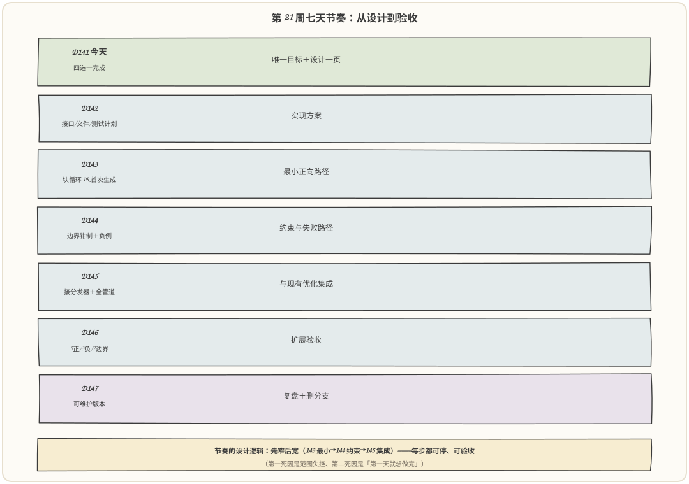
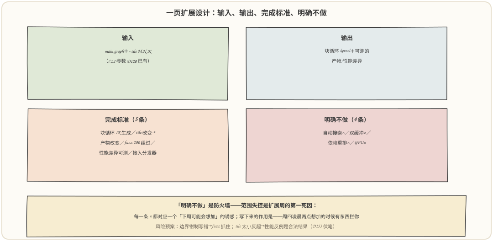

# 第 141 天：确定唯一扩展目标——四选一：块循环 Tiling 的 minic 化（--tile 真实生效）

> **今日目标**：完成本教程后，你能做到——
> 1. 完成**四候选的系统对比**（动态 Shape＋自动调度：相关性高＋成本中＋**三件套已就位缺块循环**＝✓ 选定；INT8 量化：相关性中高＋成本高（kernel 侧 INT8 计算＋requant 链全新、与 QDQ 图优化衔接断裂）＝×；Conv 算子：相关性中＋成本高（im2col/直接/Winograd 任一路径独立工程、与 MatMul 循环结构差异大）＝×；自动调优搜索：相关性高＋成本中高（D106~D111 搜索器在但与 minic 接口未通）＝…；
> 2. **选定的判据**（**衔接＞相关性＞成本**——已修好的路（D128 动态签名＋D129 特化分发）延伸一米比从零铺新路便宜十倍；"相关性高但衔接断裂"是诱惑型陷阱）；
> 3. **一页扩展设计**（主目标：块循环 Tiling 的 minic 化——让 `--tile` 参数真实生效（D125 证明的教学版空变量）；输入：main.graph＋--tile M,N,K（CLI 已有）；输出：块循环 kernel（外层 tile 壳＋内层点循环）＋可测的产物/性能差异；**完成标准 5 条**：块循环 IR 生成／tile 改变→产物改变（可 grep）／fuzz 200 组全过／至少一个 shape 的性能差异可测／接入 D129 分发器；**明确不做 4 条*…；
> 4. **"明确不做"是防火墙**（每一条 × 对应一个"周四凌晨两点想加"的诱惑——写下来才有东西拦你；**范围失控是扩展周的第一死因**）；
> 5. 排好**第 21 周七天节奏**（D141 设计（今天）→D142 方案→D143 最小正向→D144 约束→D145 集成→D146 验收（5 正/3 负/2 边界）→D147 复盘删分支——**先窄后宽、每步可停**；第二死因是"第一天就想做完"）。
> **预计时间**：学习 25 分钟＋实践 30 分钟
> **前置准备**：D125 的空变量结论（tile 不消费——今天要修的正是它）、D128/D129 的三件套（选定候选的衔接基础）、D139 的 future 清单（F-01 就是今天选定的主目标）、计划的第 21 周开篇提醒（"只选择一个主目标"）。工具：python3。本文环境：Python 3.9.6，macOS arm64，2026-11-15。
> **今日产出**：`code/choose_target.py`（四候选对比＋一页设计＋自检）、`code/run_all.sh`、`code/outputs/report.txt`（4 项自检）、`code/outputs/design.txt`（**主产出：一页扩展设计**）＋本文 3 张手绘图。

## 1. 今天解决什么问题？

第 21 周是扩展周——计划开篇的警告："默认选择'动态 Shape＋自动调度'的轻量组合。如果更倾向量化、Conv 或其他方向，可替换本周实现内容，但保留每天的设计、测试和复盘要求。"今天的任务是**四选一**并写一页设计。

对比的框架是计划给的两个轴：**岗位相关性×实现成本**——但今天加了一个更重要的第三轴：**与现有代码的衔接**（这周是在冻结版本 v0.5.0 之上的增量开发——能复用多少已有资产决定成本的真实值）。四候选里"动态 Shape＋自动调度"胜出的关键：**D128 的动态签名＋D129 的特化分发已经修好了 90% 的路**，缺的只是块循环 Tiling 这最后一块（future F-01）——延伸一米 vs 铺路十米。

## 2. 先看全貌：四选一



**图 1**：看**四行候选卡＋金框判据**——动态 Shape＋自动调度（绿✓：相关性高/成本中/三件套已就位缺块循环）；INT8 量化（红×：相关性中高/**成本高**——kernel 侧 INT8＋requant 链全新、与 QDQ 图优化衔接断裂）；Conv 算子（红×：相关性中/成本高——im2col/直接/Winograd 任一路径独立工程）；自动调优搜索（橙×并入：相关性高/成本中高——搜索器在但接口未通——**并入主目标的"调度"部分**）；金框判据：**衔接＞相关性＞成本**——"相关性高但衔接断裂"是诱惑型陷阱（INT8 的岗位故事很好听、但 kernel 侧从零开始）。

## 3. 核心概念



**图 3**：看**七行节奏卡＋底部金框**——D141 今天（唯一目标＋设计一页·绿）→D142 实现方案（接口/文件/测试计划）→D143 最小正向路径（块循环 IR 首次生成）→D144 约束与失败路径（边界钳制＋负例）→D145 与现有优化集成（接分发器＋全管道）→D146 扩展验收（5 正/3 负/2 边界）→D147 复盘＋删分支（可维护版本·紫）；金框：节奏的设计逻辑——**先窄后宽（143 最小→144 约束→145 集成）每步可停可验收**；第一死因是范围失控、第二死因是"第一天就想做完"。

### 3.1 选型判据：衔接＞相关性＞成本

**一句通俗解释**：扩展周选型的三个轴里，**与现有资产的衔接**权重最高——延伸已修好的路（D128/D129 的 90%）比铺新路（INT8 kernel 的 0%）便宜一个数量级；相关性回答"值不值得"、衔接回答"划不划算"、成本是两者的乘积。

**生活类比**：餐厅开新分店——选新菜不是看哪道菜最好吃，而是看厨房设备能不能直接做——已有烤箱的路延伸一米，比从零建冷库便宜十倍。

**对应到技术上是**：已有代码的延伸比从零建新模块便宜——D128/D129 的三件套就是烤箱，块循环就是新菜。

**类比边界**：餐厅开新分店的类比帮你建立直觉，但真实的技术实现有更多约束和量化指标——类比的目的是「快速理解方向」，不是「替代技术细节」。

### 3.2 一页设计：四象限的纪律

**一句话**：一页设计必须写全四象限——**输入**（已有什么：main.graph＋--tile 参数）、**输出**（要交付什么：块循环 kernel＋可测差异）、**完成标准**（怎么验收：5 条可勾选）、**明确不做**（防火墙：4 条 ×）——缺"明确不做"的设计在周三就会失控。

## 4. 图解核心机制



**图 2**：看**四象限卡＋金框**——输入（绿：main.graph＋--tile M,N,K——CLI 参数 D120 已有）；输出（蓝：块循环 kernel＋可测的产物/性能差异）；完成标准（橙·5 条：块循环 IR 生成／tile 改变→产物改变可 grep／fuzz 200 组过／性能差异可测／接入分发器）；明确不做（红·4 条：自动搜索×／双缓冲×／依赖重排×／GPU×）；金框："明确不做"是防火墙——**每一条 × 都对应一个"周四凌晨两点想加"的诱惑；写下来的作用是那时候有东西拦你**＋风险预案（边界钳制错→fuzz 抓；tile 太小反超→性能反例是合法结果（D153 伏笔））。

## 5. 动手实践

### 5.1 准备文件

```text
tutorials/week-021/day-141/
├── README.md / images/（3 图）
└── code/
    ├── choose_target.py        # 四候选对比＋一页设计
    ├── gen_images.py / run_all.sh
    └── outputs/
        ├── report.txt          # 4 项自检
        └── design.txt          # 主产出：一页扩展设计
```

一键复现：`cd tutorials/week-021/day-141/code && ./run_all.sh`（约 2 秒）。

### 5.2 运行与观察（report.txt 摘录）

```text
四个候选的对比：动态 Shape＋自动调度（✓ 选定）／INT8（×）／Conv（×）／自动调优（× 并入）
  主目标：块循环 Tiling 的 minic 化（--tile 真实生效）
  完成标准 5 条／明确不做 4 条——范围防火墙已立
  [PASS] 四候选齐全／唯一选定／完成标准 ≥5／明确不做 ≥4
```

### 5.3 修改一个参数再观察

**实验 A（换选型）**：把判定反转（选 INT8）——写它的"一页设计"四象限——你会发现"完成标准"很难写出 5 条可勾选的（kernel 侧从零）——**衔接断裂的候选连设计都写不圆**；**实验 B（不做清单加压）**：往"明确不做"再加两条（比如"不做 layout 变换×"、"不做多线程×"）——防火墙越厚越安全吗？（有一条成本：真需要时要有勇气拆墙）。

## 6. 常见错误与排查

**错误 1：按相关性选型**。现象：选了 INT8（"量化岗位多"）——周三发现 kernel 侧从零、周五只做了图侧半截。修复：衔接优先——能在已验证的资产上延伸的候选才是扩展周的好候选。

**错误 2：完成标准写成"实现了块循环"**。现象：标准不可验收（"实现了"谁说了算？）。修复：标准必须可勾选可 grep（"tile 改变→stage-2-loop.mlir 改变"——diff 就是证据）。

**错误 3：不做清单空白**。现象："先把能做的做了再说"——范围失控的标准前兆。修复：今天就写 ×——每个诱惑提前命名。

## 7. 今日练习

**必做**：1. 实验 A（反转选型）：给 INT8 写一页设计——体会"写不圆"的衔接断裂；2. 判据三句话复述（衔接/相关性/成本的排序与理由）；3. 防火墙四条各配一个"哪天会想加"的场景。

**选做**：4. 给未来的扩展周（如果有第二个）预写候选清单；5. 研究真实项目的 RFC 模板（Rust/TVM 的设计文档结构）——对照今天的一页四象限。

## 8. 今日验收

- [ ] 我能背出四候选与判定（动态调度 ✓／INT8 ×衔接断／Conv ×成本高／调优 ×并入）与判据排序（衔接＞相关性＞成本）
- [ ] 我能默写一页设计四象限：输入（graph＋tile 参数）／输出（块循环＋可测差异）／标准 5 条／不做 4 条
- [ ] 我知道"明确不做"是防火墙——每条 × 对应一个凌晨两点的诱惑
- [ ] 我能排出第 21 周七天的节奏（设计→方案→最小→约束→集成→验收→复盘）与两条死因（范围失控/第一天做完）

## 9. 一句话总结与明天预告

今天的闭环：**四选一**——四个候选按"衔接＞相关性＞成本"排序：动态 Shape＋自动调度胜出（D128/D129 已修 90% 的路、缺块循环 Tiling 这最后一块＝future F-01）；INT8/Conv 败于衔接断裂、调优并入主目标；**一页设计**——四象限齐全（输入 graph＋tile／输出块循环＋可测差异／标准 5 条可勾选／**不做 4 条防火墙**）；**节奏**——七天先窄后宽（最小正向→约束→集成→验收），两条死因命名（范围失控/第一天做完）。明天 D142 设计实现方案：块循环的 IR 形态设计（外层 tile 壳怎么写、边界钳制放哪、与朴素版的切换开关）＋修改点与数据流（动哪些文件、S2 生成器怎么改）＋测试计划（正确性沿用 fuzz、性能用 kernel_timing）——**把今天的一页设计展开成施工图**。

> **第 21 周积分卡**：**D141 唯一目标（4/4，块循环 Tiling）** → D142 实现方案 → D143 最小正向 → D144 约束与失败 → D145 集成 → D146 验收 → D147 复盘。
