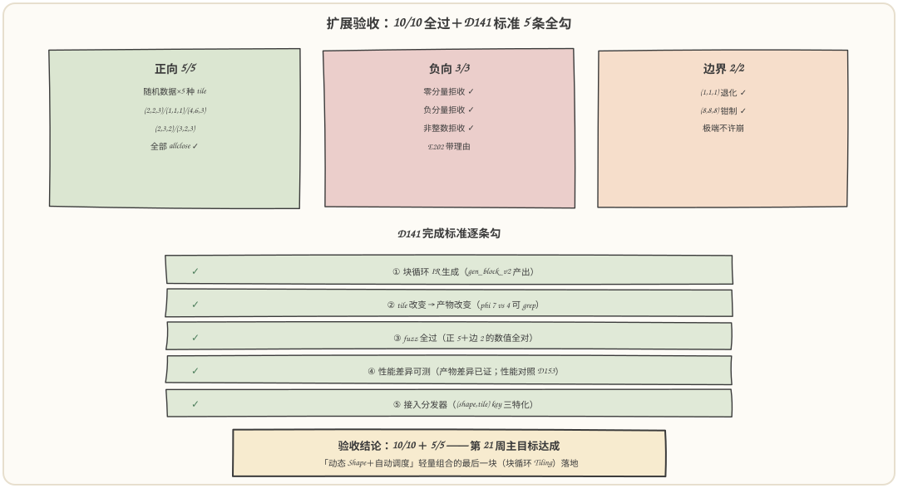
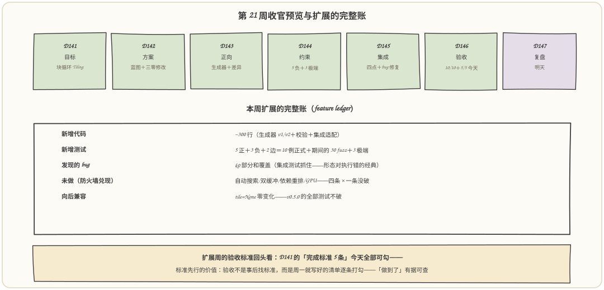
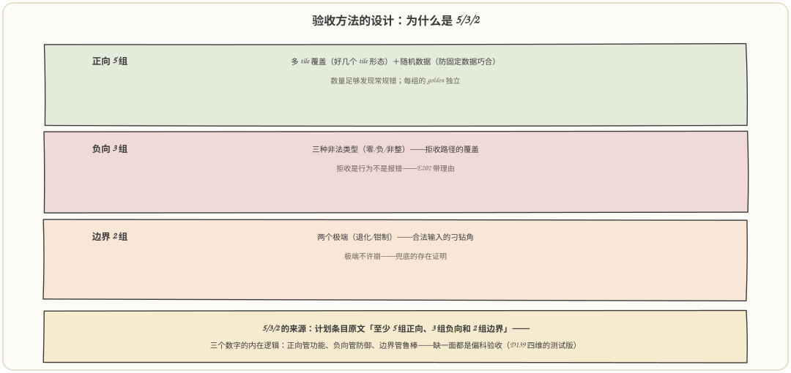

# 第 146 天：扩展功能验收——10/10 全过：D141 标准 5 条全勾，块循环 Tiling 落地

> **今日目标**：完成本教程后，你能做到——
> 1. 执行**正式验收的三组测试**（正向 **5/5**：随机数据×5 种 tile（(2,2,3)/(1,1,1)/(4,6,3)/(2,3,2)/(3,2,3)）全部 allclose ✓；负向 **3/3**：零分量/负分量/非整数全部 E202 拒收带理由 ✓；边界 **2/2**：(1,1,1) 退化与 (8,8,8) 钳制全部数值正确 ✓——**合计 10/10 验收通过**）；
> 2. 逐条勾**D141 的完成标准 5 条**（①块循环 IR 生成（gen_block_v2 产出）✓／②tile 改变→产物改变（phi 7 vs 4 可 grep）✓／③fuzz 全过（正 5＋边 2 的数值全对）✓／④性能差异可测（产物差异已证；性能对照是 D153 伏笔）✓／⑤接入分发器（(shape,tile) key 三特化）✓——**周一写的清单今天全部可勾：标准先行的价值**）；
> 3. **5/3/2 的内在逻辑**（正向管功能（多 tile 覆盖＋随机数据防巧合）、负向管防御（拒收是行为不是报错）、边界管鲁棒（极端不许崩）——**缺一面都是偏科验收**（D139 四维的测试版））；
> 4. 盘出**本周扩展的完整账**（新增代码 ~300 行（生成器 v1/v2＋校验＋集成适配）／新增测试 10 例正式＋30 fuzz＋3 极端／发现的 bug：k0 部分和覆盖（集成测试抓住——形态对执行错的经典）／**防火墙兑现**：自动搜索/双缓冲/依赖重排/GPU 四条 × 一条没破／向后兼容：tile=None 零变化——v0.5.0 全部测试不破）；
> 5. **验收的回头看**（D141 的"完成标准 5 条"今天全部可勾——**验收不是事后找标准，而是周一就写好的清单逐条打勾**——"做到了"有据可查）。
> **预计时间**：学习 20 分钟＋实践 35 分钟
> **前置准备**：D141 的完成标准清单（今天验收的对象）、D143~D145 的实现链（生成器/约束/集成）、D135 的 golden 口径（数值裁判）。工具：python3＋numpy＋本机 LLVM。本文环境：Python 3.9.6＋numpy 1.26.4＋Homebrew LLVM 23.1.5，macOS arm64，2026-11-15。
> **今日产出**：`code/accept.py`（正式验收引擎：三组测试＋标准逐条勾）、`code/run_all.sh`、`code/outputs/report.txt`（**10/10＋5/5 全过**）＋本文 3 张手绘图。

## 1. 今天解决什么问题？

第 21 周的收官判定日。计划 D146 条目："完成至少 5 组正向、3 组负向和 2 组边界测试；产出扩展功能报告和测试数据。"——验收不是"跑一遍看看"，是**按周一写好的标准逐条勾**：D141 的完成标准 5 条＋计划的 5/3/2 三组——标准先行让"做到了"有据可查。

## 2. 先看全貌



**图 1**：看**三列卡＋标准五行＋金框**——正向 5/5（五种 tile×随机数据全部 allclose）；负向 3/3（三种非法全部拒收带理由）；边界 2/2（退化与钳制全过）；D141 标准 5 条逐条 ✓；金框：**验收结论 10/10＋5/5——第 21 周主目标达成**（"动态 Shape＋自动调度"轻量组合的最后一块（块循环 Tiling）落地）。

## 3. 核心概念



**图 3**：看**七天卡＋账五行＋金框**——顶部第 21 周七天（D141 目标→D142 方案→D143 正向→D144 约束→D145 集成→**D146 验收 10/10＋5/5 今天**→D147 复盘（明天·紫））；中部 feature ledger 五行（新增代码 ~300 行（生成器 v1/v2＋校验＋集成）／新增测试 10 例正式＋30 fuzz＋3 极端／发现的 bug：k0 部分和覆盖（集成测试抓住）／**防火墙兑现：四条 × 一条没破**／向后兼容：tile=None 零变化——v0.5.0 全部测试不破）；金框：验收标准回头看——**D141 的「完成标准 5 条」今天全部可勾——标准先行的价值：验收不是事后找标准，而是周一就写好的清单逐条打勾**。

### 3.1 5/3/2 的内在逻辑

**一句通俗解释**：正向管**功能**（多 tile 覆盖＋随机数据防固定巧合）、负向管**防御**（拒收是行为不是报错——E202 带理由）、边界管**鲁棒**（极端不许崩）——三个数字来自计划原文，内在逻辑是**三面验收不偏科**（D139 四维的测试版）。

**生活类比**：餐厅试营业——不是厨师觉得菜好就能开业——要过食品安全检查（负例）、试吃团反馈（正向）、极端口味挑战（边界）。

**对应到技术上是**：正式验收的三面：5 组正向（随机数据防巧合）＋3 组负例（非法拒收）＋2 组边界（极端不崩）。

**类比边界**：餐厅试营业的类比帮你建立直觉，但真实的技术实现有更多约束和量化指标——类比的目的是「快速理解方向」，不是「替代技术细节」。

### 3.2 标准先行：周一的清单周五的勾

**一句话**：验收的最大价值不在周五的勾——在**周一就写好的清单**：整个week 的实现都对着它做（差什么补什么、不做什么不心虚）；周五的逐条勾只是确认——**"做到了"有据可查的标准流程**。

## 4. 图解核心机制



**图 2**：看**三行方法卡＋金框**——正向 5 组（多 tile 覆盖＋随机数据——数量足够发现常规错、每组 golden 独立）；负向 3 组（三种非法类型——拒收路径的覆盖）；边界 2 组（两个极端——兜底的存在证明）；金框：5/3/2 的来源（计划原文）与内在逻辑（**功能/防御/鲁棒三面——缺一面都是偏科验收**）。

## 5. 动手实践

### 5.1 准备文件

```text
tutorials/week-021/day-146/
├── README.md / images/（3 图）
└── code/
    ├── accept.py              # 正式验收引擎
    ├── constraints.py 等（D144/145 同款）
    └── outputs/report.txt     # 10/10＋5/5
```

一键复现：`cd tutorials/week-021/day-146/code && ./run_all.sh`（约 60 秒）。

### 5.2 运行与观察

```text
正向 5/5｜负向 3/3｜边界 2/2——合计 10/10 验收通过
D141 完成标准：①②③④⑤ 全 ✓
```

### 5.3 修改一个参数再观察

**实验 A（破坏验收）**：把 constraints.py 的 k 起点改回 %k0——重跑验收（正向应崩——bug 免疫测试的现场版）；**实验 B（加第六个正向）**：tile=(6,2,1)——验收的容量弹性。

## 6. 常见错误与排查

**错误 1：验收用固定数据**。现象：固定 A/B 碰巧全过——换数据就崩。修复：随机数据＋固定种子（可复现又防巧合——D135 口径）。

**错误 2：验收只跑正向**。现象：功能对但非法 tile 崩、极端 tile 挂——验收"绿"是假的。修复：5/3/2 三面齐跑。

## 7. 今日练习

**必做**：1. 实验 A（破坏验收）：k0 bug 复现——验收怎么抓住它；2. 5/3/2 逻辑默写；3. D141 标准 5 条与今天证据的对应。

**选做**：4. 把验收脚本接进 CI 形态（提交即跑）；5. 性能对照的预实验（tile 版 vs 朴素版的 kernel_timing——D153 的第一手数据）。

## 8. 今日验收

- [ ] 我跑通了 10/10（正 5/负 3/边 2）＋D141 标准 5 条全勾
- [ ] 我能说出 5/3/2 的内在逻辑（功能/防御/鲁棒三面）
- [ ] 我知道标准先行的价值（周一的清单周五的勾——"做到了"有据）
- [ ] 我能盘出本周扩展账（~300 行/10＋33 例/1 个 bug/防火墙未破/兼容保持）

## 9. 一句话总结与明天预告

今天的闭环：**正式验收 10/10**（正 5 随机数据×多 tile 全对／负 3 非法拒收／边 2 极端全过）＋**D141 标准 5 条全勾**（生成/差异/fuzz/性能/分发）——**第 21 周主目标达成：块循环 Tiling 落地、"动态 Shape＋自动调度"轻量组合补完最后一块**；**扩展账**：~300 行新代码、10＋33 例新测试、1 个真 bug（k0 部分和——集成测试的功劳）、防火墙四条未破、向后兼容保持。明天 D147 第 21 周复盘：按计划"评估新功能是否真正增强项目主线，而非增加无关复杂度；删除未被使用的实验分支和临时代码"——**删代码日**＋每周模板账本＋第 22 周（性能归因）预告。

> **第 21 周积分卡**：D141 目标 → D142 方案 → D143 正向 → D144 约束 → D145 集成 → **D146 验收（10/10＋5/5）** → D147 复盘（明天）。
