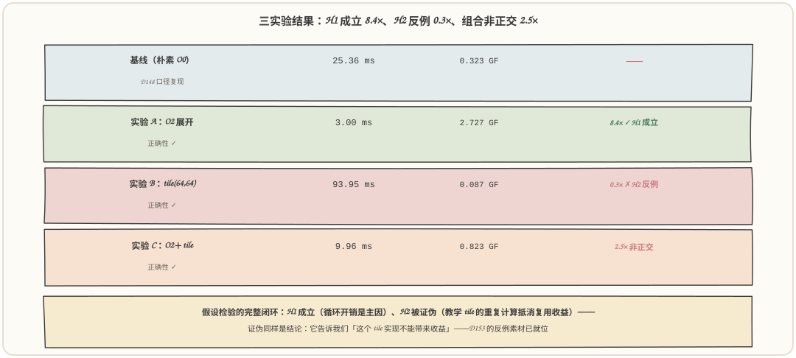
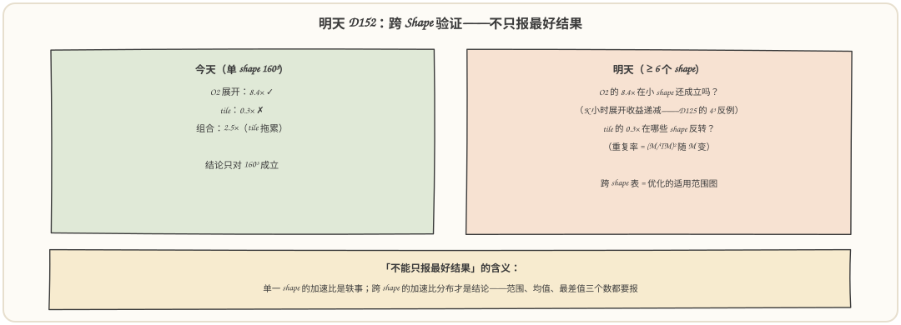
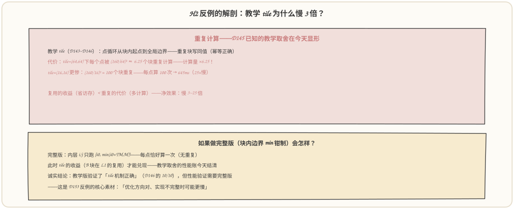

# 第 151 天：实施一个有依据的优化——H1 成立 8.4×、H2 反例 0.3×：证伪同样是结论

> **今日目标**：完成本教程后，你能做到——
> 1. 完成**三个有依据的实验**（每个都从 D150 的假设出发：**实验 A（O2 展开·验 H1）**：同一 kernel 的 -O0 vs -O2——25.36ms→3.00ms＝**8.4× 加速**、0.323→2.727 GFLOPS——**H1 成立**（循环控制开销确实是主因之一）；**实验 B（tile 扫描·验 H2）**：三种 tile（(32,32)/(64,64)/(16,16)）全部比朴素慢——最佳 (64,64) 93.95ms＝**0…；
> 2. 剖**H2 反例的机制**（教学 tile 的点循环从块内起点到**全局边界**——重复块写同值（幂等正确·D145 的取舍）但**每个点被 (M/TM)² 个块重复计算**：tile=(64,64) 时 6.25 倍计算量、tile=(16,16) 时 **100 倍**（645ms＝25× 慢）——**复用的收益（省访存）＜重复的代价（多计算）**——净效果慢 3~25 倍）；
> 3. **"证伪同样是结论"**（H2 被证伪告诉我们："这个 tile 实现不能带来收益"——**优化方向对、实现不完整时可能更慢**——这是 D153 反例的核心素材）；
> 4. **"有依据"的完整含义**（每个实验对应假设的"假设→预测→实验→结论"推理链——**不是"试试看"**：实验前有预测（H1 预期 ~8×）、实验后有判定（成立/证伪）——失败也 informative）。
> **预计时间**：学习 25 分钟＋实践 45 分钟
> **前置准备**：D150 的三假设（今天的实验设计）、D125 的 O2 证据（H1 的预测依据）、D143~D146 的 tile 生成器（实验 B 的工具）、D148 的基线（对照锚点）。工具：python3＋numpy＋本机 LLVM。本文环境：Python 3.9.6＋numpy 1.26.4＋Homebrew LLVM 23.1.5，macOS arm64，2026-11-15。
> **今日产出**：`code/optimize.py`（三实验引擎：gen_naive_ir/gen_tiled_ir＋build/bench＋对照分析）、`code/run_all.sh`、`code/outputs/report.txt`、`code/outputs/optimize.json`（**主产出：优化实验数据**）＋本文 3 张手绘图。

## 1. 今天解决什么问题？

D150 提出三假设——今天**验证**它们。计划 D151 条目："选择一种循环顺序、Tile、融合或内存策略进行修改。"——但今天的重心不是"改出更快的东西"，是**假设检验的方法论**：每个实验前有预测、实验后有判定——成立或证伪都是结论。

结果比预期更有教学价值：**H1 成立（8.4×）但 H2 被证伪（0.3×）**——教学 tile 的重复计算（D145 的已知取舍）在性能上显形：复用收益＜重复代价。这个"方向对、实现不完整反而更慢"的反例正是 D153 的核心素材——**证伪的价值**。

## 2. 先看全貌



**图 1**：看**四行结果表＋金框**——基线（朴素 O0：25.36ms/0.323GF·蓝）；实验 A（O2 展开：3.00ms/2.727GF/**8.4× ✓H1 成立**·绿）；实验 B（tile(64,64)：93.95ms/0.087GF/**0.3× ✗H2 反例**·红）；实验 C（O2＋tile：9.96ms/0.823GF/**2.5× 非正交**（tile 拖累 O2）·橙）；金框：**假设检验的完整闭环**——H1 成立、H2 被证伪——**证伪同样是结论**（"这个 tile 实现不能带来收益"——D153 反例素材已就位）。

## 3. 核心概念



**图 3**：看**左右对照＋金框**——左绿框今天（单 shape 160³：O2 8.4× ✓／tile 0.3× ✗／组合 2.5× 非正交——结论只对 160³ 成立）；右橙框明天（≥6 个 shape：O2 的 8.4× 在小 shape 还成立吗（K 小时展开收益递减——D125 的 4³ 反例伏笔）？tile 的 0.3× 在哪些 shape 反转（重复率＝(M/TM)² 随 M 变）？——**跨 shape 表＝优化的适用范围图**）；金框："不能只报最好结果"的含义——**单一 shape 的加速比是轶事；跨 shape 的加速比分布才是结论——范围、均值、最差值三个数都要报**。

### 3.1 有依据的优化：假设→预测→实验→结论

**一句通俗解释**：优化实验的纪律是**先有假设再有实验**——H1 预测"展开 ~8×"（D125 证据）→实验 A 验证 8.4×→成立；H2 预测"tile 提复用→加速"→实验 B 测得 0.3×→**证伪**——每个环节都可追溯，**不是"试试看"**。

**生活类比**：医生看病——不是把药全试一遍——先诊断（假设）、开药（对策）、复查（验证）——药没用说明诊断错，重新诊断。

**对应到技术上是**：H1 预测展开有效→O2 实验 8.4× 成立；H2 预测 tile 加速→实测 0.3× 证伪——证伪同样是结论。

**类比边界**：医生看病的类比帮你建立直觉，但真实的技术实现有更多约束和量化指标——类比的目的是「快速理解方向」，不是「替代技术细节」。

### 3.2 H2 反例的机制：重复计算吃掉复用收益

**一句话**：教学 tile 的点循环跑块内起点→全局边界——每点被 (M/TM)² 个块重复计算（(64,64) 时 6.25×、(16,16) 时 **100×**）——**复用省的访存 ＜ 重复付的计算**——净慢 3~25 倍；完整版（块内边界 min 钳制）才能兑现复用收益——**教学取舍的性能账今天结清**。

## 4. 图解核心机制



**图 2**：看**红框机制＋金框对照**——红框四行（重复计算机制：幂等正确但每点 ×6.25（tile 64）到 ×100（tile 16）——复用收益＜重复代价）；金框四行（完整版会怎样：块内边界 min 钳制——每点恰好一次→复用收益才能兑现；**诚实结论：教学版验证了 tile 机制正确（D146 的 10/10）但性能验证需要完整版**——D153 反例的核心素材："优化方向对、实现不完整时可能更慢"）。

## 5. 动手实践

### 5.1 准备文件

```text
tutorials/week-022/day-151/
├── README.md / images/（3 图）
└── code/
    ├── optimize.py            # 三实验引擎
    ├── baseline.py 等（D148 同款）
    └── outputs/report.txt ＋ optimize.json
```

一键复现：`cd tutorials/week-022/day-151/code && ./run_all.sh`（约 5 分钟——多组编译与计时）。

### 5.2 运行与观察

```text
基线：25.36 ms｜0.323 GF
A（O2）：3.00 ms｜2.727 GF｜8.4× ✓H1 成立
B（tile 64,64）：93.95 ms｜0.087 GF｜0.3× ✗H2 反例
  （tile 16,16 更惨：645ms——100 倍重复计算）
C（组合）：9.96 ms｜0.823 GF｜2.5× 非正交
```

### 5.3 修改一个参数再观察

**实验 A（完整版 tile）**：把 gen_tiled_ir 的内层 i/j 边界改成 `min(i0+TM, M)`（需要 addi＋minsi）——重跑实验 B——重复计算消除后 tile 能转正吗？（预期：至少不再慢 3 倍——完整版才是 H2 的真检验）；**实验 B（tile 粒度再扫）**：(80,80)/(128,128)/(160,160)（更大 tile→更少重复）——0.3× 会回升吗？

## 6. 常见错误与排查

**错误 1：只报加速不报反例**。现象："O2 有 8.4× 收益"——tile 的 0.3× 不写。修复：正反都要报——**反例界定适用范围**（D152 的主题）。

**错误 2：反例当失败隐藏**。现象：H2 证伪了不好意思写。修复：**证伪是结论不是失败**——它阻止了错误方向的投入。

**错误 3：把教学版结论当 tile 本身的结论**。现象："tile 化没用（0.3×）"——但这是教学实现（全局边界）的数字，不是 tile 思想的数字。修复：归因到**实现**而非方向（图 2 的诚实结论）。

## 7. 今日练习

**必做**：1. 三实验数字默写（8.4×/0.3×/2.5×）＋各自判定；2. H2 反例机制复述（(M/TM)² 重复×复用收益＜重复代价）；3. "证伪同样是结论"举例。

**选做**：4. 实验 A（完整版 tile 的 min 钳制实现与重测）；5. 把三个实验的结果画成柱状图（时间轴）。

## 8. 今日验收

- [ ] 我能背出三实验结果（A 8.4× 成立／B 0.3× 证伪／C 2.5× 非正交）与正确性全 ✓
- [ ] 我能解释 H2 反例机制（重复计算 ×6.25~100 vs 复用收益——教学取舍的性能账）
- [ ] 我知道"有依据"的完整链条（假设→预测→实验→判定——不是试试看）
- [ ] 我理解证伪的价值（阻止错误方向——D153 反例素材）与"归因到实现而非方向"

## 9. 一句话总结与明天预告

今天的闭环：**实验 A**——O2 展开 8.4×（**H1 成立**：循环开销是主因——25.36→3.00ms）；**实验 B**——tile 0.3×（**H2 证伪**：教学 tile 的重复计算（×6.25~100）吃掉复用收益——93.95ms 比朴素慢 3 倍）；**实验 C**——组合 2.5×（**非正交**：tile 拖累 O2）；**方法论**——假设→预测→实验→判定的完整推理链、**证伪同样是结论**（反例素材就位）。明天 D152 验证优化收益与副作用：**跨 Shape 检查**——O2 的 8.4× 在小 shape 还成立吗（K 小时展开收益递减——D125 的 4³ 反例伏笔）？tile 的 0.3× 在哪些 shape 反转？**≥6 个 shape 的收益分布表**（范围/均值/最差值三个数都要报——"不能只报最好结果"）。

> **第 22 周积分卡**：D148 基线 → D149 分解 → D150 三假设 → **D151 优化实验（H1✓/H2✗/C 非正交）** → D152 跨 Shape → D153 反例 → D154 闭环。
