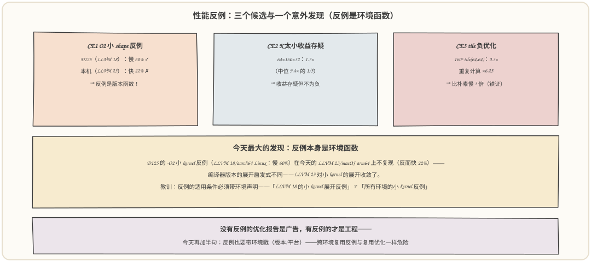
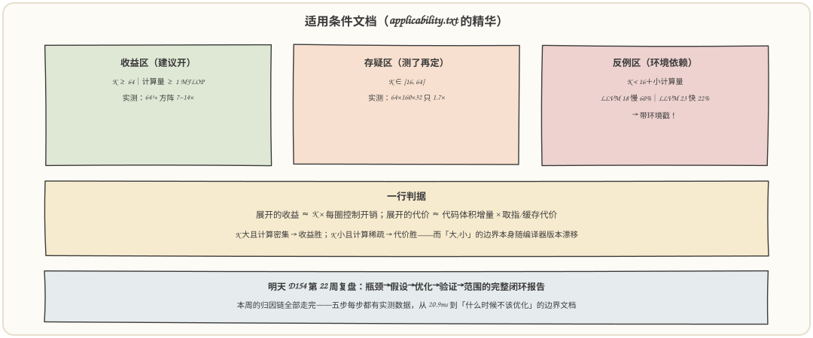
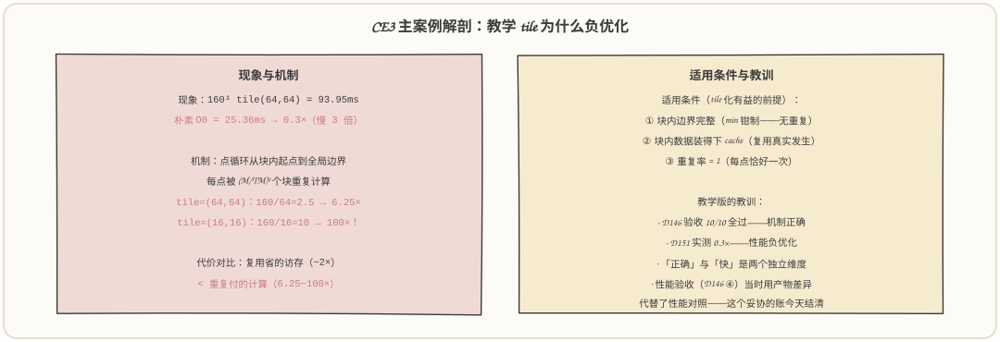

# 第 153 天：构造性能反例——三个候选＋一个意外发现：反例本身是环境函数

> **今日目标**：完成本教程后，你能做到——
> 1. 解剖**三个反例候选**（CE1 O2 小 shape 反例：D125（LLVM 18/aarch64 Linux）慢 60%——**本机（LLVM 23/macOS arm64）不复现**（反而快 22%）——反例是版本函数！；CE2 K 太小收益存疑：64×160×32 只 1.7×（中位 9.4× 的 1/5）——收益存疑但不为负；CE3 教学 tile 负优化：160³ tile(64,64)＝**0.3×（慢 3 倍）**——重复计算 ×6.25 吃掉…；
> 2. **今天最大的发现——反例本身是环境函数**（D125 的反例在 LLVM 23 上消失：编译器版本的展开启发式不同（LLVM 23 对小 kernel 的展开收敛了）——**教训：反例的适用条件必须带环境声明**——"LLVM 18 的小 kernel 展开反例"≠"所有环境的小 kernel 反例"——跨环境复用反例与复用优化一样危险）；
> 3. **O2 展开的三区适用条件文档**（收益区（建议开）：K≥64＋计算量≥1MFLOP——实测 64³+ 方阵 7~14×；存疑区（测了再定）：K∈[16,64]——1.7×~5×；反例区（环境依赖）：K<16＋小计算量——**带环境戳**（LLVM 18 慢 60%/LLVM 23 快 22%）；一行判据：**展开的收益≈K×每圈控制开销、代价≈代码体积增量×取指/缓存代价**——K 大且密集→收益胜、K 小且稀疏→代价胜（边界随编译器版本漂移））；
> 4. 剖 **CE3 主案例**（现象：tile(64,64) 93.95ms vs 朴素 25.36ms＝0.3×；机制：点循环块内起点→全局边界——每点被 (M/TM)² 块重复（(64,64) 时 6.25×、(16,16) 时 100×）；代价对比：**复用省的访存（~2×）＜重复付的计算（6.25~100×）**；教训：D146 验收 10/10 全过＝机制正确、D151 实测 0.3×＝性能负优化——**"正确"与"快"是两个独立维度**（性能验收用产物差异代替性能对照的妥协今天结清））；
> 5. **反例的价值**（它划清优化的领土——**没有反例的优化报告是广告、有反例的才是工程**；面试金句："你的优化什么时候失效？"——答得出反例才是真懂）。
> **预计时间**：学习 25 分钟＋实践 35 分钟
> **前置准备**：D151 的 tile 反例数据（CE3 的证据）、D152 的分布数据（CE2 的证据）、D125 的 -O2 反例（CE1 的原始伏笔）。工具：python3＋numpy＋本机 LLVM。本文环境：Python 3.9.6＋numpy 1.26.4＋Homebrew LLVM 23.1.5，macOS arm64，2026-11-15。
> **今日产出**：`code/counterexample.py`（三候选解剖＋适用条件生成）、`code/run_all.sh`、`code/outputs/report.txt`、`code/outputs/applicability.txt`（**主产出：适用条件文档**）、`code/outputs/counterexample.json`＋本文 3 张手绘图。

## 1. 今天解决什么问题？

计划 D153 条目："找到一个优化后不变快或更慢的用例，解释原因。"——反例日。本周已积累两块素材（D151 tile 0.3×＋D152 的 1.7×），D125 还有一个伏笔（-O2 小 kernel 慢 60%）——今天把三者正式化为**带适用条件的反例文档**。

今天最大的意外是 CE1 的验证结果：**D125 的反例在本机不复现**（LLVM 23 反而快 22%）——这不是失败是**更深的发现**：反例本身是环境函数（编译器版本的展开启发式不同）。这个发现的元教训（**反例要带环境戳**）比一个静态的反例更有价值——它把"适用条件"的维度从 shape 扩展到了环境。

## 2. 先看全貌



**图 1**：看**三卡＋金框＋紫框**——CE1（橙：D125 慢 60% ✓／本机快 22% ✗→**版本函数**）；CE2（蓝：1.7× 收益存疑）；CE3（红：tile 0.3× **铁证**）；金框：**今天最大的发现——反例是环境函数**（LLVM 18 vs 23 的展开启发式差异＋教训：适用条件必须带环境声明）；紫框：没有反例的优化报告是广告＋**反例也要带环境戳**。

## 3. 核心概念



**图 3**：看**三区卡＋判据金框＋明天卡**——收益区（绿：K≥64＋计算量≥1MFLOP——实测 64³+ 方阵 7~14×）；存疑区（橙：K∈[16,64]——1.7×~5×）；反例区（红：K<16＋小计算量——**环境依赖（LLVM 18 慢 60%/LLVM 23 快 22%——带环境戳！）**）；判据金框（**展开的收益≈K×每圈控制开销；代价≈代码体积增量×取指/缓存代价**——K 大且密集→收益胜、K 小且稀疏→代价胜——**而「大/小」的边界随编译器版本漂移**）；明天卡（D154 闭环：瓶颈→假设→优化→验证→范围的完整报告——五步每步实测）。

### 3.1 反例是环境函数

**一句通俗解释**：反例不是永恒真理——它依赖编译器版本/平台/缓存层次——D125 的反例在 LLVM 23 上消失（展开启发式收敛）；**适用条件要带环境戳**（版本/平台）——跨环境复用反例与复用优化一样危险。

**生活类比**：药品说明书——药品的「不良反应」栏不是自曝其短——是保护患者：知道什么情况不能吃，比知道能吃更重要。

**对应到技术上是**：反例划清优化领土：0.3×（tile 负优化）/1.7×（K 太小展开受限）——「什么时候不该用」是必要文档。

**类比边界**：药品说明书的类比帮你建立直觉，但真实的技术实现有更多约束和量化指标——类比的目的是「快速理解方向」，不是「替代技术细节」。

### 3.2 "正确"与"快"是独立维度

**一句话**：CE3 的教训——D146 验收 10/10（机制正确）与 D151 实测 0.3×（性能负优化）**同时成立**：正确性验收与性能验收是两把独立的尺子；用产物差异代替性能对照（当时的妥协）的账今天结清。

## 4. 图解核心机制



**图 2**：看**左右两框**——左红框现象与机制（93.95ms vs 25.36ms＝0.3×；点循环块内起点→全局边界——每点 (M/TM)² 块重复（6.25×~100×）；**复用省的访存（~2×）＜重复付的计算**）；右金框适用条件与教训（tile 有益三前提：块内边界完整/块装得下 cache/重复率=1；**"正确"与"快"独立**——D146 全过 vs D151 负优化的对照）。

## 5. 动手实践

### 5.1 准备文件

```text
tutorials/week-022/day-153/
├── README.md / images/（3 图）
└── code/
    ├── counterexample.py      # 三候选解剖
    ├── optimize.py 等（D151 同款）
    └── outputs/report.txt ＋ applicability.txt ＋ counterexample.json
```

一键复现：`cd tutorials/week-022/day-153/code && ./run_all.sh`（约 3 分钟）。

### 5.2 运行与观察

```text
CE1 本机验证：4×6×3 O2/O0 = 0.79×（不复现 D125 反例）
  → 诚实结论：反例是版本函数（LLVM 18 vs 23）
CE2 引用 D152：64×160×32 = 1.7×
CE3 引用 D151：tile(64,64) = 0.3×（铁证）
适用条件：三区（收益/存疑/反例）＋一行判据
```

### 5.3 修改一个参数再观察

**实验 A（环境变量标注）**：给 applicability.txt 的每区加环境戳（版本/平台）——跨机器复用时怎么快速判断适用性；**实验 B（CE1 的条件收窄）**：试 (2,2,2)/(3,3,3)（更小）——LLVM 23 的展开在多小才失效？

## 6. 常见错误与排查

**错误 1：反例不当结论隐藏**。现象：CE1 不复现就不写。修复：**诚实报告**（不复现本身是发现——版本依赖）。

**错误 2：适用条件不带环境**。现象："K<16 别展开"——换个编译器版本可能错。修复：环境戳（版本/平台）。

## 7. 今日练习

**必做**：1. 三候选各配一句结论＋证据来源；2. "反例是环境函数"的解释与教训；3. 三区适用条件＋一行判据默写。

**选做**：4. 实验 B（更小 shape 扫描）；5. 把 applicability.txt 转成决策表（if K≥64 and ... then 开 O2）。

## 8. 今日验收

- [ ] 我能背出三候选（CE1 版本函数/CE2 收益存疑/CE3 负优化铁证）与各自证据
- [ ] 我能解释"反例是环境函数"（LLVM 18 vs 23 的展开差异）与元教训（环境戳）
- [ ] 我能复述三区适用条件与一行判据（收益≈K×控制开销 vs 代价≈体积×取指）
- [ ] 我理解"正确与快是独立维度"（D146 全过 vs D151 负优化）与反例的价值（划清领土）

## 9. 一句话总结与明天预告

今天的闭环：**三候选解剖**——CE1 的意外（D125 反例在本机不复现→**反例是环境函数**——LLVM 版本的展开启发式差异）；CE2 收益存疑（1.7×）；CE3 铁证（tile 0.3×——重复计算吃掉复用）；**适用条件文档**——三区（收益/存疑/反例）＋一行判据（K×控制开销 vs 体积×取指）＋**环境戳**；**元发现**——反例要带版本/平台声明、跨环境复用反例与复用优化一样危险；**金句**——没有反例的优化报告是广告。明天 D154 第 22 周复盘：**瓶颈→假设→优化→验证→范围的完整闭环报告**——五步每步都有实测数据（20.9ms 起点→8.4× 的收益→1.7~14.1× 的分布→0.3× 的反例→带环境戳的边界文档）——2~3 页性能报告＋5 分钟口头汇报的口径。

> **第 22 周积分卡**：D148 基线 → D149 分解 → D150 三假设 → D151 优化（H1✓/H2✗）→ D152 跨 Shape（1.7~14.1×）→ **D153 反例（环境函数发现）** → D154 闭环（明天）。
